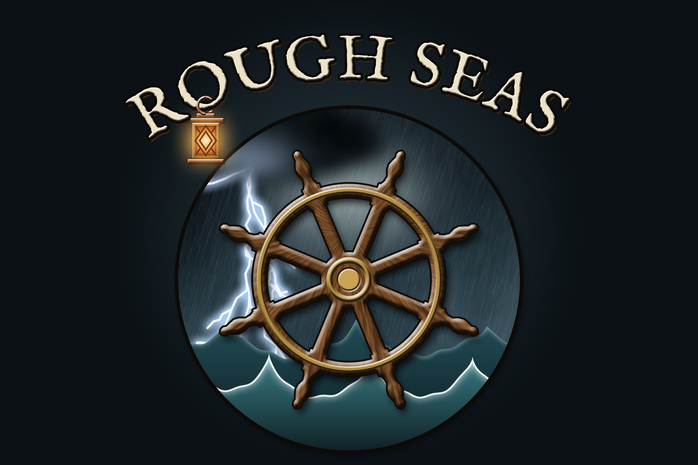

# Rough Seas

A [Vintage Story](https://www.vintagestory.at) mod that makes the ocean dangerous and worth going out on.

In the vanilla game the sea is flat, safe and empty, and crossing it means holding W on a raft. Rough Seas gives it weather, currents and surf, and vessels that crack, leak and flood by what they are made of.

> **Early development.** Make a backup before adding Rough Seas to an existing save. The mod is designed to be safe to turn on and off, but still.

## At sea

- **Wind and storms.** Wind has a direction and a strength, and waves grow with it over open water. Squalls, gales and hurricanes drift across the world: squalls in warm, wet summers, gales in cool winters, hurricanes over the warmest seas. Each one warns you first: the trees sway, the sky darkens and the swell rises. Lightning strikes inside warm storms and is drawn to masts.
- **Currents.** The oceans turn in slow gyres, with the strongest current along the western side of a basin. In the middle latitudes it runs warm and the eastern side cool; nearer the equator and the poles the pattern turns over. A vessel left alone drifts with them.
- **Hulls that crack, leak and flood.** Rocks, other boats, rapids, surf, lightning, blasts and axes crack a hull where they hit it, each by its physics: a ram loads the whole frame, a club only the plank it hits, a breaker how far the planking bends. How much it takes depends on its wood, rope or hide. A crack leaks, and a boat is lost by flooding: every vessel floats by its mass, so a light hull lies awash and a heavy one sinks. Look at a vessel to read its cracks and its leak, and mend the place you look at with the hull's own material.
- **A sea you can hear.** Open water sounds by its wind, whitecaps hiss from windward, surf roars on the shore, and a hull creaks and cracks as it takes knocks.
- **Six new vessels.** The reed boat, dugout, coracle, birch-bark canoe, hide currach and outrigger canoe join the vanilla raft and sailboat. Each one has a job it is best at.
- **Surf and swamping.** Waves break in the shallows and boats ship water over their sides. You bail it out with a bowl, jug or bucket.
- **Mooring and anchoring.** Tie up to a post ashore, or anchor the sailboat with enough rope for the depth. With too little rope the anchor drags. A storm can throw a badly moored vessel up on the beach.

The game's handbook explains all of this from a player's point of view. Search it for "Rough Seas" or open its **Guides** tab. The [wiki](https://github.com/hoblin/rough-seas/wiki) goes deeper: how each mechanic works, the numbers behind it, and where each vessel comes from.

## Install

1. Vintage Story **1.22.7**.
2. Download the latest `roughseas_<version>.zip` from the [mod DB](https://mods.vintagestory.at) or the [GitHub releases](https://github.com/hoblin/rough-seas/releases).
3. Drop the zip into your `Mods` folder (on the game's main menu, **Mods** → **Open Mods Folder**). Do not unzip it.

Multiplayer: the server and every client need the mod.

A new world can use the **Rough Seas** playstyle. It is standard survival with more open ocean. Any world has the **Dangerous oceans** setting, which is on by default. With it off, the sea keeps its weather and currents, but storms, surf and swamping do no harm.

## Problems and ideas

Report problems and suggest ideas in the [issue tracker](https://github.com/hoblin/rough-seas/issues). For a crash, attach `client-main.log`, or `server-main.log` on a server. You find them in the game's data folder under `Logs`.

## For modders

Rough Seas is written like a small game of its own. Each system (sea and weather, storms, vessels) is its own module. The numbers live in JSON assets, so you can tune them with ordinary JSON patches. [CONTRIBUTING.md](CONTRIBUTING.md) shows how to build it, test it and send a change.

## Thanks

The mod started from Mahjong Blonsky's video [Why doesn't Vintage Story have oceans?](https://youtu.be/NPrPEQdM14I). Thank you for asking the question.

## Licence

[MIT](LICENSE).
