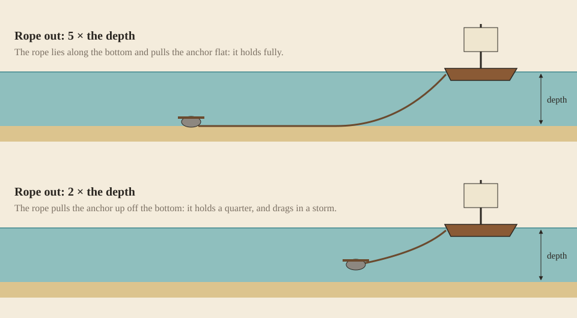

The [sailboat](Sailboat) carries a stone anchor in its prow. In vanilla it does nothing; in Rough Seas it holds the boat where you leave it, as well as the rope you let out allows.

## Letting go and hauling up

Right-click the anchor with an empty hand to let it go, and again to haul it up. The anchor sits in the sailboat's left prow slot, where it is fitted like any accessory. Only the sailboat has that slot, so it is the one vessel that anchors; the others are [tied up](Mooring#tying-up).

While someone steers the boat, the anchor doesn't hold it: it drags along behind.

## Rope

The anchor comes on its own rope, 120 metres of flax. For deeper water, an **anchor warp** adds 90 metres more:

- craft it from 9 ropes in a 3 × 3 grid, and break it back into the ropes when you need them;
- stow it at the foot of the mast, the sailboat's lower mast slot, with ctrl + right-click on the mast.

| | |
| --- | --- |
|  |  |
| Splicing it | Breaking it up |

Anchor and warp together reach 210 metres.

## Scope

How well an anchor holds depends on how much rope lies out against the depth, the *scope*. Sailors let out five to seven times the depth: the long rope lies along the seabed and pulls the anchor flat instead of lifting it out. Rough Seas lets out five times the depth, or all the rope aboard if that is less.

| Rope out, against the depth | Holds |
| --- | --- |
| 5 × or more | fully, 3000 newtons |
| 4 × | three quarters |
| 3 × | half |
| 2 × | a quarter |
| 1 × | nothing |

Deeper than the rope reaches, the anchor hangs and holds nothing at all, until the boat drifts over shallower water. With the anchor rope alone, a sailboat holds fully down to 24 metres; with the warp, down to 42.

On a long rope the boat swings in a wide circle around its anchor, and that circle has to clear the shore.

## In a storm

Every wave pulls on the rope, with the wind on the boat's sides and rigging and the sea on its hull.

- **Dragging.** When the pull beats what the anchor holds, it drags a metre downwind. Wave after wave, a short scope walks the boat towards the lee shore.
- **Snapping.** Flax rope breaks at about 11 kilonewtons. A rope that snaps takes the anchor with it, along with all the rope let out.

What the sea does to an anchored sailboat, each wave:

| Sea | Drags, rope at 5 × | Drags, rope at 3 × | Rope snaps |
| --- | --- | --- | --- |
| near gale (force 7) | almost never | 1 in 20 | never |
| gale (force 8) | 1 in 30 | 1 in 6 | never |
| strong gale (force 9) | 1 in 8 | 1 in 3 | almost never |
| storm (force 10) | 1 in 4 | every other wave | 1 in 120 |
| hurricane (force 12) | every other wave | 3 in 4 | 1 in 8 |

An anchored vessel takes the waves more gently: it [ships less water and takes milder blows](Surf-and-Swamping#at-anchor), three tenths of each. It still lies across the sea, so it [capsizes](Surf-and-Swamping#capsizing) as easily, and it still needs [bailing](Bailing). Turning bow to the wind comes with sailing, in [1.1](Roadmap#11-seamanship).

## Leaving it

Far from shore and well anchored, a sailboat rides out the night; close to shore it may be [thrown up on the beach](Mooring#thrown-ashore). With [Dangerous oceans](World-Settings#dangerous-oceans) off, the sea puts no strain on an anchor.
