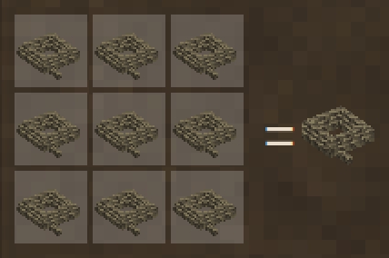
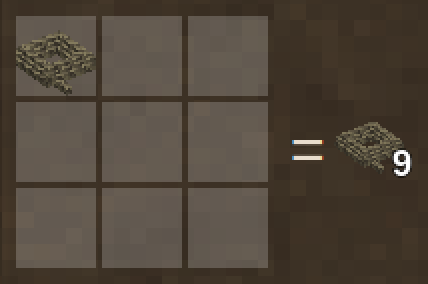
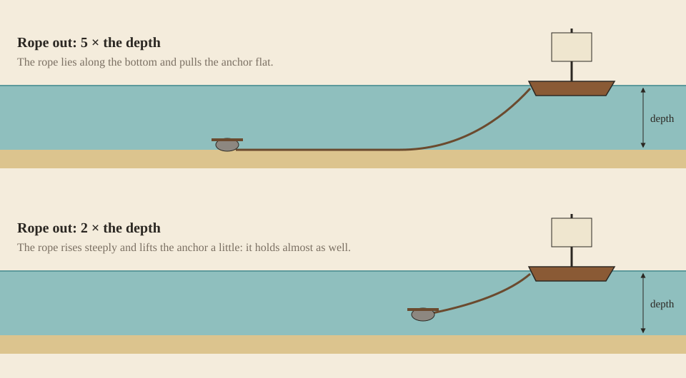

The [sailboat](Sailboat) carries a stone anchor in its prow. In vanilla it does nothing; in Rough Seas it holds the boat where you leave it, as well as its weight on the seabed allows.

## Letting go and hauling up

Right-click the anchor with an empty hand to let it go, and again to haul it up. The anchor sits in the sailboat's left prow slot, where it is fitted like any accessory. Only the sailboat has that slot, so it is the one vessel that anchors; the others are [tied up](Mooring#tying-up).

The anchor holds the boat whether or not someone sits in it: row or sail away and the rope stops you at its end, or drags the anchor along.

## Rope

The anchor comes on its own rope, 120 metres of flax. For deeper water, an **anchor warp** adds 90 metres more:

- craft it from 9 ropes in a 3 × 3 grid, and break it back into the ropes when you need them;
- stow it at the foot of the mast, the sailboat's lower mast slot, with ctrl + right-click on the mast.

| | |
| --- | --- |
|  |  |
| Splicing it | Breaking it up |

Anchor and warp together reach 210 metres.

## How it holds

The anchor is a stone of about 100 kg, and it holds by its weight: it lies on the bottom, and the rope drags it only once the pull beats the stone's grip on the bed.

| Bottom | Holds |
| --- | --- |
| Sand, gravel, mud or soil | about 330 newtons |
| Rock | about 420 newtons |

That holds the sailboat in the currents of the open sea and in an ordinary swell. A strong coastal current or a storm sea pulls harder, and the anchor drags.

Rough Seas lets out five times the depth, or all the rope aboard if that is less, as sailors do. Deeper than the rope reaches, the anchor hangs and holds nothing at all, until the boat drifts over shallower water. With the anchor rope alone, a sailboat anchors in water down to 120 metres; with the warp, 210.

A stone anchor holds about as well on a short rope as on a long one, since its weight does the holding. A long rope gives more softly when the boat comes to its end, but the boat swings in a wider circle around its anchor, and that circle has to clear the shore.

In a [current](Currents) the boat falls back to the end of its rope and swings about its bow until it lies along the stream, where the water pulls least.

## Dragging and parting

- **Dragging.** When the pull beats what the anchor holds, the stone slides along the bottom, and the boat drifts with it, slower than the water, since the stone's grip still holds it back. When the pull eases, the anchor bites again. When the boat comes to the end of its rope fast, the jerk alone can drag the stone a little before it bites.
- **Parting.** Flax rope breaks at about 11 kilonewtons. A rope that parts takes the anchor with it, along with all the rope let out.

In a storm a stone anchor drags: wave after wave, it walks the boat towards the lee shore. Anchor far from any shore, or carry the boat home.

An anchored vessel takes the waves more gently: it [ships less water](Surf-and-Swamping#at-anchor), three tenths of it, though a breaker slams it as hard as any other. It still lies across the sea, and it still needs [bailing](Bailing). Turning bow to the wind comes with sailing, in [Seamanship](Roadmap#seamanship).

## Leaving it

Far from shore in fair weather, a sailboat rides out the night at anchor; close to shore in a storm it may be [thrown up on the beach](Mooring#thrown-ashore). With [Mooring strain](World-Settings#the-mechanics) off, the anchor never drags and its rope never parts.
