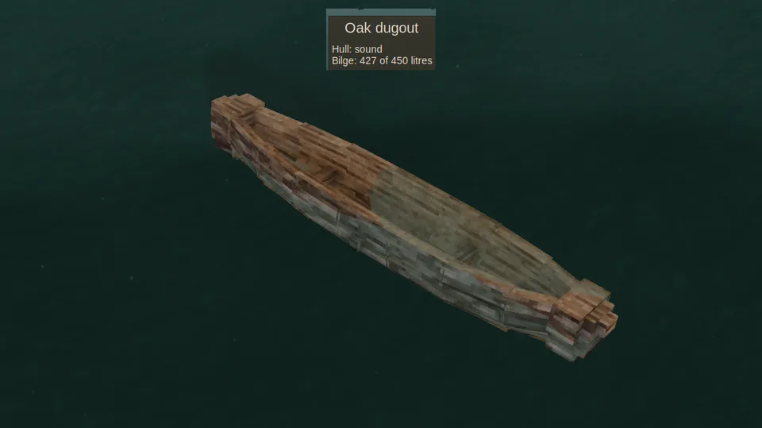

Boats with a hull hold the water that comes aboard in their bilge, and nothing takes it out again but you. Look at a vessel to see how many litres it carries; you see the water in the boat, too, rising as the bilge fills and staying level as the hull rolls.

## The bilge

| Vessel | Bilge | Deck open to the rain |
| --- | --- | --- |
| [Sailboat](Sailboat) | 1500 litres | 8 m² |
| [Hide currach](Hide-Currach) | 1500 litres | 5.5 m² |
| [Birch-bark canoe](Birch-Bark-Canoe) | 600 litres | 3.5 m² |
| [Outrigger canoe](Outrigger-Canoe) | 1578 litres, 1156 without washstrakes | 3.4 m² |
| [Dugout](Dugout) | 1156 litres | 3.4 m² |
| [Coracle](Coracle) | 250 litres | 1.5 m² |
| [Raft](Raft), [reed boat](Reed-Boat) | none: water washes through | |

Water comes in four ways:

- **Over the side**, when [waves](Surf-and-Swamping#shipping-water) run higher than her freeboard, or all at once when a load presses her gunwale under.
- **Through her cracks.** A [crack](Hull-Condition#leaks) in the bottom always leaks, one in the side once she sits low; look at her to see how many litres a minute.
- **Through her seams.** An ungreased [hide currach](Hide-Currach) seeps 30 litres a game hour.
- **From the sky.** Rain falls into an open boat: up to 10 litres per square metre of deck each game hour in a downpour, less in lighter rain. A sailboat in heavy rain takes in about 80 litres a game hour, some 40 litres a real minute. A boat under a roof stays dry.

Water aboard weighs a boat down, and a full bilge [swamps](Surf-and-Swamping#swamping) it.

## Bailing

Hold an empty bowl, jug or bucket and keep right-click pressed looking into the boat, from beside it or seated in it. Looking at the sea instead, you fill the bowl from the sea. You lean in, scoop and throw the water over the side, once a scoop.

| Container | Each scoop | Every | Litres a second |
| --- | --- | --- | --- |
| Bowl | 1 litre | 1.2 seconds | about 0.8 |
| Jug | 3 litres | 2 seconds | 1.5 |
| Wooden bucket | 10 litres | 3 seconds | about 3.3 |

Bailing is one held click, nothing more: no filling and pouring, no place to empty it.

## Keeping up

A bucket clears about 200 litres a minute. Against a calm sea and rain that is plenty; against a gale it is not. In a 5.5 m sea, unanchored, an empty bilge fills in no more than this, and sooner as the water aboard [settles the boat](Surf-and-Swamping#water-aboard):

| Vessel | Time to swamp |
| --- | --- |
| [Coracle](Coracle) | a quarter of a minute |
| [Dugout](Dugout), [outrigger](Outrigger-Canoe) | about a minute |
| [Sailboat](Sailboat) | a minute |
| [Birch-bark canoe](Birch-Bark-Canoe) | two minutes |
| [Hide currach](Hide-Currach) | ten minutes |

The currach, shipping some 150 litres a minute, can be kept dry by one bailer with a bucket. The others can't. An open sailboat left at [anchor](Anchoring) with nobody bailing in a 7 m sea swamps in about two and a half minutes.

A leak is the same race. A bucket keeps up with a stove-in bottom on most boats: the dugout's lets in about 160 litres a minute, the currach's under 90. Not the sailboat's, which lets in over 300; and two or three bad cracks outpace any bailer. Bail to stay afloat, and [mend](Mending) to stop it.

So at sea in a storm, keep bailing, and don't leave a boat out in one. The night you sleep through passes for a boat afloat near you too: she takes its waves, its rain and her leaks while you sleep. The bilge never drains by itself: a boat swamped in the night is still full in the morning.

With [Dangerous oceans](World-Settings#dangerous-oceans) off, no waves come aboard and no rain falls in.
