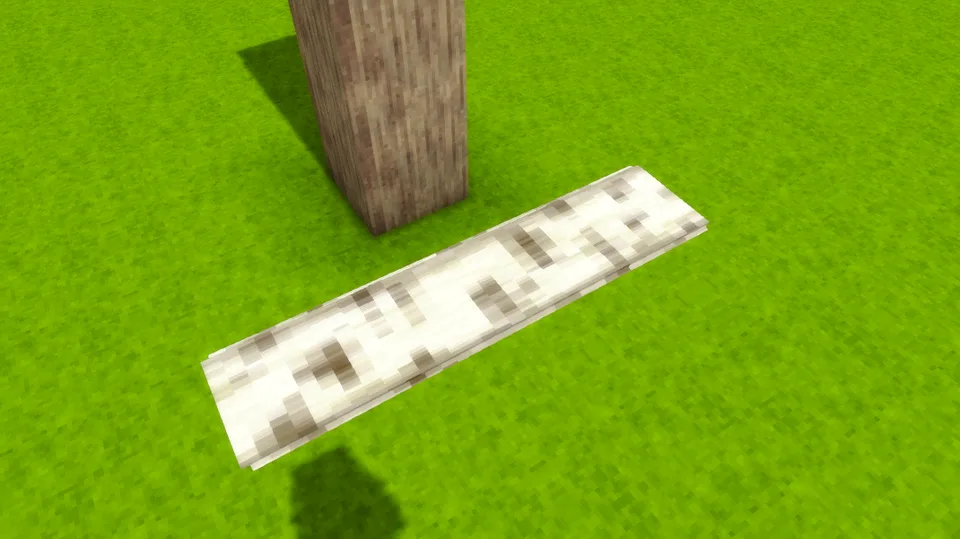
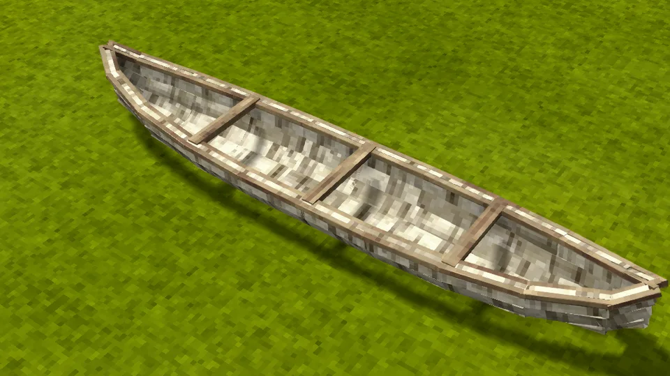
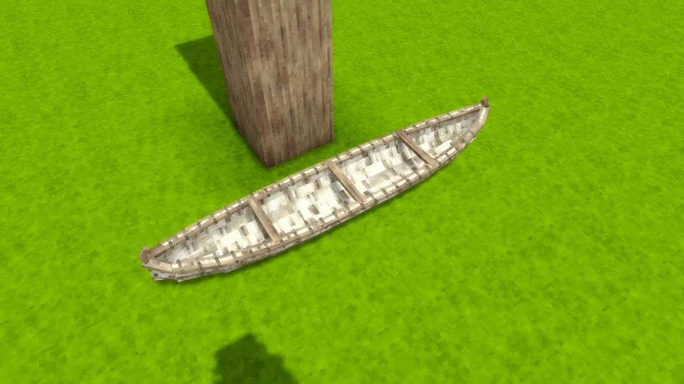
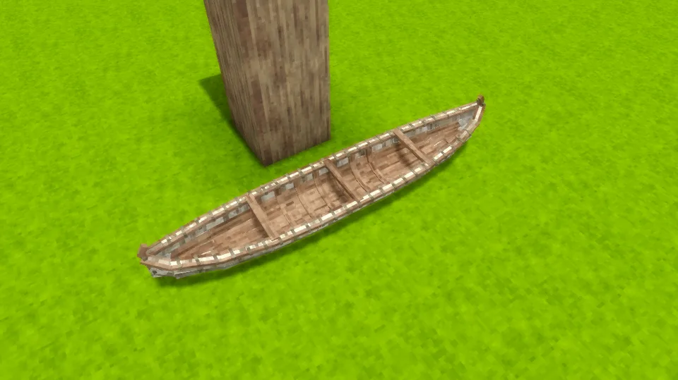
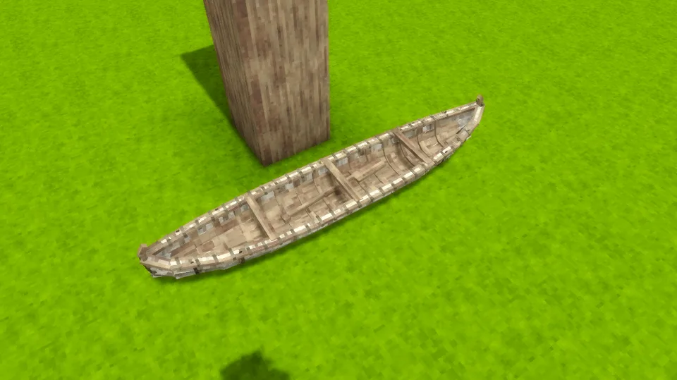

One sheet of birch bark over a frame of split laths: gunwales lashed on at intervals, three thwarts, sheathing and ribs inside, and high, upswept stems, its seams black with pitch. One person kneels amidships and paddles it with an [oar](https://wiki.vintagestory.at/Oar) in hand; a second rides in the bow.

## In Rough Seas

For long river journeys. The canoe is fast and draws almost no water, and it is the one vessel that runs rapids without taking a rock strike every second. It is also fragile: a landing that a dugout would never notice can hole it. Carry spare birch bark and patch it on the way, and pick it up to carry it past whatever the river won't let you through.

Birch is the one canoe bark in vanilla. Beside a mod that adds elm or spruce, such as [Wildcraft](Other-Mods#wildcraft-trees-and-shrubs), their bark builds canoes too: the Iroquois built theirs of elm bark, and northern and Pacific peoples of spruce bark. An elm-bark canoe is mended with elm bark. No other bark is flexible and tough enough to make one.

## Where it comes from

The birch-bark canoe belongs to the peoples of the northern woodlands of North America, the Anishinaabe, Mi'kmaq, Cree and their neighbours, who built it from what the forest gave: birch bark for the skin, cedar for the ribs and sheathing, spruce root for the lashings and spruce gum for the seams. It was light enough to carry between lakes, and later French and British fur traders crossed half a continent in larger copies of it. The model follows a two-person river canoe of that tradition, with its ribs, wrapped gunwales and curled stems.

## By the numbers

| | |
| --- | --- |
| Speed | 2.1 × the raft, the fastest paddled boat |
| Turning | nimble |
| [Hull](Hull-Condition) | 5200 J with an oak frame, 6100 J in birch; 2400 J in white cedar, the wood of a canoe from before the build |
| Upkeep | none |
| [Freeboard](Surf-and-Swamping#how-she-floats) | 27 cm empty, 24 cm with its paddler, in oak |
| [Flooded](Surf-and-Swamping#swamping) | floats awash, holding up 27 kg of gear, armour and containers in oak, more in a lighter wood |
| [Mending](Mending) | 2 bark of its tree close a third of a stove-in place |
| [Bilge](Bailing) | 600 litres |
| [Capsized by](Surf-and-Swamping#capsizing), in 1.0 | a 0.75 m breaker |
| [Rapids](Rapids) | runs them unharmed, the only vessel that does |
| [Lightning](Lightning) | a strike nearby almost always breaks it |
| [Left alone](Currents#drift) | drifts with the current and the waves |
| [Mooring](Mooring) | tied to a post |
| Carried | picked up |
| Seats | two: a paddler amidships, with an [oar](https://wiki.vintagestory.at/Oar) in hand, and a passenger in the bow |
| Cargo | a basket (8 slots) in the bow, in place of the passenger |
| Built from | a sheet of bark off a standing tree, 29 laths, 22 ropes and a litre of hot pitch |
| Wreckage | bark and a stick |

## How it is built

A bark canoe is built where its bark comes off the tree, piece by piece, each piece drawn on her as it goes on.

1. **Strip the bark.** Hold a knife on a standing birch whose trunk is at least five blocks tall, for half a minute. The bark comes off in one sheet and falls to the ground beside the tree: that sheet is the canoe, not yet framed. It floats and can be carried from the start, but has no seat. The tree stands on with its wood bare, and the axe still fells it whole. Beside a mod that adds elm or spruce, their trunks give their bark the same way.

   

2. **Split the laths.** Lay five logs of one wood on their sides, end to end, set a [splitting wedge](Recipes#splitting-wedge) on each, and hold an axe on a wedge: the wedges drive in and the trunk splits into 32 laths. Any wood will do, and the canoe's frame is as strong and as heavy as that wood.
3. **Soak them.** Laths bend only wet: two days in a barrel of water ([recipe](Recipes#soaked-laths)). Out of the water they dry again in two days, in the bundle as in the canoe, so a bundle kept too long goes back in the barrel.
4. **Frame her.** Hold a wet lath on the sheet, a few seconds a lath: the inwales, the three thwarts and the outwales first, which raise the bark into a hull, then the two stems. One row's laths make one canoe: they must all be of one wood.

   

5. **Lash the bark.** Hold vanilla rope on her to sew the bark to the gunwales and bind the stems: each rope is ten metres of lashing, and she takes 22.

   

6. **Line her.** Lay the sheathing along the bottom, then the ribs across, from the middle out. The ribs bend in wet and hold her shape once dry.

   

7. **Pitch the seams.** Hold a bowl, jug or bucket of hot pitch glue on her to pitch each of her four seams, a quarter litre a seam: one pot of glue. Glue that has set must be heated again.

   

Her hold holds water only once her seams are pitched; before that it runs through her. Once her last rib has dried, two days after it went in, she is finished and takes her seats. A canoe from before the build loads finished.

Birch bark still comes off a birch log with a knife, for patches: it mends the canoe on the way.

## Its neighbours

- The [dugout](Dugout) is the other river boat: slower and stuck where it was launched, but it shrugs off the knocks that hole a canoe.
- The [coracle](Coracle) is the other boat you carry, worn on your back.
- At sea it is out of its depth: the [hide currach](Hide-Currach) is the first boat for the coast.

## Every form it takes

| | |
| --- | --- |
|  |  |
| Afloat, from the side | From the stern quarter |
|  |  |
| From above | Beside the sailboat |
|  |  |
| Ashore | Ashore, from the quarter |
|  |  |
| Dropped on the ground | Carried |
|  |  |
| In the hotbar | Its wreckage |
