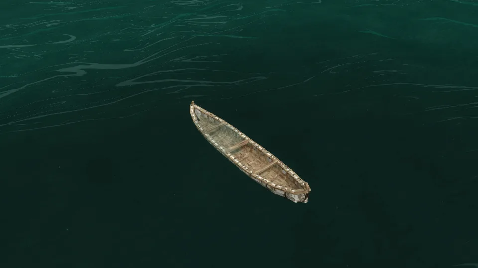

Sheets of birch bark sewn over a frame of close-set ribs, with gunwales lashed on at intervals, three thwarts and high, upswept ends. One person kneels amidships and paddles it with the paddle it carries; a second rides in the bow.

## In Rough Seas

For long river journeys. The canoe is fast and draws almost no water, and it is the one vessel that runs rapids without taking a rock strike every second. It is also fragile: a landing that a dugout would never notice can hole it. Carry spare birch bark and patch it on the way, and pick it up to carry it past whatever the river won't let you through.

Birch is the one canoe bark in vanilla. Beside a mod that adds elm or spruce, such as [Wildcraft](Other-Mods#wildcraft-trees-and-shrubs), their bark builds canoes too: the Iroquois built theirs of elm bark, and northern and Pacific peoples of spruce bark. An elm-bark canoe is mended with elm bark. No other bark is flexible and tough enough to make one.

## Where it comes from

The birch-bark canoe belongs to the peoples of the northern woodlands of North America, the Anishinaabe, Mi'kmaq, Cree and their neighbours, who built it from what the forest gave: birch bark for the skin, cedar for the ribs and sheathing, spruce root for the lashings and spruce gum for the seams. It was light enough to carry between lakes, and later French and British fur traders crossed half a continent in larger copies of it. The model follows a two-person river canoe of that tradition, with its ribs, wrapped gunwales and curled stems.

## By the numbers

| | |
| --- | --- |
| Speed | 2.1 × the raft, the fastest paddled boat |
| Turning | nimble |
| [Hull](Hull-Condition) | 2400 J |
| Upkeep | none |
| [Freeboard](Surf-and-Swamping#how-she-floats) | 28 cm empty, 25 cm with its paddler |
| [Flooded](Surf-and-Swamping#swamping) | floats awash, holding up 41 kg of gear, armour and containers |
| [Mending](Mending) | 2 bark of its tree close a third of a stove-in place |
| [Bilge](Bailing) | 600 litres |
| [Capsized by](Surf-and-Swamping#capsizing), in 1.0 | a 0.75 m breaker |
| [Rapids](Rapids) | runs them unharmed, the only vessel that does |
| [Lightning](Lightning) | a strike nearby almost always breaks it |
| [Left alone](Currents#drift) | drifts with the current and the waves |
| [Mooring](Mooring) | tied to a post |
| Carried | picked up |
| Seats | two: a paddler amidships, with its own paddle, and a passenger in the bow |
| Cargo | a basket (8 slots) in the bow, in place of the passenger |
| Built from | 12 birch bark, 2 sticks and resin |
| Wreckage | bark and a stick |

## How it is built

Birch bark comes off a birch log with a knife.

| | |
| --- | --- |
| 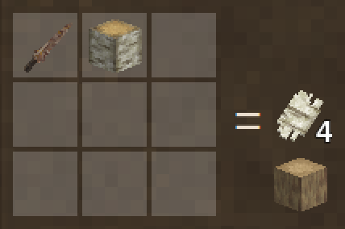 | 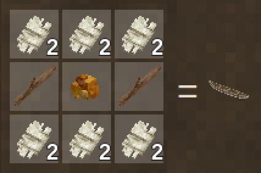 |
| The bark | The canoe |

## Its neighbours

- The [dugout](Dugout) is the other river boat: slower and stuck where it was launched, but it shrugs off the knocks that hole a canoe.
- The [coracle](Coracle) is the other boat you carry, worn on your back.
- At sea it is out of its depth: the [hide currach](Hide-Currach) is the first boat for the coast.

## Every form it takes

| | |
| --- | --- |
| 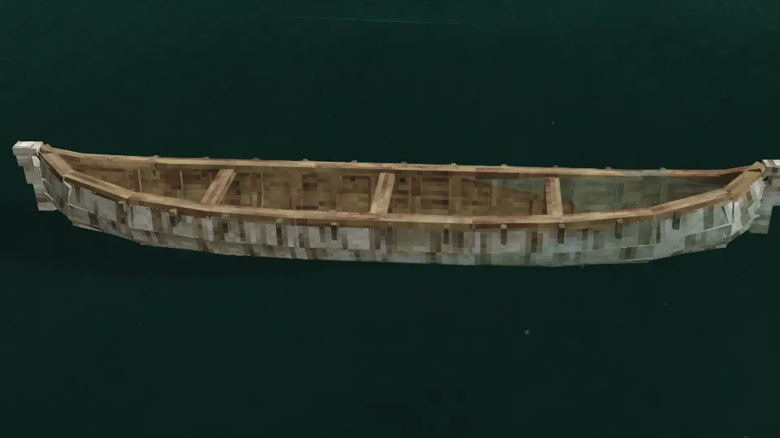 | 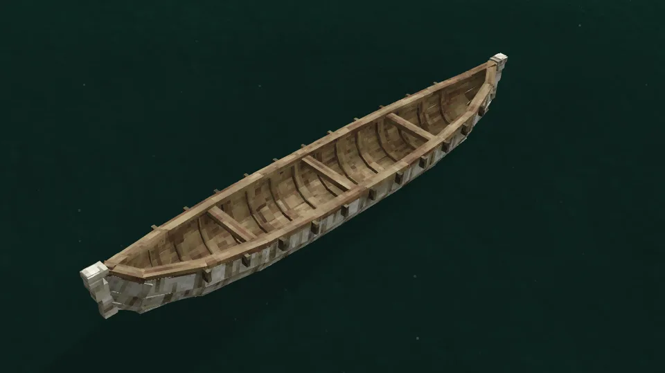 |
| Afloat, from the side | From the stern quarter |
| 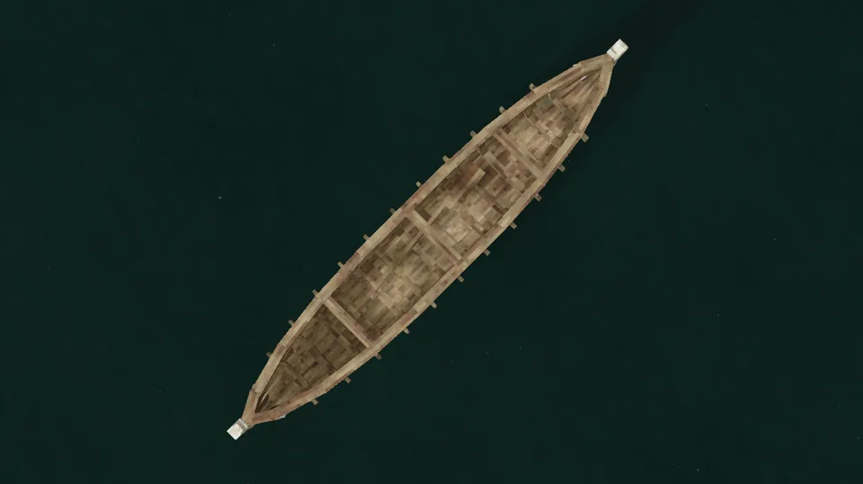 | 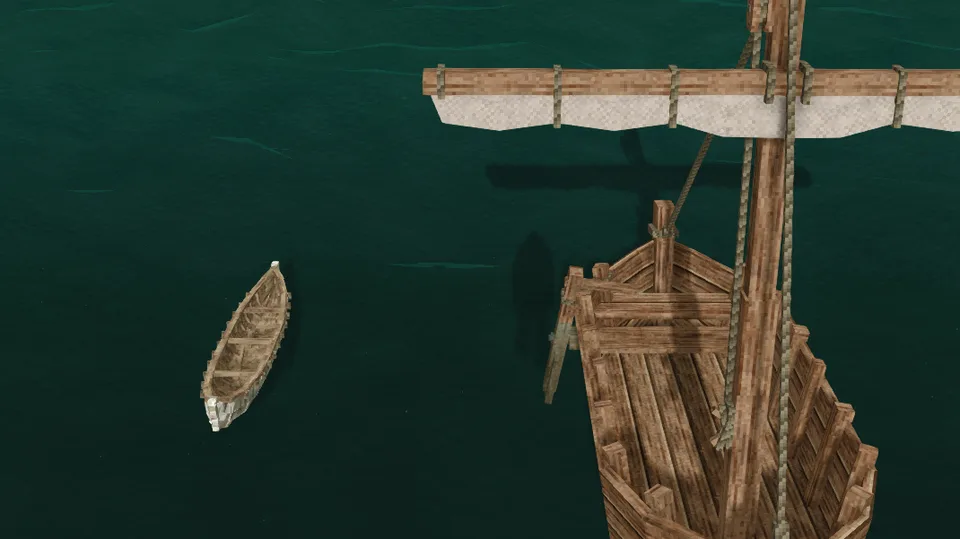 |
| From above | Beside the sailboat |
| 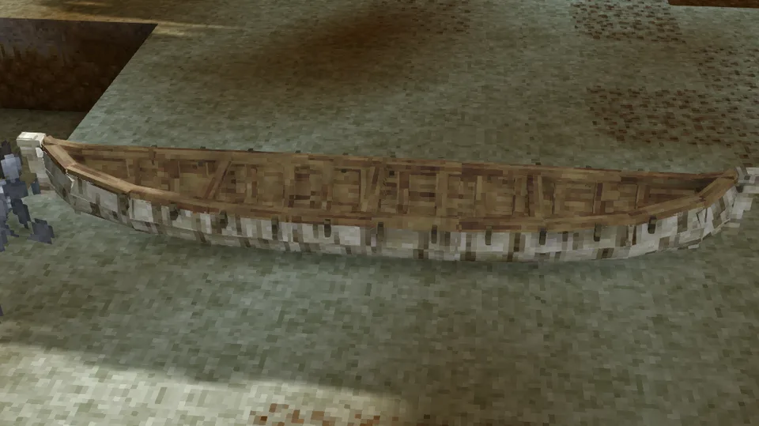 | 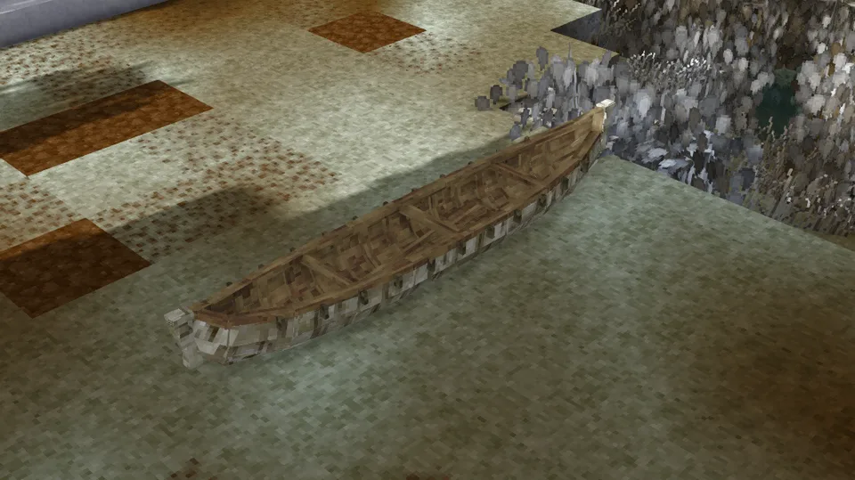 |
| Ashore | Ashore, from the quarter |
| 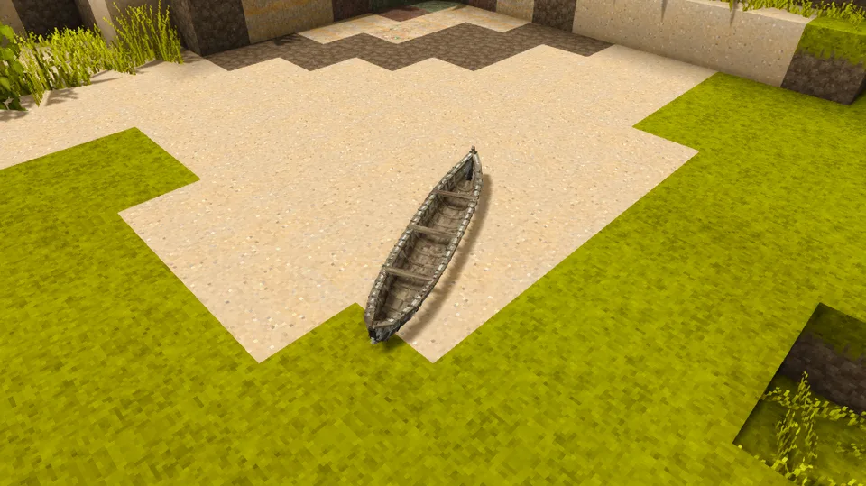 | 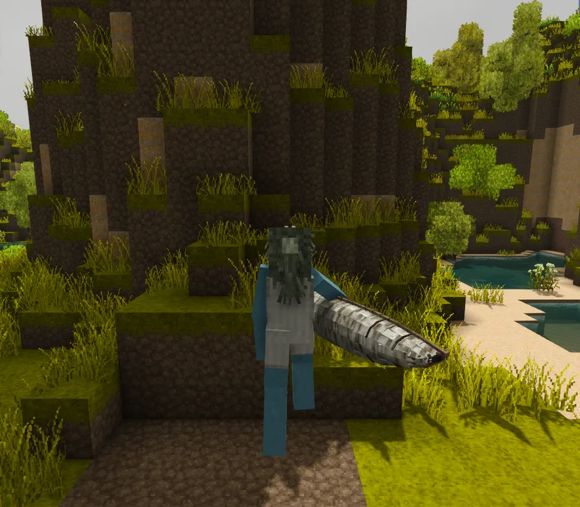 |
| Dropped on the ground | Carried |
| 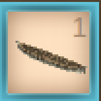 | 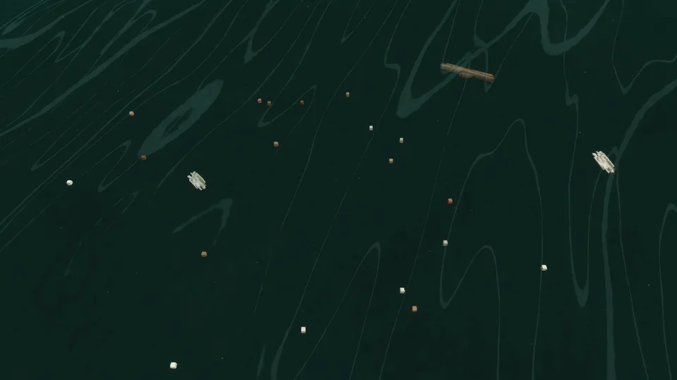 |
| In the hotbar | Its wreckage |
