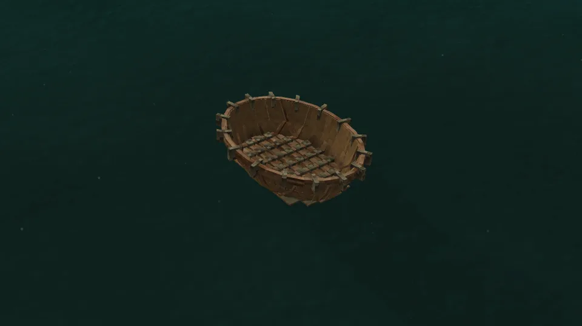

An oval bowl of hide over a basket of split laths: a lattice across the flat bottom, its ends bent up into a plaited gunwale, the hide laced to it and sealed with rendered fat. It carries one person, paddled with an [oar](https://wiki.vintagestory.at/Oar), and it is light enough to wear on your back.

## In Rough Seas

For fishing and short crossings. The coracle is the only vessel that rides in the backpack slot, so it goes wherever you walk and is in the water again the moment you reach it. It turns on the spot and makes poor headway in a straight line. Its low rim swamps in anything more than a chop: keep it to rivers, lakes and sheltered bays.

## Where it comes from

Coracles have been paddled on the rivers of Wales, Ireland and Scotland since before the Romans arrived, and round hide or basket boats of the same kind were built on the Tigris (the *quffa*), in southern India and in Vietnam. A Teifi coracle was begun as laths of split willow laid flat on the ground, seven along and seven across; their ends were bent up and held by a gunwale plaited of soaked hazel, and an ox hide, or later tarred calico, was laced over the frame. A coracle-man walked home from the river with the boat on his back. The model is a Teifi coracle, 1.5 m long and a little over a metre across.

## By the numbers

| | |
| --- | --- |
| Speed | 1 m/s, sculled over the bow or poled ([how fast](Paddles-Poles-and-Oars#how-fast)) |
| Turning | spins on the spot, 177° a second |
| [Hull](Hull-Condition) | 400 J with a willow frame, the weakest of all; about 690 J in oak, 810 J in birch |
| [Seeping](Hull-Condition#seeping-and-soaking) | ungreased, 12 litres a game hour into the bilge at each seam between hides; a full greasing lasts 2.5 days afloat |
| [Freeboard](Surf-and-Swamping#how-she-floats) | 33 cm empty, 26 cm with its paddler |
| [Flooded](Surf-and-Swamping#swamping) | floats awash under its paddler's gear; armour takes it down |
| [Mending](Mending) | 1 small prepared hide closes two thirds of a stove-in place; 1 rendered fat greases it for 1.25 days |
| [Bilge](Bailing) | 265 litres |
| [Capsized by](Surf-and-Swamping#capsizing), in 1.0 | a 0.6 m breaker |
| [Rapids](Rapids) | broken within seconds |
| [Lightning](Lightning) | a strike nearby breaks it |
| [Left alone](Currents#drift) | drifts with the current and the wind |
| [Mooring](Mooring) | tied to a post, or worn home |
| Carried | worn on the back, in the backpack slot |
| Seats | one, on the floor, a [paddle](Paddles-Poles-and-Oars) or a [pole](Paddles-Poles-and-Oars) in hand |
| Cargo | none |
| Built from | 14 laths of 2 m and 3 of 5 m, 5 ropes and two small hides' worth of hide, then greased |
| Wreckage | a few laths |

## How it is built

A coracle is built where its laths are laid out on the ground, piece by piece, each piece drawn on her as it goes on.

1. **Split and soak the laths.** Split [poles](Recipes#laths) into laths with an axe in the crafting grid: fourteen 2 m laths for her lattice and three 5 m ones for her gunwale. Laths bend only wet: two days in a barrel of water ([recipe](Recipes#soaked-laths)). Out of the water they dry again in two days, on the ground or in her as in the bundle.
2. **Lay the lattice.** Hold Shift and right-click the ground with a wet lath: it lies at its full length where you aim, along the way you face. A lath lies where you aim, to the sixteenth of a block. Lay seven side by side, an eighth of a block apart, then seven across them, three sixteenths of a block apart, each crossing all seven beneath it: that is how her bottom draws them, so binding moves no lath. One laid a sixteenth off is drawn onto its place when she is bound; further off, the laths stay laths. A lath laid wrong comes back to an empty hand with Shift + right-click.

   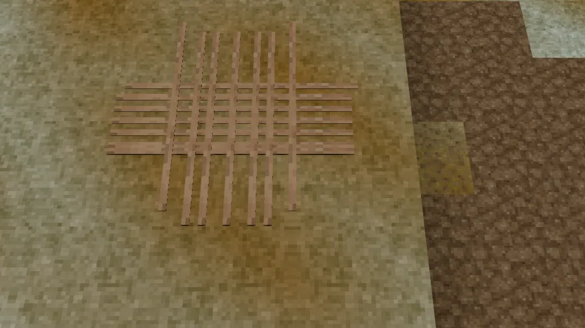

3. **Bind the crossings.** Hold rope on the lattice: the first rope ties it into the coracle where it lies, and two more tie the rest of the crossings on her bottom. Laths laid any other way, or of two woods, stay laths.

   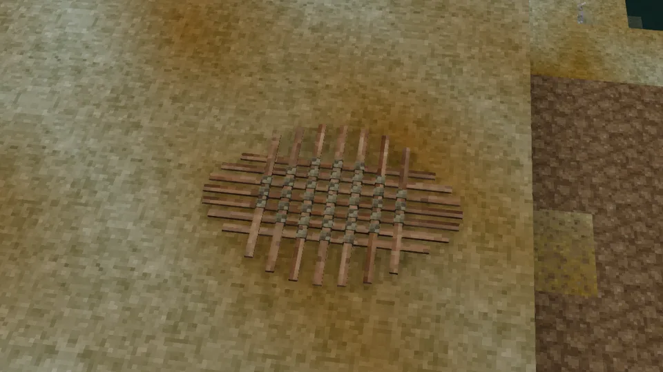

4. **Plait the gunwale.** Hold the 5 m laths on her: the first bends the lattice's ends up into her bowl, and three plaits make her gunwale. Two days later the laths have dried and her frame has set; until then no hide goes on.

   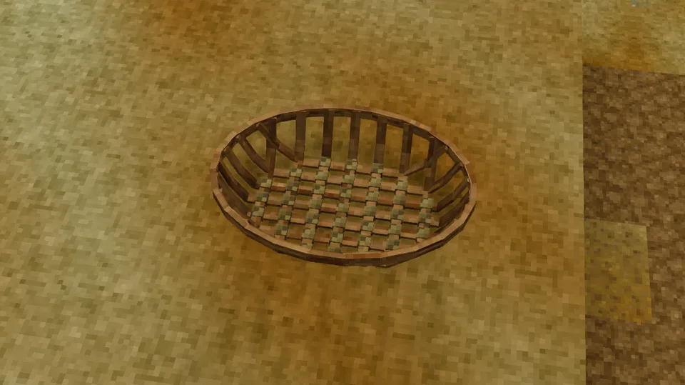

5. **Sew on hides.** Hold a hide on her: any hide before it is leather, raw, salted, soaked, scraped, prepared, oiled or a pelt. Her cover is two parts of one small hide's area each; a small hide covers one part, a medium two, a large three, a huge five, and takes as much longer to sew. A hide bigger than what is left of her cover is cut to fit, and the rest comes back to you as the smaller hides it still makes.

   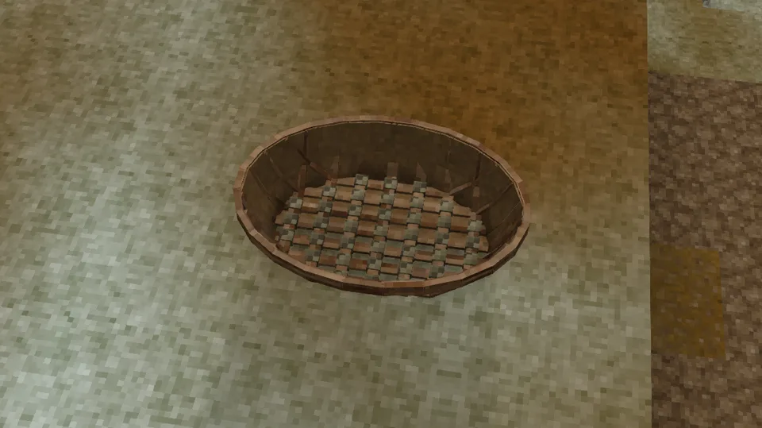

6. **Lace the cover.** Two ropes lace the hide to the gunwale. Her hold holds water only once it is laced, and she is finished: grease her with rendered fat before she goes afloat, or her seams seep.

   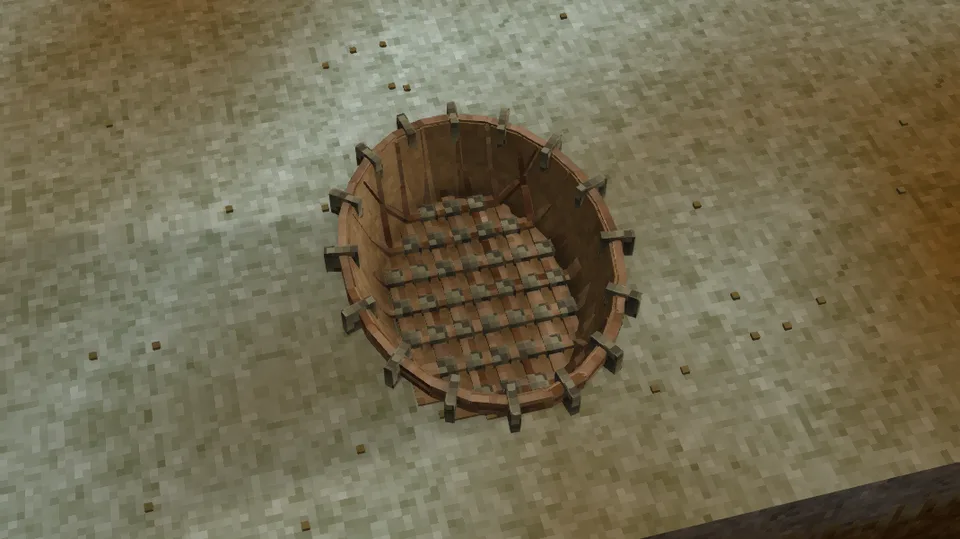

The hide she is sewn from decides how long she lasts afloat ([Seeping and soaking](Hull-Condition#seeping-and-soaking)): untanned hide rots within days in warm water unless dried ashore, prepared hide lasts years. A coracle from before the build loads finished, covered in prepared hide.

## Its neighbours

- The [birch-bark canoe](Birch-Bark-Canoe) is the other boat you carry: faster and roomier, but carried in the hands, not on the back.
- The [reed boat](Reed-Boat) crosses a lake once; the coracle crosses it every day.
- The [hide currach](Hide-Currach) is built of the same laths and hides, for the sea.

## Every form it takes

| | |
| --- | --- |
| 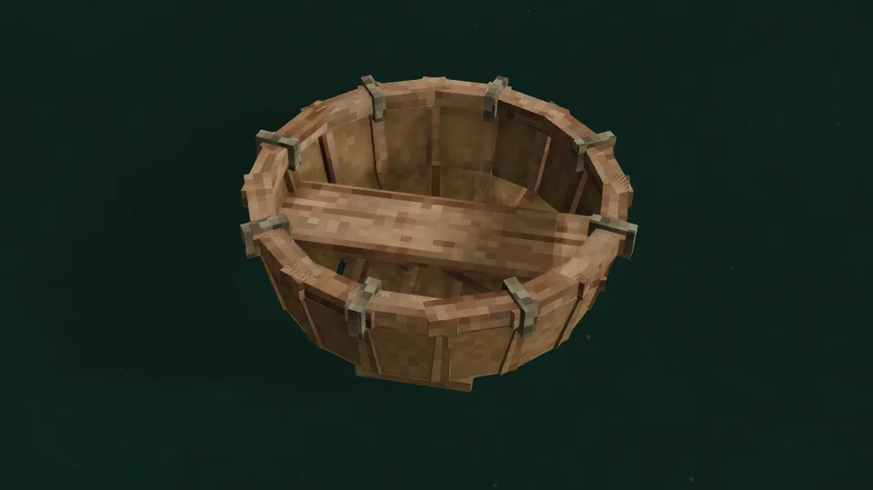 | 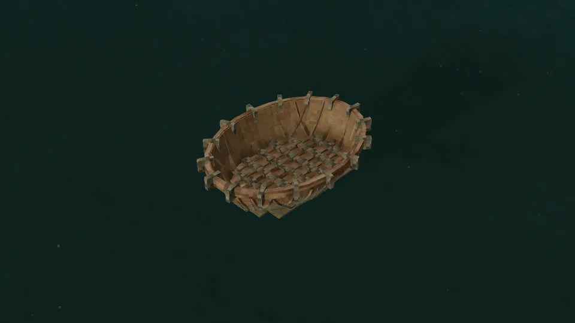 |
| Afloat, from the side | From another quarter |
| 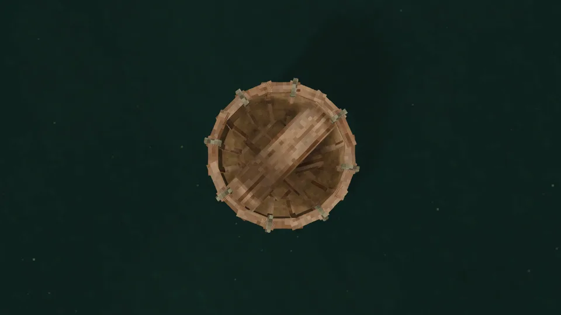 | 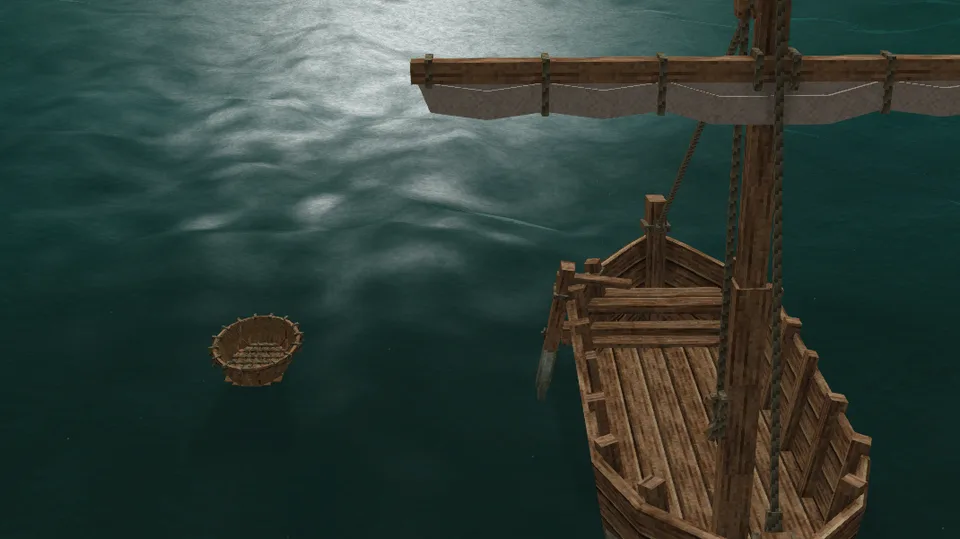 |
| From above | Beside the sailboat |
| 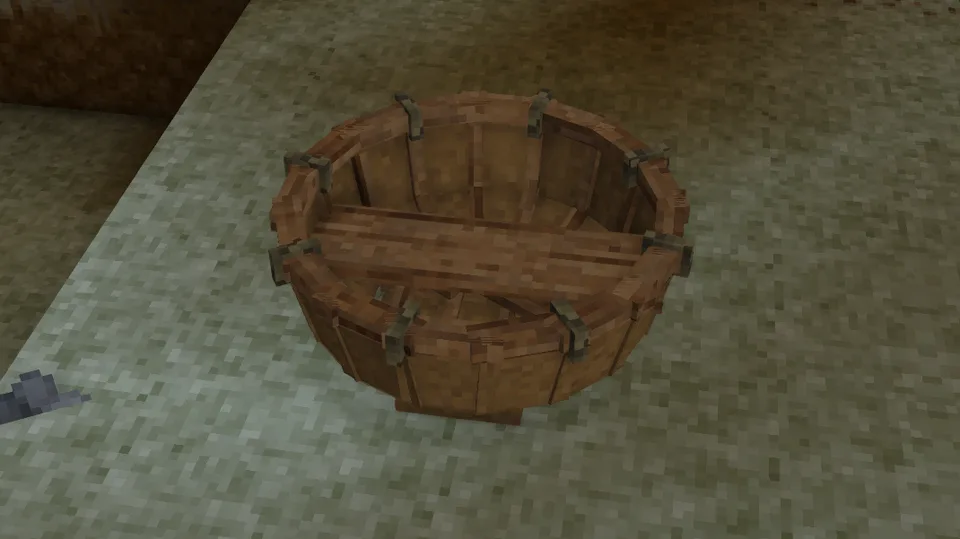 | 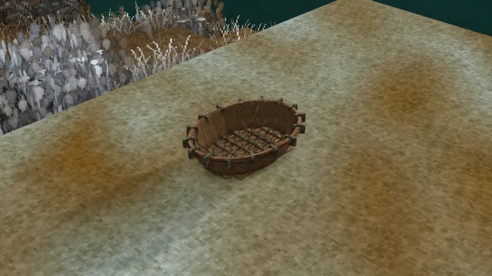 |
| Ashore | Ashore, from the quarter |
| 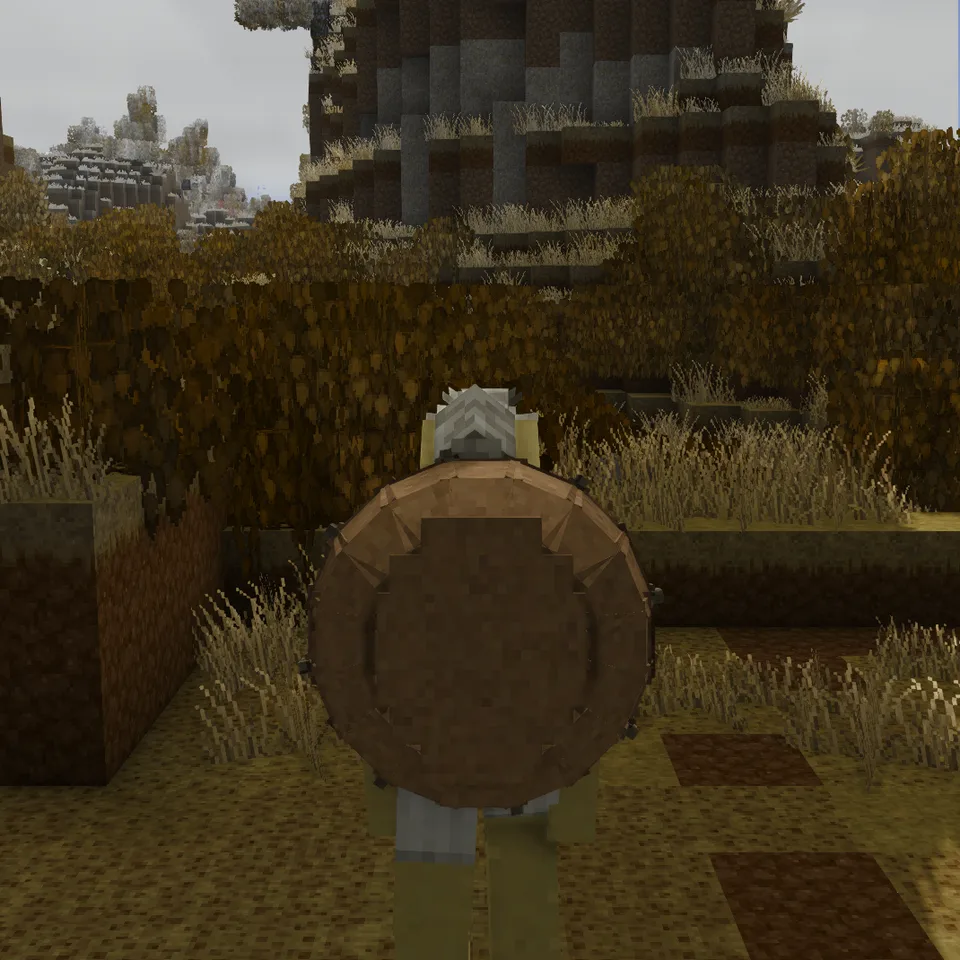 | 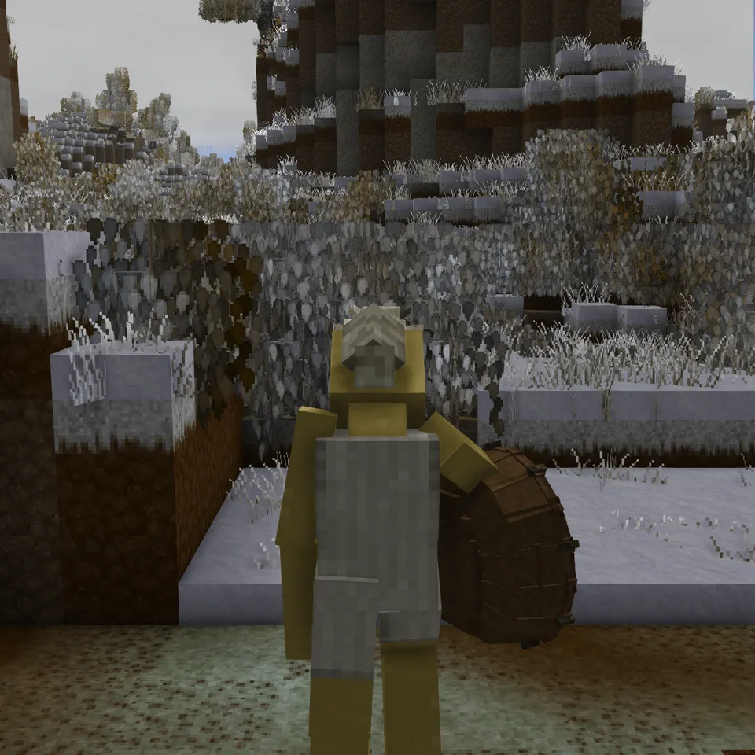 |
| Worn on the back | Carried under the arm |
| 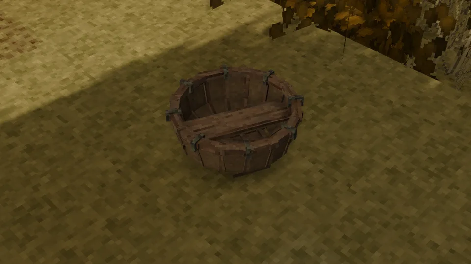 | 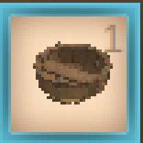 |
| Dropped on the ground | In the hotbar |
| 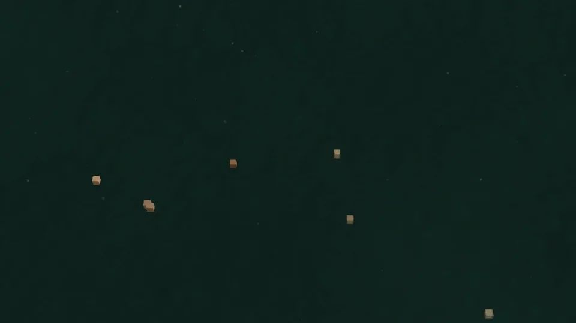 | |
| Its wreckage | |
