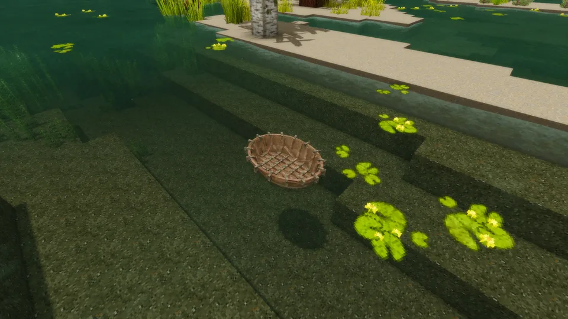

An oval bowl of hide over a basket of split laths: a lattice across the flat bottom, its ends bent up into a plaited gunwale, the hide laced to it and sealed with rendered fat. It carries one person, sculled over the bow with a [paddle](Paddles-Poles-and-Oars), and it is light enough to wear on your back.

## In Rough Seas

For fishing and short crossings. The coracle is the only vessel that rides in the backpack slot, so it goes wherever you walk and is in the water again the moment you reach it. It turns on the spot and makes poor headway in a straight line. Its low rim swamps in anything more than a chop: keep it to rivers, lakes and sheltered bays.

## Where it comes from

Coracles have been paddled on the rivers of Wales, Ireland and Scotland since before the Romans arrived, and round hide or basket boats of the same kind were built on the Tigris (the *quffa*), in southern India and in Vietnam. A Teifi coracle was begun as laths of split willow laid flat on the ground, seven along and seven across; their ends were bent up and held by a gunwale plaited of soaked hazel, and an ox hide, or later tarred calico, was laced over the frame. A coracle-man walked home from the river with the boat on his back. The model is a Teifi coracle, 1.5 m long and a little over a metre across.

## By the numbers

| | |
| --- | --- |
| Speed | 1 m/s sculled over the bow, 1.3 m/s poled ([how fast](Paddles-Poles-and-Oars#how-fast)) |
| Turning | spins on the spot, 177° a second |
| [Hull](Hull-Condition) | a knock breaks the willow lath behind the hide at 24 J, 45 J in oak, and the two either side of a gap at 57 J, 108 J in oak: past its 1 m/s sculled, only a current or a fall drives it that hard; 400 J more with a willow frame breaks it up, the weakest of all, about 690 J in oak, 810 J in birch |
| [Seeping](Hull-Condition#seeping-and-soaking) | ungreased, 13 litres a game hour into the bilge at each seam between hides; a full greasing lasts 2.5 days afloat |
| [Freeboard](Surf-and-Swamping#how-it-floats) | 33 cm empty, 26 cm with its paddler |
| [Flooded](Surf-and-Swamping#swamping) | floats awash under its paddler's gear; armour takes it down |
| [Mending](Mending) | 1 small prepared hide closes two thirds of a stove-in place; 1 rendered fat greases it for 1.25 days |
| [Bilge](Bailing) | 272 litres |
| [Capsized by](Surf-and-Swamping#capsizing), in 1.0 | a 0.6 m breaker |
| [Rapids](Rapids) | runs them unharmed, as the bark canoe does, drawing only a few inches ([a simplified model](Rapids) for now) |
| [Lightning](Lightning) | a strike nearby breaks it |
| [Left alone](Currents#drift) | drifts with the current and the wind |
| [Mooring](Mooring) | tied to a post, or worn home |
| Carried | worn on the back, in the backpack slot |
| Seats | one, on the floor, a [paddle](Paddles-Poles-and-Oars) or a [pole](Paddles-Poles-and-Oars) in hand; with a pole you stand in its middle |
| Cargo | none |
| Built from | 14 laths of 2 m and 3 of 5 m, 5 ropes and two small hides' worth of hide, then greased |
| Wreckage | a few laths |

## How it is built

You build a coracle where you pile its laths on the ground, piece by piece. Each piece shows on the coracle as you lay it.

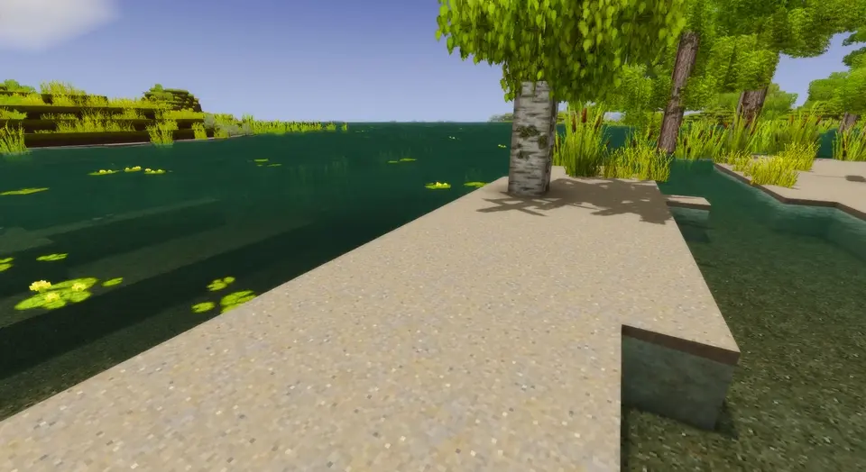

1. **Split and soak the laths.** Split [poles](Recipes#laths) into laths with an axe in the crafting grid: fourteen 2 m laths for the lattice and three 5 m ones for the gunwale. Laths bend only when wet: soak them two days in a barrel of water ([recipe](Recipes#soaked-laths)). Out of the water they dry again in two days, on the ground, in the coracle or in the bundle.
2. **Lay the lattice.** Hold Shift and right-click the ground with a wet 2 m lath to start a pile, as you pile [poles](Recipes#poles-and-laths-on-the-ground). Shift + right-click the pile with the other thirteen; hold Ctrl as well to lay a whole layer at once. Two-metre laths pile as the coracle's lattice: seven along, then seven across them. The pile is centred on the block you lay it on and reaches half a block into each of the four blocks beside it, so keep those four free. Fourteen laths make one layer, and that layer is the lattice. A fifteenth starts a second layer, and no coracle comes of that pile. To take a lath back, right-click the pile with an empty hand.

   

3. **Bind the crossings.** Hold a rope on the pile: the first rope ties the lattice into the coracle where it lies, and two more tie the rest of the crossings on its bottom. Any other pile stays a pile. A dry pile of fourteen tells you to soak the laths first.

   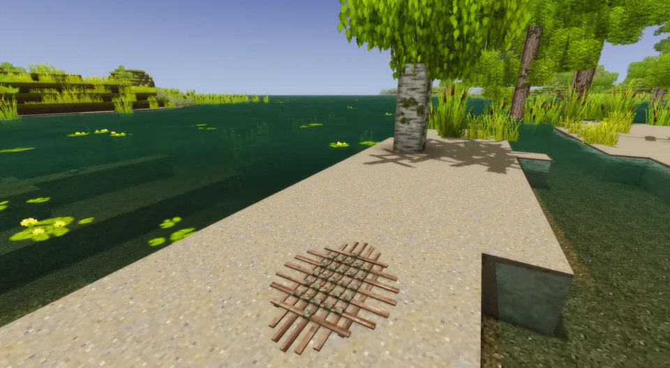

4. **Plait the gunwale.** Hold the 5 m laths on the coracle. The first bends the lattice's ends up into a bowl, and three plaits make the gunwale. Two days later the laths have dried and the frame has set; until then no hide goes on.

   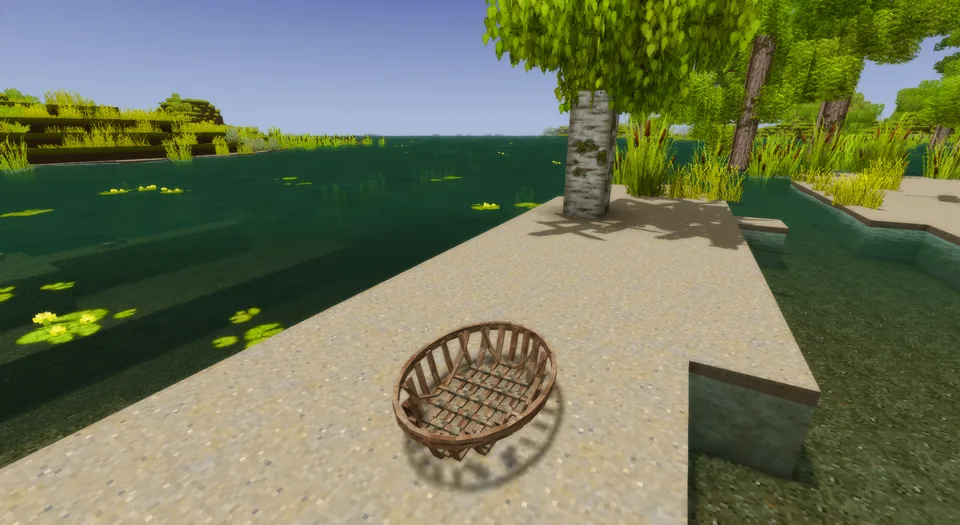

5. **Sew on hides.** Hold a hide on the coracle: any hide before it is leather, raw, salted, soaked, scraped, prepared, oiled or a pelt. The cover is two parts of one small hide's area each: a small hide covers one part, a medium two, a large three, a huge five, and takes as much longer to sew. Each part is one half of the coracle, side to side. A hide bigger than what is left of the cover is cut to fit, and you get the rest back as the smaller hides it still makes.
6. **Lace the cover.** Hold two ropes on the coracle to lace the hide to the gunwale. The hold keeps water out only once it is laced, and the coracle is finished. Grease it with rendered fat before it goes afloat, or its seams seep.

   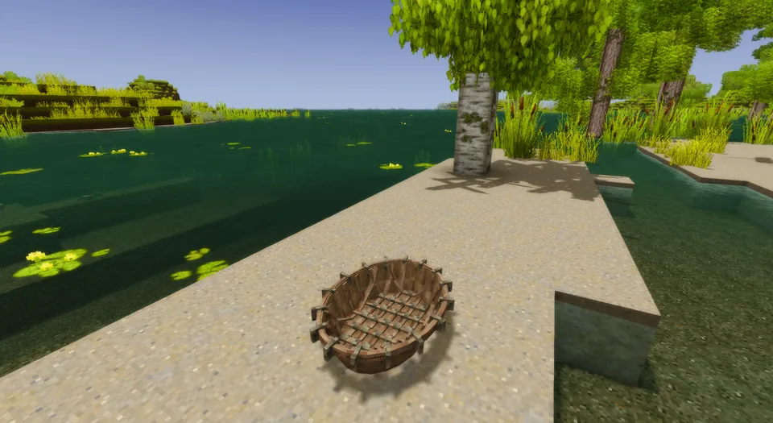

The hide you sew it from decides how long the coracle lasts afloat ([Seeping and soaking](Hull-Condition#seeping-and-soaking)): untanned hide rots within days in warm water unless dried ashore, prepared hide lasts years. A coracle from before the build loads finished, covered in prepared hide.

## Its neighbours

- The [birch-bark canoe](Birch-Bark-Canoe) is the other boat you carry: faster and roomier, but carried in the hands, not on the back.
- The [reed boat](Reed-Boat) crosses a lake once; the coracle crosses it every day.
- The [hide currach](Hide-Currach) is built of the same laths and hides, for the sea.

## Every form it takes

| | |
| --- | --- |
| 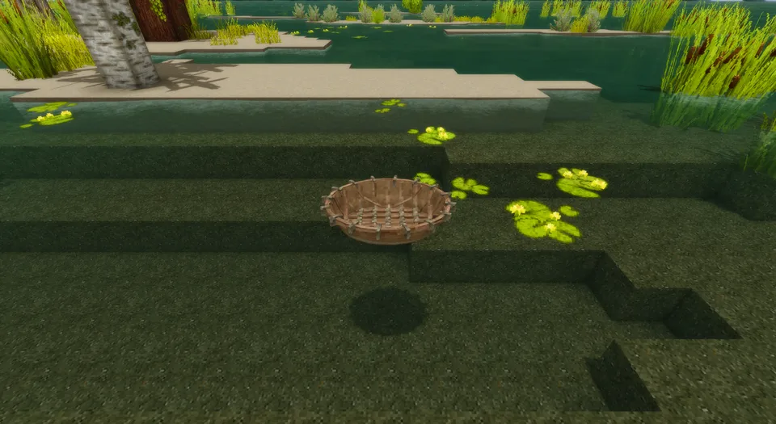 | 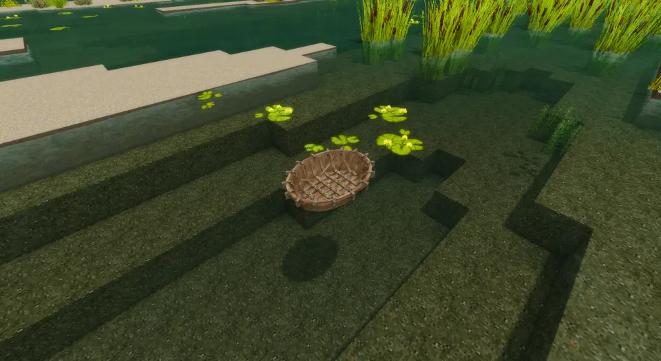 |
| Afloat, from the side | From another quarter |
| 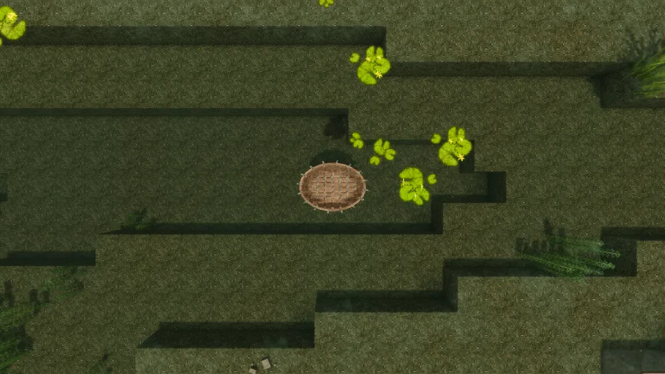 | 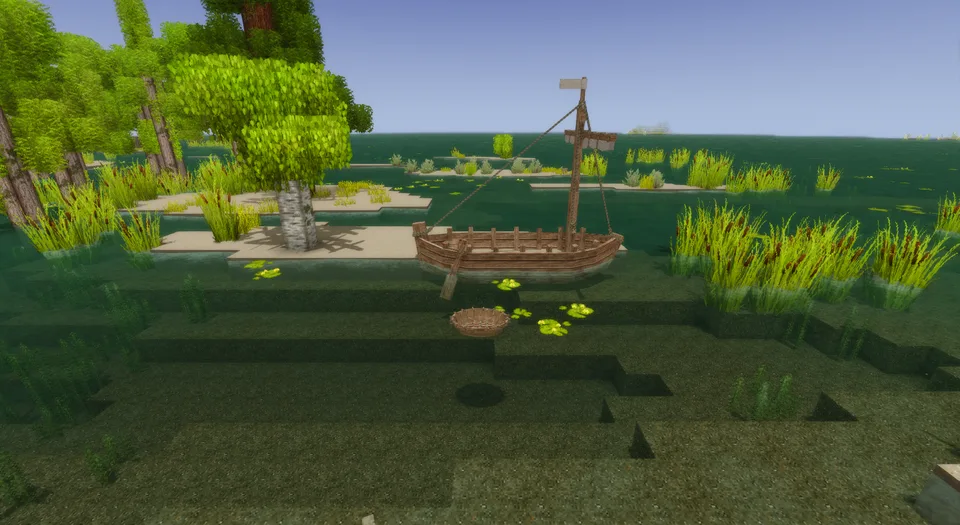 |
| From above | Beside the sailboat |
| 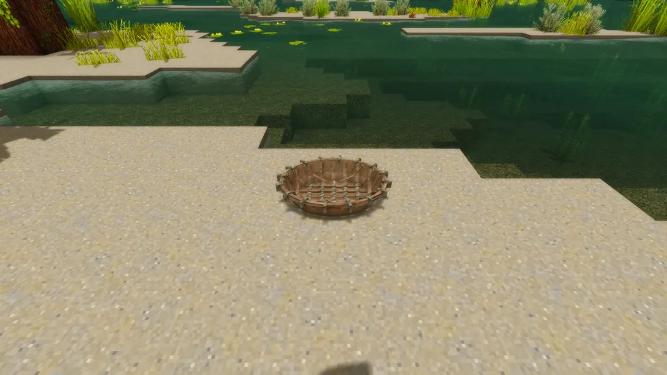 | 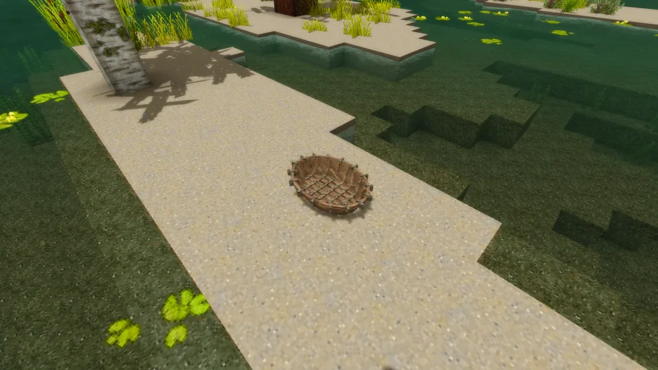 |
| Ashore | Ashore, from the quarter |
| 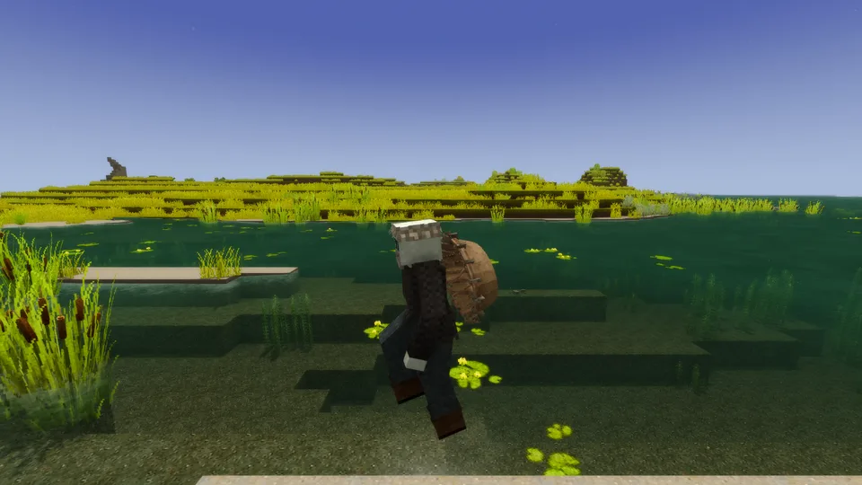 | 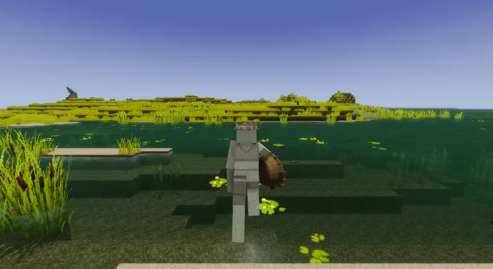 |
| Worn on the back | Carried under the arm |
| 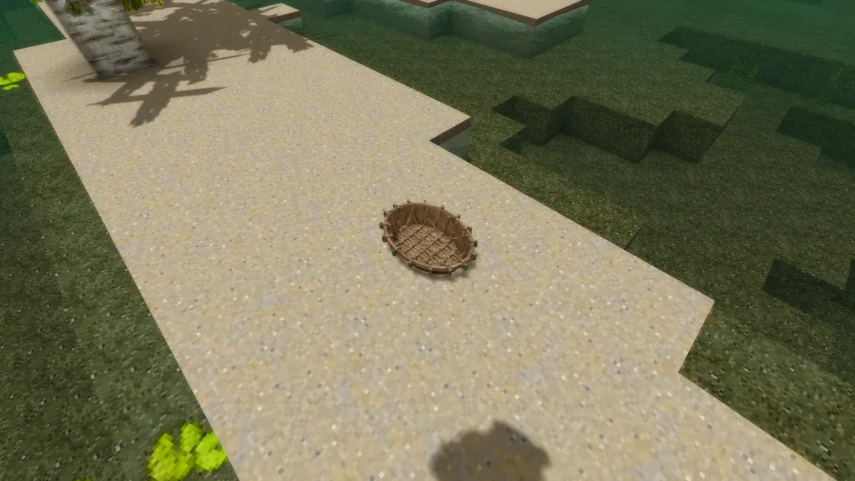 | 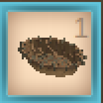 |
| Dropped on the ground | In the hotbar |
| 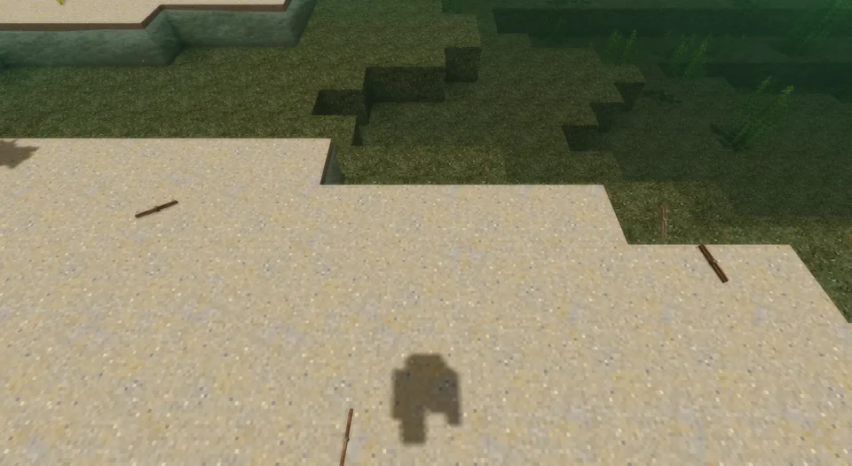 | |
| Its wreckage | |
