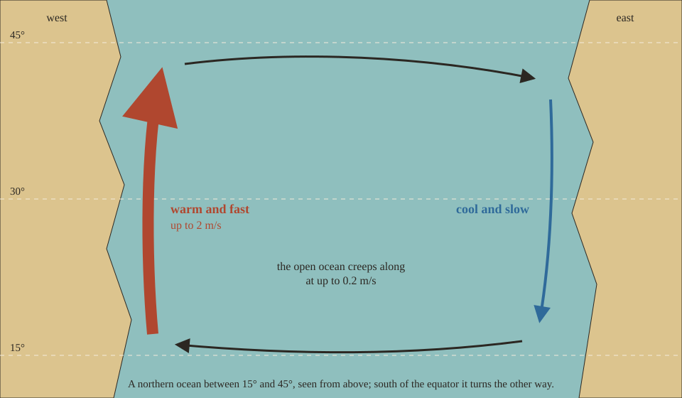

The oceans turn. Every basin carries great slow circles of water, the gyres, and a vessel left alone drifts with them.

## How the oceans turn

Rough Seas builds its currents the way oceanographers first explained them: Henry Stommel showed in 1948 that the wind turning over an ocean, with the Earth turning under it, piles the return flow into a narrow, fast current along the ocean's western shore, while the rest of the basin creeps back slowly. That is why the Gulf Stream and the Kuroshio run along the western edges of their oceans at a few knots, and the eastern side moves barely at all.

- **Western boundary currents** run along the western shore of a basin at up to 2 m/s (about 4 knots), faster than a slow walk.
- **The open ocean** creeps along at up to 0.2 m/s.
- **Size matters.** A current's strength scales with the width of its basin: a wide ocean has full-strength currents, a small sea weak ones, and a lake none.

The gyres repeat in bands of latitude, so which way a current runs depends on where you are. Between about 15° and 45° the western current carries warm water towards the pole, as the Gulf Stream does, and the eastern side is cool; nearer the equator, and between about 45° and 75°, the pattern turns over.

## Warm and cold water

The water takes its temperature from the climate above it, plus the warmth a current carries: up to about 7 °C more along a warm current, up to about 5 °C less along a cold one. Sea water never falls below −1.8 °C, the point where it freezes.

The temperature of the water has no effect yet. Cold water that saps a swimmer's strength is planned for [The living sea](Roadmap#the-living-sea).

## Drift

Every vessel afloat drifts with the current, steered or not. The current carries a hull through the drag of the water on its underwater body, so a light hull takes up the current's speed within seconds and a heavy, loaded one more slowly, and a hull lying across the stream is caught sooner than one lying along it.

At the helm you paddle or sail through the water, and the water moves under you. Heading upstream you make your usual speed through the water, so you gain ground only if that beats the current; heading across it you are set downstream by all of it. When you stop paddling the hull glides on and slows by its own drag.

A vessel at anchor or tied to a stake swings to lie along the stream, stern downstream, and the current pulls on its rope and anchor: hardly at all in the slow middle of a basin, much harder in a boundary current, since the pull grows with the square of the speed. A hull lying along the stream feels far less of it than one lying across.

So a boat left at the water's edge is not where you left it when you come back. [Tie it up or anchor it](Mooring) before you step ashore.

Drift only happens where the game is running, within about 128 blocks of a player. A vessel far from everyone stays put until someone comes near.

The [raft](Raft), the [sailboat](Sailboat) and every vessel of the mod drift the same way. Currents run with [Dangerous oceans](World-Settings#dangerous-oceans) on or off; a rope that parts or an anchor that drags in one follows the setting, as in a storm.
