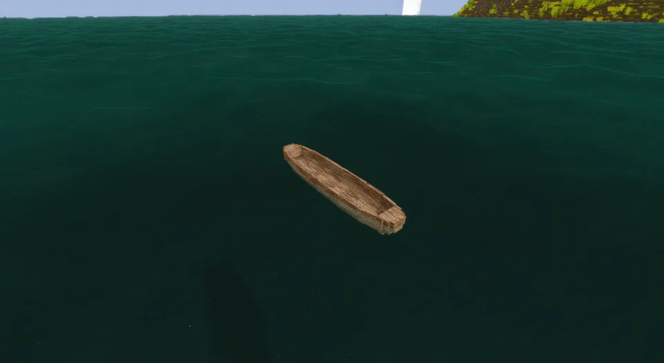

A single log, hollowed out with an axe. The bark stays on outside, the ends are left solid and blunt, and two ridges of uncut wood cross the floor to stiffen the hull. It is made from whatever wood was felled, and it looks like it: an oak dugout is oak, a pine one is pine.

## In Rough Seas

The workhorse of rivers and lakes. Nothing on the roster takes a knock like a dugout: it shrugs off rocks and bad landings that would break a bark canoe, and it needs no upkeep at all. The price is weight. It can't be picked up, so it stays where it was launched, and its narrow, round bottom makes it tippy once the sea gets up. Keep it to sheltered water and it will outlast everything else you build.

## Where it comes from

The dugout is the oldest boat we know. The Pesse canoe, dug out of a Dutch peat bog, was hollowed from a Scots pine some ten thousand years ago, and logboats turn up in the mud of almost every river and lake in Europe, Africa, Asia and the Americas. They were worked with fire and stone tools, later with metal ones, and many left solid ridges across the floor to keep the log from splitting. The model is a plain European logboat of that kind.

## By the numbers

| | |
| --- | --- |
| Speed | 1.5 × the raft, paddled |
| Turning | slow |
| [Hull](Hull-Condition) | 30 000 J in oak, more in harder [woods](Hull-Condition#what-it-is-made-of) |
| [Wear](Hull-Condition#wear) | none |
| [Mending](Mending) | 1 log of its wood restores two fifths |
| [Bilge](Bailing) | 450 litres |
| [Capsized by](Surf-and-Swamping#capsizing), in 1.0 | a 0.75 m breaker, with only 0.2 m of freeboard |
| [Rapids](Rapids) | takes a few seconds, not a long run |
| [Lightning](Lightning) | a 6000 J strike harms it about one time in five |
| [Left alone](Currents#drift) | drifts with the current and the wind |
| [Mooring](Mooring) | tied to a post |
| Carried | too heavy to pick up |
| Seats | two: the front one paddles, with its own paddle; the back one takes a passenger |
| Cargo | a basket (8 slots) in the back seat, in place of the passenger |
| Built from | 5 logs of one wood, with an axe |
| Wreckage | firewood |

## How it is built

Any wood. Redwood's logs come as sections, and it takes those.

| | |
| --- | --- |
| 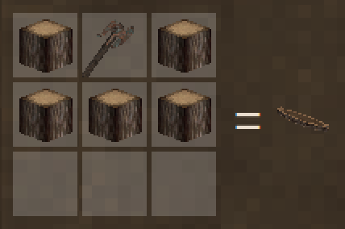 | 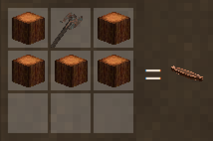 |
| From logs | From redwood log sections |

## Its neighbours

- The [birch-bark canoe](Birch-Bark-Canoe) is the other river boat: faster, carried around the falls and through the [rapids](Rapids), but holed by a landing the dugout never notices.
- The [reed boat](Reed-Boat) and the [raft](Raft) are cheaper and don't last.
- For the sea, the [outrigger canoe](Outrigger-Canoe) is a dugout made steady with a float.

## Every form it takes

| | |
| --- | --- |
| 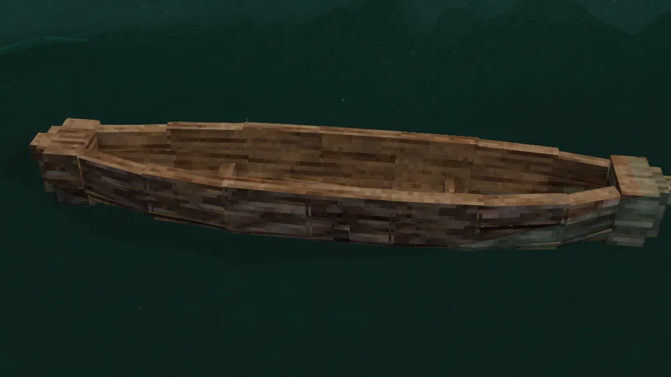 | 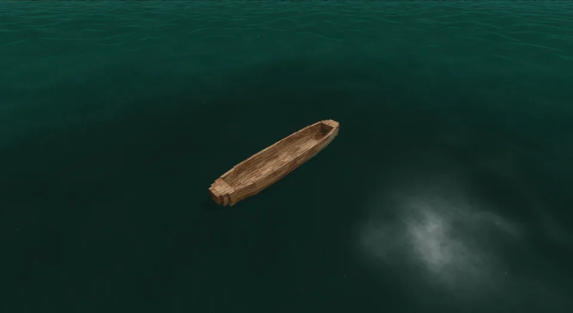 |
| Afloat, from the side | From the stern quarter |
| 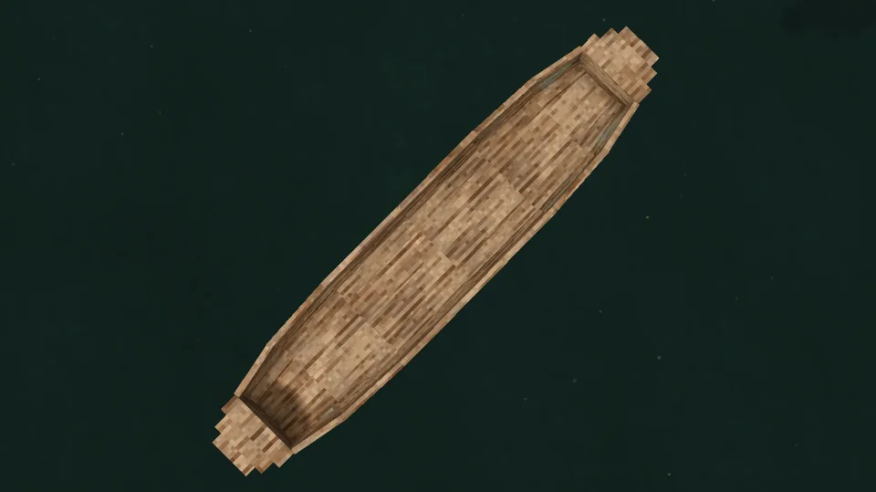 | 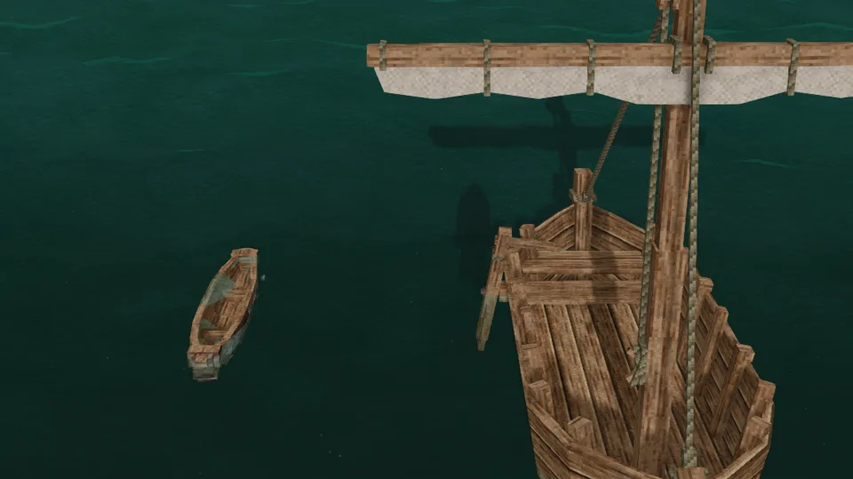 |
| From above | Beside the sailboat |
| 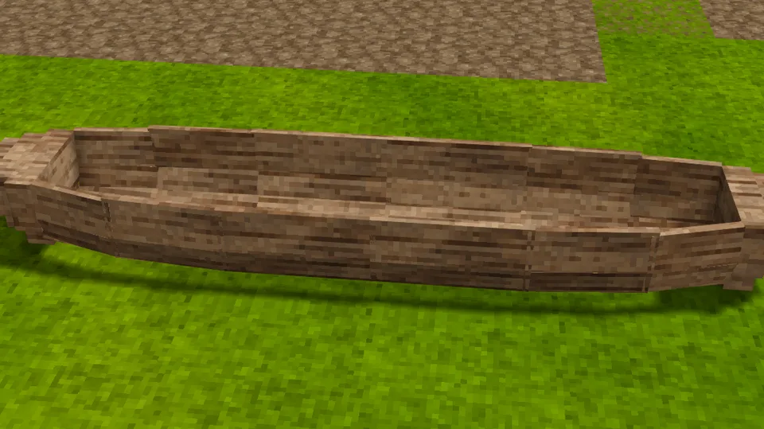 | 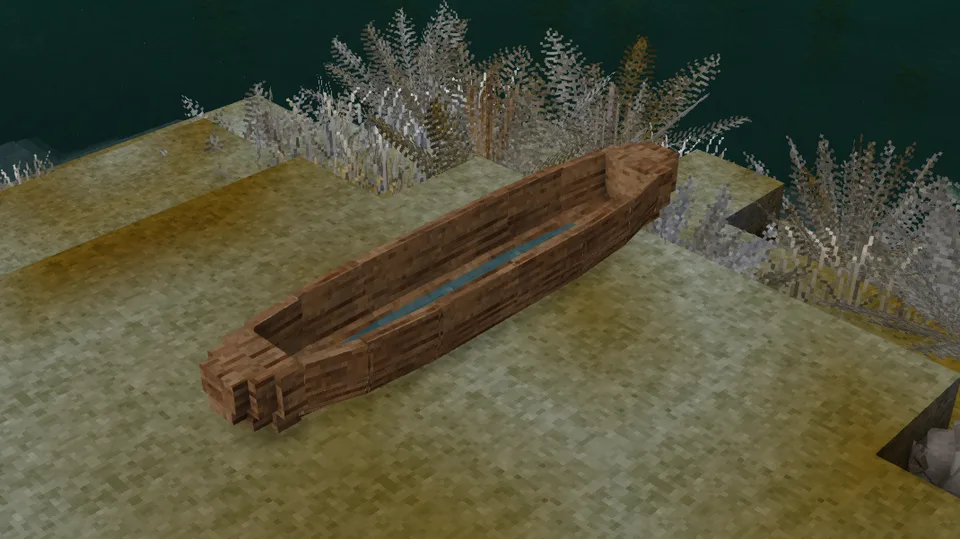 |
| Ashore | Ashore, from the quarter |
| 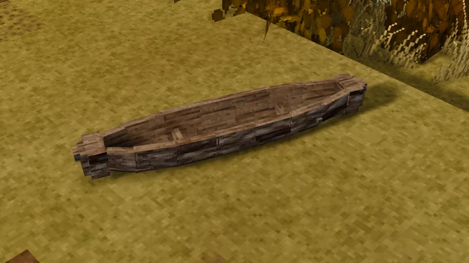 | 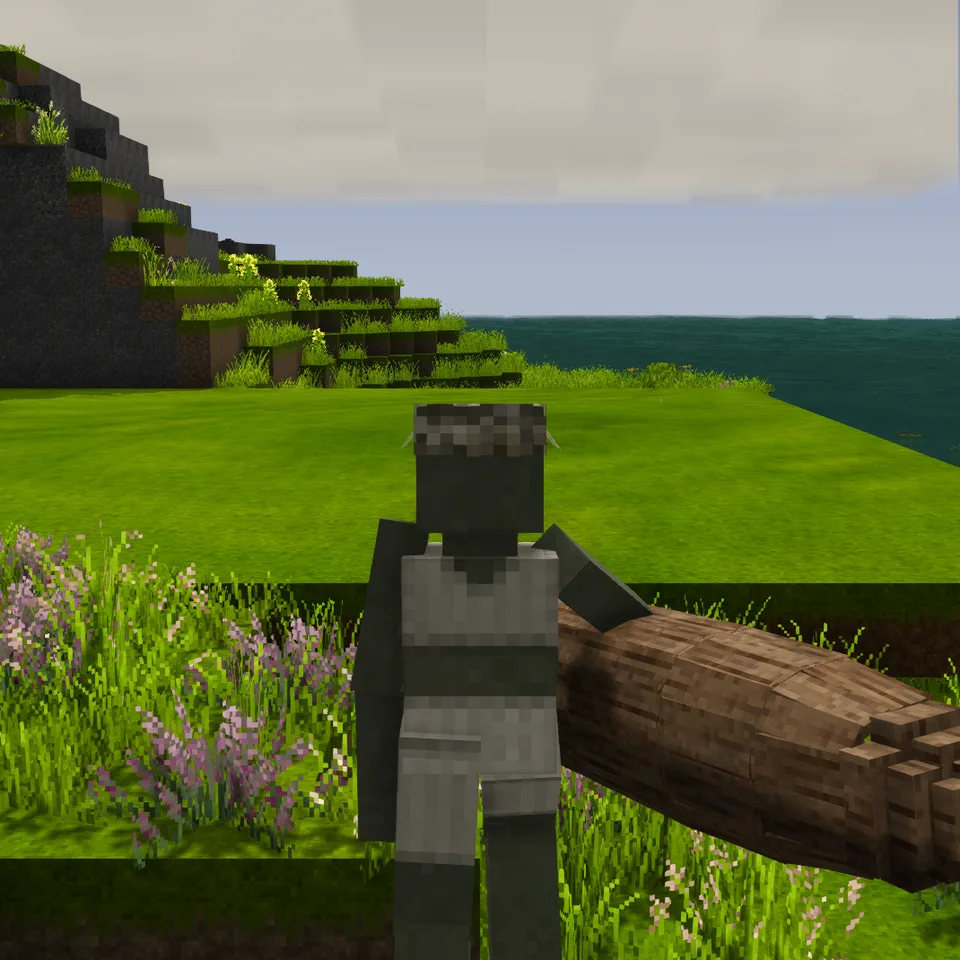 |
| Dropped on the ground | Fresh from the crafting grid, before launching |
| 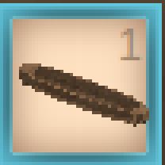 |  |
| In the hotbar | Its wreckage |
