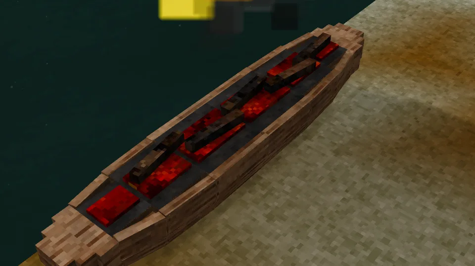
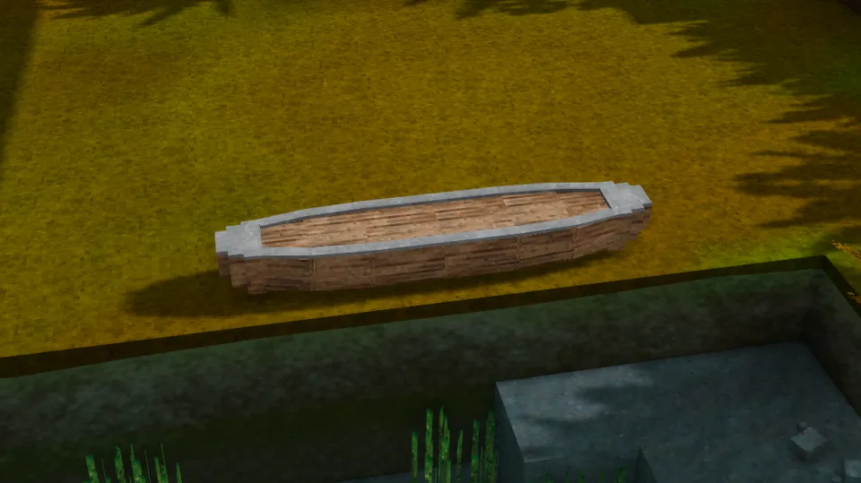
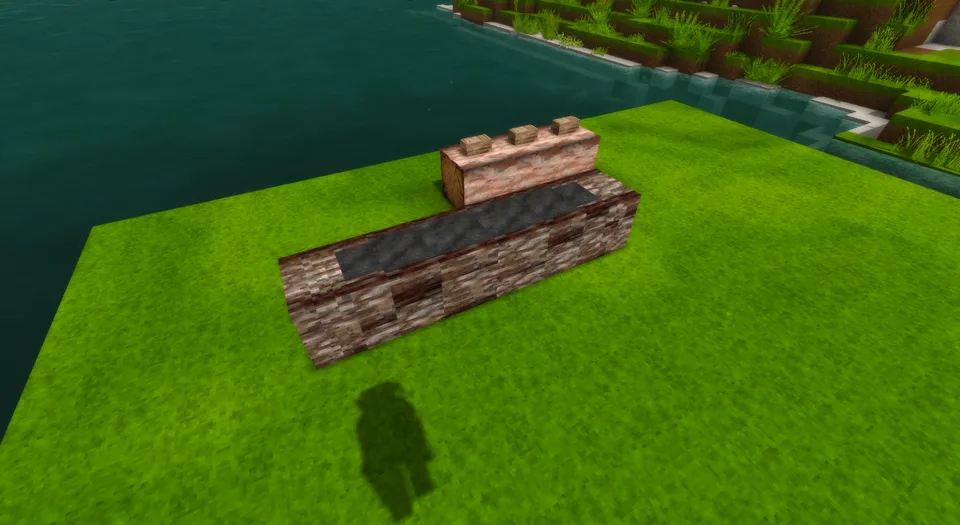

A single log, burnt and hewn hollow beside the water it floats on. The bark comes off, the sides stand steep over a round bottom, and the ends are left solid and blunt. It is made from whatever wood was felled, and it looks like it: an oak dugout is oak, a pine one is pine.

## In Rough Seas

The workhorse of rivers and lakes. Nothing on the roster takes a knock like a dugout: it shrugs off rocks and bad landings that would break a bark canoe, and it needs no upkeep at all. The price is weight. It can't be picked up: it is built on the shore and pushed in, and it stays where it was launched, and its narrow, round bottom makes it tippy once the sea gets up. Keep it to sheltered water and it will outlast everything else you build.

## Where it comes from

The dugout is the oldest boat we know. The Pesse canoe, dug out of a Dutch peat bog, was hollowed from a Scots pine some ten thousand years ago, and logboats turn up in the mud of almost every river and lake in Europe, Africa, Asia and the Americas. Where people had no metal they hollowed the log by fire, burning it a little at a time and scraping out the char with stone and shell, as John White drew the Algonquians of Roanoke doing in 1585; wet clay along the edges kept the fire in the hollow. The model follows the fire-hollowed dugouts of eastern North America and the plain logboats of Europe.

## By the numbers

| | |
| --- | --- |
| Speed | 1.5 × the raft, paddled |
| Turning | slow |
| [Hull](Hull-Condition) | 30 000 J in oak, more in harder [woods](Hull-Condition#what-it-is-made-of) |
| Upkeep | none |
| [Freeboard](Surf-and-Swamping#how-she-floats) | 24 cm empty, 20 cm with its paddler, in oak |
| [Flooded](Surf-and-Swamping#swamping) | floats awash, holding up 207 kg of gear, armour and containers in oak; sinks in a wood heavier than seawater |
| [Mending](Mending) | 1 log of its wood closes two fifths of a stove-in place |
| [Bilge](Bailing) | 450 litres |
| [Capsized by](Surf-and-Swamping#capsizing), in 1.0 | a 0.75 m breaker, with only 0.2 m of freeboard |
| [Rapids](Rapids) | takes a few seconds, not a long run |
| [Lightning](Lightning) | a 6000 J strike scratches a place |
| [Left alone](Currents#drift) | drifts with the current and the wind |
| [Mooring](Mooring) | tied to a post |
| Carried | too heavy to pick up |
| Seats | two: the front one paddles, with an [oar](https://wiki.vintagestory.at/Oar) in hand; the back one takes a passenger |
| Cargo | a basket (8 slots) in the back seat, in place of the passenger |
| Built from | 5 logs of one wood beside the water: six fires, five clay, an axe and about a week |
| Wreckage | firewood |

## How it is built

Not in the crafting grid: in the world, on the shore, the way dugouts really were made.

1. **Lay the log.** Five logs of one wood on their sides, end to end along the shore, with water in the very next blocks, level with them or a block lower. Any wood, a modded tree's too, and redwood's log sections. Five logs of mixed woods stay a wall of logs.
2. **Light it.** Light a fire on the middle log with a torch or a firestarter. The logs become a blank, and the fire chars its top for about a day.
3. **Hew out the char** with an axe, right-click.
4. **Clay, fire, hew, a day at a time.** Smear wet clay along the rim with a right-click, so that the fire eats only the hollow; light the fire again; once it burns out, hew out the char. Six fires hollow her out. Rain puts the fire out, and no fire burns in a hollow with water in it: bail it and light it again.
5. **Push her in** with Shift and a right-click, an empty hand, standing on the shore side. A heavy blank takes many pushes; a few friends push her in sooner.

She floats, and an axe breaks her up, at every stage, so a half-built dugout can be launched, or broken up for firewood. Her seats are there only once she is finished.

| | |
| --- | --- |
|  |  |
| The first fire, on the blank | Clay on the rim before the next fire |
|  |  |
| Charred, four fires in, ready to hew | Finished, ready to push in |

## Its neighbours

- The [birch-bark canoe](Birch-Bark-Canoe) is the other river boat: faster, carried around the falls and through the [rapids](Rapids), but holed by a landing the dugout never notices.
- The [reed boat](Reed-Boat) and the [raft](Raft) are cheaper and don't last.
- For the sea, the [outrigger canoe](Outrigger-Canoe) is a dugout made steady with a float.

## Every form it takes

| | |
| --- | --- |
|  |  |
| Afloat, from the side | From the stern quarter |
|  |  |
| From above | Beside the sailboat |
|  |  |
| Ashore | Ashore, from the quarter |
|  |  |
| Dropped on the ground | Held: a dugout from before the build, still an item |
|  |  |
| In the hotbar | Its wreckage |
