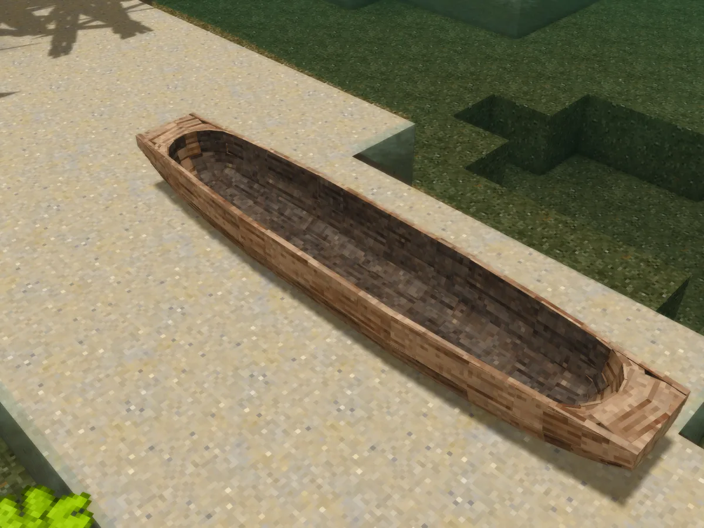

A single log, burnt and hewn hollow beside the water it floats on, from the five logs as they lay: the trunk's whole 5 m, 0.9 m wide and 0.56 m deep. The bark comes off, the sides stand steep over a round bottom, and the ends stay solid: the hollow ends in a rounded scoop, the bottom rakes up beneath each end, and above it the log's own sawn end is left flat. It is made from whatever wood was felled, and it looks like it: an oak dugout is oak, a pine one is pine.

## In Rough Seas

The workhorse of rivers and lakes. Nothing on the roster takes a knock like a dugout: it shrugs off rocks and bad landings that would break a bark canoe, and it needs no upkeep at all. The price is weight. It can't be picked up: it is built on the shore and pushed in, and it stays where it was launched, and its narrow, round bottom makes it tippy once the sea gets up. Keep it to sheltered water and it will outlast everything else you build.

## Where it comes from

The dugout is the oldest boat we know. The Pesse canoe, dug out of a Dutch peat bog, was hollowed from a Scots pine some ten thousand years ago, and logboats turn up in the mud of almost every river and lake in Europe, Africa, Asia and the Americas. Where people had no metal they hollowed the log by fire, burning it a little at a time and scraping out the char with stone and shell, as John White drew the Algonquians of Roanoke doing in 1585; wet clay along the edges kept the fire in the hollow. The model follows the fire-hollowed dugouts of eastern North America and the plain logboats of Europe.

## By the numbers

| | |
| --- | --- |
| Speed | 1.7 m/s paddled, 2.4 m/s poled ([how fast](Paddles-Poles-and-Oars#how-fast)) |
| Turning | slow, 19° a second |
| [Hull](Hull-Condition) | 30 000 J in oak, more in harder [woods](Hull-Condition#what-it-is-made-of) |
| Upkeep | none |
| [Freeboard](Surf-and-Swamping#how-it-floats) | 47 cm empty, 45 cm with its paddler, in oak |
| [Flooded](Surf-and-Swamping#swamping) | floats awash, holding up 157 kg of tools, armour and containers in oak; sinks in a wood heavier than seawater |
| [Mending](Mending) | 1 log of its wood closes two fifths of a stove-in place |
| [Bilge](Bailing) | 1436 litres |
| [Capsized by](Surf-and-Swamping#capsizing), in 1.0 | a 0.9 m breaker: its round bottom rolls |
| [Rapids](Rapids) | takes a few seconds, not a long run |
| [Lightning](Lightning) | a 6000 J strike scratches a place |
| [In a current](Currents#drift) | carried with it and with the waves, steered or not |
| [Mooring](Mooring) | tied to a post |
| Carried | too heavy to pick up |
| Seats | two: the front one paddles or poles, a [paddle](Paddles-Poles-and-Oars) or a [pole](Paddles-Poles-and-Oars) in hand, standing at its bow end to pole; the back one takes a passenger |
| Cargo | a basket (8 slots) in the back seat, in place of the passenger |
| Built from | 5 logs of one wood beside the water and an axe to strip their bark, then six fires: each takes clay for its rim (19 balls on the fresh trunk, 11 on the last), dry grass, 4 firewood and the axe; about nine days in all |
| Wreckage | firewood |

## How it is built

You don't craft a dugout in the grid: you burn it out of five logs on the shore, a fire at a time, and lay every fire as you lay a campfire. The logs stay the boat from first to last. Each hewing takes the char out of the hollow and a sixth of the outside away: the top down to a level sheer, the bottom round and the ends raked, until the squared trunk is a boat where the logs lay.

1. **Lay the logs.** Lay five logs of one wood on their sides, end to end along the shore, with water in the very next blocks, level with them or one block lower. The dugout is too heavy to carry, so you build it where it goes in. Any wood works, a modded tree's too, and so do redwood's log sections. Five logs of mixed woods stay a wall of logs.

   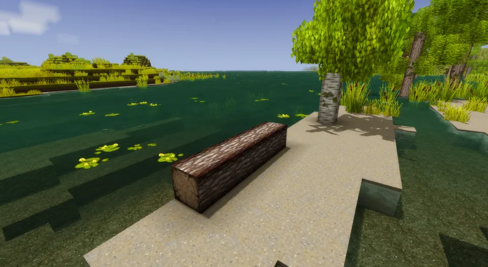

2. **Start the trunk.** Hold an axe and Shift + right-click the middle log. The logs become one trunk to work, where they lie and as they look. Until then they stay logs, so a wall of logs never turns into a boat.

   

3. **Strip the bark.** Hold right-click on the trunk with the axe. Each stroke takes the bark off one side of one log, the tops first, then each side: 15 strokes. Nothing else goes on until the trunk is bare, because the fire is laid on bare wood.

   

4. **Guard the rim with clay.** Right-click the trunk with clay, a ball at a time, until wet clay runs along both edges and over both ends: 19 balls for the fresh trunk, 13 for the next two fires, then 12, and 11 for the last two. Each ball shows where it goes, and the trunk's panel counts them. The clay is the kind you hold: blue, red or fire clay.

   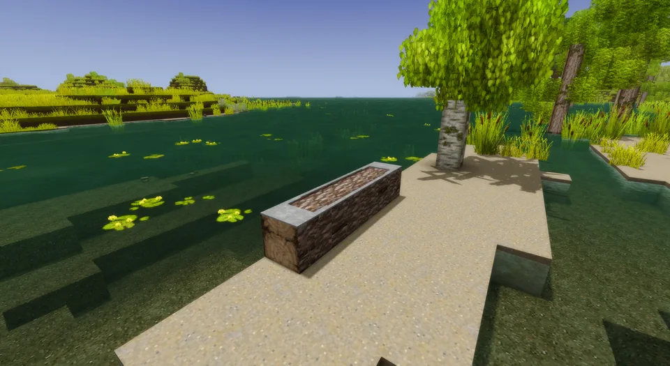

5. **Lay the fire.** Right-click the trunk with dry grass to lay the tinder, then four times with firewood. Each piece lies along the trunk where the fire will burn.

   | | |
   | --- | --- |
   |  | 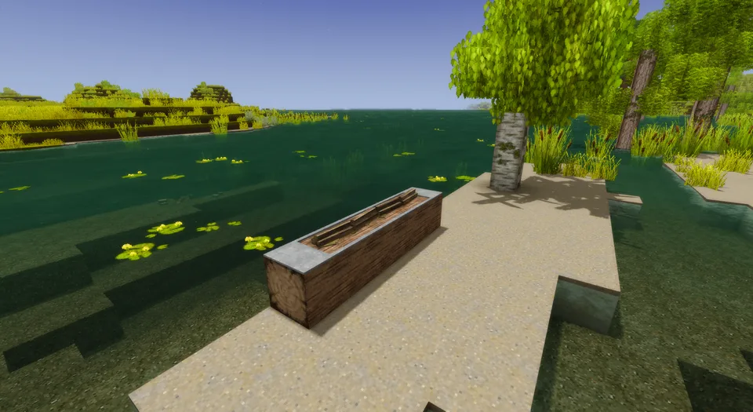 |
   | The tinder | The firewood on it |

6. **Light it.** Hold right-click on the trunk with a torch or a firestarter, as you light a campfire. A firestarter often fails: hold it again until the fire takes. The grass catches first and the wood takes in its first hour. Keep out of the hollow while it burns: it burns you as a campfire does. Then the fire smoulders for about a day and a half, with little flame and a lot of smoke, and burns down to a bed of embers that chars a hand's breadth into the wood. Rain puts it out, and no fire burns in a hollow with water in it: bail it and light it again, and it burns what it had left.

   | | |
   | --- | --- |
   | 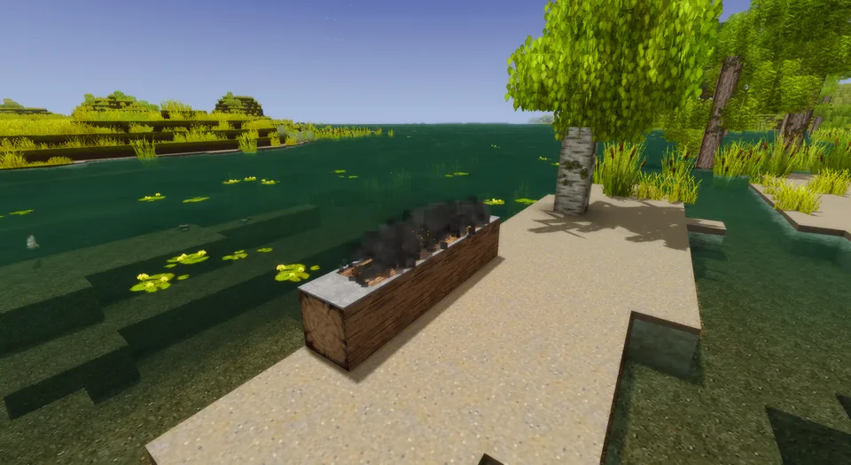 | 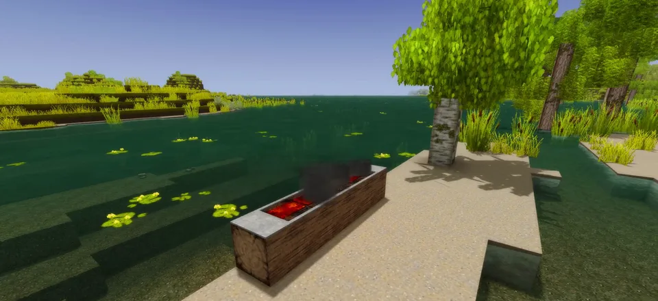 |
   | Catching | Smouldering |

7. **Hew out the char.** Once the fire is out, the wood it lay on is black with char, and the dried clay still sits on the rim. Hold right-click on the trunk with an axe: you swing again and again, and chips fly at every blow. First you cut the char out of the hollow from the bow to the stern, a third of it at a time, its floor going down to sound wood, scorched brown by the fire. Then you trim the outside back from the stern to the bow, and the rim comes down with its clay. It tires you as hard work does.

   | | |
   | --- | --- |
   |  | 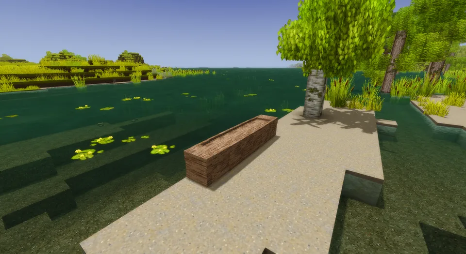 |
   | Charred, ready to hew | One fire in, hewn |

8. **Repeat until six fires have burned.** Clay the rim, lay dry grass and four firewood, light it and hew. Each fire takes the hollow deeper, and the sixth finishes the dugout.

   | | |
   | --- | --- |
   |  | 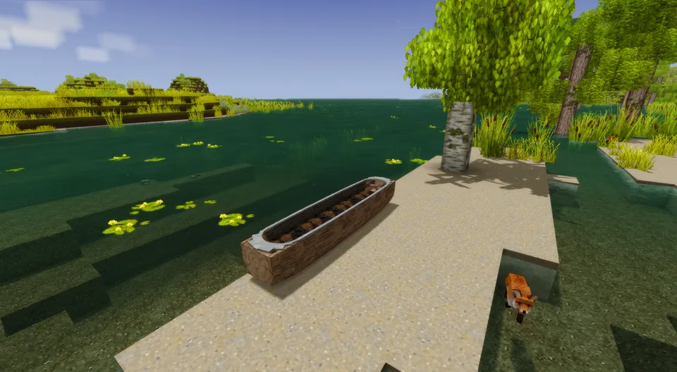 |
   | Three hewings in | Four fires in, charred |

9. **Push it in.** Walk into the dugout from the shore side. It gives way before you and slides into the water. If you slip past it before it goes in, step back onto the shore behind it and walk into it again.

   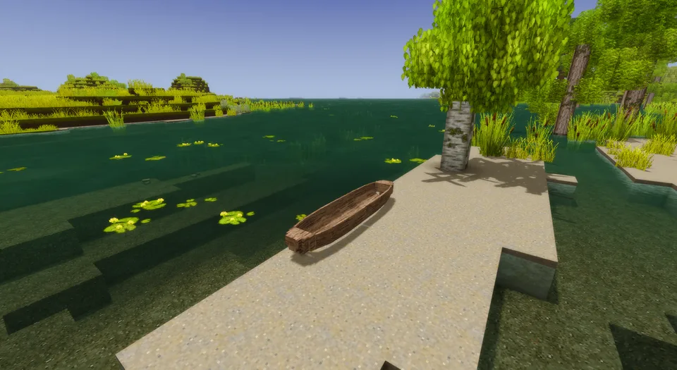

**Never light a fire without clay.** Nothing stops you, but with the rim bare the fire burns it too, and by the time it dies it has charred right through the sides. What you find is not a hollow but a crooked log, black all over: a spoiled blank. All you can do with it is break it up with an axe for firewood.

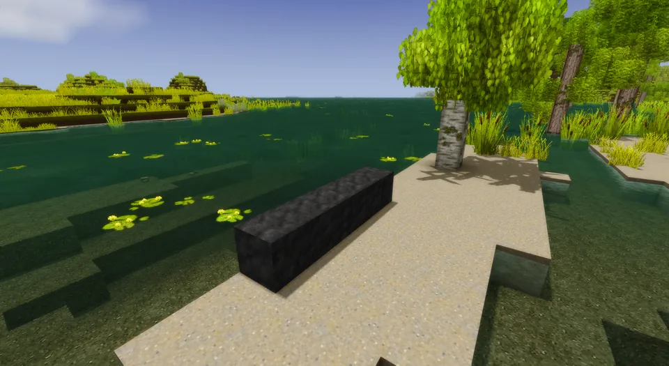

The dugout floats at every stage and an axe breaks it up at every stage, so you can launch a half-built dugout or break it up for firewood. Its seats appear only once it is finished.

## Its neighbours

- The [birch-bark canoe](Birch-Bark-Canoe) is the other river boat: faster, carried around the falls and through the [rapids](Rapids), but holed by a landing the dugout never notices.
- The [reed boat](Reed-Boat) and the [raft](Raft) are cheaper and don't last.
- For the sea, the [outrigger canoe](Outrigger-Canoe) is a dugout made steady with a float: a finished dugout is rigged into one where it lies.

## Every form it takes

| | |
| --- | --- |
| 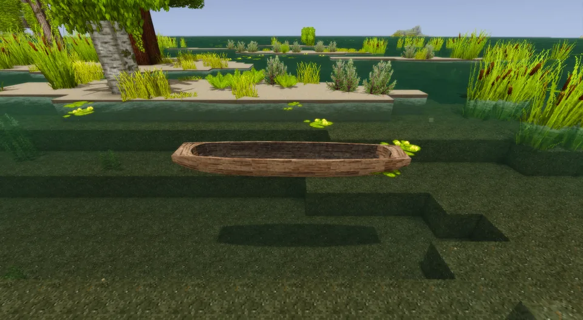 | 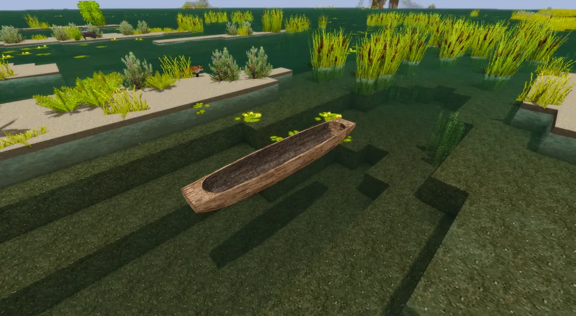 |
| Afloat, from the side | From the stern quarter |
| 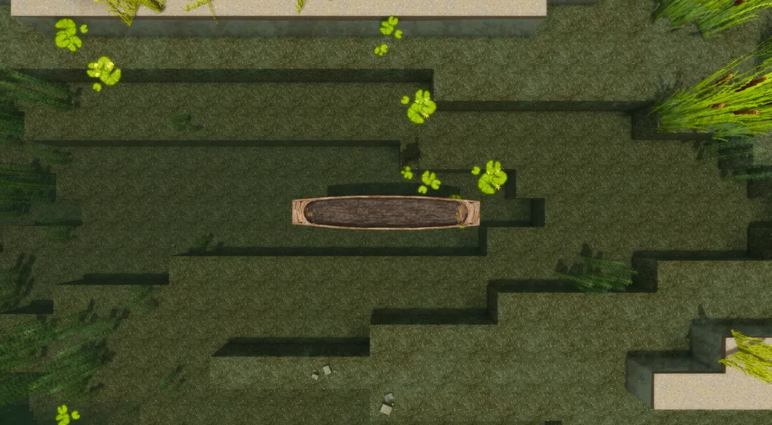 | 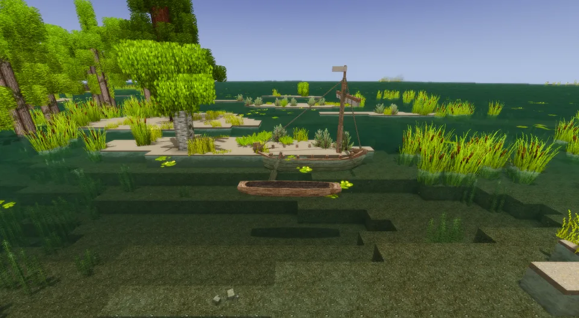 |
| From above | Beside the sailboat |
| 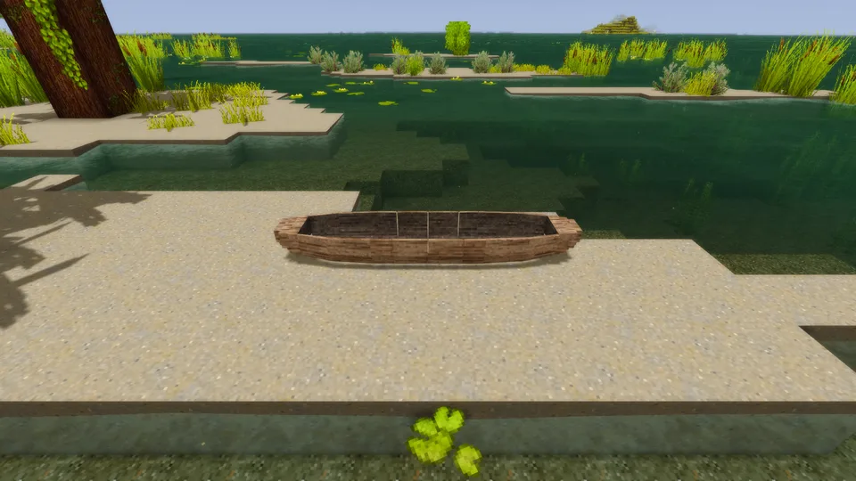 | 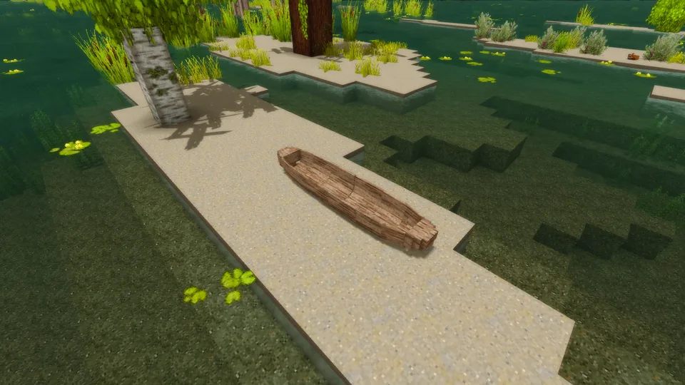 |
| Ashore | Ashore, from the quarter |
| 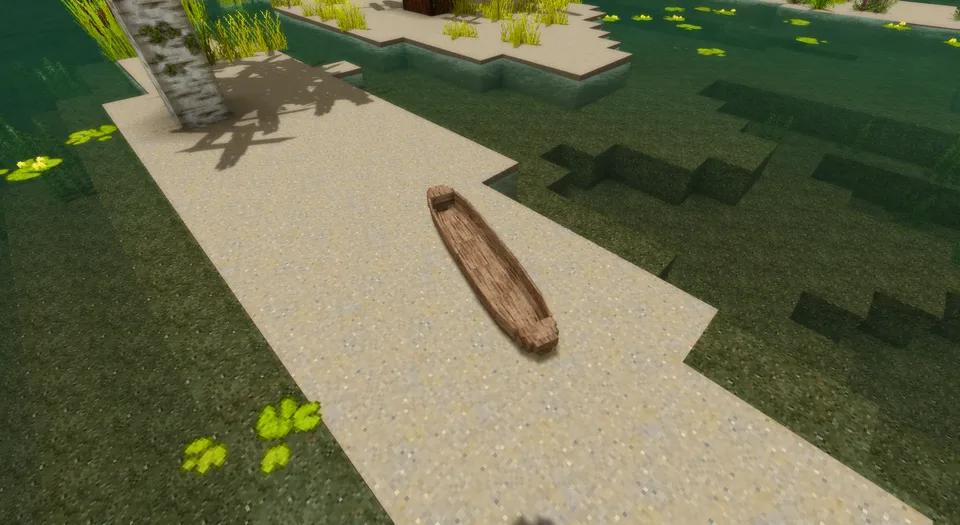 | 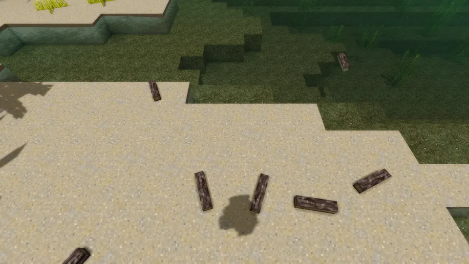 |
| Dropped on the ground | Its wreckage |
| 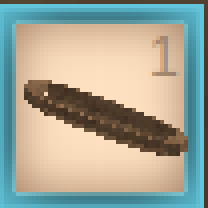 | |
| In the hotbar | |
