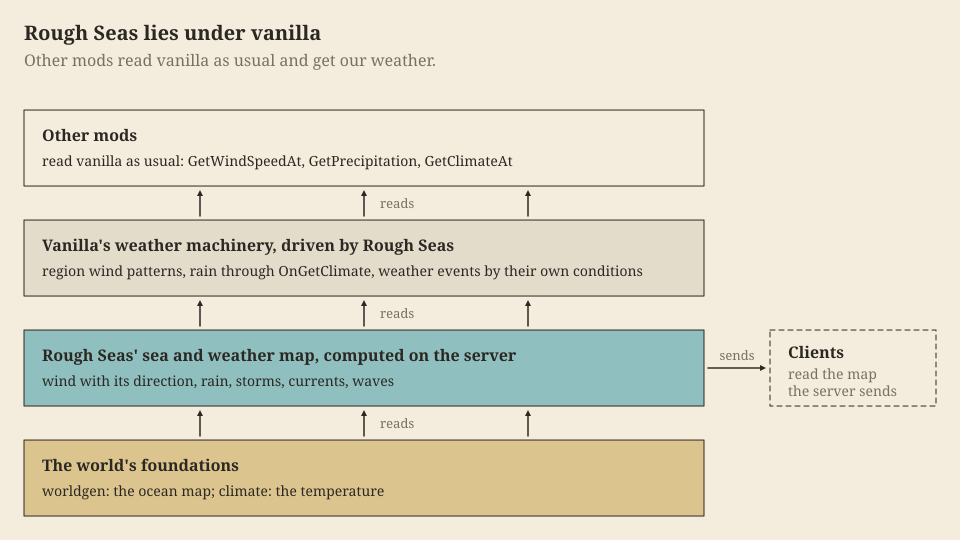

Rough Seas keeps one model of the world's wind, waves, storms and currents, computed on the server from the world's own climate and ocean map. The rest of the game meets that model in three ways, and a mod meets it in the same three.

- **Through vanilla.** We don't replace the game's weather; we drive it. Each region's wind pattern, the rain and the weather events still come out of vanilla's machinery, set from our model. So a mod written for plain Vintage Story reads our weather without a line about us. A mod that moves a lever vanilla itself has, drying the world or shifting its temperature, gets the answer vanilla would give; a mod that sets the weather in vanilla's place changes what vanilla reports, not our sea ([Reading the weather](Reading-the-Weather#what-moves-our-sea)).
- **Through our own code.** Vanilla has no place for the wind's direction, for waves or for currents. We publish them from our own types, on both sides: the sea state, and on a client the drawn sea, its picture of the waves.
- **Through behaviours.** A vessel takes our sea by carrying our entity behaviours, configured in JSON: it floats by its mass, ships water, cracks, floods, moors and drifts. No code.

## The pages

Each page covers one part, for the mod that touches it; read the ones yours does.

| Your mod | Read |
| --- | --- |
| reads the wind, rain or temperature, or changes them | [Reading the weather](Reading-the-Weather) |
| adds weather events | [Weather events](Weather-Events) |
| sets a region's wind pattern | [Wind patterns](Wind-Patterns) |
| reshapes the oceans, or calls vanilla's ocean layer | [The ocean map](The-Ocean-Map) |
| reads the wind's direction, waves, storms or currents: a helm, a sail, a fish | [Reading the sea](Reading-the-Sea) |
| poses a vessel of its own on the swell a client draws | [Reading the sea](Reading-the-Sea#the-drawn-sea) |
| adds a vessel, or gives ours its behaviours | [Building a vessel](Building-a-Vessel) |

Where a page touches physics, it says what the mod does and links [The science behind it](The-Science-Behind-It) for why.

## What we keep

What these pages document is what we keep: vanilla's channels as they describe them, `ISeaWeather` with `SeaState`, `SeaCurrent` and `SeaClock`, `IDrawnSea` with `SeaPose` and `HullResponse`, and our vessel behaviours with their keys and their configs. It follows semantic versioning: a change that breaks any of it comes with a new major version and a line in the release notes, and what we add comes in a minor version. If you build on it, or need something it doesn't give, tell us on the [issue tracker](https://github.com/hoblin/rough-seas/issues).

### Hulls that crack, leak and flood

Hulls that crack, leak and flood changed the vessel keys, so they came as a major version. What a vessel of yours built before them needs to change:

- `roughseas:vesselintegrity` loses `wearPerDay`: a reed hull's [`soak`](Building-a-Vessel#the-hull) and a cracking hull's `seep` take its place. A mend's `restores` now closes that much of one place's crack, or of a lashed hull's lashing; with `greases`, it is the share of `seep.greaseDays` it gives back.
- `roughseas:bilge` loses `sinks`: a swamped vessel sinks by its [buoyancy](Building-a-Vessel#floating).
- `roughseas:seaforces`' `freeboardMetres` counts only for a vessel that doesn't float by its mass, one with no `depthMetres` on its `vesselintegrity`.
- `config/vessels/impact.json` is now `config/vessels/mass.json`, with `crewKg` added; a patch to it follows the rename.
- A carried vessel's hull travels on its item as the stack attribute `roughseas:vessel`; `roughseas:worn` is gone.

New: the hull `model`, `parts[].share`, `depthMetres`, `waterplaneSquareMetres`, `seep`, `soak`, the `density` of a material, `config/vessels/hull.json`, the `response` block of `config/storms.json`, and [`HullResponse`](Reading-the-Sea#how-a-hull-answers). A world from before keeps its vessels: a raft takes its old condition as its lashing, a reed boat as water soaked up, and a cracking hull starts sound; a vessel carried as an item does the same from its durability.

### Blows by their physics

In 3.1 every blow meets what really takes it ([The hull](Building-a-Vessel#the-hull)). No key was removed, so a vessel of yours loads as it did, but it fares differently:

- `impactCapacity` is what a broad load (a knock, a ram, rapids, a blast) must reach to break the hull up, and a smaller one cracks its place by its share; on a `reed` hull too, which now tears.
- Two hulls with `vesselintegrity` ram each other; `minImpactSpeed` is the speed they take in their stride.
- Without a `shell`, the frame's capacity resists point blows and cuts too, and breakers, now a pressure against the planking, don't harm the hull. Give it a [`shell`](Building-a-Vessel#the-hull) for both.
- `Struck`'s second value is the blow over what resisted it, which is the shell for a point blow, a cut or a breaker, no longer always the hull's capacity. Its knock is `Harmed` only when the place came to a worse stage.

New: the vessel's `shell`, `config/vessels/damage.json`'s `broadSources`, `cutShare` and `variation`, a material's `toughness` and `cutToughness`, and `hull.json`'s `soakedStrengthShare`. Gone, never documented here: `config/storms.json`'s `waves.breakerTransfer`, `waves.periodSecondsPerRootMetre` and `ashore.impactFactor`.

### One sea, one clock

In 3.2 every client draws the same waves, and everything at sea keeps one clock ([The sea's time](Reading-the-Sea#the-seas-time)). A vessel of yours loads as it did, but code that reads the time changes:

- `ISeaWeather.NowHours` gave way to `ISeaWeather.Clock`, a `SeaClock`: its `Hours` is the old value. A mechanic of yours at sea that keeps a watch of it stands still and races with the calendar, as ours do.
- `IDrawnSea.Seconds` is the waves' time, the same on every client, so a mod that rides our swell needs no clock of its own.
- Waves come aboard, bilges fill and leaks run by game time, so a vessel near a sleeping player lives through the night.

Gone, never documented here: `config/storms.json`'s `lightning.checkSeconds`, and in `config/soundscape.json` the `water.lapping` loop and `shore.lappingSound` and `lappingStrength`. A hull's splash is `water.splash` now, and the slaps take a `volumePerMetre`.

### Heave by mass

In 4.0 a vessel with a draft heaves by its own mass ([Floating](Building-a-Vessel#floating)), and what it drags with it comes from its form. A vessel of yours loads as it did; code that reads the heave changes:

- `HullResponse.HeavePeriod(draftMetres, config)` gave way to `HullResponse.HeavePeriod(kg, addedKg, kgPerMetre)`; `HullResponse.Of` keeps its arguments.
- `config/storms.json`'s `response.heaveAddedMass` is gone: `HeaveAddedMass` gives the water from a hull's waterplane.
- `IBuoyant.SettlingMetres` is gone; `ReferenceDraftMetres`, `KgPerMetre` and `AddedKg` are new. `IOutboard` adds `WaterplaneSquareMetres` and `LengthMetres`.
- Vanilla's `swimmingOffsetY` now sets the vessel's keel: vanilla's `Swimming` means its keel is wet.

### Dugouts built in place

The dugout is burnt and hewn out of five logs on the shore ([Built in place](Building-a-Vessel#built-in-place)), and its grid recipes are gone. No key was removed, so a vessel of yours loads as it did.

- The dugout's rower holds what drives it, as on vanilla's raft: the dugout sets `requiresPaddlingTool`, and its strokes are its own for each tool ([Paddles, poles and oars](#paddles-poles-and-oars)).
- `roughseas:bilge`'s `capacityLitres` is what the finished hull holds; while it is built, it holds what is cut out of it.

- An axe starts it: Shift + right-clicked on the middle log of a row, it lays the blank. Anywhere else an axe does what vanilla does.
- Every axe in the game, a modded one too, carries our collectible behaviour `roughseas:hew`, so that holding it on a blank strips its bark and on a charred blank hews.
- Rain on a vessel, in its bilge and drying it ashore, is what `WeatherSystemBase.GetPrecipitation` reads, as vanilla's fires do, and nothing under a roof.

New: the behaviour `roughseas:burnout` with its keys, the collectible behaviour `roughseas:hew`, and the watched tree `roughseas:build` on a vessel being built.

### Bark canoes framed in place

The bark canoe is stripped off a standing tree and framed where it lies ([Framed in place](Building-a-Vessel#framed-in-place)), and its grid recipe is gone. No key was removed, so a canoe of yours loads finished, and the bark from a log still mends it.

- The bark canoe's rower holds what drives it, as the dugout's does: the canoe sets `requiresPaddlingTool`, and its paddler kneels. Its own built-in paddle is gone; its strokes are its own for each tool ([Paddles, poles and oars](#paddles-poles-and-oars)).
- A knife held on a standing birch, elm or spruce trunk strips it: the trunk becomes our `roughseas:debarkedtrunk-{wood}`, which keeps the grown log's tree-felling group, its spread and its hold on the leaves, and drops vanilla's debarked log. A mod that looks for `log-grown-*` to find a trunk misses a stripped one.
- Rope held on a canoe still being lashed lashes the canoe instead of tying itself to it: a Harmony prefix on `ItemRope.OnHeldInteractStart`. Once its lashing is done, rope ties to it as before.
- Rope and every liquid container in the game, a modded one too, carry our collectible behaviour `roughseas:framing`, and our laths carry it by their JSON, so that holding them on a canoe being built lays its next piece.
- A vessel picked up keeps its build on the item, as it keeps its hull's condition, under the stack attribute `roughseas:build`; the item of a framed vessel carries our collectible behaviour `roughseas:carriedbuild`, which draws the vessel as far as it is built and in its laths' wood.

New: the behaviour `roughseas:framing` with its keys, the collectible behaviour of the same code, the items `roughseas:lath-{wood}-{dry|wet}` and the blocks `roughseas:wedge-{we|ns}` and `roughseas:debarkedtrunk-{wood}`.

### Outriggers rigged on a dugout

The outrigger canoe is a finished dugout rigged where it lies ([Rigged in place](Building-a-Vessel#rigged-in-place)), and its grid recipes are gone. Its code is still `roughseas:outrigger-{wood}`, the wood its hull's, so an outrigger of yours loads finished, its float and poles of that wood.

- Its hull is the dugout's: its shape, shell, collision boxes, seats, bilge and `impactCapacity`. Its washstrakes and platform, sawn planks, are gone, and with them its old `hullBox`. A patch that addressed its old shape's elements or its selection boxes by index misses: its boxes are the dugout's three, then `LowerMastAP`.
- Its rower holds what drives it, as the dugout's does: the outrigger sets `requiresPaddlingTool`, and its strokes are its own for each tool ([Paddles, poles and oars](#paddles-poles-and-oars)). Its own built-in paddle is gone.
- It mends with a log of its hull's wood, and breaks into firewood, a rope and linen.
- A pole held on a finished dugout with a row of three logs alongside replaces the dugout with a new outrigger entity: a mod that keeps a dugout's entity id sees it die (`EnumDespawnReason.Removed`). The dugout's cracks and bilge go across through `IHandedOver`; ropes tied to the dugout do not.
- `roughseas:framing`'s `framePart` now names a part by its new `name` key, not by its material: the bark canoe's frame part is `"name": "frame"`.
- Axes and cloth carry our collectible behaviour `roughseas:framing` too, as rope does.
- The wedge's `laths` and `lath` attributes are now `splits`: what a row of so many wedged logs splits into, five into laths, three into poles.

- `IHullForm` grew `Wrecked`, `UnhewnLitres`, `DepthMetres` and `WaterplaneSquareMetres`, and `Hollowed` became `HoldLitres`: what a vessel being built breaks into, the wood it still carries outside its hull, and its depth, waterplane and hold so far. A vessel with a mast that stands only once stepped implements the new `IMasted`. An implementation of yours returns the designed values to keep its behaviour.
- The dugout is the five logs from first to last: 4.5 m long, 0.9 m wide, 0.56 m deep, a 1298-litre hold and 252 kg in oak, against 400 kg and 450 litres before. Its shape's stage groups are each level's whole trunk, `Clay{n}` each fire's rim, and `Shell` the finished hull; the item hides the stages as before. A dugout of yours loads as it was, at its new size.
- The outrigger takes optional washstrakes, sawn planks: `roughseas:framing`'s stages may be `optional` and raise its side and hold. One saved without a build has them on.

New: the behaviours `roughseas:riggable` and `roughseas:rigging` with their keys, `roughseas:framing`'s works `pole`, `hew`, `cloth` and `plank` and its keys `replaces`, `optional`, `raisesMetres`, `raisesLitres`, `part` and `texture`, `roughseas:burnout`'s keys `blankDepthMetres`, `blankWaterplaneSquareMetres` and `unhewnLitres`, a part's `name` and `takesKnocks`, and the items `roughseas:pole-{wood}`.

### Reed boats bound in place

The reed boat is bound from two reed bundles laid side by side ([Bound in place](Building-a-Vessel#bound-in-place)), and its grid recipe is gone. Its code is still `roughseas:reedboat`, so a reed boat of yours loads finished, with its ends bound up and its soak as it was.

- It is a float of two 19 cm bundles: 3 m by 0.36 m, 0.19 m deep, 50 kg, its rider 5 cm above the water. Its shape, collision boxes and seat height changed, and its `Hull`, `FrontSeat` and `Cargo` elements with them; a patch that addressed its old shape's `Port`, `Starboard`, `Core` or `Binding` elements misses. Its `soak` and the `reed` material's density changed with it ([why](The-Science-of-the-Hull)).
- Its rower holds what drives it: the reed boat sets `requiresPaddlingTool`, and its strokes are its own for each tool ([Paddles, poles and oars](#paddles-poles-and-oars)). Its own built-in paddle is gone.
- `roughseas:framing` no longer needs a vessel of a wood, and strips a tree only when it has `barkSeconds`.
- The help text `roughseas:shipyard-lash` now reads "Lash it with rope" on every framed vessel.

New: the block `roughseas:reedbundle` of class `roughseas:BlockBundles` ([its codes](#reed-boats-of-the-plant-they-were-bound-from)) and the behaviour `roughseas:droop`.

### Coracles and currachs laid out on the ground

The coracle and the hide currach are laid out as laths on the ground and built where they lie ([Laid out on the ground](Building-a-Vessel#laid-out-on-the-ground)), and their grid recipes are gone. Their codes are still `roughseas:coracle` and `roughseas:currach`, so one of yours loads finished, the currach the right way up, both covered in prepared hide.

- The coracle's built-in sculling paddle is gone: the coracle sets `requiresPaddlingTool`, and its sculler holds a paddle. The currach sets it `false` and is rowed with its own oars ([The currach rowed facing its stern](#the-currach-rowed-facing-its-stern)). Their strokes are their own for each tool ([Paddles, poles and oars](#paddles-poles-and-oars)).
- Their shapes are new: the coracle a Teifi basket of a lattice and a plaited gunwale, 1.5 by 1.07 m, with no seat board; the currach double-ended, 4.76 by 1.2 m, with ribs, stringers and a thwart pole in place of its transom, floor and stem post. A patch that addressed their old elements misses. Their bilges hold 272 and 1911 litres, and they weigh 17 and 88.5 kg.
- Laths and poles have a length: `roughseas:lath-{wood}-{2|3|4|5}-{dry|wet}` and `roughseas:pole-{wood}-{2|3|4|5}`, no longer `lath-{wood}-{dry|wet}` and `pole-{wood}`. A row of two to five wedged logs splits into 64 poles as long as it; the wedge's `splits` list one per row length. An axe splits a pole into 16 laths of its length in the crafting grid (`recipes/grid/laths.json`). Their name takes the length as `{1}`.
- Every piece of a `lath` or `pole` stage names its length in the shape, a `"metres"` key on its group, and takes a lath or pole at least that long. The bark canoe's and the outrigger's pieces name theirs too.
- `seep`'s `litresPerHour` is now `litresPerHourASeam`: a cover seeps at every seam between hides. A cracking hull's new `cover` gives the hides of one from before its build; `config/vessels/hides.json` gives each hide's keeping afloat and the water it takes up, and a patch can change them.
- `IAfloat.Pass` takes the water's temperature, and a hull whose cover is sewn on it as it is built implements the new `ICovered`.
- Hides carry our collectible behaviour `roughseas:framing`, as rope does. Laths go down with Shift in vanilla's ground storage, wet or dry ([Poles and laths piled on the ground](#poles-and-laths-piled-on-the-ground)), and rope held on a pile that starts a vessel binds it rather than doing what vanilla's rope does.

New: the behaviour `roughseas:covering` with its keys `start`, `overturned` and `overturnedPivot`, `roughseas:framing`'s work `hide` and its keys `bends`, `hides` and `hideStates`, `roughseas:vesselintegrity`'s key `cover`, the interface `ICovered`, and `config/vessels/hides.json`.

### Every build without a jump, every hull by its model

Each vessel built in place now changes the way the work would, and floats by numbers measured off its model ([why](The-Science-of-the-Hull#floating)).

- The weights, depths, waterplanes, holds, decks and `swimmingOffsetY` of the dugout, outrigger, bark canoe, coracle and currach changed. The dugout's walls are 5 cm and its blank is the square trunk: `unhewnLitres` 3329, `blankWaterplaneSquareMetres` 5, `hollowDepthMetres` 0.5125, `hollowBeamMetres` 0.8. A patch that set these numbers sets them against its new model.
- The outrigger's float is hewn from its three logs in six passes: its stage `Ends` and the groups `Float` and `Blunt` are gone, and `Hewing` (a `successive` stage replacing `FloatLog`) comes after `Booms`, whose pieces follow it (`follows`). Its washstrakes' end pieces are boards across its hollow, and the washstrakes add 422 litres, its measured opening 15 cm higher. The bark canoe's and the currach's holds stop at the lowest point of their gunwale, where water first spills over: 609 and 1911 litres. The outrigger's texture codes `floatbark` and `floatrings` draw the logs, in the float's wood. A dugout off the block grid is squared onto the logs when rigged, turned and moved so the float lies on them, no end of it more than half a block; one turned further from the row isn't rigged.
- The bark canoe's sheet is 5 m long. Its stages are `Frame` (inwales and thwarts), `Slashes` and `Ends` (knife cuts, work `cut`) and `Outwales`, before its stems; all four lift its `Skin` group, one child a level, `Skin1` to `Skin13`, and its frame pieces show from `Frame{n}At{k}` and `Outwales{n}At{k}`. The finished canoe's item is drawn by `roughseas:carriedbuild` too, which shows only its last step.
- The currach's gunwale pieces show from `Gunwale{n}At{k}`, its stern ends apart until its second end lashing.
- A hide bigger than what is left of a cover gives back the rest as smaller hides of its kind. `Laying.Spend` has an overload taking the pieces the work used.
- A reed boat's ends sag over the soak it takes before it sinks with nothing aboard, not over its full saturation. The interface `ISoaking` is gone; `EntityBehaviorVesselIntegrity.SoakToSinkKg` gives that soak.
- A refused piece logs a `[shipyard]` line once a hold.

New: `roughseas:framing`'s stage keys `successive`, `follows` and `lifts` and its work `cut`, the shape key `depthMetres` on a lifted group's steps, `roughseas:rigging`'s key `floatStage`, the shape keys `woodLitres` and `waterlineSquareMetres`, and `bin/lib/hulls/physics.py`, which prints what each builder measures.

### Paddles, poles and oars

A paddled, poled or rowed vessel goes as fast as its rower drives it against the water's drag on it ([Driving it](Building-a-Vessel#driving-it)), and the tools that drive it are items of their own.

- Our vessels no longer carry `speedMultiplier` or `turnSpeed`: their speed and turn come from our behaviour `roughseas:propulsion`, which vanilla's raft gets by patch. A Harmony postfix on `EntityBoat.SeatsToMotion` hands any boat that carries it to the behaviour; vanilla's sailboat and every other mod's boat move as before. Under sail, vanilla's motion stands.
- While someone holds a vessel's controls and it is not under sail, the behaviour's own drag takes the water's place along the surface: a prefix on `EntityBehaviorPassivePhysics.MotionAndCollision` gives back what vanilla's water drag takes from its horizontal motion, and leaves it on its vertical motion, which it keeps damping. `WaterDragValue` itself stays vanilla's.
- What the rower spends is the behaviour's `EffortWatts`, the power his body gives while he strokes, and `Stroke`, the stroke he makes; until a stamina of our own takes it, the effort costs him satiety.
- Vanilla's crude oar carries `roughseas:propulsion` as a 2 m pole, and its `tpHandTransform` is ours, so it lies in the hand where our strokes put a pole.
- Each vessel's rower has strokes of his own for each tool, `roughseas-{vessel}-{pole|paddle}-{ready|forward|backward}`, in `patches/player-{vessel}.json`, the raft's too; they key `ItemAnchor` to hold the tool where the stroke puts it. The currach's are `roughseas-currach-{ready|forward|backward}` again, with its own oars and thole pins.
- Every vessel of ours has an `Oar Storage` slot, its box `OarAP` after its others; the coracle takes `rideableaccessories` for it.
- The pole is drawn at its length: `shapeByType` takes `item/pole-{2|3|4|5}` and its attributes are by type. The shape `item/pole` is gone.
- The currach's build ends with a stage `Oars` of the new work `oar`, two `roughseas:tholeoar-{wood}`, and its `parts` gain `oars`; `roughseas:covering`'s new key `oars` names what that stage takes. With them it weighs 88.5 kg.
- The hull's drag law, `HullDrag` with `WaveMaking`, lives with the hull, and a vessel's size for it is its `Hull` box, which a client now measures once its selection boxes load rather than keeping its entity's selection box for good.

New: the behaviour `roughseas:propulsion` with its keys, the items `roughseas:paddle-{wood}` and `roughseas:tholeoar-{wood}`, the item attribute `roughseas:propulsion`, `config/propulsion.json` and `config/vessels/drag.json`.

### Damage drawn in the model

Our vessels draw each place's crack in their own model, from a scratch to a hull stove in, and an outrigger's float takes the knocks on its side on its own lashings ([Building a vessel](Building-a-Vessel#the-hull)). A vessel of yours loads as it did, its overlay still drawn from `damage.textures`.

- Our dugout, outrigger, bark canoe, coracle and currach dropped `damage.textures`: their wounds are `Wound{Place}…` groups in their shapes, and a patch to their shapes must keep them. Only `wood` and `reed` overlays are left; the `bark` and `hide` ones are gone.
- A knock on an outrigger's float side no longer cracks its starboard side: it goes to `IOutboard`, `roughseas:floatlashing` on ours, whose lashings live in `roughseas:vessel/float`. So do a blast's and lightning's broad load landing outside its hull on that side; a blade or a club there only chips the float. An outrigger saved before has its lashings whole.
- Once those lashings give out the outrigger is replaced by a dugout (`EnumDespawnReason.Removed`), as rigging replaced the dugout before. The outrigger's riders keep their seats; what its accessory slots held drops beside it.
- `HullDamage.Visible` is `Overlaid`, true only while an overlay is drawn.
- Two vessels meet where either one's `IHull.Reach` touches the other's: its hull out to what stands off it, so a vessel that crosses only an outrigger's float rams the float. The knock's direction is still taken from the hulls, or toward the outboard when only it was met.
- `HullShape.PointOf` sets each port place a little toward the bow and each starboard place toward the stern, so a leak no longer starts at the mirror of the other side's.

New: `IOutboard` with `OffMetres`, `IHull.Reach`, `HullShape.Spanning`, `EntityBehaviorVesselIntegrity.Impact`, `HullDamage.Hidden`, the behaviour `roughseas:floatlashing` with its keys, and `roughseas:rigging`'s `lashing`.

### Paddling on both sides

A paddle works on one side and turns the vessel away from it, and the paddler changes sides to hold a course or to turn it ([Driving it](The-Science-of-the-Hull#driving-it)). A vessel of yours loads as it did.

- A paddled vessel's `strokes` hold `paddle-starboard` and `paddle-port` in place of `paddle`, each with a fourth animation, `change`, that carries the paddle over to that side: `roughseas-{vessel}-paddle-{starboard|port}-{ready|forward|backward}` and `roughseas-{vessel}-paddle-to-{starboard|port}`. A vessel whose `strokes` keep a bare `paddle`, the coracle sculling over its bow, is paddled on no side. A patch that played or replaced `roughseas-{vessel}-paddle-{ready|forward|backward}` misses.
- The vessel's new key `paddleAbeamMetres` is how far out from its middle the blade drives: the blade's thrust turns the vessel by that lever. Without the key a paddle drives it straight, as before.
- The side is decided on the server, which syncs it to every client in the vessel's watched attributes `roughseas:paddleSide` (−1 starboard, 1 port) and `roughseas:paddleChanging`.
- `HullDrag.Turning` takes the vessel's speed through the water: under way a hull resists turning in proportion to it, so every vessel turns on a wider circle while it makes way than before, and spins on the spot as before. `Propulsor.Push` takes the `Side` the tool works on.
- `config/propulsion.json`'s `paddling` stroke gains `veerDegrees`, how far off its course the vessel goes before the paddler changes sides.

New: the enum `Side`, the class `Paddler`, the keys `paddleAbeamMetres` and `veerDegrees`, and the watched attributes `roughseas:paddleSide` and `roughseas:paddleChanging`.

### Poled standing

- `roughseas:propulsion`'s `handsAboveWaterMetres` moved into its new `pole` object, with the `stroke` the pole makes and the `stance` the rower takes to work it ([Driving it](Building-a-Vessel#driving-it)). A patch that set the old key sets nothing.
- With a pole in hand, the rower's seat changes while the rower holds the vessel's controls: its `RiderOffset`, `Animation` and `EyeHeight` become the stance's, and go back when the rower puts the pole away, leaves the vessel or someone else takes it. Only the seat of whoever holds the controls changes. A mod that reads a seat's config off one of our vessels reads the stance while he poles.
- One owner now writes a seat's pose, `SeatPoses` in `RoughSeas.Vessels`. A swamped hull's hold outranks a stance, and a stance outranks the seat as built.
- New player animation `roughseas-stand`, which the stance stands the rower in. The pole strokes key his legs and hips too, `UpperFootR/L`, `LowerFootR/L` and `LowerTorso`.
- `config/propulsion.json` has a second pole stroke, `seatedpole`, for a vessel too tender to stand on. `pole` is the standing one, at a gross efficiency of 0.134.

New: the `pole` key with `stroke`, `handsAboveWaterMetres` and `stance`, the stroke `seatedpole`, the animation `roughseas-stand`, `SeatPoses`, `bin/lib/hulls/leg.py` and `physics.stands`, which decides from a hull whether its poler stands, and the bench's `bin/scene shallows`.

### The currach rowed facing its stern

The currach's rower sits where a real Aran rower does: facing its stern, pulling the oars on pins that stand just abaft the thwart.

- Our vessels' seats are `VesselSeat`, vanilla's boat seat turned by its `mountRotation`: the rider's body, head and camera face that way. Vanilla turns only the limits a body is held in. The currach's seat has `mountRotation` y 180; a pole's `stance` takes a `mountRotation` of its own, so its poler stands facing its bow.
- The currach's thwart, seat and thole pins moved: the `BackSeat` box is at x 2.12 to 10.12, its point on the thwart; the cargo boxes lie two forward of the rower and one aft of the rower's feet. Its `spanMetres` is 4.12 and its `bladeSquareMetres` 0.057, the blade under the water and its `sweepMetres` 1.3.
- Its oars pivot on their pins through the bull on the loom's after side, the loom lying on its gunwale, their looms reach from the pin to its middle, and their blades stand upright, face to the water they push.

New: `RoughSeas.Vessels.VesselSeat`, and a seat's `mountRotation` read by `bin/lib/hulls/stroke.py`.

### Every box inside the round it builds

Our vessels' shapes are rebuilt so that no box stands outside the round it builds and no two faces share a plane. A vessel of yours loads as it did; a patch that addresses their elements by name should look again.

- The coracle's bottom strips, `Bottom{Bow|Stern}{n}`, are inscribed in its bottom and joined to its sides by `Floor{n}` facets, one under each side board. Its bottom reaches round its outermost laths, its laths lie inside its hide, and its binding ties the 27 crossings where both laths lie flat: still three ropes. Its hold is 272 litres.
- A hull lofted through stations (the currach, bark canoe, dugout and outrigger) takes more stations toward its ends, so its boards' names run on through them, and each tapering panel takes a second board, `{name}Top`.
- The currach's and the bark canoe's ends are as broad as what they close round: the currach is 4.76 m long, with a 1911-litre hold; the bark canoe's stem stands 5 cm higher inside its bark, and its lashing takes 21 ropes.
- The dugout's stepped ends are no wider than the hull they continue, its lower ends narrowest: it is 252 kg of oak, with 3329 litres hewn away (`unhewnLitres`).
- A reed bundle and the outrigger's float are as thick as their round: the bundles are 19 cm across, and the float is 196 litres, 132 kg in oak, which makes the outrigger 491 kg.

### Bundles that crush, knocks that happen once

- A knock against a block is read as vanilla reads a fall: on the step a collision first blocks an axis of its motion, at the speed its position really changed by over the tenth of a second before, not from `Pos.Motion`, which a steered vessel's rider rewrites each frame. A vessel held against a rock, by a current or its rider paddling on, strikes it once. A ram's closing speed comes from both hulls' real change of position too. `IHull.Velocity` gives a hull's, in m/s, kept by `Course`; `Impact.Step` takes it in place of its motion's history, and `Contact`'s closing speed is in m/s.
- A `bundle` shell takes a broad load by crushing its stems first: `Resistance.CushionJoules`, from the material's new `crushStrength` and `densificationStrain`, across the bundle's `metres` along one metre of it. Only what is left meets `impactCapacity`. Our reed boat's `impactCapacity` is now its lashings' work to break, 30,600 J. A `bundle` shell of yours on our `reed` row crushes too, and takes knocks it used to tear from.
- The bench's `/bridge current SPEED YAW` sets one current everywhere in place of the sea's, to carry an unridden vessel as a river would.

New: a material's `crushStrength` and `densificationStrain`, `Resistance.CushionJoules` and `Resistance.Severity`.

### Framed hulls take a knock where it lands

- A `shell` can name its `frame`, `{ "material", "metres", "widthMetres", "spacingMetres", "spanMetres" }`: the laths or ribs behind it. A broad load (a knock, a ram, rapids, a blast, lightning) on such a shell meets only the shell where it lands and the members there, `Resistance.Framed`: on a member (`Resistance.Backed` rolls it by `MemberShare`), a `rigid` shell's holing with its lining, nothing for a `skin`, plus the member's `toughness` across its section; between two, both members, and a `skin`'s stretch across the gap until its pull breaks them, from a material's new `tensileStrength` and `elongation`. The members' breaking brings the place to a split (`HullModel.FrameBroken`, a crack of 0.5), twice that stoves it in, and only what is left meets `impactCapacity` to break the hull up; a load that neither opens the shell nor breaks a member leaves the place whole. A shell without a `frame`, or a hull with no `impactCapacity`, takes a broad load as before.
- Our coracle, bark canoe and currach carry a `frame`, a 1 by 6 cm lath of their build's wood, and feel a knock from about 1.2 m/s with one aboard where they used to shrug off 2 m/s. A patch that removes the `frame` gives them the whole-frame knock back.
- `Resistance.Loss` and `Resistance.BreaksFrame` are now the resistance's own, and `BreaksFrame` takes the blow's severity, and whether it landed on a member, rather than its loss. `Resistance.Backed` takes the blow.

- While a vessel is built, a broad load meets only the frame members laid: `roughseas:framing`'s stages marked `members` lay them, and `Shell.Framed` spaces them wider while some are missing.

New: a shell's `frame` (`FrameMember`), `Resistance.Framed` (`FramedResistance`), a material's `tensileStrength` and `elongation`, `HullModel.FrameBroken`, a framing stage's `members`.

### Reed boats of the plant they were bound from

A reed bundle keeps the plant it was bound from, and the boat each of its bundles. A world's reed boats and bundles from before load as cattail, through the engine's remap files.

- The bundle is `roughseas:reedbundle-{port}-{starboard}-{axis}`, its `count` gone: `starboard` is `none` while it lies alone. Each plant is the code of the vanilla tops item it was bound from, `cattailtops`, `papyrustops` or `thatch`, and the grid recipe makes the bundle of the tops it takes.
- The boat is `roughseas:reedboat-{port}-{starboard}`, its item the same; the creative inventory lists the three of one plant. Bound from two plants, each side is its own. Its wreckage is a handful of each side's tops, `game:{port}` and `game:{starboard}`.
- Its shape draws each bundle in its own texture, `port` and `starboard`, and its bound ends in `tips`: the port plant's reed with the starboard plant's strands (`reed-{plant}-strands`) laid over it. The textures `roughseas:entity/vessel/reed-{plant}` replace `reed`, and its `damage` marks all three.
- A W–E pair binds into a boat turned half round from before (`yaw` 3π/2, was π/2), so each bundle stays on the side it lay.

New: `Reeds`, the plants a vessel's bundles were bound from, and its name.

### The raft paddled kneeling

Vanilla's raft is paddled from its side, at its own size. A vessel of yours loads as it did.

- The raft's `Hull` box is its logs, 3.88 by 1.32 m, where it reached its rope wraps' corners, 4.25 by 1.88; the bamboo raft's is 4.19 by 1.32, where it was 4.19 by 1.63. Its drag, reach, the places a knock lands and its heave all read it, and through its beam so do the sea's pull on its mooring, the water it ships and its roll: a moored raft holds about ten times longer in a gale.
- `roughseas:seaforces`'s `beamMetres` may be left out: the hull then takes its `Hull` box's width, so a vessel's beam lives in one place. The new `capsizeBreakerBeams` gives the capsizing breaker as a share of that beam. The raft carries neither `beamMetres` nor `capsizeBreakerMetres` now. `EntityBehaviorSeaForces.BeamMetres` reads the vessel's hull each time, and `Seaworthiness.From` takes the beam.
- `roughseas:propulsion` takes ahead and turning from the rower's keys, not from vanilla's motion: a paddled boat that carries it no longer goes astern while its rider looks astern. Vanilla's raft is one of them.
- The raft's seats hold the body to its heading, `bodyYawLimit` 0.4, and its rower kneels, `mountAnimations.idle` `roughseas-kneel`. Its paddle strokes key `LowerTorso` and `UpperTorso` as well: the paddler shifts toward the working side and bends the trunk to it. Its pole's stance stands the poler half a metre toward the side the pole works.
- In `bin/lib/hulls`, `seat` reads a seat where the game seats a rider, through the elements it hangs from, and `paddling` takes a trunk `bend`, a `shift` of the hips toward the working side and the `middle` both sides mirror about.

New: `capsizeBreakerBeams`, `EntityBehaviorPropulsion.Asked`.

### Every vessel's parameters in one place

`bin/model build` now writes every value it measures off a vessel's model into its own JSON, in metres with the voxels beside them ([Measured from the model](Building-a-Vessel#measured-from-the-model)): our vessels' entity files, and for vanilla's raft and sailboat our patches. A vessel of yours loads as it did, unless it set one of the keys renamed below.

- `roughseas:vesselintegrity`'s `hullBox`, in the shape's voxels, is gone. `hullBoxMetres`, `{ "from", "to" }` in metres from the point the entity stands at, gives the hull box instead; without it the hull is measured on its `HullAP` element at runtime, as before. A vessel of yours that set `hullBox` is now measured on that element.
- `roughseas:covering`'s `overturnedPivot`, a height in voxels, is now `overturnedPivotVoxels`, a point `[x, y, z]` on the shape that the line the vessel is turned about runs through.
- `roughseas:bilge` takes `levelHeightsMetres`, the height of each level of water its shape draws; the renderer no longer reads them from the shape, so a bilge of yours without it shows no water.
- `roughseas:rigging` takes `floatLengthMetres`, the float's length for the water it drags as the vessel heaves; before, the float's count of logs stood in for it.
- `roughseas:seaforces` takes `capsizeBreakerLengths`, the capsizing breaker as a share of its hull box's length. The sailboat's is 0.55, from the Wolfson Unit's trials: 4.25 m on its 7.72 m, where it was 3.3. The dugout, the bark canoe and the outrigger give `capsizeBreakerBeams` 1 in place of a breaker in metres. Our vessels leave `beamMetres` out, but for the outrigger, whose measured 2.57 m spans hull and float.
- Our vessels' `hitboxSize` is their hull's width and height, and their `collisionBoxes` their hull box in pieces, with the outrigger's float. The raft's box is measured from vanilla's logs, 3.88 by 1.32 m, and the sailboat's from vanilla's planking, 7.72 by 2.5 m.
- Measured values that changed: the sailboat's hold 1500 to 8209 litres, its deck 8 to 15.1 m², its waterplane 3 to 8.98 m² and its mast 6 to 7.0 m; windage, in m², the dugout 0.6 to 1.93, the currach 0.9 to 2.54, the bark canoe 0.5 to 1.41, the outrigger 4 to 2.76, the sailboat 6 to 11.46, the raft 1 to 0.35, the reed boat 0.3 to 0.18 and the coracle 0.5 to 0.35; the outrigger's `finSquareMetres` 0.38 to 0.15; the reed boat's depth 0.182 to 0.194 m and its seated poler's hands 0.72 to 0.49 m above the water; `backedShare` and `bottomBackedShare` the coracle's 0.47 and 0.65 to 0.4 and 0.49, the currach's 0.4 and 0.31 to 0.39 and 0.4, the reed boat's 0.1 and 0.05 to 0.27 and 0.28, and the bark canoe's 1 to 0.48 and 0.98; `seep.litresPerHourASeam` the coracle's 12 to 13, the currach's 15 to 12.6; the raft's `shell.spanMetres` 1.5 to 1.0. `paddleAbeamMetres` is measured from the vessel's middle. A gale's sea now pulls a moored sailboat about as hard as the gale's wind does, where it pulled twice as hard. A patch that sets one of these values sets it against the vessel's model, and on our own vessels the next build writes over it.
- The drawn sea poses a vessel by its hull box's length and its beam; it took its collision box's longer side for both.
- `HullShape`'s members are `HalfLengthMetres`, `HalfBeamMetres`, `DepthMetres`, `CentreAlongMetres`, `CentreAcrossMetres` and `KeelMetres`, where they were `HalfLength`, `HalfBeam`, `Depth`, `CentreAlong`, `CentreAcross` and `Keel`. `HullShape.FromBox(fromMetres, toMetres)` takes a box in metres from the entity's origin, and `HullShape.VoxelsPerBlock` is gone. `Seaworthiness.From(attributes, beamMetres, lengthMetres)` takes the vessel's length too.

New: `hullBoxMetres`, `overturnedPivotVoxels`, `levelHeightsMetres`, `floatLengthMetres`, `capsizeBreakerLengths`, the voxel twin of every measured key, and `RoughSeas.Units.Voxels`, which converts voxels and metres from the one definition in `RoughSeas/Units/voxel.json`.

### The dugout's build revised

The dugout is built as the sources describe it: the bark comes off first, the fire is laid on bare wood, catches and smoulders down to embers, and every hewing is drawn the way the finished hull is ([Built in place](Building-a-Vessel#built-in-place)). A vessel of yours loads as it did.

- An axe Shift + right-clicked on the middle log lays the blank, in its bark; dry grass laid with Shift on a log does what vanilla does again, and our Harmony prefix on `ItemDryGrass.OnHeldInteractStart` is gone. A blank no longer starts with its grass laid.
- `roughseas:hew` strips the bark a stroke a piece before anything else goes on: clay, dry grass, firewood and a light are refused with `shipyard-debark-first` until it is bare.
- A burnt-out fire leaves the clay on the rim; the hewing takes it off. The first ball's kind is kept as `clayType` in `roughseas:build`, and the bark stripped as `barkStripped`.
- The dugout's fire spawns vanilla's fire particles at their real quantities (they never showed before) and lights the ground round it, `LightHsv` as a pit kiln's.
- The dugout's shape: `Bark`, `Grass`, the pieces `Wood{n}x{k}`, `Fire{n}At{p}` and the pieces of `Clay{n}` are new; `Blank1` to `Blank5` are hull boards like its `Shell`, with floors, where they were stacked bands. Its ends show end grain, the outrigger's too. Its `char` texture is vanilla's burnt log.

New: `barkPieces`, `hollowLengthMetres`, `shipyard-debark`, `shipyard-bark`, `shipyard-debark-first`.

### The dugout's hewing shown as it's done

A hewing no longer changes the dugout at once: the inside is cut a section at a time, then the outside trimmed a section at a time, in the same strokes ([Built in place](Building-a-Vessel#built-in-place)).

- `roughseas:burnout` needs `hewnSectionsMetres`, and its shape drawn in those sections: `Blank{n}`, `Char{n}` and `Shell` hold a group per section and the dugout's ends, and `Hewn{n}` is new. A burnout vessel of yours draws its levels as the dugout's do.
- `IVesselHold` grew `DesignedLitres`, the hold it is built to: a hewing's strokes are counted from it.
- `roughseas:hew` swings the player animation `roughseas-hew`, vanilla's felling chop with its chop at the blow, where it swung vanilla's `axechop` with a chop a stroke from the server.

- The one who last took an axe to it is kept as `hewer` in `roughseas:build`: only that hull throws chips at their blows.

New: `hewnSectionsMetres`, `roughseas-hew`, `hewer`, `IVesselHold.DesignedLitres`.

### A vessel lies where it is laid

A vessel that becomes an entity, bound, hewn, rigged or spawned, stays where it was put: it no longer slides sideways off a ledge, nor sinks a block into the ground. A vessel of yours loads as it did.

- Vanilla's `passivephysicsmultibox` turns only the middle of each collision box with its yaw, never its sides, so a box longer than it is wide reaches past the vessel's sides once the vessel lies across it, and vanilla pushes the vessel out of whatever it overlaps. Our vessels' `collisionBoxes` are now their hull box in squares as wide as the hull, spread from end to end and overlapping where its length isn't a whole number of them: the reed boat's nine, the bark canoe's six, the dugout's five, the currach's four and the coracle's two. The outrigger's hull keeps five and its float takes the other five of the ten vanilla's physics holds, 0.25 m squares spread along its 3 m float.
- Every hull's boxes start at its origin. A box starting above it, as the reed boat's did by 9 mm, rests on the ground by float rounding, and the vessel sinks through the block under it a few ticks later.
- A vessel of yours on `passivephysicsmultibox` meets both: cut its hull in squares, as vanilla's raft (1.5 by 1.5 m) and sailboat (2.8 by 2.8 m) are, from `y1` 0.

### Wedges driven blow by blow

Each wedge is driven on its own, a step a blow, and the row splits once every wedge in it is home ([Recipes](Recipes#splitting-wedge)).

- The wedge's blocks are `roughseas:wedge-{we|ns}-{0..4}`, the last part how far it is driven; it drops and is crafted as `roughseas:wedge-we-0`. Its `splitSeconds` is now `secondsPerBlow`.
- Every axe carries `roughseas:drive`, which swings the player animation `roughseas-drive` (its butt brought down on the wedge, chop at the blow) while held on a wedge not yet home. The wedge's own hold and its progress bar are gone.
- `roughseas:drive` and `roughseas:hew` count blows the same way, one a cycle of their animation, each on the server.
- A pole's handbook page gives how it is split under "Created by", from `handbook.createdBy`.
- Poles and laths show one icon for every length: the collectible behaviour `roughseas:icon` draws its `shape` in place of the item's in inventory slots and the handbook, in the item's own textures. Their per-length `guiTransformByType` is one `guiTransform`.

New: `roughseas:drive`, `roughseas-drive`, `roughseas:icon`, `secondsPerBlow`, `shipyard-drive` (was `shipyard-split`), `handbook-createdby-pole`.

### Poled as poles are

A pole's shove, its reach and its drawing are one ([Driving it](Building-a-Vessel#driving-it)). A vessel of yours loads as it did; one that takes a pole should read on.

- A pole drives the vessel only while its drawn shove is on the bed. A pole stroke's animation starts and ends halfway through its recovery, so its shove is the `driveShare` of it that begins `(1 − driveShare) / 2` in. `PoleStroke.Shove` gives the force at the share of the animation the rider is at: in the shove, the stroke's mean times the stroke's seconds over the shove's, nothing in the rest. `StrokeConfig.Phase`, `Driving` and `Lift` say where a share of the animation falls. A vessel of yours whose pole strokes are drawn another way thrusts off their beat.
- `PoleStroke.Thrust` is the stroke's mean: `pushNewtons` for as long as the shove lasts, the drawn drive's seconds or the time the vessel takes to pass the shove's travel, whichever is shorter, over the shove and the recovery. The travel is `pushMetres` or, for a pole too short for the water, as far as its top reaches the upper hand (`PoleConfig.Travel`). `PoleStroke` takes the `Pole` itself, the water's depth, the hands' height over the water and the water's density.
- The beat quickens with the vessel's speed, and the shove is drawn as quick: `Stroke.Pace` is the drawn shove's seconds over the shove's at that speed while the animation is in its shove, and 1 in its recovery, which keeps its time; `MountStrokes.Pace` plays the rider's running stroke at that pace through a copy of its `AnimationMetaData`. `Stroke.LiftWatts` takes the stroke's speed, since a quicker beat lifts the pole more often. That speed, `Propulsor.StrokeSpeed`, is the vessel's speed the way the pole drives it, or the sweep's when it only turns it, and none against its way; force, pace and lift all take it.
- Bringing the pole up costs the work of lifting its foot from the bed to the surface less what the water bears of it, paid once a stroke whether it drives the vessel, turns it or both: `Stroke.LiftWatts`, which `Propulsor.Push` takes off before it shares the rest.
- `roughseas:propulsion`'s `pole` takes `plantAheadMetres`, `plantAsternMetres`, `plantAcrossMetres`, `drawnPoleMetres` and `drawnBedMetres`, which our builds write. The bed is sounded where the foot lands, twice over a shelf's edge, which then takes the deeper. Without the plant keys it is sounded a pole's footing from the point the vessel stands at; without `drawnPoleMetres` the drawn pole doesn't slide.
- `RowerStation.Propulsor` and `Tool.Drive` take the way the stroke goes, `EntityBehaviorPropulsion.Way`: astern, or turning to starboard from rest, the pole is planted ahead of the hands. `RowerStation`'s depth now comes from a point of the hull, `EntityBehaviorSeaForces.WaterDepth(alongMetres, acrossMetres, maxBlocks)`.
- On a client, a Harmony prefix on `EntityShapeRenderer.RenderItem` slides the pole in a controlling rider's right hand along its length to the bed, never past its top in the upper hand and back to its drawn height as the recovery lifts it, through a copy of its `tpHandTransform`. A mod that draws held items another way sees the pole at its fitted place.
- Every vessel's `pole-backward` stroke is its own animation: the pole planted ahead of the hands and shoved toward its bow. The ready pose holds the pole upright, halfway through the recovery, where both strokes start and end.
- A pole that finds no bed shows its rider the in-game error `roughseas-pole-too-deep`, the lang key `roughseas:propulsion-pole-too-deep`.

New: `Stroke.Shove`, `Stroke.Pace`, `Propulsor.StrokeSpeed`, `StrokeConfig.Phase`, `Driving` and `Lift`, `Stroke.LiftWatts`, `MountStrokes.Pace`, `Pole.LiftJoules`, `Pole.Travel`, `PoleConfig.Footing`, `PoleConfig.Travel`, `RowerStation.BedMetres`, `MountStrokes.DrawnShare`, `EntityBehaviorPropulsion.Way` and `PoleSlide`, the `pole` keys above, `propulsion-pole-too-deep`.

### The pole seen in first person

A reed boat's rider poling in first person, and a bark canoe's poling standing, sees the water ahead past the arms. Everyone else, and the rider in third person, sees the stroke as before.

- The reed boat's pole strokes have first-person twins, `roughseas-reedboat-pole-{ready|forward|backward}-fp`, in `patches/player-reedboat.json`. They are the strokes with both upper arms moved 7 voxels down and 3 toward the pole's side, so the hands keep the pole. Vanilla plays a mount animation's `-fp` twin on the rider's own first-person arms, as it does for its crude oar.
- A patch to one of those strokes patches its twin too, or the rider sees the old stroke in first person. A twin of yours plays beside its stroke, so give it the same frames, end and speed.

- The bark canoe's standing pole strokes have twins of their own, `roughseas-barkcanoe-pole-{ready|forward|backward}-fp`, in `patches/player-barkcanoe.json`: both upper arms moved 3 voxels down and 1 out, as vanilla's `crudeoarforward-fp` moves them, so the view ahead stays clear and the hands and the pole stay in it. The dugout's standing pole has none, its arms already low.

New: `roughseas-reedboat-pole-{ready|forward|backward}-fp`, `roughseas-barkcanoe-pole-{ready|forward|backward}-fp`.

### Poles and laths piled on the ground

Poles and laths, wet or dry, go down on the ground with vanilla's ground storage, in a pile as long as they are ([Recipes](Recipes#poles-and-laths-on-the-ground)).

- Both carry vanilla's `GroundStorable` in its `Stacking` layout, with one `stackingModel` a length, `roughseas:block/pile/{pole|lath}pile-{2..5}`, one at a time or a layer with Ctrl: 64 poles, 8 to a layer; 160 laths of 3 to 5 m, 16 to a layer, lengthwise as poles lie; 140 laths of 2 m, 14 to a layer, seven along and seven across as a coracle's lattice. `upSolid` is false, so nothing piles or stands on top of one. `bin/model build` writes the lath piles' shapes (`bin/lib/hulls/piles.py`, from `coracle.py`): the 2 m pile's first layer is the coracle's flat lattice, of whole 2 m laths.
- A Harmony prefix and postfix on `BlockGroundStorage.CreateStorage`, for an item that carries our collectible behaviour `roughseas:longpile`: a new pile starts only where every block of its footprint has room, ground and the player's leave to build, or the player sees vanilla's `placefailure-notenoughspace`; then vanilla's fillers, `multiblock-monolithic-*`, hold the blocks beside it, so a click or a break on any of them reaches the pile. Its footprint is the blocks of its length, or the behaviour's optional `footprint` property, the blocks it reaches over as `[x, z]` offsets from its own block in the pile's frame (the 2 m lath's: the block and its four neighbours). A mod that starts ground storage another way starts a pile of ours one block long. `roughseas:pilefootprint`, patched onto `game:groundstorage` ahead of its `UnstableFalling`, takes the fillers up with the pile. It also holds a long pile up while ground lies under any block of its length; with none left, the pile breaks and drops its pieces instead of falling. A mod that sets a block beside a pile of ours finds a filler there.
- A pole stacks to 32 (it was 8), and a split drops its 64 in stacks of the pole's `maxstacksize`.
- A row of N logs splits into 64 poles that burn as long as the logs' firewood, four of 24 s a log (three of kapok, purpleheart or ebony): a pole N logs long burns 1.5 × N s, 1.125 × N s of those three. A dry lath burns a sixteenth of its pole; a wet one has no `combustibleProps` and doesn't burn.
- The lath's item shape, `shapes/item/lath.json`, is one lath in place of the tied bundle, and the lath no longer carries `roughseas:icon`.
- Every vanilla wood in `config/vessels/materials.json` has a `toughness` now: kapok, koa (`wood-acacia`), bald cypress, larch, redwood, walnut, ebony, purpleheart and aged wood are new, each with its source.

New: `roughseas:longpile`, `roughseas:pilefootprint`, the pile shapes.

### Laths in one pile, work held

A coracle and a currach start from one pile of wet laths, and every build and mend is held work ([Laid out on the ground](Building-a-Vessel#laid-out-on-the-ground), [The hull](Building-a-Vessel#the-hull)). A vessel of yours loads as it did, unless it set `layout`.

- The lath bed is gone: the block `roughseas:lathbed`, the collectible behaviour `roughseas:lathbed` and the shape `block/laidlath`. Wet laths pile in vanilla's ground storage as dry ones do, and a 2 m pile lies as a coracle's lattice over its block and its four neighbours, through `roughseas:longpile`'s new `footprint`.
- `roughseas:covering`'s `layout` is replaced by `start`, `{ "laths", "metres" }`: the count and length of the laths in the one pile that starts the vessel, written by our builders. Rope on a pile of exactly that many wet laths binds it into the blank where it lies and uses the pile up; a Harmony prefix on `BlockEntityGroundStorage.OnPlayerInteractStart` hands rope's click to the binding, since vanilla's rope is ground-storable.
- Wet laths have no `combustibleProps`.
- Mending is held: each `repairs` entry takes `seconds`, how long a patch is held on the hull. The vessel's `OnInteract` no longer mends; every material a `repairs` entry names carries our collectible behaviour `roughseas:framing`, which holds the patch as it holds a build's piece, through the interface `IMendedHull`.
- While a build's or a mend's hold does work, the holder plays vanilla's `knifescrape`, and stops on letting go or a refusal.
- Every cooking pot carries `roughseas:framing` too, as liquid containers do: a `pitch` stage takes hot pitch from the pot it was cooked in, and empties it with the last portion.
- Every build answers its interaction help, its look line and a right-click that does no work from its next step in `EntityBehaviorBuild`, which raises the in-game error `roughseas-build-step`. The lang key `game:cantride-roughseas-unfinished` and the error `roughseas-unfinished` are gone. Shift + right-click picks up a vessel being built, with an empty hand or holding a piece of its build.
- The bark canoe's `Lashing` stage holds a rope 3 seconds, where it held it 15.

New: `roughseas:covering`'s `start`, `roughseas:longpile`'s `footprint`, `repairs[].seconds`, `IMendedHull`, `roughseas-build-step`.

## What not to touch

| Name | What it is |
| --- | --- |
| `roughseas:seamap` | the map region moddata, and the network channel that carries the map to clients |
| `roughseas:oceancalibration` | save data: what the world's ocean map means |
| `roughseas:vessels` | the network channel a rider's client reports its vessel's knocks over |
| `roughseas-force*` | our wind patterns, which our model sets; to hold a region's wind, set a pattern of your own ([Wind patterns](Wind-Patterns)) |

## Adding and removing Rough Seas

The mod can join an existing world, and leave one. Without it the world opens cleanly: each region keeps the strength of the wind we last set for up to a game hour, then vanilla rolls its own pattern.
