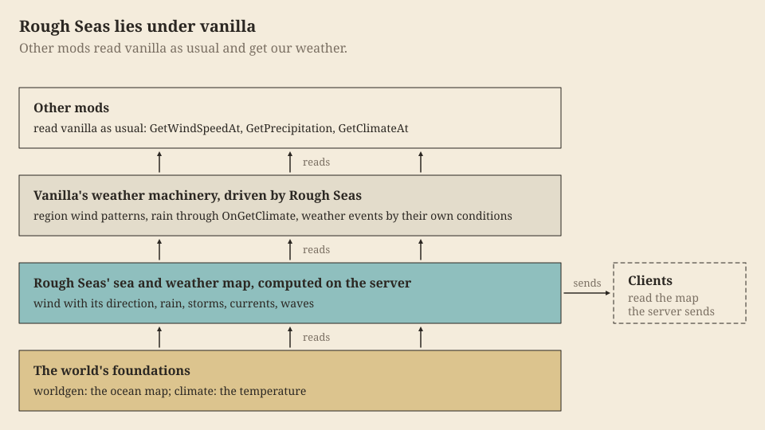

Rough Seas keeps one model of the world's wind, waves, storms and currents, computed on the server from the world's own climate and ocean map. The rest of the game meets that model in three ways, and a mod meets it in the same three.

- **Through vanilla.** We don't replace the game's weather; we drive it. Each region's wind pattern, the rain and the weather events still come out of vanilla's machinery, set from our model. So a mod written for plain Vintage Story reads our weather without a line about us. A mod that moves a lever vanilla itself has, drying the world or shifting its temperature, gets the answer vanilla would give; a mod that sets the weather in vanilla's place changes what vanilla reports, not our sea ([Reading the weather](Reading-the-Weather#what-moves-our-sea)).
- **Through our own code.** Vanilla has no place for the wind's direction, for waves or for currents. We publish them from our own types, on both sides: the sea state, and on a client the drawn sea, its picture of the waves.
- **Through behaviours.** A vessel takes our sea by carrying our entity behaviours, configured in JSON: it floats by its mass, ships water, cracks, floods, moors and drifts. No code.

## The pages

Each page covers one part, for the mod that touches it; read the ones yours does.

| Your mod | Read |
| --- | --- |
| reads the wind, rain or temperature, or changes them | [Reading the weather](Reading-the-Weather) |
| adds weather events | [Weather events](Weather-Events) |
| sets a region's wind pattern | [Wind patterns](Wind-Patterns) |
| reshapes the oceans, or calls vanilla's ocean layer | [The ocean map](The-Ocean-Map) |
| reads the wind's direction, waves, storms or currents: a helm, a sail, a fish | [Reading the sea](Reading-the-Sea) |
| poses a vessel of its own on the swell a client draws | [Reading the sea](Reading-the-Sea#the-drawn-sea) |
| adds a vessel, or gives ours its behaviours | [Building a vessel](Building-a-Vessel) |

Where a page touches physics, it says what the mod does and links [The science behind it](The-Science-Behind-It) for why.

## What we keep

What these pages document is what we keep: vanilla's channels as they describe them, `ISeaWeather` with `SeaState`, `SeaCurrent` and `SeaClock`, `IDrawnSea` with `SeaPose` and `HullResponse`, and our vessel behaviours with their keys and their configs. It follows semantic versioning: a change that breaks any of it comes with a new major version and a line in the release notes, and what we add comes in a minor version. If you build on it, or need something it doesn't give, tell us on the [issue tracker](https://github.com/hoblin/rough-seas/issues).

### Hulls that crack, leak and flood

Hulls that crack, leak and flood changed the vessel keys, so they came as a major version. What a vessel of yours built before them needs to change:

- `roughseas:vesselintegrity` loses `wearPerDay`: a reed hull's [`soak`](Building-a-Vessel#the-hull) and a cracking hull's `seep` take its place. A mend's `restores` now closes that much of one place's crack, or of a lashed hull's lashing; with `greases`, it is the share of `seep.greaseDays` it gives back.
- `roughseas:bilge` loses `sinks`: a swamped vessel sinks by its [buoyancy](Building-a-Vessel#floating).
- `roughseas:seaforces`' `freeboardMetres` counts only for a vessel that doesn't float by its mass, one with no `depthMetres` on its `vesselintegrity`.
- `config/vessels/impact.json` is now `config/vessels/mass.json`, with `crewKg` added; a patch to it follows the rename.
- A carried vessel's hull travels on its item as the stack attribute `roughseas:vessel`; `roughseas:worn` is gone.

New: the hull `model`, `parts[].share`, `depthMetres`, `waterplaneSquareMetres`, `seep`, `soak`, the `density` of a material, `config/vessels/hull.json`, the `response` block of `config/storms.json`, and [`HullResponse`](Reading-the-Sea#how-a-hull-answers). A world from before keeps its vessels: a raft takes its old condition as its lashing, a reed boat as water soaked up, and a cracking hull starts sound; a vessel carried as an item does the same from its durability.

### Blows by their physics

In 3.1 every blow meets what really takes it ([The hull](Building-a-Vessel#the-hull)). No key was removed, so a vessel of yours loads as it did, but it fares differently:

- `impactCapacity` is what a broad load (a knock, a ram, rapids, a blast) must reach to break the hull up, and a smaller one cracks its place by its share; on a `reed` hull too, which now tears.
- Two hulls with `vesselintegrity` ram each other; `minImpactSpeed` is the speed they take in their stride.
- Without a `shell`, the frame's capacity resists point blows and cuts too, and breakers, now a pressure against the planking, don't harm the hull. Give it a [`shell`](Building-a-Vessel#the-hull) for both.
- `Struck`'s second value is the blow over what resisted it, which is the shell for a point blow, a cut or a breaker, no longer always the hull's capacity. Its knock is `Harmed` only when the place came to a worse stage.

New: the vessel's `shell`, `config/vessels/damage.json`'s `broadSources`, `cutShare` and `variation`, a material's `toughness` and `cutToughness`, and `hull.json`'s `soakedStrengthShare`. Gone, never documented here: `config/storms.json`'s `waves.breakerTransfer`, `waves.periodSecondsPerRootMetre` and `ashore.impactFactor`.

### One sea, one clock

In 3.2 every client draws the same waves, and everything at sea keeps one clock ([The sea's time](Reading-the-Sea#the-seas-time)). A vessel of yours loads as it did, but code that reads the time changes:

- `ISeaWeather.NowHours` gave way to `ISeaWeather.Clock`, a `SeaClock`: its `Hours` is the old value. A mechanic of yours at sea that keeps a watch of it stands still and races with the calendar, as ours do.
- `IDrawnSea.Seconds` is the waves' time, the same on every client, so a mod that rides our swell needs no clock of its own.
- Waves come aboard, bilges fill and leaks run by game time, so a vessel near a sleeping player lives through the night.

Gone, never documented here: `config/storms.json`'s `lightning.checkSeconds`, and in `config/soundscape.json` the `water.lapping` loop and `shore.lappingSound` and `lappingStrength`. A hull's splash is `water.splash` now, and the slaps take a `volumePerMetre`.

## What not to touch

| Name | What it is |
| --- | --- |
| `roughseas:seamap` | the map region moddata, and the network channel that carries the map to clients |
| `roughseas:oceancalibration` | save data: what the world's ocean map means |
| `roughseas:vessels` | the network channel a rider's client reports its vessel's knocks over |
| `roughseas-force*` | our wind patterns, which our model sets; to hold a region's wind, set a pattern of your own ([Wind patterns](Wind-Patterns)) |

## Adding and removing Rough Seas

The mod can join an existing world, and leave one. Without it the world opens cleanly: each region keeps the strength of the wind we last set for up to a game hour, then vanilla rolls its own pattern.

### Dugouts built in place

The dugout is burnt and hewn out of five logs on the shore ([Built in place](Building-a-Vessel#built-in-place)), and its grid recipes are gone. No key was removed, so a vessel of yours loads as it did.

- The dugout's rower holds an oar, as on vanilla's raft: it sets `requiresPaddlingTool` and paddles with vanilla's `crudeOar` strokes. A mod that patched its own paddle or strokes patches a vessel that no longer has them.
- `roughseas:bilge`'s `capacityLitres` is what the finished hull holds; while she is built, she holds what is cut out of it.

- A vanilla campfire starts it: dry grass laid with Shift on the middle log of a row lays the blank instead of vanilla's firepit (a Harmony prefix on `ItemDryGrass.OnHeldInteractStart`). Anywhere else dry grass does what vanilla does.
- Every axe in the game, a modded one too, carries our collectible behaviour `roughseas:hew`, so that holding it on a charred blank hews.
- Rain on a vessel, in her bilge and drying her ashore, is what `WeatherSystemBase.GetPrecipitation` reads, as vanilla's fires do, and nothing under a roof.

New: the behaviours `roughseas:burnout` and `roughseas:launch` with their keys, the collectible behaviour `roughseas:hew`, and the watched tree `roughseas:build` on a vessel being built.

### Bark canoes framed in place

The bark canoe is stripped off a standing tree and framed where it lies ([Framed in place](Building-a-Vessel#framed-in-place)), and its grid recipe is gone. No key was removed, so a canoe of yours loads finished, and the bark from a log still mends it.

- The bark canoe's rower holds an oar, as the dugout's does: it sets `requiresPaddlingTool` and paddles with vanilla's `crudeOar` strokes, kneeling. Its own paddle, its `roughseas-barkcanoe-*` strokes and `patches/player-barkcanoe.json` are gone.
- A knife held on a standing birch, elm or spruce trunk strips it: the trunk becomes our `roughseas:debarkedtrunk-{wood}`, which keeps the grown log's tree-felling group, its spread and its hold on the leaves, and drops vanilla's debarked log. A mod that looks for `log-grown-*` to find a trunk misses a stripped one.
- Rope held on a canoe still being lashed lashes her instead of tying itself to her: a Harmony prefix on `ItemRope.OnHeldInteractStart`. Once her lashing is done, rope ties to her as before.
- Rope and every liquid container in the game, a modded one too, carry our collectible behaviour `roughseas:framing`, and our laths carry it by their JSON, so that holding them on a canoe being built lays her next piece.
- A vessel picked up keeps her build on the item, as she keeps her hull's condition, under the stack attribute `roughseas:build`; the item of a framed vessel carries our collectible behaviour `roughseas:carriedbuild`, which draws her as far as she is built and in her laths' wood.

New: the behaviour `roughseas:framing` with its keys, the collectible behaviour of the same code, the items `roughseas:lath-{wood}-{dry|wet}` and the blocks `roughseas:wedge-{we|ns}` and `roughseas:debarkedtrunk-{wood}`.

### Outriggers rigged on a dugout

The outrigger canoe is a finished dugout rigged where she lies ([Rigged in place](Building-a-Vessel#rigged-in-place)), and its grid recipes are gone. Her code is still `roughseas:outrigger-{wood}`, the wood her hull's, so an outrigger of yours loads finished, her float and poles of that wood.

- Her hull is the dugout's: its shape, shell, collision boxes, seats, bilge and `impactCapacity`. Her washstrakes and platform, sawn planks, are gone, and with them her old `hullBox`. A patch that addressed her old shape's elements or her selection boxes by index misses: her boxes are the dugout's three, then `LowerMastAP`.
- Her rower holds an oar, as the dugout's does: she sets `requiresPaddlingTool` and paddles with vanilla's `crudeOar` strokes. With the oar in hand she sails too. Her own paddle, its `roughseas-outrigger-*` strokes and `patches/player-outrigger.json` are gone.
- She mends with a log of her hull's wood, and breaks into firewood, a rope and linen.
- A pole held on a finished dugout with a row of three logs alongside replaces the dugout with a new outrigger entity: a mod that keeps a dugout's entity id sees it die (`EnumDespawnReason.Removed`). Her hull's cracks and bilge go across through `IHandedOver`; ropes tied to the dugout do not.
- `roughseas:framing`'s `framePart` now names a part by its new `name` key, not by its material: the bark canoe's frame part is `"name": "frame"`.
- Axes and cloth carry our collectible behaviour `roughseas:framing` too, as rope does.
- The wedge's `laths` and `lath` attributes are now `splits`: what a row of so many wedged logs splits into, five into laths, three into poles.

- `IHullForm` grew `Wrecked`, `UnhewnLitres`, `DepthMetres` and `WaterplaneSquareMetres`, and `Hollowed` became `HoldLitres`: what a vessel being built breaks into, the wood she still carries outside her hull, and her depth, waterplane and hold so far. A vessel with a mast that stands only once stepped implements the new `IMasted`. An implementation of yours returns the designed values to keep its behaviour.
- The dugout is the five logs from first to last: 4.5 m long, 0.9 m wide, 0.56 m deep, a 1156-litre hold and 361 kg in oak, against 400 kg and 450 litres before. Her shape's stage groups are each level's whole trunk, `Clay{n}` each fire's rim, and `Shell` the finished hull; the item hides the stages as before. A dugout of yours loads as she was, at her new size.
- The outrigger takes optional washstrakes, sawn planks: `roughseas:framing`'s stages may be `optional` and raise her side and hold. One saved without a build has them on.

New: the behaviours `roughseas:riggable` and `roughseas:rigging` with their keys, `roughseas:framing`'s works `pole`, `hew`, `cloth` and `plank` and its keys `replaces`, `optional`, `raisesMetres`, `raisesLitres`, `part` and `texture`, `roughseas:burnout`'s keys `blankDepthMetres`, `blankWaterplaneSquareMetres` and `unhewnLitres`, a part's `name` and `takesKnocks`, and the items `roughseas:pole-{wood}`.

### Reed boats bound in place

The reed boat is bound from two reed bundles laid by the water ([Bound in place](Building-a-Vessel#bound-in-place)), and its grid recipe is gone. Her code is still `roughseas:reedboat`, so a reed boat of yours loads finished, with her ends bound up and her soak as it was.

- She is a float of two 20 cm bundles: 3 m by 0.4 m, 0.2 m deep, 50 kg, her rider 5 cm above the water. Her shape, collision boxes and seat height changed, and her `Hull`, `FrontSeat` and `Cargo` elements with them; a patch that addressed her old shape's `Port`, `Starboard`, `Core` or `Binding` elements misses. Her `soak` and the `reed` material's density changed with her ([why](The-Science-of-the-Hull)).
- Her rower holds an oar: she sets `requiresPaddlingTool` and paddles with vanilla's `crudeOar` strokes. Her own paddle, its `roughseas-reedboat-*` strokes and `patches/player-reedboat.json` are gone.
- `roughseas:framing` no longer needs a vessel of a wood, and strips a tree only when it has `barkSeconds`.
- The help text `roughseas:shipyard-lash` now reads "Lash her with rope" on every framed vessel.

New: the block `roughseas:reedbundle-{one|two}-{we|ns}` of class `roughseas:BlockBundles`, the behaviour `roughseas:droop`, and the hull model interface `ISoaking`.
