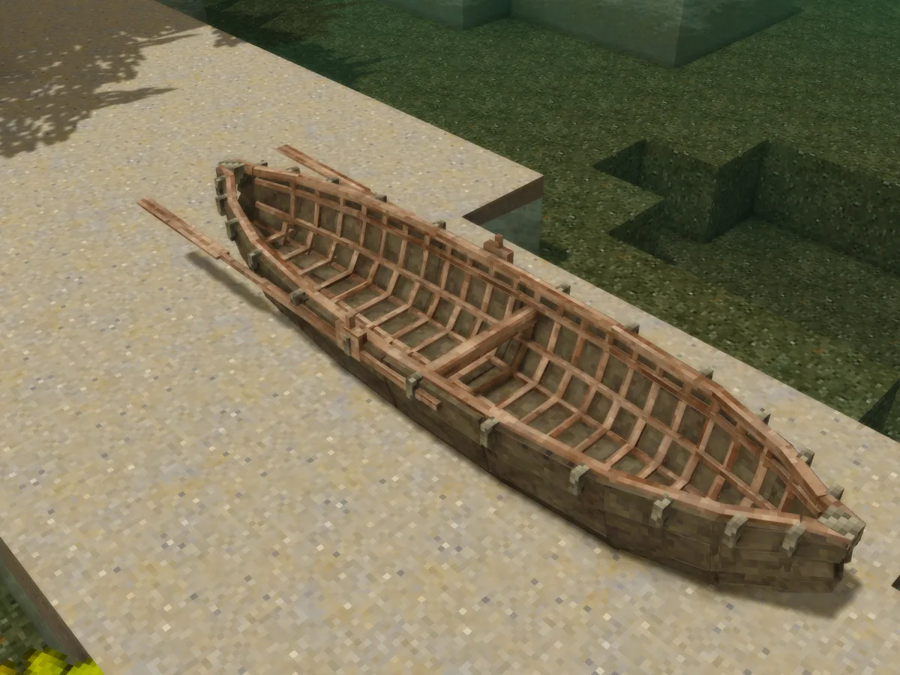

A light frame of split laths, ribs bent over two long gunwales and stringers along them, with hides laced over it and sealed with rendered fat. It is pointed at both ends, where its gunwales are drawn together and bound, and a thwart pole across its middle, a hand below its gunwale, takes the rower. The rower sits facing its stern and pulls its two oars on their thole pins, which stand just abaft the thwart.

## In Rough Seas

The first venture to sea under oars. A hide hull flexes with the waves instead of fighting them, and the currach carries cargo, so it is the first boat in which a coast becomes a road. Its seams seep once the grease washes out of them, so it needs greasing with rendered fat every few days afloat to keep it tight.

## Where it comes from

Currachs have worked the Atlantic coast of Ireland for as long as there are records. The early Irish ones were covered with ox hides, and the monks who sailed to the Hebrides, Iceland and, by legend, beyond, sailed in them; in 1976–77 Tim Severin crossed from Ireland to Newfoundland in the *Brendan*, a leather boat built in this way. A currach was built upside down: its gunwale laid out on the ground, its ribs bent over it and set into it, the stringers tied along them, and the frame turned over once it had set and been covered. The model is a small hide currach of that kind, 4.8 m long and 1.2 m in beam.

## By the numbers

| | |
| --- | --- |
| Speed | 2.4 m/s rowed on its thole pins, 2.5 m/s poled standing ([how fast](Paddles-Poles-and-Oars#how-fast)) |
| Turning | 39° a second, rowed: one oar pulled, the other backed |
| [Hull](Hull-Condition) | it rides the sea, but a knock breaks the ash lath behind its hide at 41 J, rowing into a rock at 1.2 m/s, and the two either side of a gap at 102 J, 1.5 m/s; 3000 J more with an ash frame breaks it up, about 2800 J in oak, 3300 J in birch |
| [Seeping](Hull-Condition#seeping-and-soaking) | ungreased, 13 litres a game hour into the bilge at each seam between hides; a full greasing lasts 2.5 days afloat |
| [Freeboard](Surf-and-Swamping#how-it-floats) | 58 cm empty, 56 cm with its rower |
| [Flooded](Surf-and-Swamping#swamping) | floats awash with three baskets aboard; three chests take it down |
| [Mending](Mending) | 1 large prepared hide closes two thirds of a stove-in place; 1 rendered fat greases it for 1.25 days |
| [Bilge](Bailing) | 1911 litres |
| [Capsized by](Surf-and-Swamping#capsizing), in 1.0 | a 2 m breaker, the best of the small boats in surf |
| [Rapids](Rapids) | doesn't survive them for now: the bottom stove in at the first rock ([a simplified model](Rapids)) |
| [Lightning](Lightning) | a strike nearby almost always breaks it |
| [Left alone](Currents#drift) | drifts with the current and the wind |
| [Mooring](Mooring) | tied to a post |
| Carried | picked up |
| Seats | one: the rower on the thwart, facing its stern, rowing its own two oars with an empty hand, or standing on its floor, facing its bow, to pole it through shallows |
| Cargo | three spots on the bottom, two behind the rower and one beyond his feet; each takes a basket (8 slots), a storage vessel (12) or a chest (16; a treasure chest 4) |
| Built from | 2 laths of 5 m for its gunwale, 9 of 3 m and 13 of 2 m for its ribs and 7 of 5 m for its stringers, 6 ropes, eight small hides' worth of hide, a 2 m pole and two [thole oars](Recipes#thole-oar), then greased |
| Wreckage | a few laths |

## How it is built

You build a currach upside down, where you lay its gunwale out on the ground, piece by piece. Each piece shows on the currach as you lay it.

1. **Split and soak the laths.** Split [poles](Recipes#laths) into laths with an axe in the crafting grid, and soak them two days in a barrel of water ([recipe](Recipes#soaked-laths)): only wet laths bend. A piece takes any lath at least as long as it, cut down: the gunwales and stringers take 5 m laths, the nine longest ribs 3 m ones and the other thirteen 2 m ones.
2. **Lay out the gunwale.** Hold Shift and right-click the ground with a wet 5 m lath. It lies at its full length where you aim, to the sixteenth of a block, along the way you face. Lay a second one next to it, seventeen sixteenths of a block apart, a little over a metre, as far apart as the gunwale laths are drawn. A lath laid a sixteenth off is moved onto its place when you bind them.

   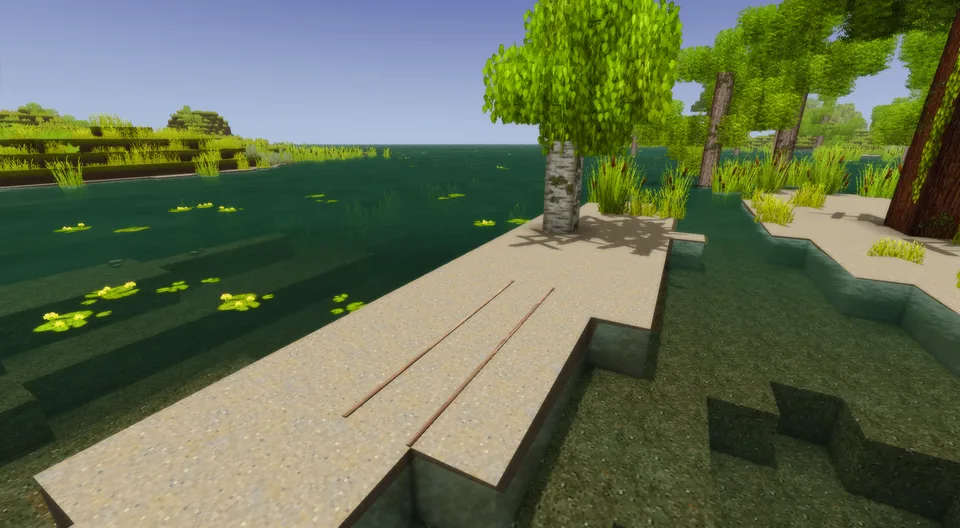

3. **Bind the ends.** Hold a rope on the laths: the first rope draws their ends together at the bow, while at the stern they still run straight. The second rope draws them together at the stern and closes the gunwale.

   | | |
   | --- | --- |
   | 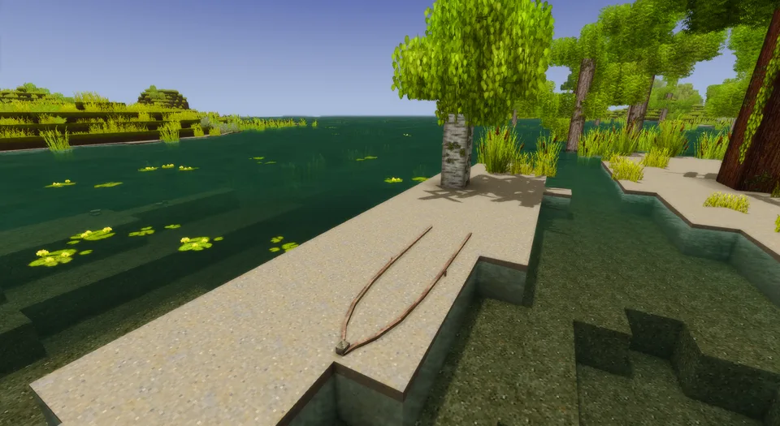 | 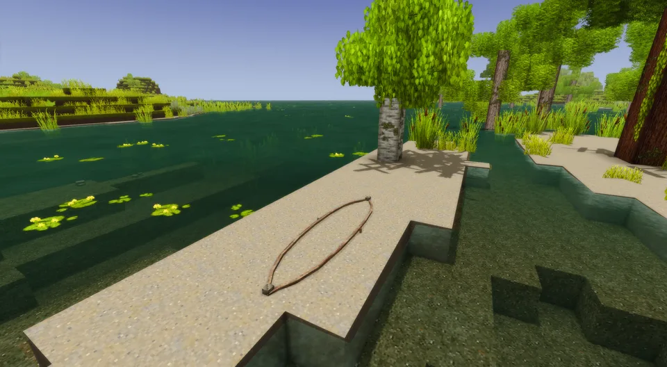 |
   | The first rope, at the bow | The second, at the stern |

4. **Frame it.** Hold wet laths on the currach: the ribs, bent over the gunwale from the middle out, then the stringers along them. Two days later the ribs have dried and the frame has set; until then no hide goes on.

   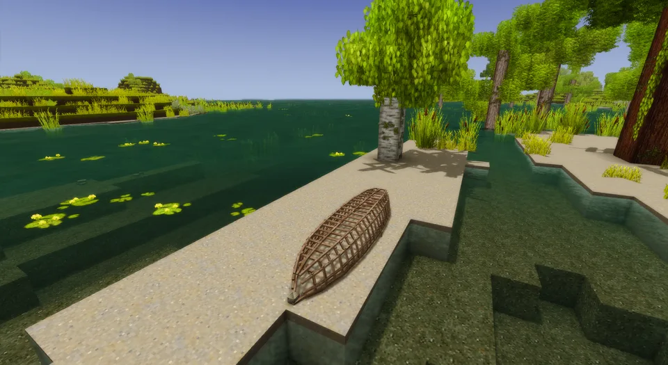

5. **Sew on hides.** Hold a hide on the currach: any hide before it is leather, raw, salted, soaked, scraped, prepared, oiled or a pelt. The cover is eight parts of one small hide's area each: a small hide covers one part, a medium two, a large three, a huge five, and takes as much longer to sew. A hide bigger than what is left of the cover is cut to fit, and you get the rest back as the smaller hides it still makes. Hold four ropes on it to lace the cover to the gunwale, and a 2 m pole to set the thwart across it. Last, ship its two [thole oars](Recipes#thole-oar), one on each thole pin: hold one on the currach and right-click. They stay aboard from then on, as on Aran, where they came off only to dry.

   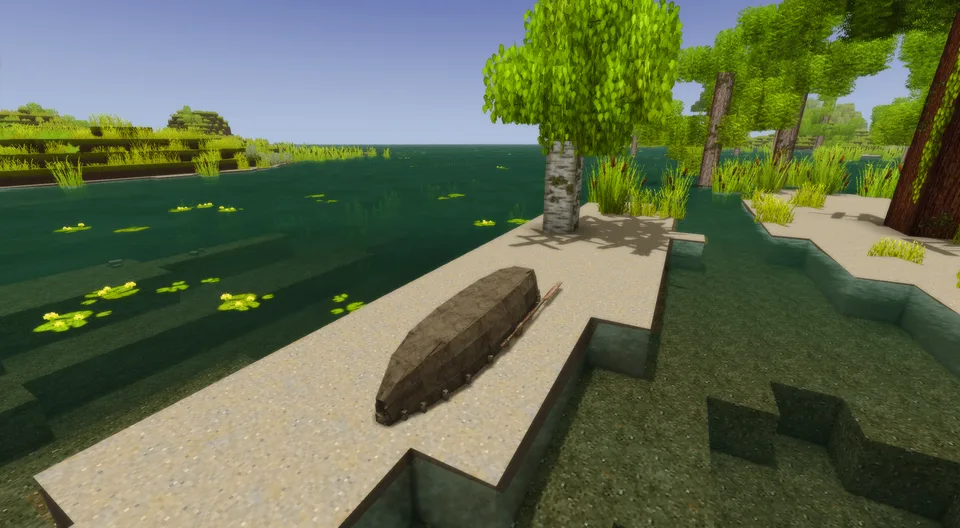

6. **Turn it over.** Right-click the currach with an empty hand. It takes its seat once it is the right way up. Grease it with rendered fat before it goes afloat, or its seams seep.

   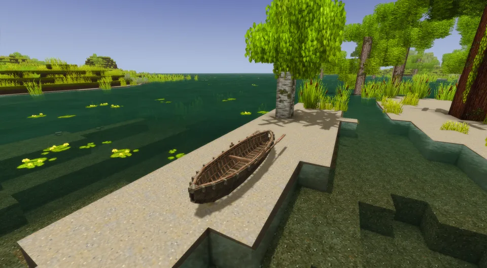

The hides you sew it from decide how long the currach lasts afloat ([Seeping and soaking](Hull-Condition#seeping-and-soaking)): untanned hide rots within days in warm water unless dried ashore, prepared hide lasts years. A currach from before the build loads finished, the right way up, covered in prepared hide.

## Its neighbours

- The [outrigger canoe](Outrigger-Canoe) is the other boat for the sea: faster and steadier under sail, but it carries one basket and can't be picked up.
- The [sailboat](Sailboat) carries far more and takes far harder blows, and it costs a shipyard's worth of planks.
- The [dugout](Dugout) and the [bark canoe](Birch-Bark-Canoe) are what to leave on the river.
- The [coracle](Coracle) is built of the same laths and hides, and carried on your back.

## Every form it takes

| | |
| --- | --- |
| 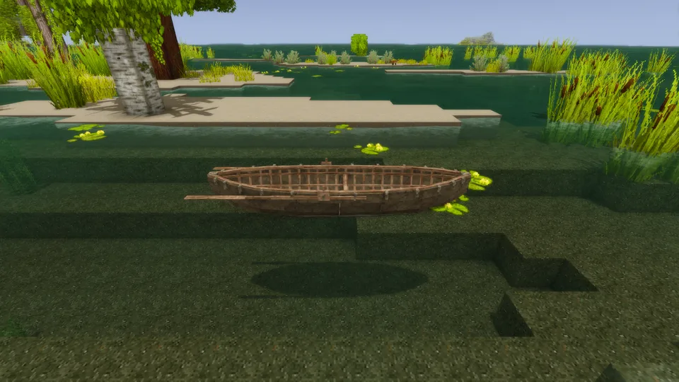 | 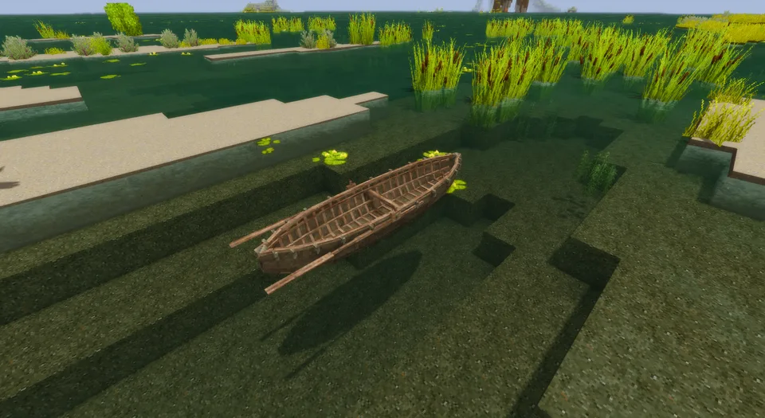 |
| Afloat, from the side | From the stern quarter |
| 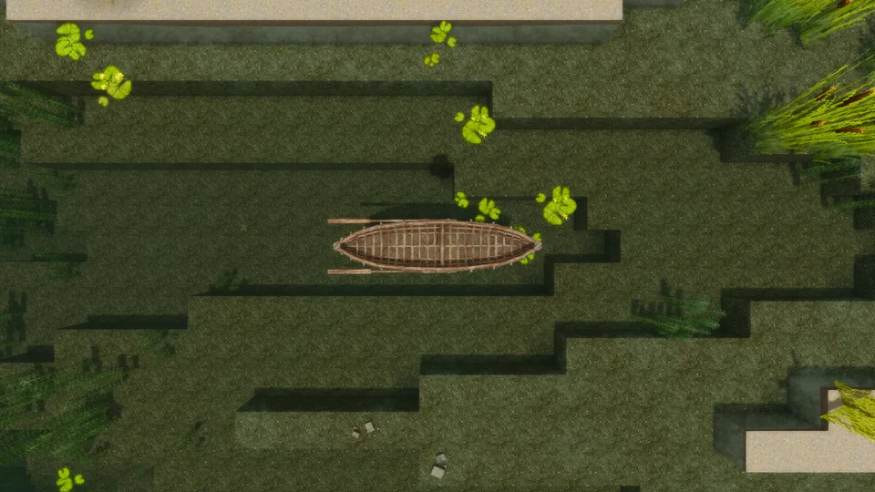 | 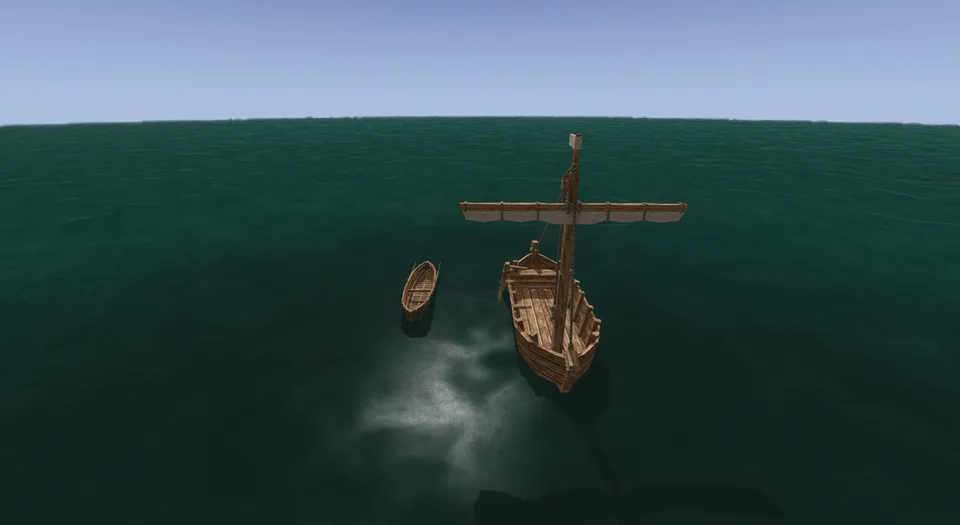 |
| From above | Beside the sailboat |
| 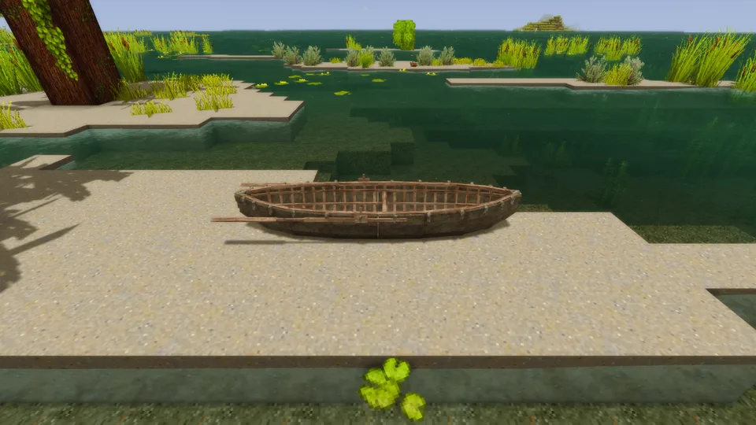 | 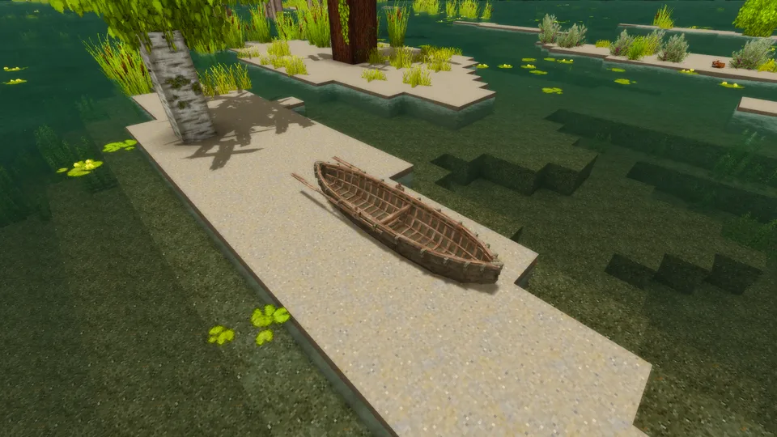 |
| Ashore | Ashore, from the quarter |
| 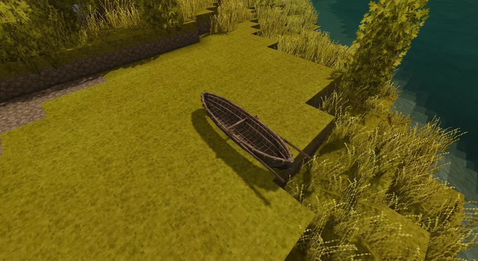 | 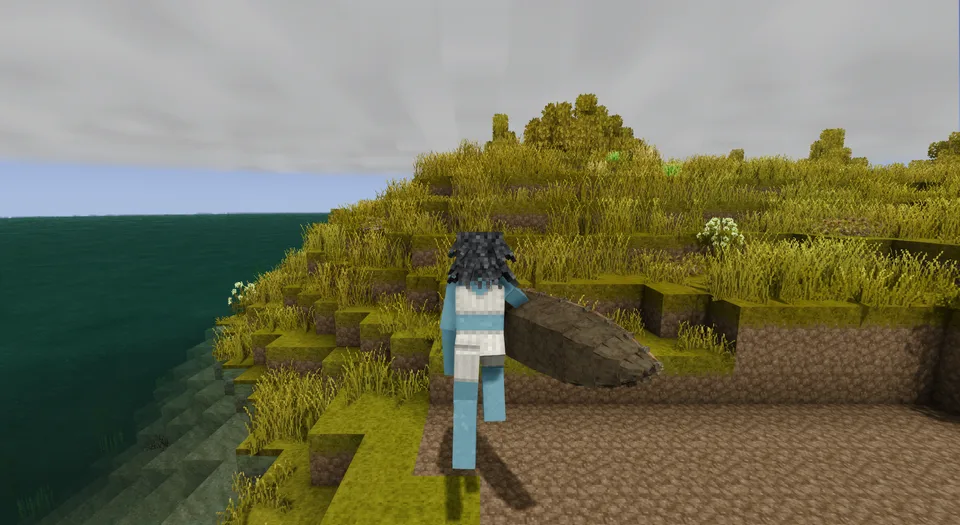 |
| Dropped on the ground | Carried |
| 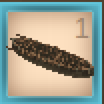 | 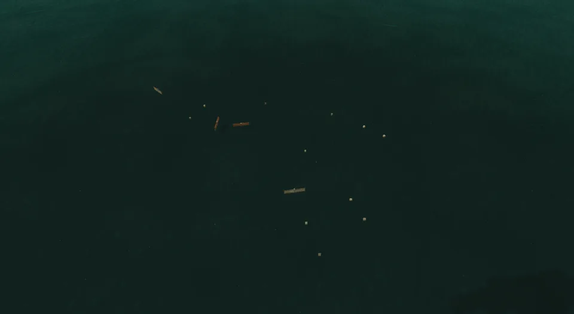 |
| In the hotbar | Its wreckage |
