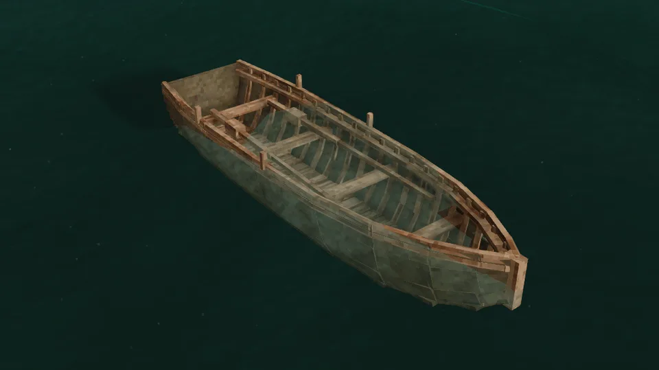

A light wooden frame, laths bent over a flat floor and flaring out to the gunwale, with cured hides stretched over it and sealed with rendered fat. The bow rises to a point, the stern is cut square, and the oars ride on thole pins.

## In Rough Seas

The first venture to sea under oars. A hide hull flexes with the waves instead of fighting them, and the currach carries cargo, so it is the first boat in which a coast becomes a road. Its seams seep once the grease washes out of them, so it needs greasing with rendered fat every few days afloat to keep it tight.

## Where it comes from

Currachs have worked the Atlantic coast of Ireland for as long as there are records. The early Irish ones were covered with ox hides, and the monks who sailed to the Hebrides, Iceland and, by legend, beyond, sailed in them; in 1976–77 Tim Severin crossed from Ireland to Newfoundland in the *Brendan*, a leather boat built in this way. The currachs of Aran and Connemara are rowed with narrow, bladeless oars that pivot on a single thole pin through a wooden block. The model is one of these: a flat-floored, flaring hull of close laths, a square stern, one thwart for the rower, and two oars stowed along the gunwales.

## By the numbers

| | |
| --- | --- |
| Speed | 1.7 × the raft, rowed |
| Turning | steady |
| [Hull](Hull-Condition) | 3000 J: it rides the sea, but one hard knock holes it |
| [Seeping](Hull-Condition#seeping-and-soaking) | ungreased, 30 litres a game hour into the bilge; a full greasing lasts 2.5 days afloat |
| [Freeboard](Surf-and-Swamping#how-she-floats) | 42 cm empty, 40 cm with its rower |
| [Flooded](Surf-and-Swamping#swamping) | floats awash with three baskets aboard; three chests take it down |
| [Mending](Mending) | 1 large prepared hide closes two thirds of a stove-in place; 1 rendered fat greases it for 1.25 days |
| [Bilge](Bailing) | 1500 litres |
| [Capsized by](Surf-and-Swamping#capsizing), in 1.0 | a 2 m breaker, the best of the small boats in surf |
| [Rapids](Rapids) | takes them badly |
| [Lightning](Lightning) | a strike nearby almost always breaks it |
| [Left alone](Currents#drift) | drifts with the current and the wind |
| [Mooring](Mooring) | tied to a post |
| Carried | picked up |
| Seats | one: the rower on the stern thwart, with its own two oars |
| Cargo | three spots on the bottom, forward of the rower; each takes a basket (8 slots), a storage vessel (12) or a chest (16; a treasure chest 4) |
| Built from | 10 planks, 3 large prepared hides and 2 rendered fat |
| Wreckage | sticks and leather |

## How it is built

## Its neighbours

- The [outrigger canoe](Outrigger-Canoe) is the other boat for the sea: faster and steadier under sail, but it carries one basket and can't be picked up.
- The [sailboat](Sailboat) carries far more and takes far harder blows, and it costs a shipyard's worth of planks.
- The [dugout](Dugout) and the [bark canoe](Birch-Bark-Canoe) are what to leave on the river.

## Every form it takes

| | |
| --- | --- |
| 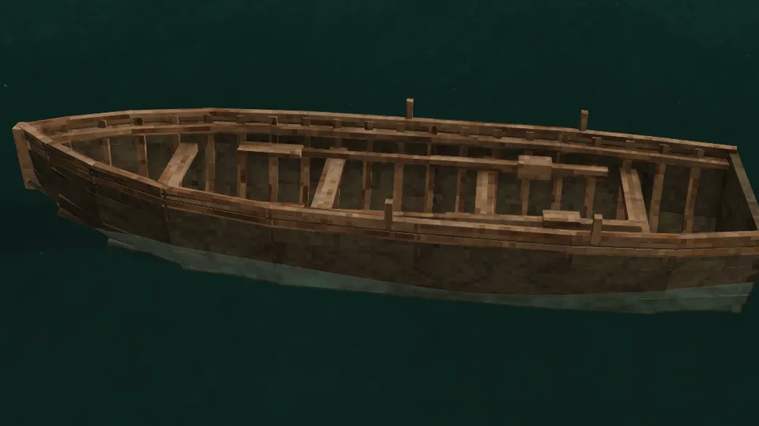 | 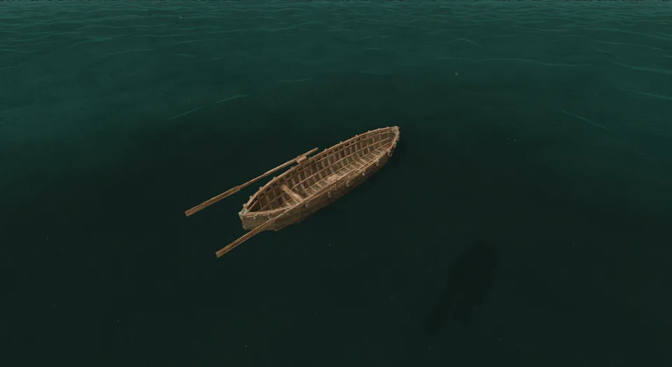 |
| Afloat, from the side | From the stern quarter |
| 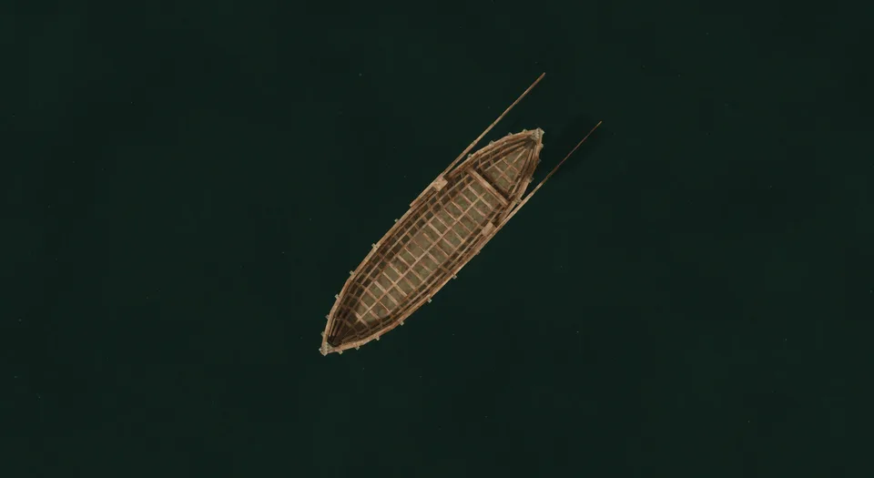 | 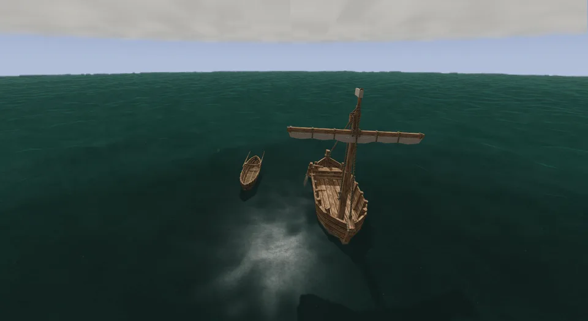 |
| From above | Beside the sailboat |
| 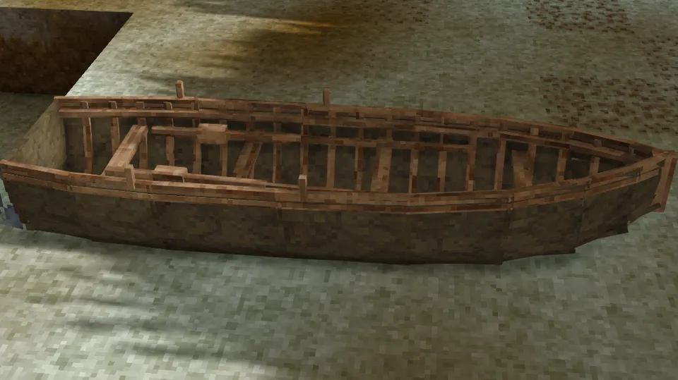 | 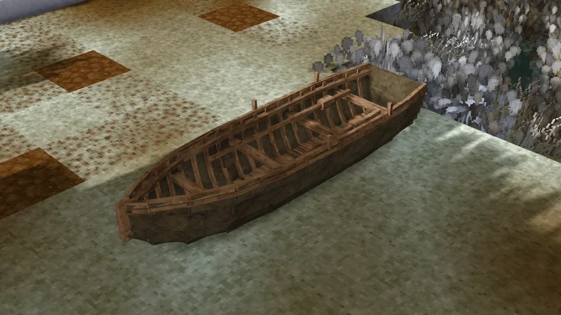 |
| Ashore | Ashore, from the quarter |
| 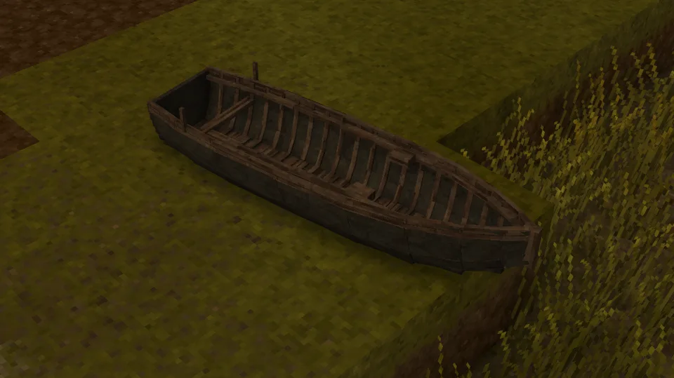 | 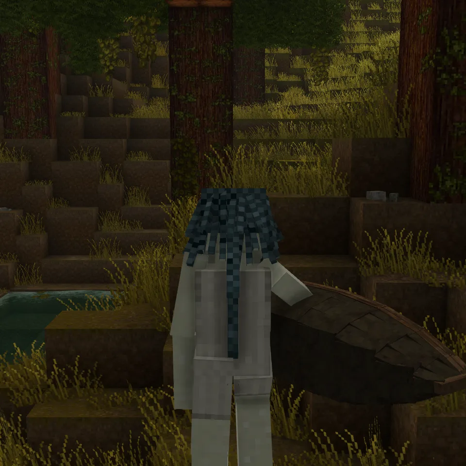 |
| Dropped on the ground | Carried |
| 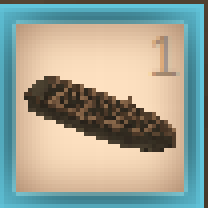 | 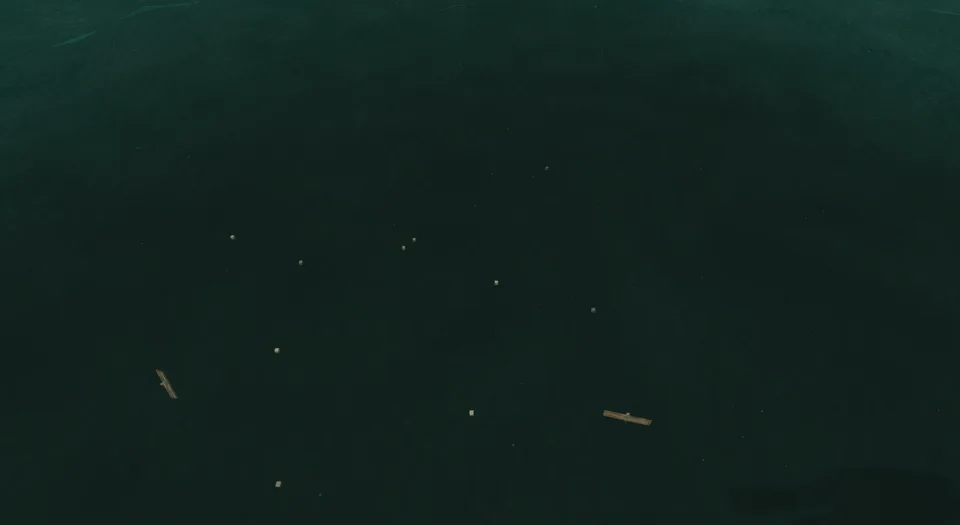 |
| In the hotbar | Its wreckage |
