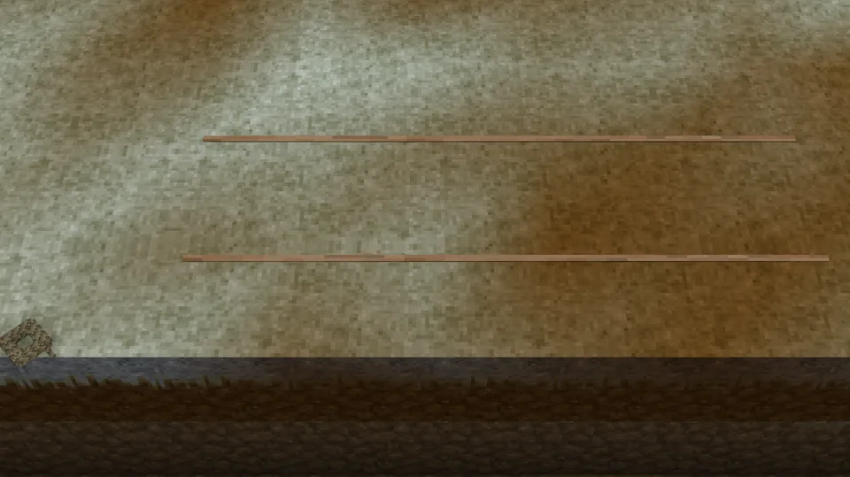
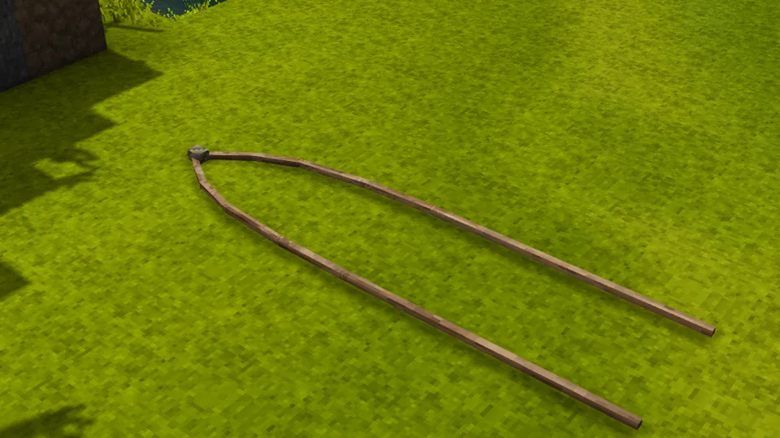
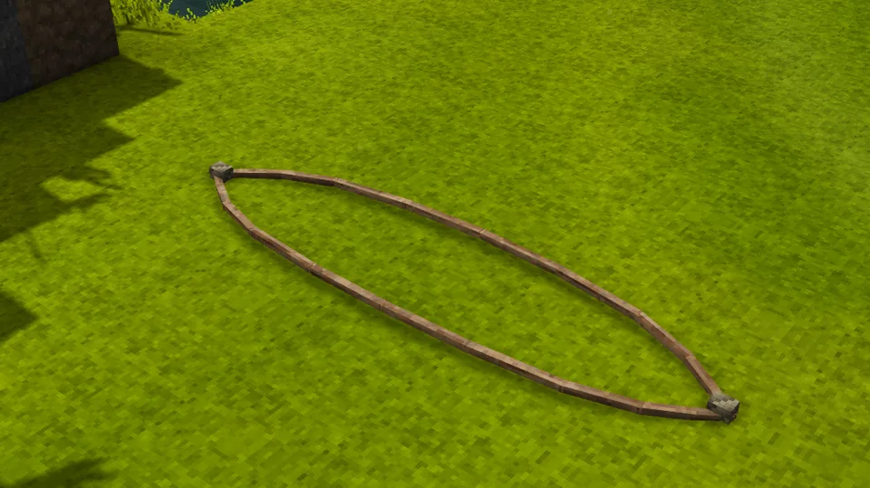
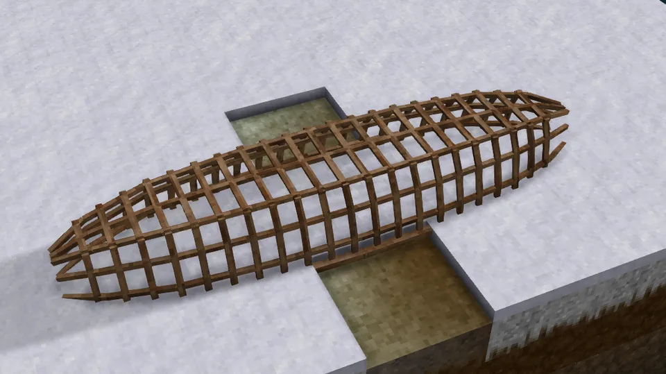
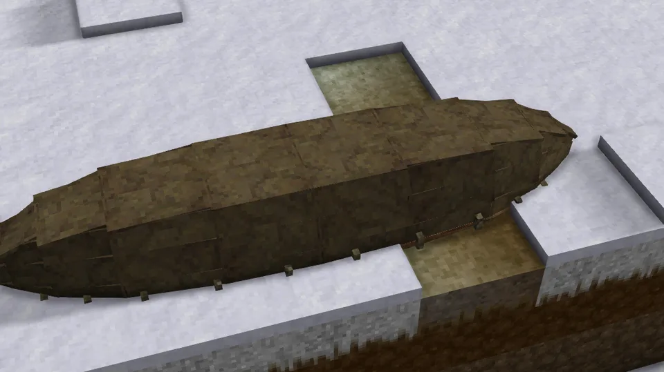
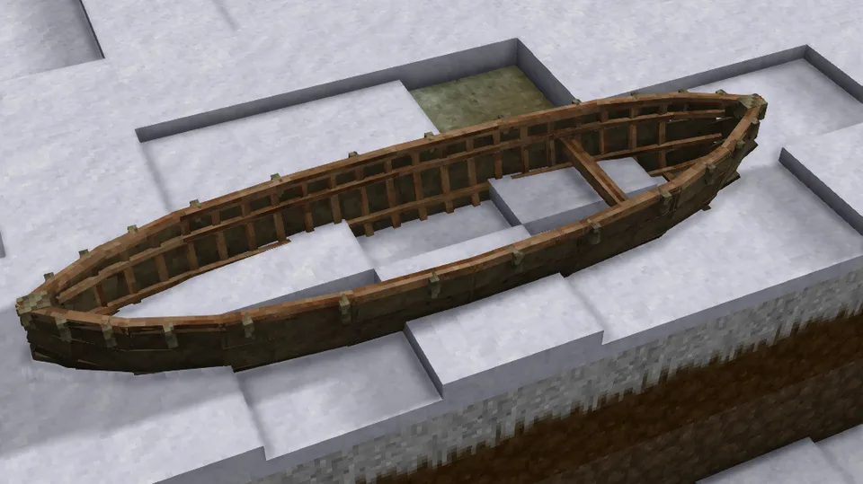

A light frame of split laths, ribs bent over two long gunwales and stringers along them, with hides laced over it and sealed with rendered fat. She is pointed at both ends, where her gunwales are drawn together and bound, and a thwart pole across her aft takes the rower, who rows her with an [oar](https://wiki.vintagestory.at/Oar) in hand.

## In Rough Seas

The first venture to sea under oars. A hide hull flexes with the waves instead of fighting them, and the currach carries cargo, so it is the first boat in which a coast becomes a road. Her seams seep once the grease washes out of them, so she needs greasing with rendered fat every few days afloat to keep her tight.

## Where it comes from

Currachs have worked the Atlantic coast of Ireland for as long as there are records. The early Irish ones were covered with ox hides, and the monks who sailed to the Hebrides, Iceland and, by legend, beyond, sailed in them; in 1976–77 Tim Severin crossed from Ireland to Newfoundland in the *Brendan*, a leather boat built in this way. A currach was built upside down: her gunwale laid out on the ground, her ribs bent over it and set into it, the stringers tied along them, and the frame turned over once it had set and been covered. The model is a small hide currach of that kind, 4.7 m long and 1.2 m in beam.

## By the numbers

| | |
| --- | --- |
| Speed | 2.5 m/s rowed on her thole pins, 2 m/s poled ([how fast](Paddles-Poles-and-Oars#how-fast)) |
| Turning | 42° a second, rowed: one oar pulled, the other backed |
| [Hull](Hull-Condition) | 3000 J with an ash frame: she rides the sea, but one hard knock holes her; about 2800 J in oak, 3300 J in birch |
| [Seeping](Hull-Condition#seeping-and-soaking) | ungreased, 15 litres a game hour into the bilge at each seam between hides; a full greasing lasts 2.5 days afloat |
| [Freeboard](Surf-and-Swamping#how-she-floats) | 58 cm empty, 56 cm with her rower |
| [Flooded](Surf-and-Swamping#swamping) | floats awash with three baskets aboard; three chests take her down |
| [Mending](Mending) | 1 large prepared hide closes two thirds of a stove-in place; 1 rendered fat greases her for 1.25 days |
| [Bilge](Bailing) | 1878 litres |
| [Capsized by](Surf-and-Swamping#capsizing), in 1.0 | a 2 m breaker, the best of the small boats in surf |
| [Rapids](Rapids) | takes them badly |
| [Lightning](Lightning) | a strike nearby almost always breaks her |
| [Left alone](Currents#drift) | drifts with the current and the wind |
| [Mooring](Mooring) | tied to a post |
| Carried | picked up |
| Seats | one: the rower on the thwart, rowing her own two oars with an empty hand, or poling her through shallows |
| Cargo | three spots on the bottom, forward of the rower; each takes a basket (8 slots), a storage vessel (12) or a chest (16; a treasure chest 4) |
| Built from | 2 laths of 5 m for her gunwale, 9 of 3 m and 12 of 2 m for her ribs and 7 of 5 m for her stringers, 6 ropes, eight small hides' worth of hide and a 2 m pole, then greased |
| Wreckage | a few laths |

## How it is built

A currach is built upside down where her gunwale is laid out on the ground, piece by piece, each piece drawn on her as it goes on.

1. **Split and soak the laths.** Split [poles](Recipes#laths) into laths with an axe in the crafting grid, and soak them two days in a barrel of water ([recipe](Recipes#soaked-laths)): only wet laths bend. A piece takes any lath at least as long as it, cut down: her gunwales and stringers take 5 m laths, her nine longest ribs 3 m ones and the other twelve 2 m ones.
2. **Lay out the gunwale.** Hold Shift and right-click the ground with a wet 5 m lath: it lies at its full length where you aim, to the sixteenth of a block, along the way you face. Lay a second beside it, eighteen sixteenths of a block apart, a little over a metre, as far apart as her gunwale laths are drawn: one laid a sixteenth off is drawn onto its place when she is bound.

   

3. **Bind the ends.** Hold rope on the laths: the first rope draws their ends together at her bow where they lie, while astern they still run straight; the second draws them together at her stern and closes her gunwale.

   | | |
   | --- | --- |
   |  |  |
   | The first rope, at her bow | The second, at her stern |

4. **Frame her.** Hold wet laths on her: the ribs, bent over the gunwale from the middle out, then the stringers along them. Two days later the ribs have dried and her frame has set; until then no hide goes on.

   

5. **Sew on hides.** Hold a hide on her: any hide before it is leather, raw, salted, soaked, scraped, prepared, oiled or a pelt. Her cover is eight parts of one small hide's area each; a small hide covers one part, a medium two, a large three, a huge five, and takes as much longer to sew. A hide bigger than what is left of her cover is cut to fit, and the rest comes back to you as the smaller hides it still makes. Four ropes lace the cover to her gunwale, and a 2 m pole set across her is her thwart. Last, ship her two [thole oars](Recipes#thole-oar), one on each thole pin: hold one on her and right-click. They stay aboard from then on, as on Aran, where they came off only to dry.

   

6. **Turn her over.** Right-click her with an empty hand. She takes her seat once she is the right way up; grease her with rendered fat before she goes afloat, or her seams seep.

   

The hides she is sewn from decide how long she lasts afloat ([Seeping and soaking](Hull-Condition#seeping-and-soaking)): untanned hide rots within days in warm water unless dried ashore, prepared hide lasts years. A currach from before the build loads finished, the right way up, covered in prepared hide.

## Its neighbours

- The [outrigger canoe](Outrigger-Canoe) is the other boat for the sea: faster and steadier under sail, but she carries one basket and can't be picked up.
- The [sailboat](Sailboat) carries far more and takes far harder blows, and she costs a shipyard's worth of planks.
- The [dugout](Dugout) and the [bark canoe](Birch-Bark-Canoe) are what to leave on the river.
- The [coracle](Coracle) is built of the same laths and hides, and carried on your back.

## Every form it takes

| | |
| --- | --- |
|  |  |
| Afloat, from the side | From the stern quarter |
|  |  |
| From above | Beside the sailboat |
|  |  |
| Ashore | Ashore, from the quarter |
|  |  |
| Dropped on the ground | Carried |
|  |  |
| In the hotbar | Its wreckage |
