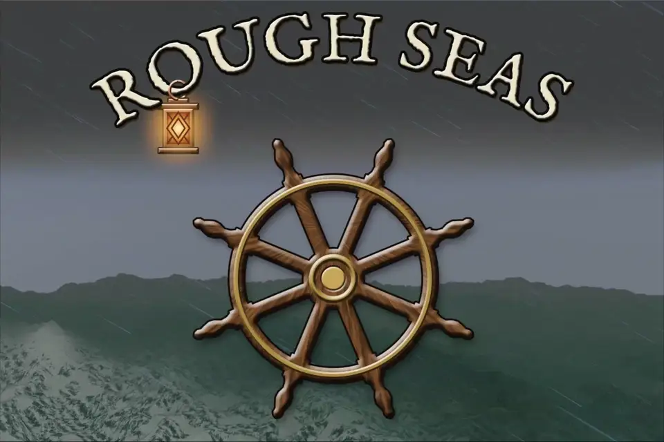

# Rough Seas

*The sea lets you cross. It never promises to.*

Rough Seas is a [Vintage Story](https://www.vintagestory.at/) mod that makes the ocean dangerous and worth going out on. The sea gets weather of its own: wind that rises and falls, storms that cross the world, waves that break on the shore and currents that turn the oceans. Every vessel can crack, flood or sink, each by what it is made of, and six new ones fill the gap between the raft and the sailboat.

The game's handbook carries a short guide, *Going to Sea*, with what keeps you alive. This wiki holds the depth: how each mechanic works, the numbers and the real-world data behind it, and where each vessel comes from.

## Contents

**Showcase**
- [Showcase](Showcase): every animation of the mod's mechanics in this wiki, linked to the page it belongs to.

**Getting started**
- [World settings](World-Settings): the *Rough Seas* playstyle, and a setting for each mechanic.
- [Vessels](Vessels): which one for which water.
- [Recipes](Recipes): everything the mod adds to the crafting grid.
- [Paddles, poles and oars](Paddles-Poles-and-Oars): what drives each vessel, and how fast.
- [Swimming](Swimming): floating on the waves, what you carry, and crests that break over you.

**The sea**
- [Wind and waves](Wind-and-Waves): the wind, the Beaufort scale, and why every wave is different.
- [The look of the sea](The-Look-of-the-Sea): how the swell, whitecaps and surf are drawn, tuned against photographs.
- [Storms](Storms): squalls, gales and hurricanes, where they form and how they warn you.
- [Lightning](Lightning): strikes in warm storms, and the masts that draw them.
- [Currents](Currents): the gyres, warm and cold water, and how they carry every boat afloat.

**Your vessel**
- [Hull condition](Hull-Condition): where a blow cracks a hull, how the crack leaks, and what it is made of.
- [Mending](Mending): patching a hull with its own material.
- [Rapids](Rapids): white water, and the two boats that run it.
- [Surf and swamping](Surf-and-Swamping): how a hull floats, shipping water, sinking, breakers and capsizing.
- [Bailing](Bailing): the bilge, the rain, and keeping up.

**Leaving it**
- [Anchoring](Anchoring): the sailboat's anchor, rope and scope.
- [Mooring](Mooring): tying up, and the storm that throws a boat ashore.

**Rivers and lakes**
- [Raft](Raft)
- [Reed boat](Reed-Boat)
- [Dugout](Dugout)
- [Coracle](Coracle)
- [Birch-bark canoe](Birch-Bark-Canoe)

**At sea**
- [Hide currach](Hide-Currach)
- [Outrigger canoe](Outrigger-Canoe)
- [Sailboat](Sailboat)

**The science behind it**
- [The science of the weather](The-Science-of-the-Weather): the measurements and models the wind and storms stand on, and where we bent them.
- [The science of the waves](The-Science-of-the-Waves): the same for the waves and the surf on the shore.
- [The science of a body in the water](The-Science-of-a-Body-in-the-Water): the same for how the waves, a stroke, the current and a rope move a hull or a swimmer.
- [The science of the hull](The-Science-of-the-Hull): the same for how a hull takes a blow, floats, leaks, rides the swell and is built.

**Beside other mods**
- [Beside other mods](Other-Mods): the mods we tested Rough Seas with, what changes in one mod set, and what we recommend.

**Sound credits**
- [Sound credits](Sound-Credits): the recordings the sea and the hulls sound with, and who made them.

**For modders**
- [For modders](For-Modders): what Rough Seas is to your mod, and what we keep stable.
- [Reading the weather](Reading-the-Weather): wind, rain and temperature through vanilla's own calls.
- [Weather events](Weather-Events): how every mod's events fire under our weather.
- [Wind patterns](Wind-Patterns): our pattern in every region, and setting one yourself.
- [The ocean map](The-Ocean-Map): the world's ocean layer, and mods that reshape it.
- [Reading the sea](Reading-the-Sea): wind direction, waves, storms and currents from code, and the swell a client draws.
- [Building a vessel](Building-a-Vessel): making a vessel float, ride, ship water, crack, moor and drift in our sea.

**What's next**
- [Roadmap](Roadmap): sailing by the wind, cold water and sharks, diving and wrecks.

---

Rough Seas is open source under the MIT license: [source, issues and releases](https://github.com/hoblin/rough-seas). These pages are written in the repository's `docs/wiki/` and published here on every change; to fix one, open a pull request there.

