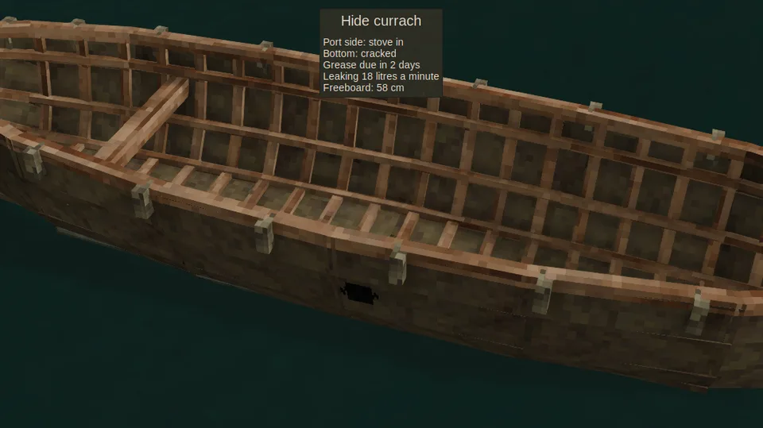

Every vessel has a hull, and the hull wears and breaks. How much it takes depends on what it is made of, and every source of harm, from a rock to a lightning bolt, is weighed the same way.

## Reading it

Look at a vessel to read its condition:

| Condition | Left of the hull |
| --- | --- |
| *sound* | more than three quarters |
| *scarred* | more than half |
| *damaged, taking strain* | more than a quarter |
| *breaking up* | a quarter or less |

Cracks show on the hull as it weakens (on a bamboo raft only the words do). A vessel you pick up keeps its condition as durability on the item, and a damaged boat set back on the water is just as damaged.

## How a hull takes a blow

Every blow is turned into energy, in joules, and weighed against what the hull can take, its *capacity*:

- the bigger the blow against the capacity, the likelier it does harm at all, and the more it takes when it does;
- a blow as big as the capacity harms the hull about two times in three, and then takes half to one and a half times a sound hull's condition, so it breaks a sound hull about half the times it lands;
- a blow far below the capacity mostly glances off; one far above it breaks the vessel outright.

So a small knock on a big hull is nothing, while the same knock may hole a light one, and no hull is ever quite safe or quite doomed: there is always some luck in it.

## What it is made of

A hull's capacity comes from its build, and for a wooden hull also from its wood. Each wood counts by its *modulus of rupture*, the bending strength measured for that timber in the [Wood Database](https://www.wood-database.com/), against oak:

| Wood | Strength, MPa | Against oak |
| --- | --- | --- |
| ebony | 158 | 1.63 × |
| purpleheart | 152 | 1.56 × |
| bamboo (raft) | 130 | 1.34 × |
| birch | 114 | 1.18 × |
| maple | 109 | 1.12 × |
| walnut | 101 | 1.04 × |
| oak | 97 | 1 |
| larch | 90 | 0.93 × |
| acacia | 87 | 0.90 × |
| pine | 83 | 0.86 × |
| bald cypress | 73 | 0.75 × |
| redwood | 62 | 0.64 × |
| aged wood (raft) | 49 | 0.5 × |
| kapok | 36 | 0.37 × |

An ebony sailboat takes more than four times the knocks of a kapok one. The [raft](Raft), [sailboat](Sailboat), [dugout](Dugout) and [outrigger canoe](Outrigger-Canoe) are built of a chosen wood; the [reed boat](Reed-Boat), [coracle](Coracle), [birch-bark canoe](Birch-Bark-Canoe) and [hide currach](Hide-Currach) have a single build each. Their capacities, in oak, are compared on [Vessels](Vessels).

## What harms a hull

### Knocks and landings

Running into rock, the shore or another vessel strikes the hull with the energy of the speed lost: half the mass, the vessel's own and everyone aboard, times the square of the speed. A change of speed under 1 m/s never counts, so easing in to a landing is always safe.

What one rider's knock does, losing 2 or 4 m/s at once:

| Vessel | Chance of harm at 2 m/s | at 4 m/s |
| --- | --- | --- |
| [Dugout](Dugout) | 3% | 12% |
| [Outrigger canoe](Outrigger-Canoe) | 4% | 15% |
| [Sailboat](Sailboat) | 9% | 32% |
| [Birch-bark canoe](Birch-Bark-Canoe) | 8% | 27% |
| [Hide currach](Hide-Currach) | 10% | 36% |
| [Reed boat](Reed-Boat) | 19% | 57% |
| [Raft](Raft) | 27% | 71% |
| [Coracle](Coracle) | 33% | 80% |

An oak raft paddled flat out into a rock breaks in four or five rams; a sailboat under full sail, in about two.

### Waves

Breaking waves strike the hull, harder the higher they run and harder still on a flooded hull. That is on [Surf and swamping](Surf-and-Swamping); waves that reach a vessel left [moored by the shore](Mooring#thrown-ashore) can strike it while you are away.

### Rapids

White water batters every hull but one, every second it is in it. See [Rapids](Rapids).

### Weapons, explosions and lightning

A swing at a hull counts 200 joules for each point of damage the weapon does; an iron axe breaks an oak raft in about six swings, and a bare fist harms one now and then. Explosions and [lightning](Lightning) count 1000 joules a point, so a bomb or a bolt does far more.

### Wear

Two hulls wear just by floating, counted in game hours afloat. Time on land pauses the wear, and a vessel left afloat far away wears on all the same.

- The [reed boat](Reed-Boat) soaks through: it loses a third of its condition a day and is gone in about three days.
- The [hide currach](Hide-Currach) loses a tenth a day as its hides dry out and its seams open; greasing it with rendered fat gives back what it wore, never what a knock took.

The other vessels don't wear.

## Keeping it whole

A hull is [mended](Mending) one patch at a time, with the vessel's own material.

## When it breaks

A broken vessel is gone. What it was built from scatters on the water as wreckage, and like any dropped item it lasts about ten minutes:

| Vessel | Wreckage |
| --- | --- |
| [Raft](Raft) | a few logs (or bamboo stakes) and maybe a rope |
| [Sailboat](Sailboat) | about 40 planks, a few support beams, ropes and linen |
| [Reed boat](Reed-Boat) | a handful of reed tops |
| [Dugout](Dugout) | firewood |
| [Coracle](Coracle) | a few sticks |
| [Birch-bark canoe](Birch-Bark-Canoe) | some bark and a stick |
| [Hide currach](Hide-Currach) | sticks and a couple of leathers |
| [Outrigger canoe](Outrigger-Canoe) | a few planks, a rope and some linen |

Whatever it carried goes with it. Raising a sunk vessel and what it held is planned for [1.3](Roadmap#13-the-deep).

With [Dangerous oceans](World-Settings#dangerous-oceans) off, waves and lightning do no harm; knocks, rapids, weapons, explosions and wear still do.
