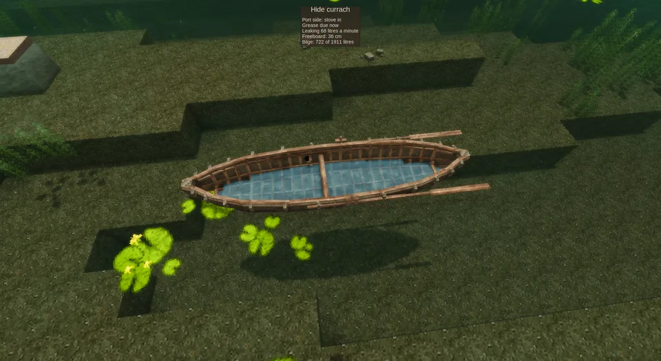
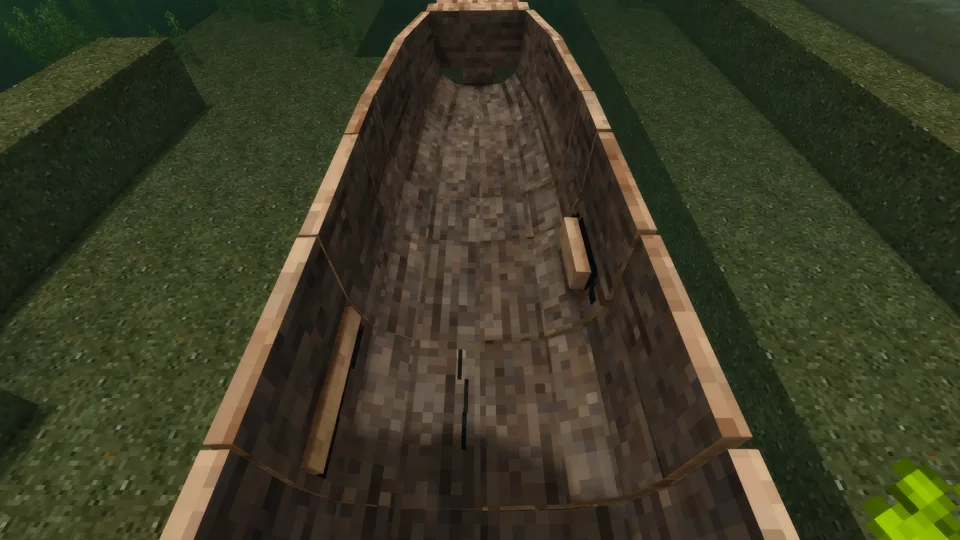
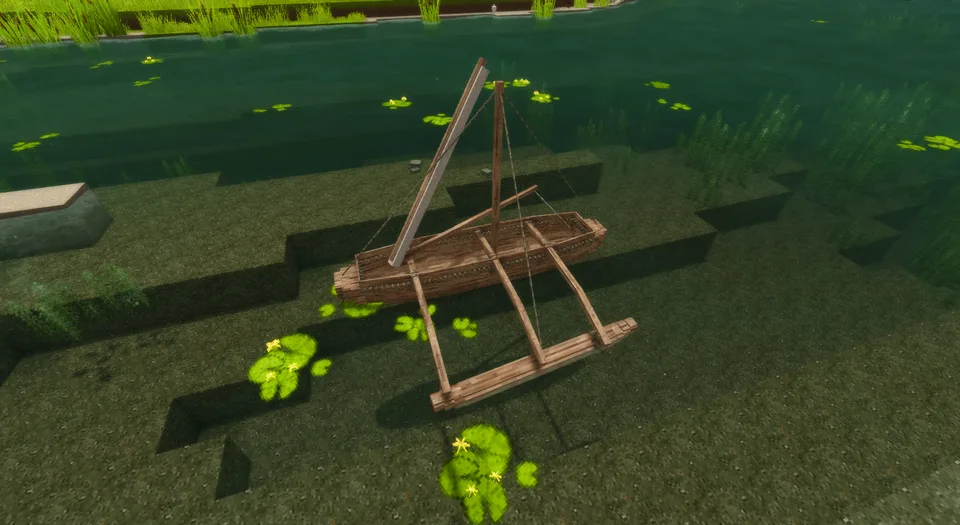

Every vessel has a hull, and a knock cracks it where it lands. A crack leaks, the leaks fill the bilge, and a hull is lost by flooding far more often than by breaking: only a really severe blow breaks one up at once. What a blow does depends on what it is and what it meets: a ram tests the whole frame of a planked or carved hull, but only the skin and the rib behind it on a hull of skin over a frame, a club only the plank where it lands, a breaking wave how far the planking bends.

## Reading it

Look at a vessel to read its hull. A sound one says *Hull: sound*; a cracked one lists each cracked place and how bad it is:

| State | Crack | Hole it leaks through |
| --- | --- | --- |
| *scratched* | a tenth to a quarter | up to 6 cm² |
| *cracked* | a quarter to a half | up to 12 cm² |
| *split* | a half to three quarters | up to 19 cm² |
| *stove in* | three quarters or more | up to 25 cm², a hole 5.6 cm across |

Below it: how many litres a minute it leaks, and its [freeboard](Surf-and-Swamping#how-it-floats) in centimetres, the side it shows above the water; *Awash* when the sea comes over that side, *Sunk* when the vessel lies on the bottom.

Our vessels show each crack where it is, in the hull itself, from outside and from your seat aboard: a scratch is a hairline through the wall, a crack runs along the grain, a split opens across the whole span between what holds the shell and its edge springs, and a place stove in is broken through, its shell pushed in and the dark of the breach around it. Bark splits along its grain, and a bark canoe's sheathing breaks with it; hide tears into a flap. From a split on, the rib or lath under it breaks too, and a place stove in pushes its broken ends inward. A port crack sits nearer the bow than its starboard twin, so the two sides never mirror each other. The crack is as long as the shell's span, but drawn wider than the few millimetres it really opens, so that you see it. A dugout or a bark canoe still being built shows its cracks too. The sailboat marks each cracked place on its planks instead. A vessel you pick up carries its hull with it, every crack in place, and its durability on the item shows how much is left.

The [raft](Raft) and the [reed boat](Reed-Boat) are not cracked: the raft reads *Lashings* in percent, the reed boat *Reed waterlogged* and, once something has torn it, *Reed torn*, and their marks spread over the whole of them.

## Where a blow lands

A hull has seven places: the port and starboard bow, the port and starboard side, the port and starboard quarter, and the bottom. The bow and the quarter are the outer 30% of its length at each end.

- **A knock** lands where the hull hit: within 45° of its length, on the bow or the quarter of that side; otherwise on the side.
- **Rapids**, and a storm that throws it ashore, strike the bottom.
- **A breaking wave** strikes the side the wind comes from.
- **A weapon** strikes where it hits; **an explosion**, the side facing it.

Each harming blow cracks its own place further, and a second knock elsewhere cracks elsewhere.

### An outrigger's float

An [outrigger](Outrigger-Canoe)'s float stands 2 m out from its side, so a knock from that side meets the float before the hull, and so do a blast and lightning landing there. It harms not the float but the lashings that hold it under the booms; a blade or a club on the float only chips its log, as a [raft](Raft)'s: look at the canoe to read *Float lashings* in percent. As they work loose the float hangs lower under the booms, then a lashing parts and the float slews, and once they give out the float comes away with the booms, and the mast they hold up comes down with it. What is left is the [dugout](Dugout) it was rigged on, you still in your seat, its hull's cracks and the water in it as they were, less what its lower side can't hold, and its float, booms, mast, spars, sail, stays and washstrakes float off beside it as firewood, poles, cloth, rope and planks. [Flax twine](Mending) binds them up again before that. A knock from its other side, or on its bow or quarter, strikes its hull as before.

## How a hull takes a blow

What a blow does depends on what it is:

- **A knock, a ram, rapids, an explosion or lightning** shakes the whole boat. A heavy, stout hull takes it in its stride; a light one cracks where it was hit, and a hard enough one breaks it up at once. The [coracle](Coracle), the [bark canoe](Birch-Bark-Canoe) and the [hide currach](Hide-Currach) are skins over a frame of laths, and there a blow meets only the skin where it lands and the lath or rib behind it ([below](#hide-bark-and-reed)).
- **A club, a spear, a stone or a fist** hits one plank. A thin plank gives sooner than a thick one: a club that only cracks a dugout's wall can stave in a sailboat's plank at one blow.
- **An axe or a saw** cuts through far more easily: an iron axe opens a place of most boats at every swing.
- **A breaking wave** presses on the windward side, and either the planks hold or they are stove in ([Breakers](Surf-and-Swamping#breakers)).

A hull breaks up from one really severe blow, or once every place is stove in. Cracks short of that don't break it: they let in the sea.

No two boats are quite alike, as no two pieces of wood are, so the same knock may crack one hull a little more than another. There are no dice: a small knock on a stout hull always leaves a small scratch, and a big one on a light hull is always trouble. On a planked or carved hull, small knocks add up.

### Hide, bark and reed

- **Hide** springs back from a club or a stone, unless a rib or a lath is right behind it there, and then that breaks. A blade cuts hide anywhere. A knock, a ram or rapids that lands on a lath presses the hide onto it: the hide stays whole, and the lath breaks, a split with the lath snapped behind it, and a harder blow stoves the place in. One that lands between two laths stretches the hide first, and it is the hide's pull that breaks both laths, so it takes about twice as much. Only what a stove-in place can't take goes on into the whole frame and can break the boat up.
- **Bark** is no hide: it splits along its grain under a knock, with the sheathing that lines it, and the rib behind takes the rest, or both ribs when it lands between them. A light knock opens the bark and leaves the ribs whole; a harder one breaks them too.
- **Reed bundles** spring back from every blow and every breaker. A blade harms them only where it cuts a lashing, and the boat comes apart once the reed is torn through. A knock, a ram, rapids or lightning crushes the bundles where it lands, and they take it: only what that leaves strains the lashings, and only the lashings part. A knock at any speed a paddle or a river gives leaves the boat whole; only a heavy blast tears it.

## What it is made of

A hull's strength comes from its build, and for a wooden hull also from its wood, by how strong that timber really is against oak:

| Wood | Against oak |
| --- | --- |
| ebony | 1.63 × |
| purpleheart | 1.56 × |
| bamboo (raft) | 1.34 × |
| birch | 1.18 × |
| maple | 1.12 × |
| walnut | 1.04 × |
| oak | 1 |
| larch | 0.93 × |
| acacia | 0.90 × |
| pine | 0.86 × |
| bald cypress | 0.75 × |
| redwood | 0.64 × |
| aged wood (raft) | 0.5 × |
| kapok | 0.37 × |

A wood from another mod counts by its species when we know it (the list is in [Beside other mods](Other-Mods#wildcraft-trees-and-shrubs)); one we don't counts as an average wood.

An ebony sailboat takes more than four times the knocks and the breakers of a kapok one. Against a club or an axe, what counts is how tough the wood is rather than how strong: birch and walnut are the toughest, beech and oak close behind, pine and spruce give twice as easily, and ebony, for all its strength, three times as easily. The numbers: [The science of the hull](The-Science-of-the-Hull#hulls). The [raft](Raft), [sailboat](Sailboat), [dugout](Dugout) and [outrigger canoe](Outrigger-Canoe) are built of a chosen wood, and the [bark canoe](Birch-Bark-Canoe), [coracle](Coracle) and [hide currach](Hide-Currach) have frames of the wood their laths were split from, whatever bark or hide covers them. Their capacities, in oak, are compared on [Vessels](Vessels).

The wood weighs too: a hull of a light wood floats higher and paddles a little faster than oak, one of a heavy wood lower and slower, and one heavier than seawater goes down when it floods ([Surf and swamping](Surf-and-Swamping#how-it-floats)).

## What harms a hull

### Knocks and landings

Running into rock or the shore strikes the hull by the speed it loses into the obstacle: hitting it head-on loses all of it, while a hull glancing along a shore loses only the part that pointed into it. Up to about 1 m/s the hull takes it in its stride, so easing in to a landing is always safe. A hull strikes once, when it meets the rock: paddling on against the rock, or a current holding the hull there, strikes it no more.

The knock grows with everything aboard:

- the vessel itself;
- each rider, with about 10 kg of everyday gear, and armour by how much it slows its wearer: full plate adds about 25 kg;
- each basket, crate or chest at its own empty weight; what is in them doesn't count;
- water in the bilge, by how full it is. A half-full bilge sloshes and brings only half its weight to bear, while a swamped one hits with all of it. Bail before you land.

What one rider's knock does, losing 2 or 4 m/s at once, in oak:

| Vessel | At 2 m/s | At 4 m/s |
| --- | --- | --- |
| [Dugout](Dugout) | scratches | scratches |
| [Outrigger canoe](Outrigger-Canoe) | scratches; on its float's side, works nearly half its lashings loose | scratches; on its float's side, tears the float away |
| [Sailboat](Sailboat) | scratches | cracks |
| [Birch-bark canoe](Birch-Bark-Canoe) | splits it with its ribs broken, or stoves it in on a rib | stoves it in |
| [Reed boat](Reed-Boat) | nothing | nothing |
| [Hide currach](Hide-Currach) | stoves it in where it hit | stoves it in |
| [Raft](Raft) | shakes a quarter of its lashings loose | mostly breaks it up |
| [Coracle](Coracle) | splits it with its laths broken, or stoves it in on a lath | stoves it in |

Every knock adds to its place's crack, so a scratch from a bump becomes a crack after a few more. The three framed hulls feel a knock far sooner than the rest, since one lath or rib takes it rather than the whole boat; but a knock that breaks nothing in them, neither opening bark nor snapping a lath, leaves no mark, for hide and green wood spring back. With one aboard, in oak, a knock on a lath breaks it at 1.2 m/s in a currach and 1.4 in a coracle, and one between two laths breaks both at 1.5 and 1.8; a bark canoe's bark opens at 1.3 m/s, and its ribs break at 1.6 on a rib and 1.8 between two. A gentle landing, up to 1 m/s, is as safe in them as in any boat.

### Rams

A vessel that runs into another strikes both, the harder the faster they closed. Both take the same knock, and it is set mostly by the lighter boat: a coracle rammed by a sailboat takes about half of what a rock would give it, and the sailboat the same, which to the sailboat is nothing. As with a rock, coming alongside gently does no harm.

Only hull against hull rams. A creature or a player swimming into a vessel only pushes it: flesh takes up the blow.

### Waves

Breaking waves slam the windward side, and a plunging crest far harder than a spilling one. That is on [Surf and swamping](Surf-and-Swamping#breakers); waves that reach a vessel left [moored by the shore](Mooring#thrown-ashore) can throw it on its bottom while you are away.

### Rapids

White water batters the bottom of every hull but two, every second it is in it. See [Rapids](Rapids).

### Weapons, explosions and lightning

A weapon hits as hard as the damage it does. An iron axe opens a place of a sailboat or a dugout at every swing, and takes an oak raft apart in about nine. A club springs off a currach's hide until it finds a lath. A bomb or a bolt of [lightning](Lightning) shakes the whole boat and does far more.

## Leaks

A crack lets the sea in faster the deeper it lies under the waterline. A crack in the bottom always leaks. One in the bow, a side or the quarter sits a quarter of the way up the side: on a light boat riding high it barely leaks, or not at all, while a loaded boat sits low enough for it to pour.

What one stove-in place lets in, with one aboard and a dry bilge, in a hull of oak where it has a wood:

| Vessel | Bilge | Stove-in bottom | Stove-in side | The bottom fills it in |
| --- | --- | --- | --- | --- |
| [Coracle](Coracle) | 272 litres | 119 litres a minute | none | two and a quarter minutes |
| [Dugout](Dugout) | 1298 litres | 137 | none | nine and a half minutes |
| [Outrigger canoe](Outrigger-Canoe) | 1720 litres | 159 | none | eleven minutes |
| [Birch-bark canoe](Birch-Bark-Canoe) | 609 litres | 92 | none | six and a half minutes |
| [Sailboat](Sailboat) | 8209 litres | 188 | none | forty-four minutes |
| [Hide currach](Hide-Currach) | 1911 litres | 84 | none | twenty-three minutes |

A bottom leak keeps its pace as the hull fills, for the water inside rises with it; a side leak slows once the water inside stands above it. A bottom only cracked by a hard knock lets in about a quarter as much. A bucket bails about 200 litres a minute ([Bailing](Bailing)): it keeps up with one bad leak in most boats, but enough cracks outpace any bailing, and then without [mending](Mending) the boat is done.

## Seeping and soaking

A wooden hull barely wears: the dugout, the outrigger, the bark canoe and the sailboat need no upkeep. Hide and reed change just by floating, counted in game hours afloat:

- A hide cover, the [coracle](Coracle)'s and the [hide currach](Hide-Currach)'s, seeps at every seam where one hide meets the next once the grease is gone: about 13 litres a game hour a seam across a currach or a coracle. Rendered fat keeps them tight for two and a half days afloat; look at the boat to see when the next greasing is due.
- A cover rots by the hides it is sewn from. Untanned hide, raw, soaked or scraped, keeps a day afloat in water at 20 °C and two weeks at 5 °C, then rots through in as long again, cracking the boat everywhere; salted hide keeps half a day more, oiled hide and pelts three times as long, and bark-tanned prepared hide a year. Its time afloat counts by the water it was in, so days in cold water spent little of its keeping. A day ashore in the sun dries a cover through, and it keeps afresh, as untanned covers were dried every day; each hide rots no further than its own part of the cover. A wet cover is heavier by the water it takes up.
- The [reed boat](Reed-Boat) soaks up 33 kg of water a day afloat, sitting deeper as it does and its ends sagging: after a day its rider sits awash, and left alone it is on the bottom within four. Ashore under the open sky, in daylight and no rain, it dries out, but each drying leaves a third of what it drove out behind as rot that never dries. Soaked and dried a few times, it sinks the moment it is launched.

A [raft](Raft) has no hull to fill: a knock works its lashings loose instead, and once they are all loose it comes apart.

## Keeping it whole

A hull is [mended](Mending) one patch at a time, with the vessel's own material, on the place you look at.

## When it is lost

A flooded hull lies awash or goes to the bottom, by what it is built of and what it carries ([Swamping](Surf-and-Swamping#swamping)). A sunk vessel lies on the bottom whole, its cargo still aboard: dive down to it, or break it up there with an axe for its wreckage. Raising it is planned for [The deep](Roadmap#the-deep).

A vessel broken up, by one severe blow, by every place stove in, by its lashings coming loose, its reed torn through or an axe on the bottom, is gone. What it was built from scatters on the water as wreckage, and like any dropped item it lasts about ten minutes:

| Vessel | Wreckage |
| --- | --- |
| [Raft](Raft) | a few logs (or bamboo stakes) and maybe a rope |
| [Sailboat](Sailboat) | about 40 planks, a few support beams, ropes and linen |
| [Reed boat](Reed-Boat) | a handful of tops from each bundle, of the plant it was bound from |
| [Dugout](Dugout) | firewood |
| [Coracle](Coracle) | a few laths |
| [Birch-bark canoe](Birch-Bark-Canoe) | some bark and a stick |
| [Hide currach](Hide-Currach) | a few laths |
| [Outrigger canoe](Outrigger-Canoe) | firewood, a rope, some linen, and planks once it has washstrakes |

Whatever it carried goes with it.

With [Hull damage](World-Settings#the-mechanics) off, only weapons and explosions harm a hull: no knock, ram, rapids, breaker or weather cracks it, hide doesn't rot, seams don't seep and reed doesn't soak. Turning it off mends every hull whole.
