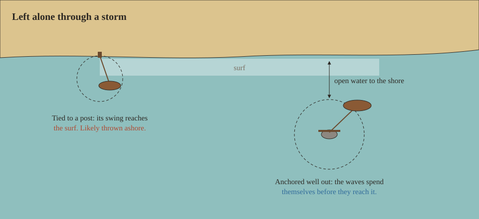

A vessel left alone [is carried off by the current](Currents#drift), and a [storm](Storms) can throw it onto the shore. Where you leave it matters as much as how you tie it.

## Tying up

Tie a vessel to a fence post or a growing tree's trunk ashore with a rope, the way you tie an animal: right-click the vessel with the rope, then the post. Every vessel can be tied up, by one rope. To change the rope's length, hold it and pick *Shorten* or *Lengthen* in its tool modes (F): a rope runs from 1.5 to 10 metres.

The vessel lies free within the rope's length. When the current or a wave carries it out to the rope's end, the rope stops it there, and the jerk runs through the rope.

- **A short rope** keeps the vessel close to the post, but it gives little, so it jerks hard.
- **A long rope** gives more, so it jerks softly, but the vessel swings wider, nearer the shore.
- **A heavy vessel** jerks harder than a light one at the same speed.

A rope that takes more than it holds parts, and the cut rope lies by the post. In a quiet bay or a river nothing parts. In a storm, the sea decides: on a 2.5 m rope a sailboat parts it in a gale's 5.5 m sea, while on a 9 m rope it rides that sea out and parts only in the bigger waves of a 7 m sea. A raft is light and jerks a rope far less.

In a [current](Currents) the vessel falls back to the end of its rope and swings about its bow until it lies along the stream. A vessel tied up and also [anchored](Anchoring) is held by both: the rope and the anchor's rope share the pull between them.

While you sit in a tied vessel and row or sail away, the rope stops you at its end; reach it fast enough and it parts.

## Thrown ashore

A vessel moored near the shore with nobody around may be thrown onto the beach while you are away. When you come back after a game hour or more, Rough Seas works out what the waves did while you were gone: how high they ran, for how long, and how much open water lay between the vessel and the shore. The higher and longer the sea, and the nearer the shore, the likelier it is that the vessel was thrown ashore. A thrown vessel hits the bottom as if run aground at the speed the breakers of the highest sea of that time ran: in a gale's 5.5 m sea, about 7 m/s. That breaks up a raft, and the heavy sailboat more often than not, and cracks or stoves in the bottom of the rest. It isn't moved, its anchor and bilge are as they were, and the hull [takes the strike](Hull-Condition#how-a-hull-takes-a-blow).

| While you were away | Shore beyond the vessel's swing | Chance it was thrown ashore |
| --- | --- | --- |
| 8 hours of 5.5 m seas (a gale) | 50 metres | about 86% |
| 8 hours of 3 m seas | 100 metres | under 1% |

Only the distance to the shore and the sea count, not how well it was tied. A long rope lets the boat swing wider, and nearer the shore. The safe place to leave a vessel in a storm is far from any shore, or out of the water.

## Leaving a vessel

- On a river or a pond: tie it up. The waves there stay small, and the current is what pulls. A big lake in a storm raises a sea of its own: treat its shore as a coast.
- On the coast in fair weather: tie it up, or [anchor](Anchoring) the sailboat.
- On the coast with a storm coming: carry it home, or anchor well out, and leave nothing that matters aboard.

With [Mooring strain](World-Settings#the-mechanics) off, no rope parts and no vessel is thrown ashore; the rope still holds a vessel at its length. With [Currents](World-Settings#the-mechanics) on, currents still pull at it.
