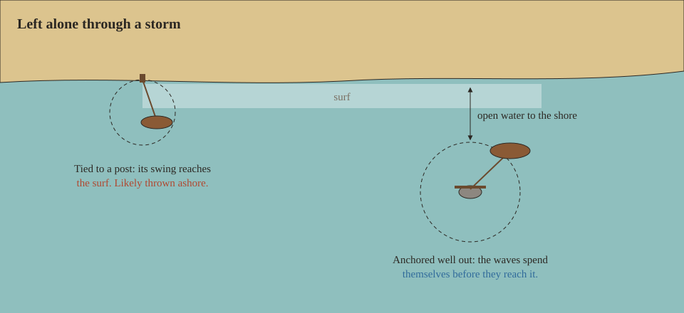

A vessel left alone [drifts with the current](Currents#drift), and a [storm](Storms) can throw it onto the shore. Where you leave it matters as much as how you tie it.

## Tying up

Tie a vessel to a fence post ashore with a rope, the way you tie an animal. Every vessel can be tied up. The post keeps it within 10 metres; a vessel tied up and also [anchored](Anchoring) is held by the anchor.

A strong enough pull snaps the rope. Every wave pulls on it, with the wind on the vessel's sides and rigging and the sea on its hull, so the bigger the vessel, the sooner it goes. Chance the rope snaps, each wave:

| Vessel | Gale (force 8) | Strong gale (force 9) | Storm (force 10) |
| --- | --- | --- | --- |
| [Sailboat](Sailboat) | 1 in 40 | 1 in 10 | 1 in 4 |
| [Outrigger canoe](Outrigger-Canoe) | 1 in 100 | 1 in 20 | 1 in 6 |
| [Raft](Raft) | 1 in 250 | 1 in 30 | 1 in 8 |
| [Coracle](Coracle) | almost never | 1 in 150 | 1 in 20 |
| [Hide currach](Hide-Currach) | almost never | 1 in 500 | 1 in 40 |
| [Reed boat](Reed-Boat) | never | almost never | 1 in 100 |
| [Dugout](Dugout), [birch-bark canoe](Birch-Bark-Canoe) | never | almost never | 1 in 250 |

A snapped vessel drifts, and in a storm the drift is downwind. Pull small boats ashore, or pick them up, before a gale.

## Thrown ashore

A vessel moored near the shore with nobody around may be thrown onto the beach while you are away. When you come back after a game hour or more, Rough Seas works out what the waves did while you were gone: how high they ran, for how long, and how much open water lay between the vessel and the shore. The higher and longer the sea, and the nearer the shore, the likelier it is that the vessel was thrown ashore. A thrown vessel takes three times the blow of a breaker as high as the highest sea of that time; it isn't moved, its anchor and bilge are as they were, and the hull [takes the strike](Hull-Condition#how-a-hull-takes-a-blow).

| While you were away | Shore beyond the vessel's swing | Chance it was thrown ashore |
| --- | --- | --- |
| 8 hours of 5.5 m seas (a gale) | 50 metres | about 86% |
| 8 hours of 3 m seas | 100 metres | under 1% |

Only the distance to the shore and the sea count, not how well it was tied. A long anchor rope lets the boat swing wider, and nearer the shore. The safe place to leave a vessel in a storm is far from any shore, or out of the water.

## Leaving a vessel

- On a river or lake: tie it up. There are no waves, only the current.
- On the coast in fair weather: tie it up, or [anchor](Anchoring) the sailboat.
- On the coast with a storm coming: carry it home, or anchor well out, and leave nothing that matters aboard.

With [Dangerous oceans](World-Settings#dangerous-oceans) off, the sea doesn't snap ropes or throw vessels ashore; currents still pull at them.
