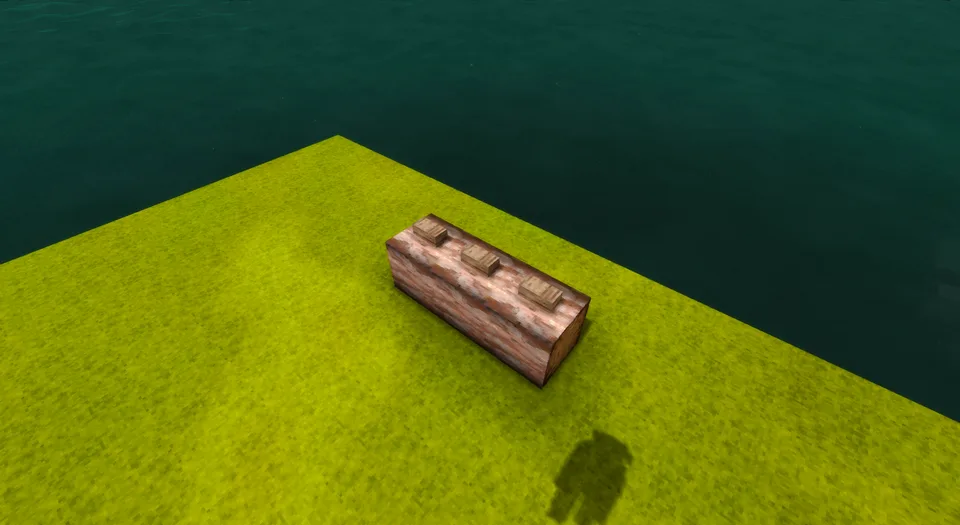
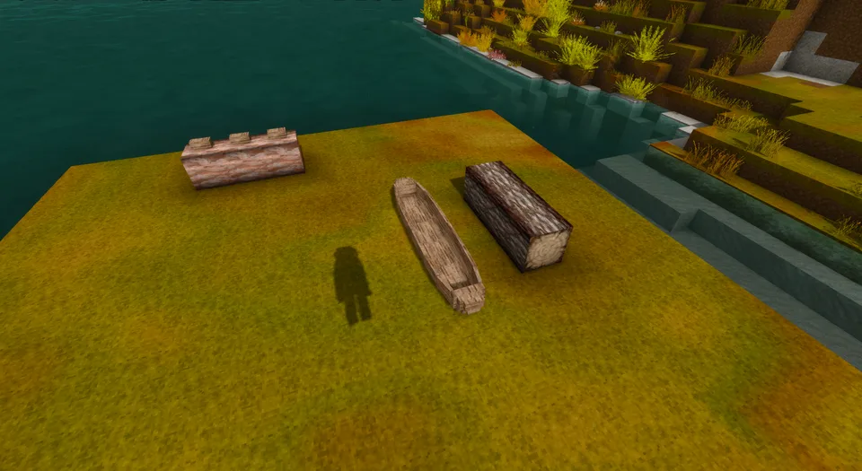
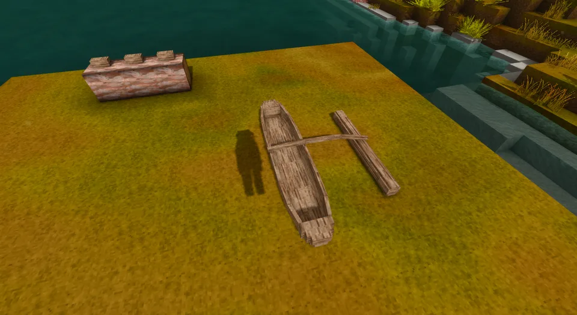
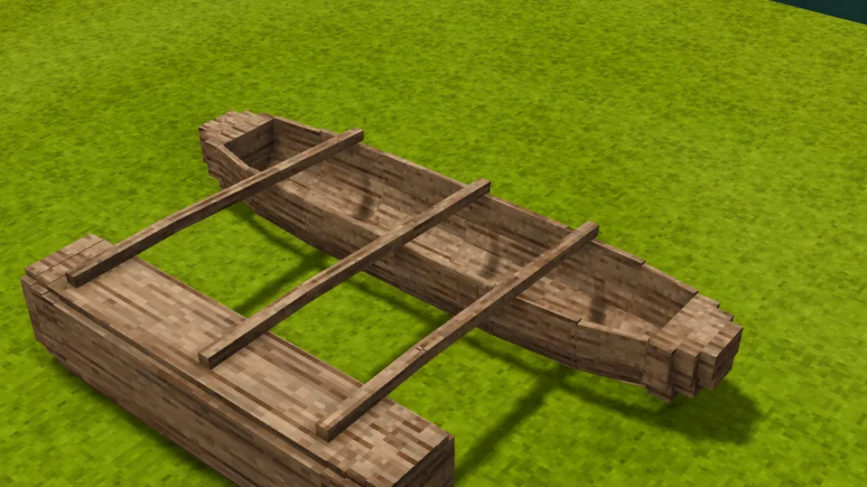
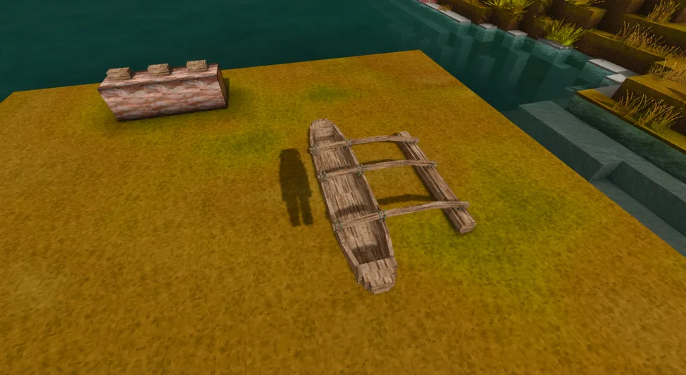
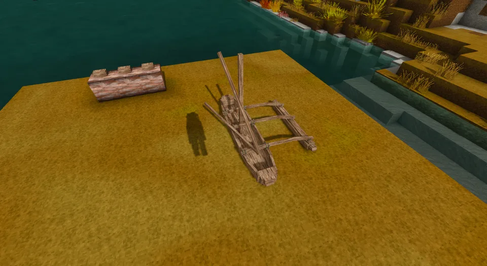
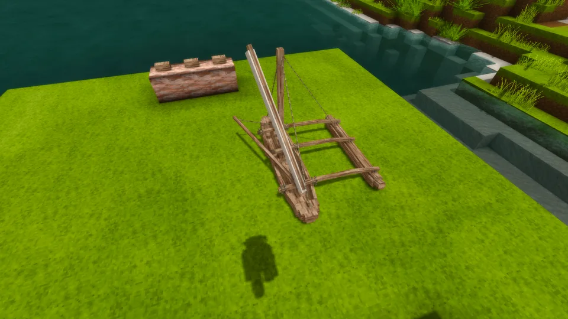
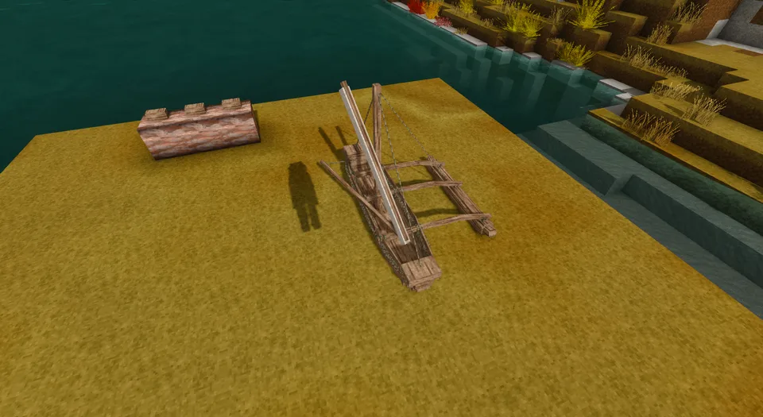

A dugout with a float log held out to one side on three crooked booms lashed across her gunwales and down onto it, and a mast stayed fore, aft and out to the float: 5 blocks long and 3 across, hull, gap and float. For the open sea she takes washstrakes of sawn planks sewn along her sides and across her ends. Her crab-claw sail hangs between two spars, set, reefed or furled to the upper one. Her hull, her float, her poles and her washstrakes can each be of their own wood.

## In Rough Seas

For a long crossing of open sea. The outrigger is the fastest vessel before metal, and it sails, leaving every rowed boat far astern. The float keeps the narrow hull upright where a dugout would roll over. It also stands out on its side, so knocks from that side work its lashings loose rather than cracking her hull; let them give out and the float and rig come away, leaving the dugout. Built without a saw she is a coastal boat whose low sides ship water as a dugout's do; once you have a saw, washstrakes raise her side for the open sea. It is clumsy to turn and it can't be picked up, so where you launch it is where it lives.

## Where it comes from

The outrigger is the boat of the Austronesian expansion, the greatest migration by sea before modern times: from Taiwan and Island Southeast Asia, canoes like it carried people west to Madagascar and east across the Pacific to Hawaii, Rapa Nui and New Zealand. A burnt and hewn dugout hull carries a single float (the *ama*), a smaller log shaped with an adze and pointed at its ends, on booms lashed across the hull with fibre cord, and a crab-claw sail of woven matting on two spars. All of it was made without metal or saw. The model is a small single-outrigger sailing canoe of that family, with linen in place of the matting.

## By the numbers

| | |
| --- | --- |
| Speed | 2.7 × the raft under full sail, faster than the sailboat |
| Turning | clumsy |
| [Hull](Hull-Condition) | 30 000 J in oak, more in harder [woods](Hull-Condition#what-it-is-made-of): her hull is the dugout's |
| Upkeep | none |
| [Freeboard](Surf-and-Swamping#how-she-floats) | with washstrakes 58 cm empty, 56 cm with its helmsman; without them 43 and 41; in oak |
| [Flooded](Surf-and-Swamping#swamping) | floats awash, holding up 271 kg of gear, armour and containers in oak; sinks in a wood heavier than seawater |
| [Mending](Mending) | 1 log of its hull's wood closes two fifths of a stove-in place; 1 flax twine binds up a ninth of her float's lashings |
| [Her float](Hull-Condition#an-outriggers-float) | takes the knocks on its side on its lashings: with one aboard, losing 2 m/s into rock works nearly half of them loose, and 4 m/s tears them out and leaves her the dugout |
| [Bilge](Bailing) | 1720 litres with washstrakes, 1298 without |
| [Capsized by](Surf-and-Swamping#capsizing), in 1.0 | a 2.6 m breaker; it barely rolls in a sea |
| [Lightning](Lightning) | its 3 m mast draws strikes |
| [Rapids](Rapids) | takes a few seconds, not a long run |
| [Left alone](Currents#drift) | drifts with the current and the wind |
| [Mooring](Mooring) | tied to a post |
| Carried | too heavy to pick up |
| Seats | two: the front one steers, under sail too, and paddles with an [oar](https://wiki.vintagestory.at/Oar) in hand; the back one takes a passenger |
| Cargo | a basket (8 slots) in the back seat, in place of the passenger |
| Built from | a finished [dugout](Dugout), 3 logs for her float, 6 poles of 3 m, 10 ropes and 4 linen cloths; washstrakes, when she takes them, 10 planks and 4 ropes |
| Wreckage | firewood, a rope, some linen, and planks once she has washstrakes |

Its sail drives it the same whatever the wind does; sailing by the wind comes in [Seamanship](Roadmap#seamanship).

## How it is built

Not in the crafting grid: an outrigger is a finished [dugout](Dugout) rigged where she lies, piece by piece, each piece drawn on her as it goes on. Nothing in it needs a saw.

1. **Split the poles.** Lay three logs of one wood on their sides, end to end, anywhere, set a [splitting wedge](Recipes#splitting-wedge) on each, and hold an axe on a wedge: the trunk splits into 64 poles of 3 m. She takes six, and a longer pole serves too, cut down. Any wood will do, a modded tree's too.

   

2. **Lay her float.** Beside a finished dugout, lay three more logs of one wood on their sides, end to end along her, the middle one beside her middle, a block off: hull, gap, float.

   

3. **Join them.** Hold a pole on the dugout: her first boom goes across her gunwales onto the logs, and the logs become her float where they lie, still three logs a metre across. She is now the outrigger, her hull the same hull, with its cracks and the water in it. A float on the far side turns her end for end. A dugout pushed off the block grid, or lying a little askew, is squared onto them, so her float lies exactly where they lay; one lying too far askew has to be pushed straight first.

   

4. **Lay the booms.** Hold the other two poles on her for the fore and aft booms. Each is a crooked pole that rests on her gunwales and on the logs' top, as the curved booms of Hawaii and the Marshall Islands came down to the float. All her poles must be of one wood.
5. **Hew the float.** Hold an axe on her: each pass hews the float all round, top, sides and bottom alike, from the square logs toward a round log 30 cm across with its ends pointed and lifted. Six passes take it down from 3000 litres of wood to 224. The booms settle onto it as it shrinks: they never hang in the air and never pass through wood. While the float is still the logs, she weighs two tonnes and barely moves.

   

6. **Lash her.** Rope lashes each boom to both gunwales and straight onto the float: thirteen turns a lashing, 52 metres in all, six ropes.

   

7. **Step the mast.** Hold the last three poles on her: the mast, then the crab claw's upper and lower spars.

   

8. **Bend on the sail and set up the stays.** Hold linen cloth on her, four pieces for her 3.5 m² of sail, then four ropes: the forestay, the backstay, the shroud out to the float and the sheet. She is finished and takes her seats.

   

9. **Washstrakes, when you take her to sea.** Any time after she is finished, once you have a saw: hold planks of one wood on her, a board along each side four planks long and a board across each end of her hollow, ten in all, then four ropes to sew them on, a stitch every 7.6 cm. Sewn, they raise her side 15 cm and add 422 litres to her hold: a 2 m swell that boards a dugout runs past her. Without them she is a coastal boat.

   

Push her into the water with Shift and an empty hand: she is heavy, a few centimetres a push over dry ground, so rig her at the water's edge. An outrigger from before the build loads finished, with her washstrakes on, as she was built.

## Its neighbours

- The [hide currach](Hide-Currach) is the other small boat for the sea: slower, but it carries cargo and can be carried.
- The [sailboat](Sailboat) is slower and carries far more.
- The [dugout](Dugout) is the same hull without the float: she is built on one, and is as tough, and tippy at sea.

## Every form it takes

| | |
| --- | --- |
|  |  |
| Afloat, from the side | From the stern quarter |
|  |  |
| From above | Beside the sailboat |
|  |  |
| Ashore | Ashore, from the quarter |
|  |  |
| Dropped on the ground | Held in the hand |
|  |  |
| In the hotbar | Its wreckage |
