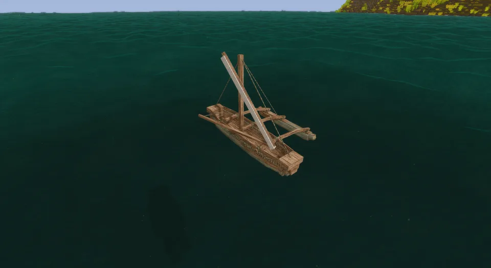

A dugout hull raised with a plank washstrake, with a float log held out to one side on two curved booms, a small platform between them, and a mast stayed fore, aft and out to the float. Its sail is set, reefed or furled to the yard, and stands at a reach, 40° to the hull.

## In Rough Seas

For a long crossing of open sea. The outrigger is the fastest vessel before metal, and it sails, leaving every rowed boat far astern. The float keeps the narrow hull upright where a dugout would roll over. It is clumsy to turn and it can't be picked up, so where you launch it is where it lives.

## Where it comes from

The outrigger is the boat of the Austronesian expansion, the greatest migration by sea before modern times: from Taiwan and Island Southeast Asia, canoes like it carried people west to Madagascar and east across the Pacific to Hawaii, Rapa Nui and New Zealand. A dugout hull is built up with sewn planks, and a single float (the *ama*) rides on booms lashed across the hull. The model is a single-outrigger sailing canoe of that family; Pacific canoes more often carried the triangular crab-claw sail than the rectangular one it sets here.

## By the numbers

| | |
| --- | --- |
| Speed | 2.7 × the raft under full sail, faster than the sailboat |
| Turning | clumsy |
| [Hull](Hull-Condition) | 15 000 J in oak, more in harder [woods](Hull-Condition#what-it-is-made-of) |
| Upkeep | none |
| [Freeboard](Surf-and-Swamping#how-she-floats) | 45 cm empty, 40 cm with its helmsman, in oak |
| [Flooded](Surf-and-Swamping#swamping) | floats awash, holding up 130 kg of gear, armour and containers in oak; sinks in a wood heavier than seawater |
| [Mending](Mending) | 2 planks of its wood close a fourteenth of a stove-in place |
| [Bilge](Bailing) | 600 litres |
| [Capsized by](Surf-and-Swamping#capsizing), in 1.0 | a 2.1 m breaker; it barely rolls in a sea |
| [Lightning](Lightning) | its 3.4 m mast draws strikes |
| [Rapids](Rapids) | takes a few seconds, not a long run |
| [Left alone](Currents#drift) | drifts with the current and the wind |
| [Mooring](Mooring) | tied to a post |
| Carried | too heavy to pick up |
| Seats | two: the helmsman aft, who paddles when the sail is furled, and a passenger forward |
| Cargo | a basket (8 slots) forward, in place of the passenger |
| Built from | 4 logs and 8 planks of one wood (or 4 log sections and 8 planks of that mod's woods), 2 ropes and a sail |
| Wreckage | planks, a rope and some linen |

Its sail drives it the same whatever the wind does; sailing by the wind comes in [Seamanship](Roadmap#seamanship).

## How it is built

Logs and planks of one wood, a modded tree's too. Redwood, and any wood that comes in sections, builds from its log sections, with planks of any wood from the same mod.

| | |
| --- | --- |
| 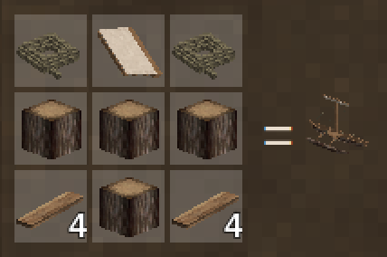 | 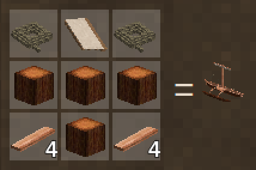 |
| From logs | From redwood log sections |

## Its neighbours

- The [hide currach](Hide-Currach) is the other small boat for the sea: slower, but it carries cargo and can be carried.
- The [sailboat](Sailboat) is slower and carries far more.
- The [dugout](Dugout) is the same hull without the float: tougher, and tippy at sea.

## Every form it takes

| | |
| --- | --- |
| 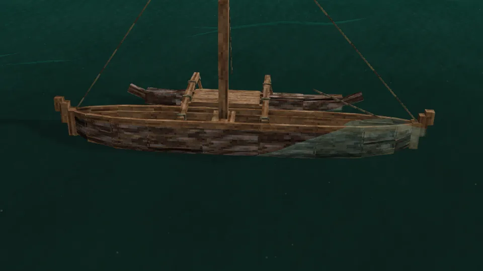 | 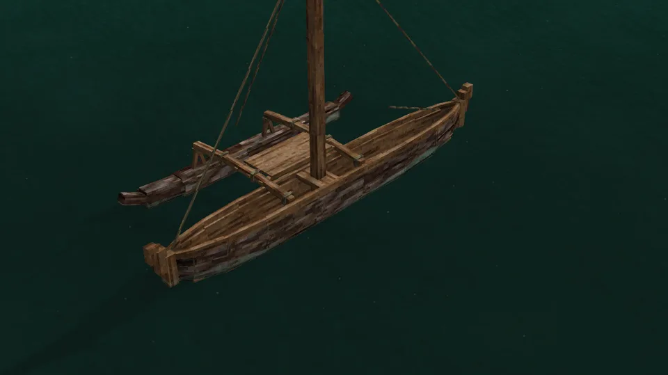 |
| Afloat, from the side | From the stern quarter |
| 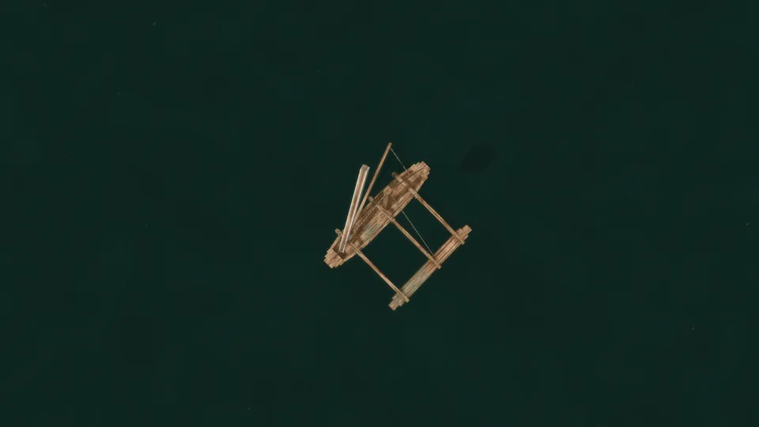 | 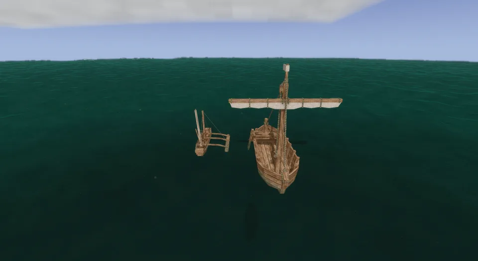 |
| From above | Beside the sailboat |
| 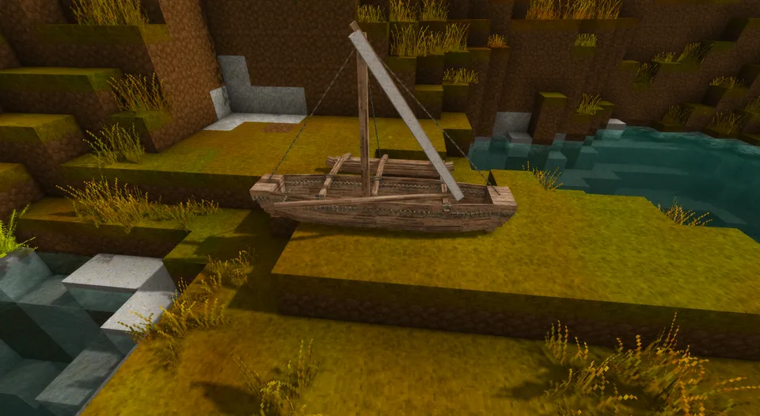 | 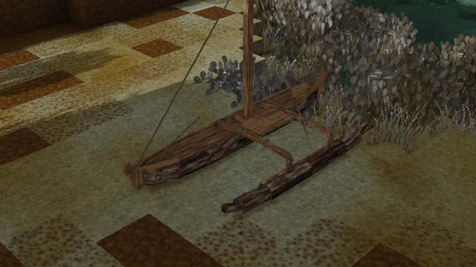 |
| Ashore | Ashore, from the quarter |
| 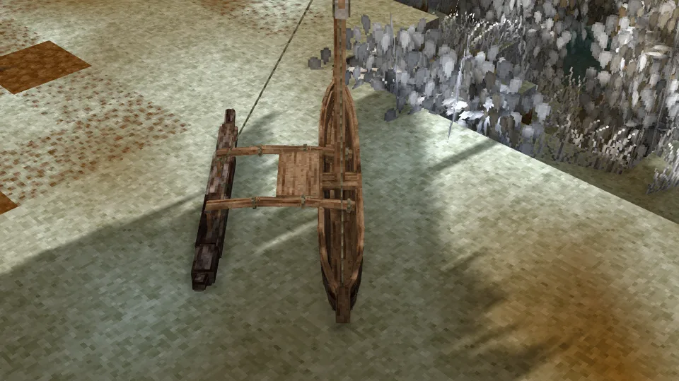 | 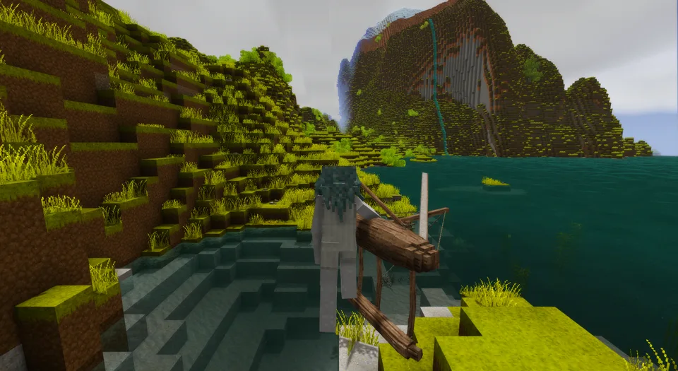 |
| Dropped on the ground | Fresh from the crafting grid, before launching |
| 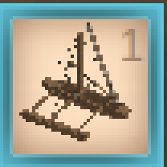 | 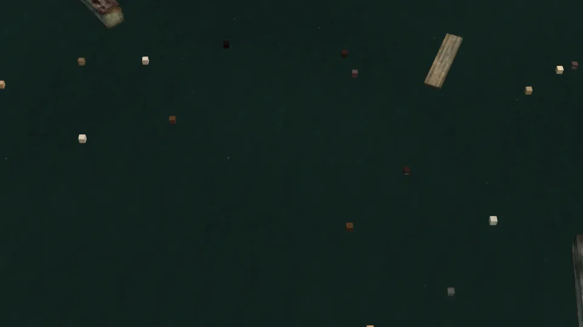 |
| In the hotbar | Its wreckage |
