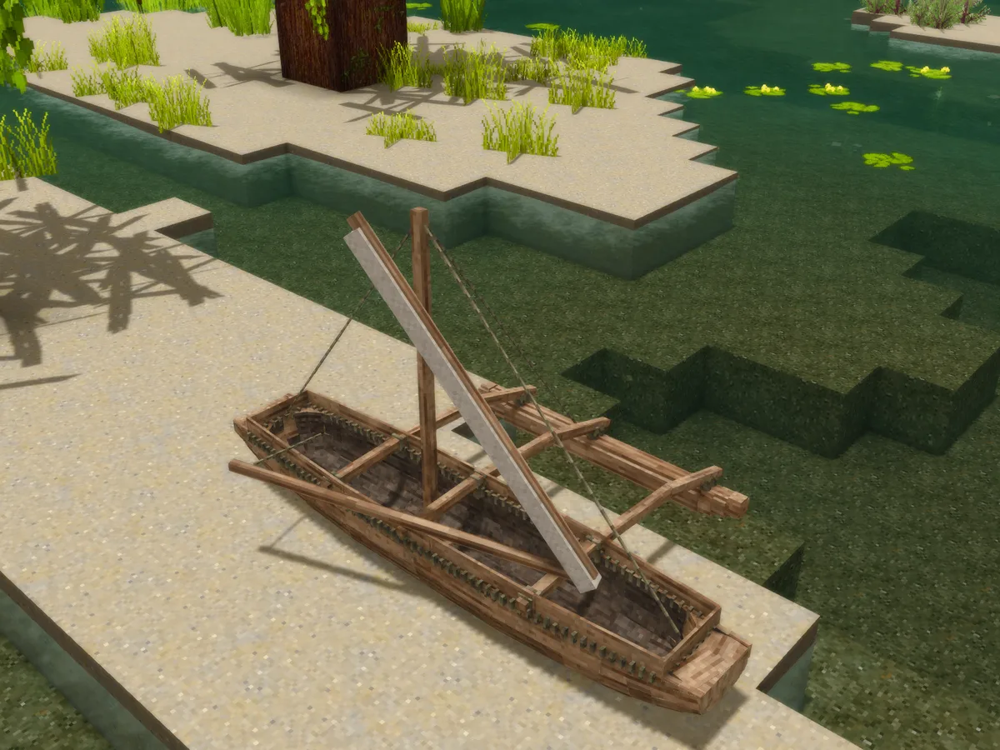
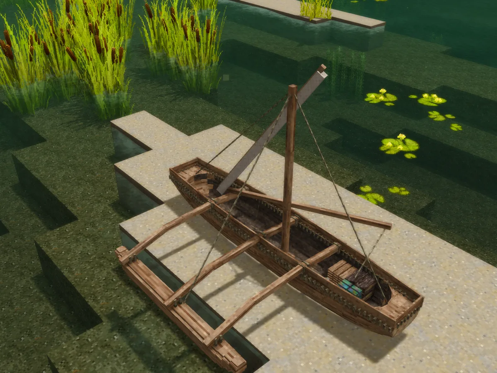

A dugout with a float log held out to one side on three crooked booms lashed across its gunwales and down onto the float, and a mast stepped on the middle boom by the float's side: 5 blocks long and 3 across, hull, gap and float. The mast rakes toward the end the sail's foot stands at, held by a shroud and a wooden shore out toward the float and by running stays to both ends. For the open sea it takes washstrakes of sawn planks sewn along its sides and across its ends. Its crab-claw sail hangs from the mast on a halyard, between a yard and a boom: set full, reefed by rolling its foot round the boom, or furled with both spars let down along its side. Its hull, its float, its poles and its washstrakes can each be of their own wood.

## In Rough Seas

For a long crossing of open sea. The outrigger sails by the wind, leaving every rowed boat far astern on a reach. It keeps its float to windward, as real outriggers did, and changes tack by shunting: the sail's foot goes to the other end, and it sails the other way. The float keeps the narrow hull upright where a dugout would roll over. It also stands out on its side, so knocks from that side work its lashings loose rather than cracking the hull; let them give out and the float and rig come away, leaving the dugout. Built without a saw it is a coastal boat whose low sides ship water as a dugout's do; once you have a saw, washstrakes raise its side for the open sea. It is clumsy to turn and it can't be picked up, so where you launch it is where it lives.

## Where it comes from

The outrigger is the boat of the Austronesian expansion, the greatest migration by sea before modern times: from Taiwan and Island Southeast Asia, canoes like it carried people west to Madagascar and east across the Pacific to Hawaii, Rapa Nui and New Zealand. A burnt and hewn dugout hull carries a single float (the *ama*), a smaller log shaped with an adze and pointed at its ends, on booms lashed across the hull with fibre cord, and a crab-claw sail of woven matting on two spars. All of it was made without metal or saw. The model is a small single-outrigger sailing canoe of that family, with linen in place of the matting. Its rig is the one the canoes of Fiji, the Marshall Islands and the Marianas sailed with: they kept the float always to windward, and to change tack they carried the sail's foot to the other end, which became the bow.

## By the numbers

| | |
| --- | --- |
| Speed | by the wind: about a third of the wind's speed with the wind abeam ([sailing it](#sailing-it)); 1.5 m/s paddled, 2.1 m/s poled ([how fast](Paddles-Poles-and-Oars#how-fast)) |
| Turning | clumsy, 14° a second paddled |
| [Hull](Hull-Condition) | 30 000 J in oak, more in harder [woods](Hull-Condition#what-it-is-made-of): its hull is the dugout's |
| Upkeep | none |
| [Freeboard](Surf-and-Swamping#how-it-floats) | with washstrakes 58 cm empty, 56 cm with its helmsman; without them 44 and 42; in oak |
| [Flooded](Surf-and-Swamping#swamping) | floats awash, holding up 289 kg of tools, armour and containers in oak; sinks in a wood heavier than seawater |
| [Mending](Mending) | 1 log of its hull's wood closes two fifths of a stove-in place; 1 flax twine binds up a ninth of its float's lashings |
| [Its float](Hull-Condition#an-outriggers-float) | takes the knocks on its side on its lashings: with one aboard, losing 2 m/s into rock works nearly half of them loose, and 4 m/s tears them out and leaves the dugout |
| [Bilge](Bailing) | 2009 litres with washstrakes, 1436 without |
| [Capsized by](Surf-and-Swamping#capsizing), in 1.0 | a 2.6 m breaker; it barely rolls in a sea |
| [Lightning](Lightning) | its masthead, 3.5 m up, draws strikes |
| [Rapids](Rapids) | takes a few seconds, not a long run |
| [In a current](Currents#drift) | carried with it and with the waves, steered or not |
| [Mooring](Mooring) | tied to a post |
| Carried | too heavy to pick up |
| Seats | two: the front one steers, under sail whatever is in hand, and with the sail lowered paddles or poles, a [paddle](Paddles-Poles-and-Oars) or a [pole](Paddles-Poles-and-Oars) in hand, standing at its bow end to pole; the back one takes a passenger |
| Cargo | a [hold](Vessels#holds) of 8 slots behind the passenger; the mast stands where the dugout's middle hold lies |
| Built from | a finished [dugout](Dugout), 3 logs for its float, 7 poles (4 of 3 m, 1 of 2 m, 2 of 4 m), 11 ropes and 3 linen cloths; washstrakes, when it takes them, 12 planks and 5 ropes |
| Wreckage | firewood, a rope, some linen, and planks once it has washstrakes |

## Sailing it

1. **Set the sail.** Sit in the front seat and right-click the halyard cleat at the foot of the mast. The first click sets half the sail, rolled round the boom, the second the full sail, and the third lowers it.
2. **Steer.** Under sail the wind drives the canoe, and <kbd>A</kbd> and <kbd>D</kbd> steer it whatever you hold. A paddle or a pole drives it only with the sail lowered.
3. **Keep the wind on the float's side.** The sail stands on the other side of the mast, to leeward, and fills there. A wind from that other side takes the sail aback: it presses on the wrong face, and the sail drives nothing.
4. **Pick your heading.** With the wind abeam the canoe makes about a third of the wind's speed, and it runs on with the wind behind it, the sail swung out across it. As you turn toward the wind it slows, and head to wind the sail draws nothing and the wind pushes the canoe back.
5. **Shunt to sail the other way.** Right-click the sail step at the far end. Over a few seconds the stays rake the mast over toward that end, the sail's foot is carried along the lee side into that step, and the canoe sails toward that end with its float still to windward. The sail draws nothing while it is carried. You stay in your seat, so you now face the way you came.

The wind pushes the canoe sideways a little as it sails, and drifts it downwind with the sail lowered. A canoe [tied up](Mooring) with its sail set strains its rope; set loose, it sails off on its own. How the wind drives it: [the science of the hull](The-Science-of-the-Hull#under-sail).

## How it is built

You don't craft an outrigger in the grid: you rig a finished [dugout](Dugout) where it lies, piece by piece, and each piece shows as you lay it. None of it needs a saw.

1. **Split the poles.** Lay three logs of one wood on their sides, end to end, anywhere, set a [splitting wedge](Recipes#splitting-wedge) on each, and hold an axe on each wedge in turn until it is driven home. Once the last is home, the trunk splits into 64 poles of 3 m. The outrigger takes four, one of 2 m for the mast's shore, and two of 4 m for its sail's spars: split rows of two and of four logs for those. A longer pole serves too, cut down. Any wood will do, a modded tree's too.

   

2. **Lay the float.** Lay three more logs of one wood on their sides beside a finished dugout, end to end along it, the middle log beside its middle, a block off: hull, gap, float.

   

3. **Join them.** Hold a pole on the dugout. The first boom goes across its gunwales onto the logs, and the logs become the float where they lie, still three logs a metre across. The dugout is now the outrigger: the same hull, with its cracks and the water in it. A float on the far side turns it end for end. A dugout pushed off the block grid, or lying a little askew, is squared onto the logs, so the float lies exactly where they lay; push one lying too far askew straight first.

   

4. **Lay the booms.** Hold the other two poles on the outrigger for the fore and aft booms. Each is a crooked pole that rests on the gunwales and on top of the logs, as the curved booms of Hawaii and the Marshall Islands came down to the float. All the poles must be of one wood.
5. **Hew the float.** Hold an axe on the outrigger. Each pass hews the float all round, top, sides and bottom alike, from the square logs toward a round log 30 cm across with its ends pointed and lifted. Six passes take it down from 3000 litres of wood to 196. The booms settle onto it as it shrinks: they never hang in the air and never pass through wood.

   

6. **Lash it.** Hold rope on the outrigger to lash each boom to both gunwales and straight onto the float: thirteen turns a lashing, 52 metres in all, six ropes.

   

7. **Step the mast.** Hold four more poles on the outrigger: the mast, stepped on the middle boom by the float's side; the shore that props it out toward the float; then the 4 m poles for the crab claw's yard and boom.

   

8. **Bend on the sail and set up the rigging.** Hold linen cloth on the outrigger, three pieces for its 2.8 m² of sail, then five ropes: the stays to its two ends, the shroud out to the float, the halyard the yard hangs from, and the sheet. The outrigger is finished and takes its seats.

   

9. **Add washstrakes for the open sea.** Any time after it is finished, once you have a saw, hold planks of one wood on the outrigger: a board along each side five planks long, end to end, and a board across each end of the log, twelve in all. Then hold five ropes on it to sew them on, a stitch every 7.6 cm. Sewn, they raise the sides 15 cm and add 574 litres to the hold: a 2 m swell that boards a dugout runs past the outrigger. Without them it is a coastal boat.

   

Walk into it from the shore side to push it into the water. It can't be picked up, so rig the dugout where it was built, at the water's edge. An outrigger from before the build loads finished, with its washstrakes on, as it was built.

## Its neighbours

- The [hide currach](Hide-Currach) is the other small boat for the sea: slower, but it carries cargo and can be carried.
- The [sailboat](Sailboat) carries far more, under a square sail that sails by the wind too and needs no shunt.
- The [dugout](Dugout) is the same hull without the float: the outrigger is built on one, and is as tough, and tippy at sea.

## Every form it takes

| | |
| --- | --- |
|  |  |
| Afloat, from the side | From the stern quarter |
|  |  |
| From above | Beside the sailboat |
|  |  |
| Ashore | Loaded |
|  |  |
| Dropped on the ground | Its wreckage |
|  | |
| In the hotbar | |
