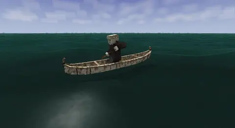
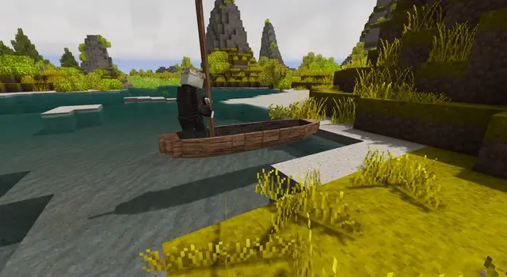
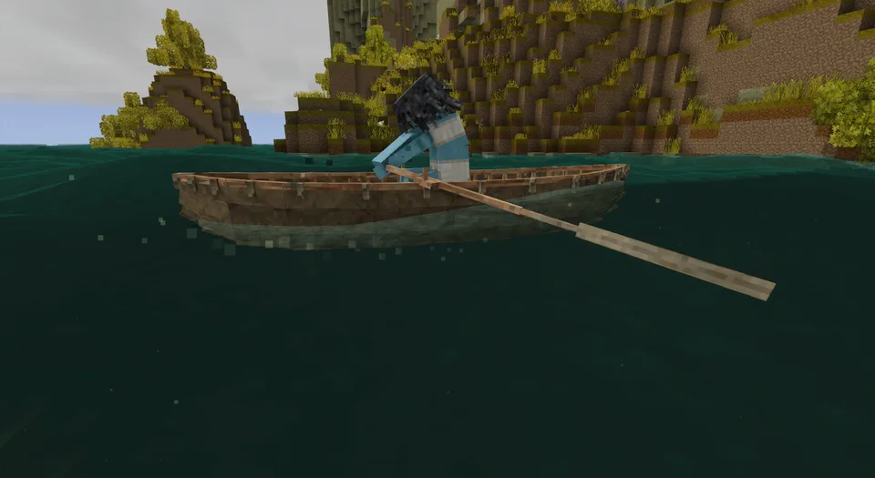
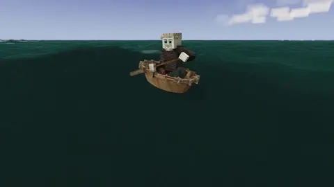
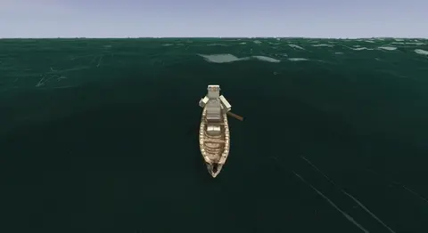

A vessel goes as fast as you can drive her against the water. Each tool drives her its own way, and each works only where it really works: a pole needs a bottom to push on, an oar needs a thole pin to pull against. Vanilla's crude oar is a pole two metres long.

## The tools

| Tool | Made from | Works | In |
| --- | --- | --- | --- |
| Paddle | a 2 m [pole](Recipes#paddle), an axe and a knife | in water of any depth | every boat but the currach; the coracle is sculled with it over her bow |
| Pole | split from a row of logs, 2 to 5 m long | where it reaches the bottom: in water about a metre shallower than it is long | every boat but the sailboat |
| Crude oar | vanilla's | as a 2 m pole: in water of about a metre | every boat but the sailboat |
| Thole oar | a 3 m [pole and a short lath](Recipes#thole-oar), an axe and a knife | in water of any depth, on a thole pin | the [currach](Hide-Currach), two of them, shipped as the last step of her build |

A pole reaches the bottom at about these depths. From the reed boat, poled sitting, it reaches a little deeper, and from the raft, whose logs stand higher, a little less:

| Pole | 2 m | 3 m | 4 m | 5 m |
| --- | --- | --- | --- | --- |
| Reaches | 1 m | 1.9 m | 2.8 m | 3.8 m |

## Using them

- Sit in the seat that steers, the tool in hand: <kbd>W</kbd> and <kbd>S</kbd> drive her, <kbd>A</kbd> and <kbd>D</kbd> sweep her round. The currach is rowed with an empty hand, her own two oars on their thole pins.
- With a pole in hand you stand up to pole, as polers do, wherever the vessel bears a person standing: on the raft, in the dugout, the outrigger and the currach, in the bark canoe behind her middle thwart, and in the middle of the coracle. The reed boat is too narrow to stand on, so you pole her sitting. Standing, your legs drive the shove too, so a pole drives a vessel harder than it does from a seat.
- A paddle works on one side and turns her away from it. Holding <kbd>W</kbd>, the paddler keeps her course as real paddlers do: once the bow has swung off it, he changes sides by himself, carrying the paddle over the bow while his hands change grips, a stroke without drive. The bow wanders a little either side of the course; a short hull changes sides every few strokes, a long one less often. <kbd>A</kbd> and <kbd>D</kbd> put him on the side that turns her.
- Past a pole's reach the stroke finds nothing: she glides on and slows.
- A pole or a paddle stows aboard every vessel with <kbd>Ctrl</kbd> + right-click on her, one at a time; the raft keeps one on its oar rest.
- Paddling, poling and rowing make you hungry, about as much as sprinting does.
- A round, short hull turns easily and goes slowly: the coracle spins on the spot. A long one runs straight and turns slowly; the outrigger's float makes her slowest of all to turn.

| | |
| --- | --- |
|  |  |
| A paddle along the side | A pole off the bottom, standing |
|  |  |
| The currach's oars on their thole pins | A coracle sculled over her bow |
|  | |
| A paddler changing sides | |

## How fast

One rower, the average finisher of a canoe marathon, on calm water with nothing else aboard, paddling a straight course and changing sides as he goes; poled in a metre of water with a 3 m pole. A load slows her, and a crack that floods her more.

| Vessel | Paddled | Poled | Turns |
| --- | --- | --- | --- |
| [Raft](Raft) | 0.4 m/s | 0.7 m/s | 15° a second |
| [Reed boat](Reed-Boat) | 2.1 m/s | 2.3 m/s, sitting | 33° a second |
| [Dugout](Dugout) | 1.7 m/s | 2.2 m/s | 19° a second |
| [Coracle](Coracle) | 1 m/s, sculled | 1.2 m/s | 177° a second |
| [Birch-bark canoe](Birch-Bark-Canoe) | 2.1 m/s | 2.8 m/s | 26° a second |
| [Hide currach](Hide-Currach) | 2.5 m/s, rowed | 2.4 m/s | 40° a second, rowed |
| [Outrigger canoe](Outrigger-Canoe) | 1.5 m/s | 1.9 m/s | 14° a second |

A metre a second is 3.6 km/h; the voyageurs' canoes made some 2.2 m/s on the lakes. How these speeds come about, and where each number comes from, is on [the science of the hull](The-Science-of-the-Hull#driving-her).
