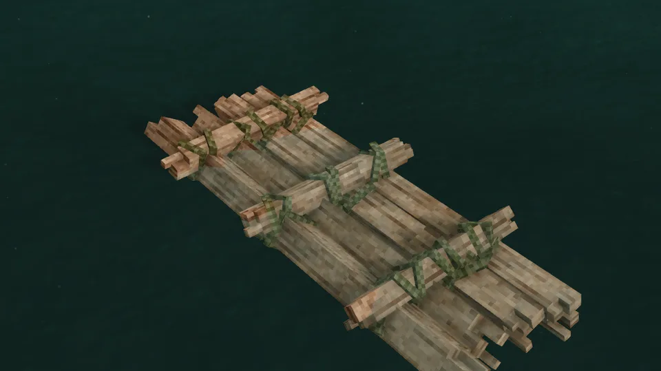
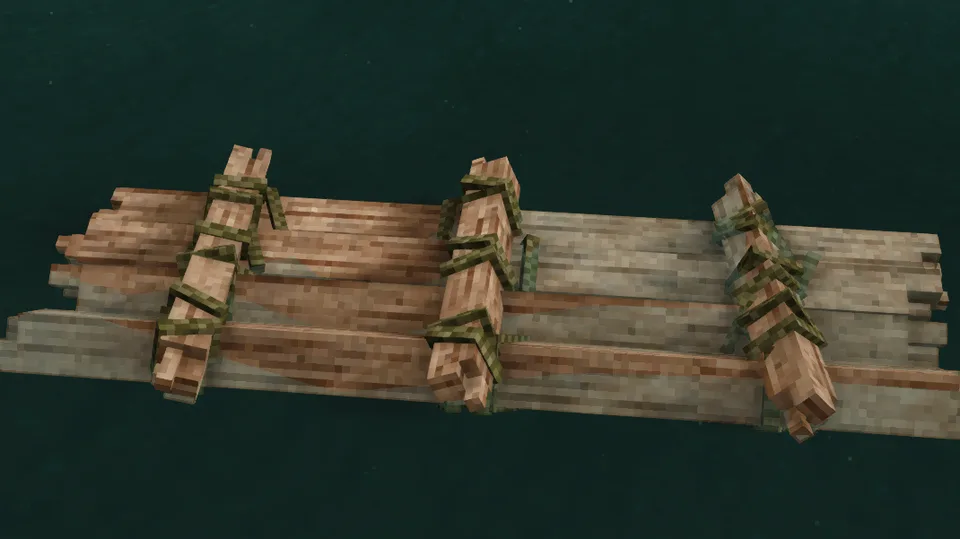
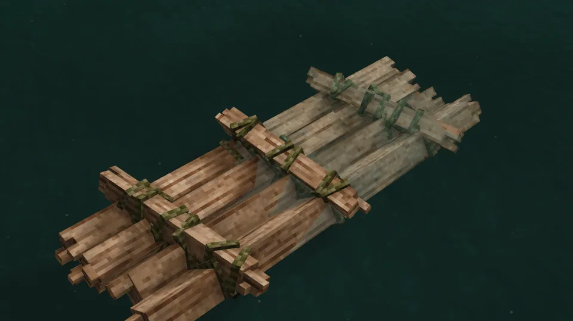
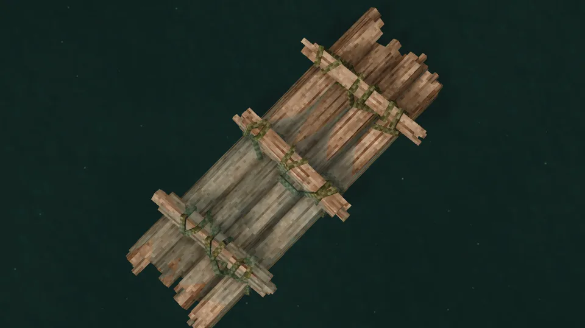
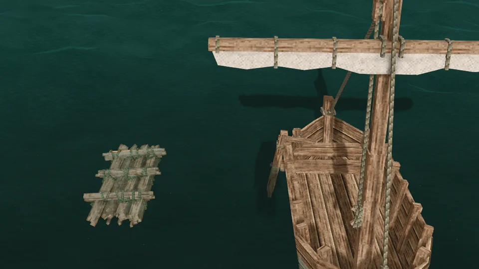
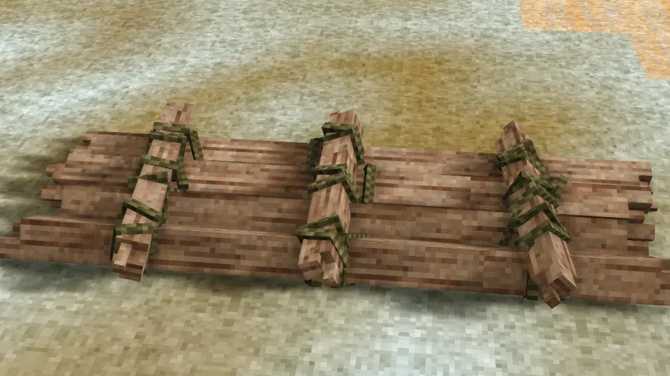
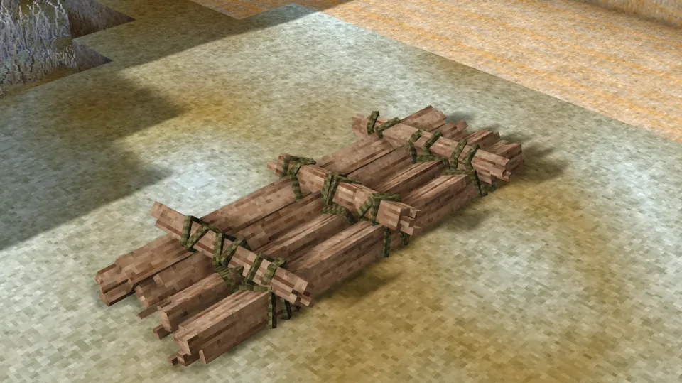
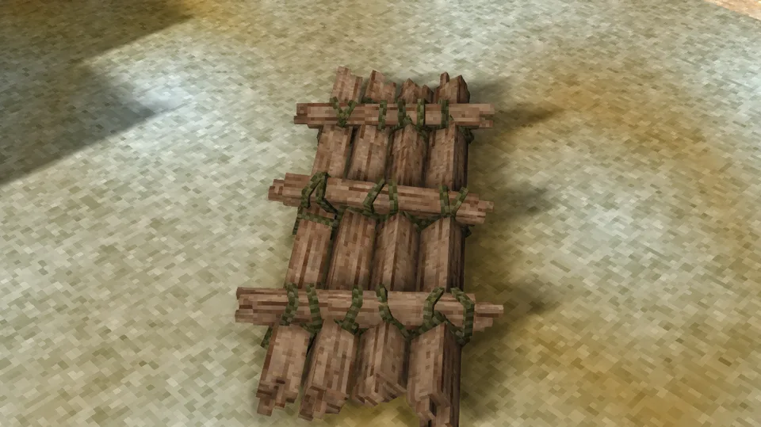
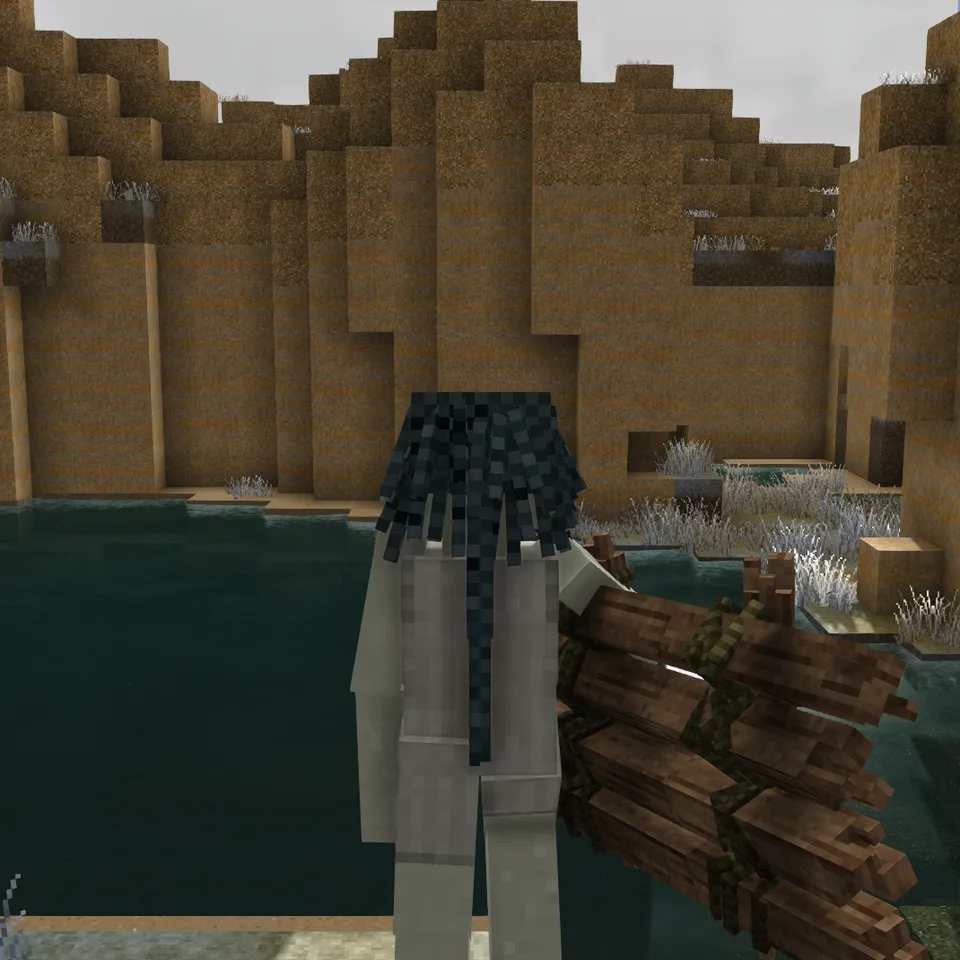
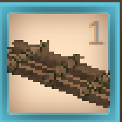

Logs laid side by side and lashed with rope to three cross-logs. It is the game's own first vessel, built from timber and rope with no tools beyond an axe; a bamboo raft is the same thing in bamboo stakes.

## In Rough Seas

A barge for floating cargo down a river or across a calm lake. A raft never swamps, because the water washes straight through it, but that is all it does well: a few hard knocks break it, [rapids](Rapids) tear it apart in seconds, and a [breaking sea](Surf-and-Swamping) does the same. The wood counts: an oak raft takes more than a pine one, and a bamboo one more than either. Mend it with a log of its own wood.

## Where it comes from

The raft is as old as people on the water: whoever first crossed a river on two logs tied together had built one. Timber was floated to market as great rafts down the Rhine, the Vistula and the rivers of North America for centuries, the logs themselves the cargo; bamboo rafts still work the rivers of Asia; and in 1947 Thor Heyerdahl's *Kon-Tiki*, nine balsa logs lashed with hemp, drifted 7000 kilometres from Peru to Polynesia on the currents and the trade wind.

## By the numbers

| | |
| --- | --- |
| Speed | the measure for the others: about 2.8 blocks a second, paddled |
| Turning | steady |
| [Hull](Hull-Condition) | 1200 J in oak; bamboo a third more, aged wood half |
| [Wear](Hull-Condition#wear) | none |
| [Mending](Mending) | 1 log of its wood restores a sixth; 3 bamboo stakes a third |
| [Bilge](Bailing) | none: the sea washes through |
| [Capsized by](Surf-and-Swamping#capsizing) | a 2 m breaker |
| [Rapids](Rapids) | broken in about a quarter of a minute |
| [Lightning](Lightning) | a strike nearby breaks it |
| [Left alone](Currents#drift) | drifts with the current and the wind |
| [Mooring](Mooring) | tied to a post |
| Carried | picked up |
| Seats | two, fore and aft; either one paddles, with an oar in hand |
| Cargo | a basket (8 slots) in place of either rider |
| Fittings | a rest for a spare oar |
| Built from | 12 logs and 3 ropes, or 18 bamboo stakes and 3 ropes |
| Wreckage | a few logs and a rope |

## Its neighbours

- The [reed boat](Reed-Boat) is cheaper still and lasts three days.
- The [dugout](Dugout) costs five logs and an axe's work, and takes knocks no raft survives.

## Every form it takes

| | |
| --- | --- |
|  |  |
| Afloat, from the side | From the stern quarter |
|  |  |
| From above | Beside the sailboat |
|  |  |
| Ashore | Ashore, from the quarter |
|  |  |
| Dropped on the ground | Carried |
|  |  |
| In the hotbar | Its wreckage |
