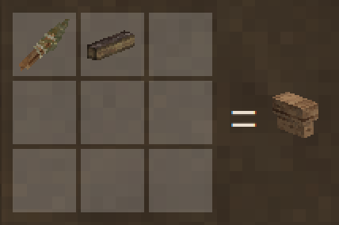
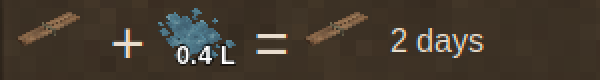

Everything Rough Seas adds to the crafting grid, as the game's handbook shows it. In the game, a grid cycles through every wood and material the recipe takes.

## Birch bark

Comes off a birch log with a knife, leaving the log debarked. It [mends](Mending) the [birch-bark canoe](Birch-Bark-Canoe) on the way. Beside a mod that adds elm or spruce, their logs give bark the same way, for elm-bark and spruce-bark canoes.

## Reed boat

Cattail tops, papyrus tops or thatch, the reed that tule gives.

## Dugout

Not in the grid any more: a dugout is burnt and hewn out of five logs on the shore. See [how it is built](Dugout#how-it-is-built).

## Coracle

## Birch-bark canoe

Not in the grid any more: its bark is stripped off a standing tree in one sheet, and it is framed where it lies. See [how it is built](Birch-Bark-Canoe#how-it-is-built).

## Splitting wedge

Whittled from firewood with a knife. One on each of five logs lying end to end, driven with an axe, splits the trunk into 32 laths for a bark canoe; on each of three, into 6 poles for an outrigger. The wedges come back.

## Soaked laths

Laths bend into a canoe only wet: two days in a barrel of water, 0.15 litres a lath. They dry again in two days.

## Hide currach

## Outrigger canoe

Not in the grid any more: a finished dugout is rigged where she lies with a float, poles split with wedges, rope and linen cloth. See [how it is built](Outrigger-Canoe#how-it-is-built).

## Anchor warp

Nine ropes splice into 90 metres of [warp](Anchoring#rope), and it breaks back into the ropes.

| | |
| --- | --- |
|  |  |
| Splicing it | Breaking it up |
