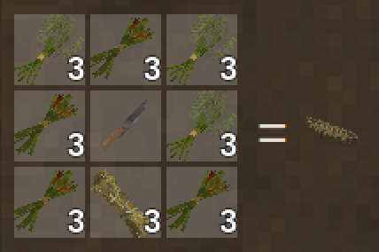
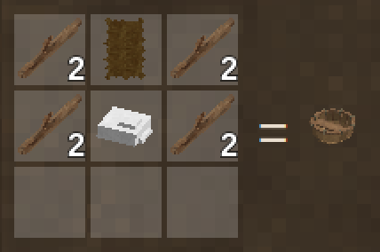
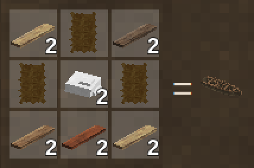
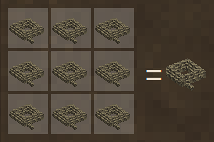
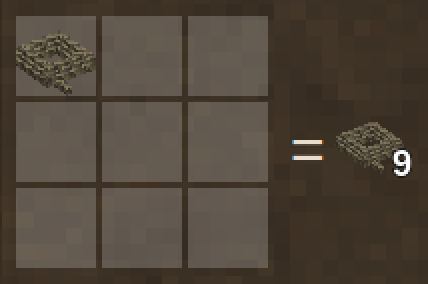

Everything Rough Seas adds to the crafting grid, as the game's handbook shows it. In the game, a grid cycles through every wood and material the recipe takes.

## Birch bark

Comes off a birch log with a knife, leaving the log debarked. It builds the [birch-bark canoe](Birch-Bark-Canoe) and [mends](Mending) it. Beside a mod that adds elm or spruce, their logs give bark the same way, and it builds an elm-bark or spruce-bark canoe.

## Reed boat

Cattail tops, papyrus tops or thatch, the reed that tule gives.

## Dugout

Any wood, a modded tree's too. Redwood's logs come as sections, and it takes those, as it does any wood that comes in sections.

| | |
| --- | --- |
|  |  |
| From logs | From redwood log sections |

## Coracle

## Birch-bark canoe

## Hide currach

## Outrigger canoe

Logs and planks of one wood, a modded tree's too. Redwood, and any wood that comes in sections, builds from its log sections, with planks of any wood from the same mod.

| | |
| --- | --- |
|  |  |
| From logs | From redwood log sections |

## Anchor warp

Nine ropes splice into 90 metres of [warp](Anchoring#rope), and it breaks back into the ropes.

| | |
| --- | --- |
|  |  |
| Splicing it | Breaking it up |
