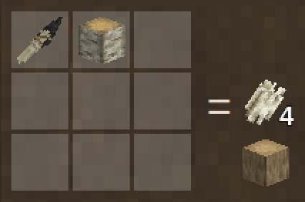
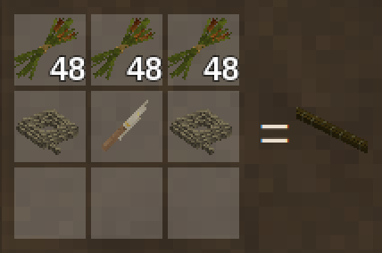
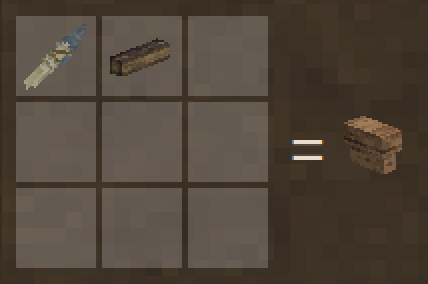
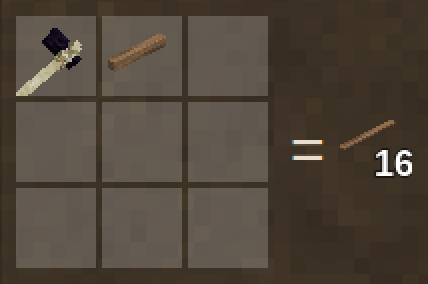
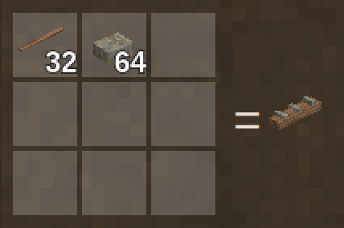
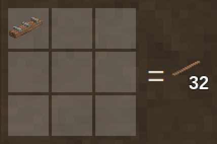
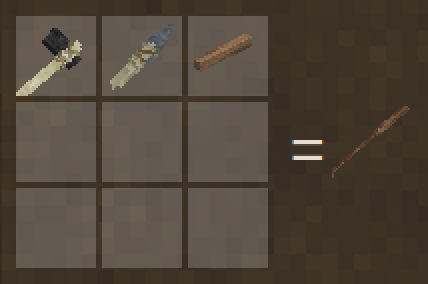
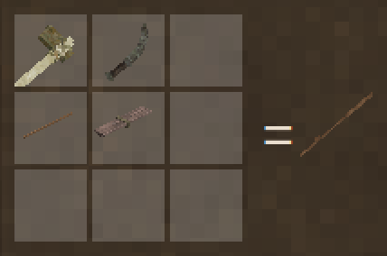
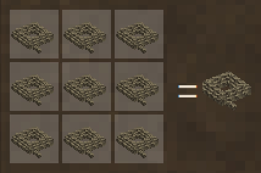
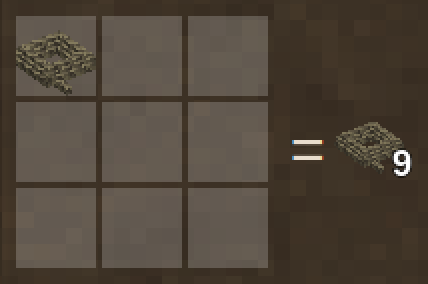

Everything Rough Seas adds to the crafting grid, as the game's handbook shows it. In the game, a grid cycles through every wood and material the recipe takes.

## Birch bark

Comes off a birch log with a knife, leaving the log debarked. It [mends](Mending) the [birch-bark canoe](Birch-Bark-Canoe) on the way. Beside a mod that adds elm or spruce, their logs give bark the same way, for elm-bark and spruce-bark canoes.

## Reed boat

Not in the grid any more: two reed bundles are laid side by side and bound into one with rope. See [how it is built](Reed-Boat#how-it-is-built).

## Reed bundle

Cattail tops, papyrus tops or thatch, the reed that tule gives, bound with two ropes into a bundle of that plant. Two of them, laid side by side and bound with rope, make a [reed boat](Reed-Boat#how-it-is-built).

## Dugout

Not in the grid any more: a dugout is burnt and hewn out of five logs on the shore. See [how it is built](Dugout#how-it-is-built).

## Coracle

Not in the grid any more: wet laths are piled on the ground as a lattice, bound with rope, bent up into a basket and covered with hides where it lies. See [how it is built](Coracle#how-it-is-built).

## Birch-bark canoe

Not in the grid any more: its bark is stripped off a standing tree in one sheet, and it is framed where it lies. See [how it is built](Birch-Bark-Canoe#how-it-is-built).

## Splitting wedge

Whittled from firewood with a knife. Set one on each of two to five logs of one wood lying end to end, then hold an axe on each wedge in turn: every blow of its butt drives the wedge a step deeper, four blows from set to home. Once the last wedge is home, the trunk splits into 64 poles as long as the row: a row of three gives 3 m poles, a row of five 5 m ones. The wedges come back.

## Laths

An axe splits a pole into 16 laths as long as the pole. A piece of a vessel takes any lath at least as long as it, cut down.

## Poles and laths on the ground

Hold Shift and right-click the ground with poles or laths, wet or dry, to start a pile there, along the way you face, then Shift + right-click the pile to add more. Hold Ctrl as well to lay a whole layer at once. Right-click the pile with an empty hand to take one back.

- **Poles** lie side by side in a square pile as long as they are, 8 to a layer, 64 in all.
- **Laths of 3, 4 or 5 m** lie lengthwise: the first along one side of the block, the second along the other, then in toward the middle, 16 to a layer, 160 in all.
- **Laths of 2 m** pile as a [coracle](Coracle#how-it-is-built)'s lattice: seven along, then seven across them, 14 to a layer, 140 in all. The pile is centred on its block and reaches half a block into each of the four blocks beside it.

A pile needs room and ground under every block it reaches, and nothing goes on top of it. Once laid, it rests on all of them: dig out the ground under part of it and it stays, and with no ground left under it, it falls apart. A pile of fourteen wet 2 m laths, or of two wet 5 m laths and nothing more, bound with rope, starts a [coracle](Coracle#how-it-is-built) or a [currach](Hide-Currach#how-it-is-built).

Poles stack 32 to a slot. As fuel, the poles split from a log burn as long as the firewood that log would give, and dry laths split from a pole as long as the pole. Wet laths don't burn.

## Soaked laths

Laths bend into a vessel's frame only wet. They soak through in two days, and dry again in two days out of the water. You soak them one of two ways.

**In a barrel**, 0.08 litres of water a metre of lath. A barrel takes planks, so this way comes after the saw.

**On the bottom of any water**, before you have a saw. Laths float even wet, so you weigh them down with stones:

1. Put a full stack of 32 dry laths of one length and one wood in the crafting grid with stones of any rock: 26 stones for 2 m laths, 38 for 3 m, 51 for 4 m and a full stack of 64 for 5 m. You get a lath bundle.
2. Hold the bundle and right-click any water: a pond, a river or the sea. It sinks to the bottom and doesn't despawn. In still water and the sea it stays where it sank; running water, such as a waterfall's run, pushes it along as it pushes anything in it.
3. Leave it for two days. Look at the bundle to see how long it has lain in the water.
4. Right-click the bundle to lift it out. In deep water you dive for it.
5. Put the bundle in the crafting grid to untie it. You get the 32 laths, wet once it has soaked two days, and every stone back.

Out of the water, a soaked bundle dries again in two days, as its laths do.

| | |
| --- | --- |
|  |  |
| Bundling the laths | Untying a soaked bundle |

## Paddle

A [paddle](Paddles-Poles-and-Oars) is carved from a two-metre pole with an axe and a knife.

## Thole oar

A [thole oar](Paddles-Poles-and-Oars) is made from a three-metre pole, with a two-metre lath for its bull, by an axe and a knife. A currach takes two, shipped on its thole pins as the last step of its build.

## Hide currach

Not in the grid any more: two long wet laths are piled on the ground and bound into its gunwale, framed upside down, covered with hides and turned over. See [how it is built](Hide-Currach#how-it-is-built).

## Outrigger canoe

Not in the grid any more: a finished dugout is rigged where it lies with a float, poles split with wedges, rope and linen cloth. See [how it is built](Outrigger-Canoe#how-it-is-built).

## Anchor warp

Nine ropes splice into 90 metres of [warp](Anchoring#rope), and it breaks back into the ropes.

| | |
| --- | --- |
|  |  |
| Splicing it | Breaking it up |
