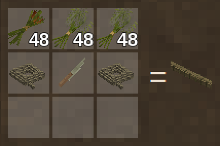
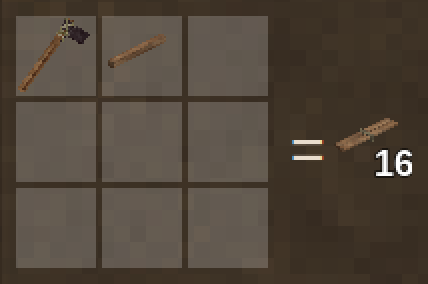

Everything Rough Seas adds to the crafting grid, as the game's handbook shows it. In the game, a grid cycles through every wood and material the recipe takes.

## Birch bark

Comes off a birch log with a knife, leaving the log debarked. It [mends](Mending) the [birch-bark canoe](Birch-Bark-Canoe) on the way. Beside a mod that adds elm or spruce, their logs give bark the same way, for elm-bark and spruce-bark canoes.

## Reed boat

Not in the grid any more: two reed bundles are laid by the water and bound into one with rope. See [how it is built](Reed-Boat#how-it-is-built).

## Reed bundle

Cattail tops, papyrus tops or thatch, the reed that tule gives, bound with two ropes. Two of them, laid side by side by the water and bound with rope, make a [reed boat](Reed-Boat#how-it-is-built).

## Dugout

Not in the grid any more: a dugout is burnt and hewn out of five logs on the shore. See [how it is built](Dugout#how-it-is-built).

## Coracle

Not in the grid any more: wet laths are laid out on the ground as a lattice, bound with rope, bent up into a basket and covered with hides where it lies. See [how it is built](Coracle#how-it-is-built).

## Birch-bark canoe

Not in the grid any more: its bark is stripped off a standing tree in one sheet, and it is framed where it lies. See [how it is built](Birch-Bark-Canoe#how-it-is-built).

## Splitting wedge

Whittled from firewood with a knife. One on each of two to five logs of one wood lying end to end, driven with an axe, splits the trunk into 64 poles as long as the row: a row of three gives 3 m poles, a row of five 5 m ones. The wedges come back.

## Laths

An axe splits a pole into 16 laths as long as the pole. A piece of a vessel takes any lath at least as long as it, cut down.

## Soaked laths

Laths bend into a vessel's frame only wet: two days in a barrel of water, 0.08 litres a metre of lath. They dry again in two days.

## Hide currach

Not in the grid any more: two long wet laths are laid out on the ground and bound into her gunwale, framed upside down, covered with hides and turned over. See [how it is built](Hide-Currach#how-it-is-built).

## Outrigger canoe

Not in the grid any more: a finished dugout is rigged where she lies with a float, poles split with wedges, rope and linen cloth. See [how it is built](Outrigger-Canoe#how-it-is-built).

## Anchor warp

Nine ropes splice into 90 metres of [warp](Anchoring#rope), and it breaks back into the ropes.

| | |
| --- | --- |
|  |  |
| Splicing it | Breaking it up |
