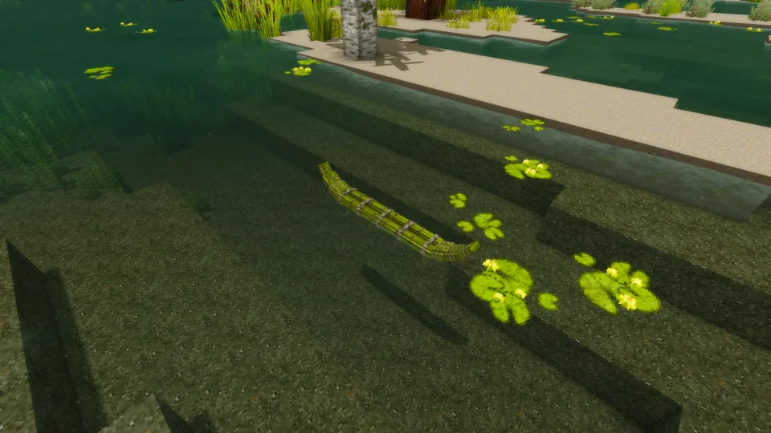

Two bundles of reeds three metres long, lashed side by side, their ends bound up into points. More a float than a boat: one person sits on it, low and half in the water, and paddles or poles it, with a basket behind.

## In Rough Seas

A day afloat at a time. The reed boat is the first thing you can build that floats you, and hard to break: a club or a breaker only bends the bundles, and a blade harms it only where it cuts a lashing. A knock on a rock, a ram, a run of rapids or lightning crushes the bundles for a moment, and they take it; only a heavy blast tears its lashings. Water is what ends it. The reed soaks up two thirds of its weight in water a day afloat, sitting lower and lower: after a day its rider sits awash, and left alone it is on the bottom within four days. As it soaks, its ends sag, since nothing but the reed holds them up. Haul it out under the open sky and it dries in the sun, but each drying leaves it a little more rotten, and soaked through and dried a few times, it sinks the moment it is launched. It can't be mended, and the sea washes straight through it, so there is nothing to bail. Take it across the lake or out to the island, and dry it before the trip home. It is a summer boat: you sit wet on it.

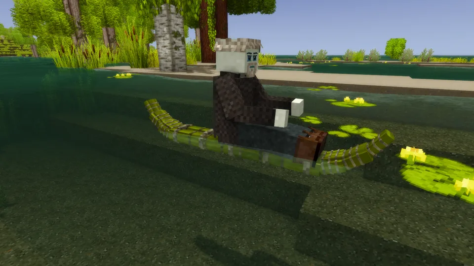

## Where it comes from

People have tied reeds into boats wherever reeds grow by water: Egyptians built papyrus skiffs on the Nile, and the Sumerians reed boats sealed with bitumen in the marshes of Mesopotamia. The model follows the *caballito de totora*, the "little reed horse" of Peru's north coast, which the Moche were drawing two thousand years ago and the fishermen of Huanchaco still bind today: two bundles of totora, bound tight with cord and lashed together, their ends swept up into a point, paddled out through the surf and ridden back in on the breakers. One of them, 2.4 m long, weighs 41 kg dry and some 68 kg soaked with sea water. On Lake Titicaca the Uru and Aymara build larger *balsas* of the same reed and haul them out to dry between trips, which keeps them months. Aymara builders from the lake made Thor Heyerdahl's *Ra II*, the papyrus boat that crossed the Atlantic in 1970; with nowhere to dry it, it settled about 10 cm deeper every day of the crossing, and the first *Ra*, built without the line that held an Egyptian stern up, was abandoned once its sagging stern dragged in the sea. In California the Chumash and the Ohlone bound the same kind of boat from tule.

## By the numbers

| | |
| --- | --- |
| Speed | 2.1 m/s paddled, 2.5 m/s poled ([how fast](Paddles-Poles-and-Oars#how-fast)) |
| Turning | nimble, 33° a second |
| [Hull](Hull-Condition) | 30 600 J in its lashings, once the bundles have crushed; tears, shown as *Reed torn* |
| [Soaking](Hull-Condition#seeping-and-soaking) | 33 kg of water a day afloat: its rider awash after a day, on the bottom within four left alone; dries ashore in the sun, a third of it left behind as rot |
| [Freeboard](Surf-and-Swamping#how-it-floats) | 14 cm empty, 5 cm with its rider, when dry |
| [Mending](Mending) | cannot be mended |
| [Bilge](Bailing) | none: the sea washes through |
| [Capsized by](Surf-and-Swamping#capsizing), in 1.0 | a 0.9 m breaker |
| [Rapids](Rapids) | unharmed: its bundles crush and take each strike |
| [Lightning](Lightning) | unharmed: its bundles crush and take the strike |
| [In a current](Currents#drift) | carried with it, steered or not |
| [Mooring](Mooring) | tied to a post |
| Carried | picked up, from the first binding on |
| Seats | one, a [paddle](Paddles-Poles-and-Oars) or a [pole](Paddles-Poles-and-Oars) in hand; it is too narrow to stand on, so it is poled sitting |
| Cargo | a basket (8 slots) |
| Built from | two reed bundles, each 144 cattail tops, papyrus tops or thatch and two ropes, and four ropes more: 288 reeds and 8 ropes, 50 kg |
| Wreckage | the tops each bundle was bound from, broken up with an axe once it has sunk |

## How it is built

You bind a reed boat where its bundles lie, anywhere: it is light enough to carry to the water. Each binding shows on the boat as you tie it.

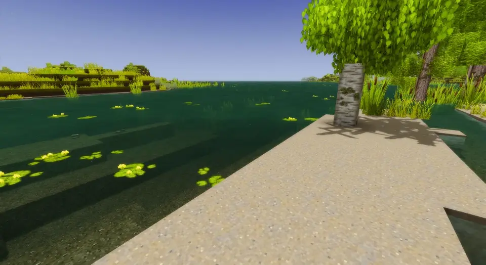

1. **Bind two bundles.** In the crafting grid, 144 cattail tops, papyrus tops or thatch and two ropes make a three-metre bundle, tied every quarter metre; the knife cuts and trims ([recipe](Recipes#reed-bundle)). The plant is bound dried, so a bundle has its dry colour wherever you cut it: brown cattail, pale straw papyrus or olive tule.
2. **Lay them side by side.** Place a bundle on the ground. It lies along the way you look. Place the second bundle on it, and it lies next to the first, of the same plant or another. Each bundle is three blocks long.

   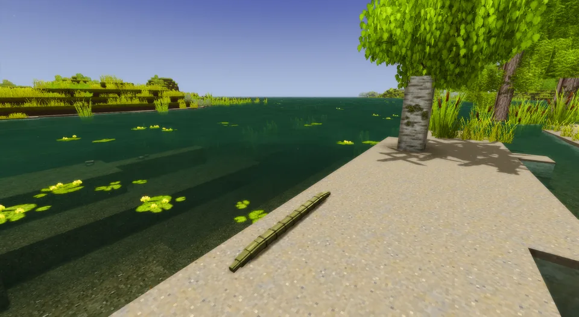
   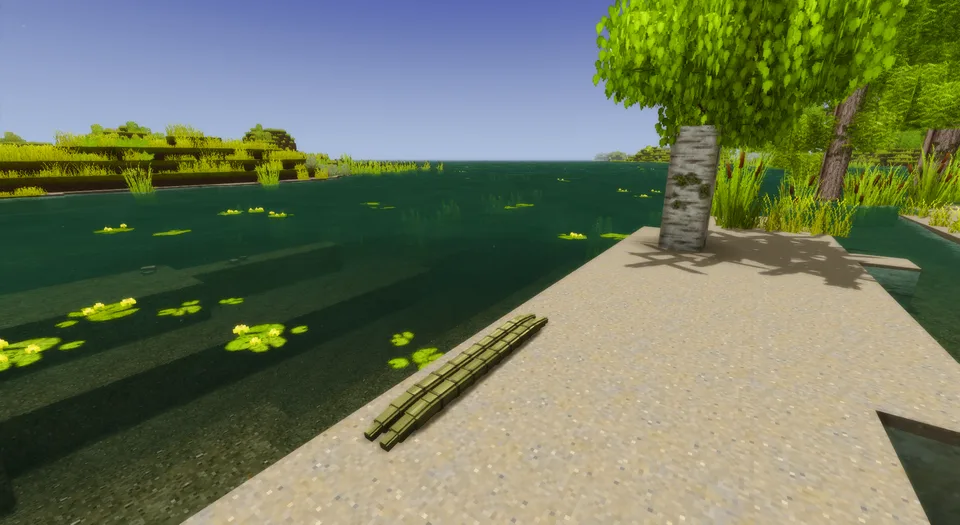

3. **Tie them into a boat.** Hold a rope on the pair. The first lashing goes around both bundles, and they become the boat where they lie. From now on the boat floats and can be carried, but has no seat yet.

   

4. **Lash the boat.** Hold a second rope on it to lash it along its length.

   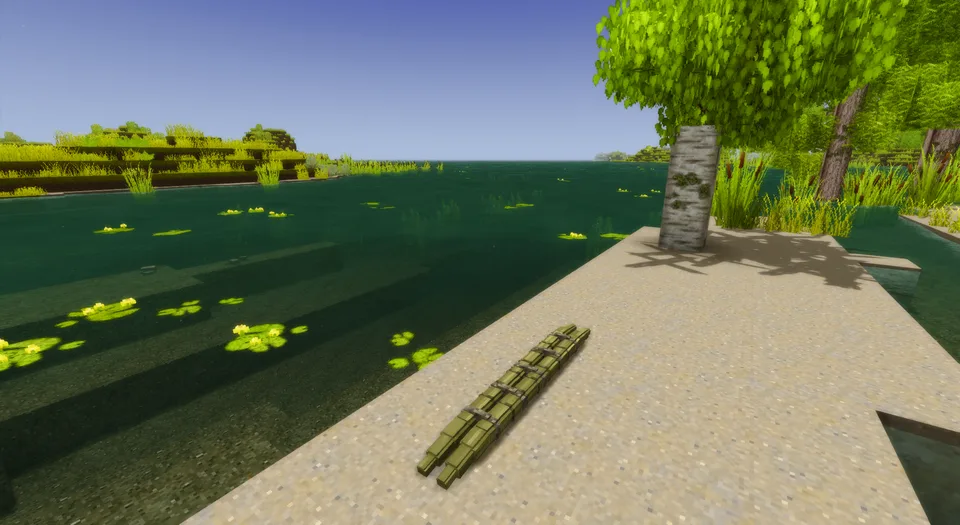

5. **Bind up the ends.** Hold a rope on the boat for each end, and the end is drawn together and bound up into a point. With both ends up, the boat is finished and takes a rider.

   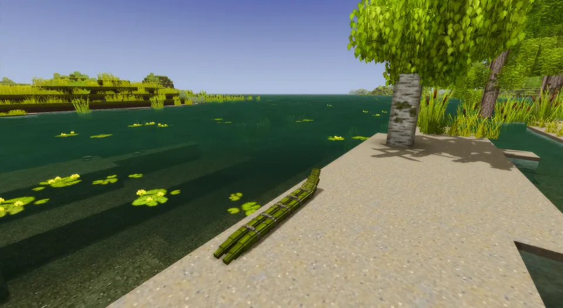
   

Carry it to the water and row away. Each side of the boat stays the bundle it was, in its plant's colour, with both plants' stems bound together in the ends. When the boat breaks up, each bundle leaves the tops it was bound from. A reed boat from before the build loads finished, and one from before bundles kept their plant is of cattail.

## Its neighbours

- The [raft](Raft) is the other cheap way across: it costs an axe and timber instead of a knife and reeds, keeps you drier, doesn't soak, and can be mended.
- The [dugout](Dugout) is what you build once you mean to stay on the water.

## Every form it takes

| | |
| --- | --- |
| 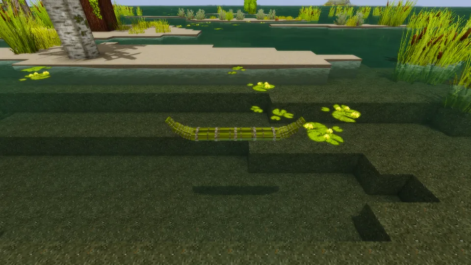 | 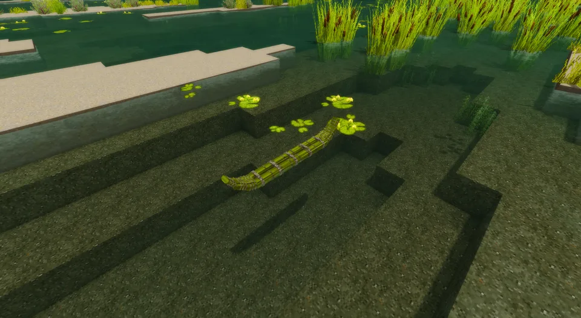 |
| Afloat, from the side | From the stern quarter |
| 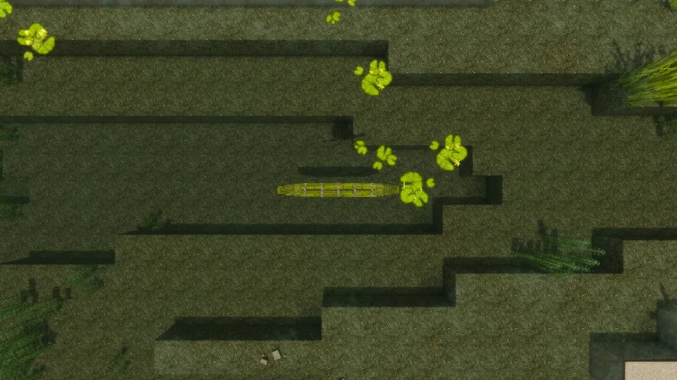 | 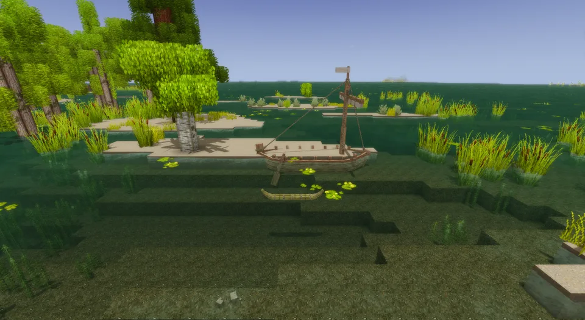 |
| From above | Beside the sailboat |
| 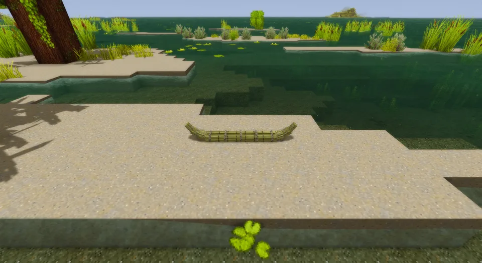 | 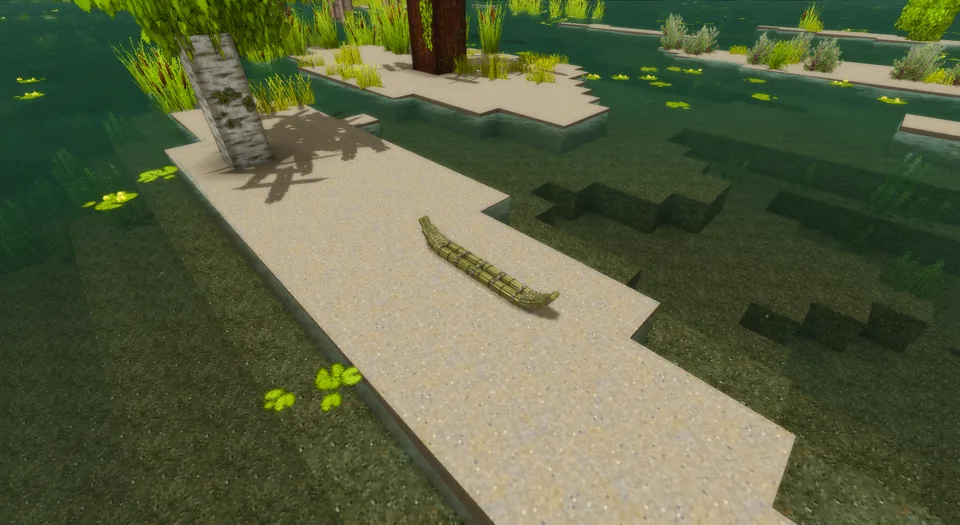 |
| Ashore | Ashore, from the quarter |
| 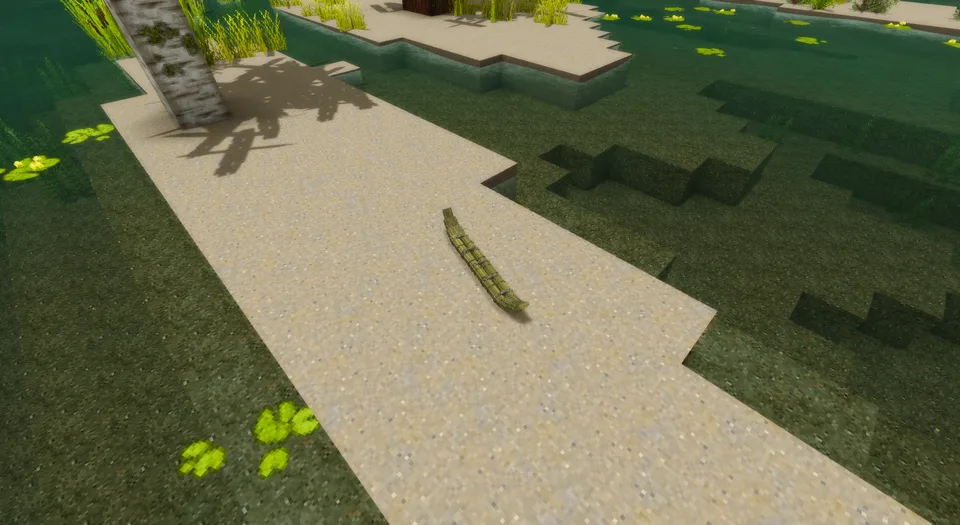 | 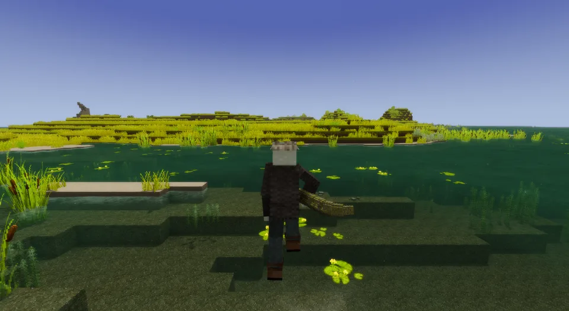 |
| Dropped on the ground | Carried under the arm |
| 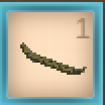 | 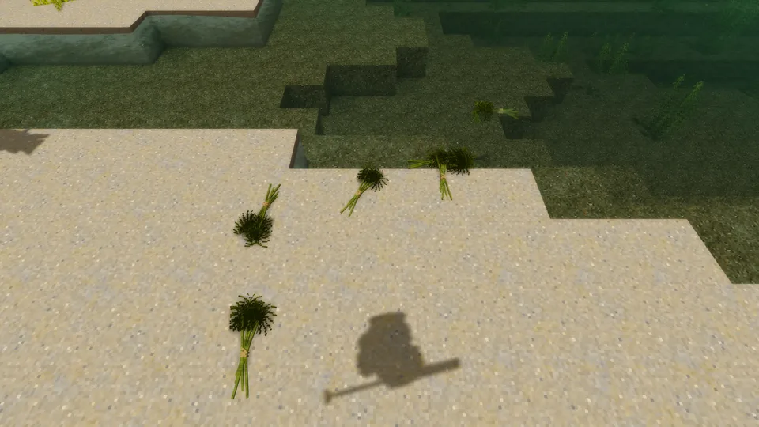 |
| In the hotbar | Its wreckage |
