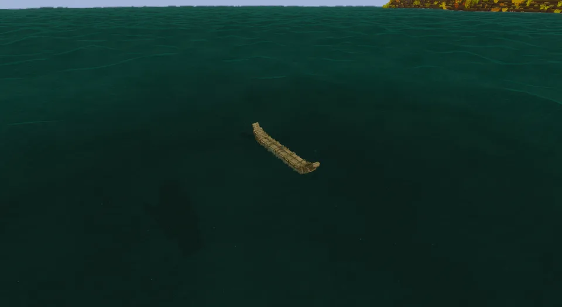

Two bundles of reeds three metres long, lashed side by side, their ends bound up into points. More a float than a boat: one person sits on it, low and half in the water, and rows it with an [oar](https://wiki.vintagestory.at/Oar) in hand, with a basket behind.

## In Rough Seas

A day afloat at a time. The reed boat is the first thing you can build that floats you, and hard to break: a club or a breaker only bends the bundles, and a blade harms it only where it cuts a lashing. A hard knock on a rock, a ram or a run of rapids tears it, though, and lightning tears it apart. Mostly, water is what ends it. The reed soaks up two thirds of its weight in water a day afloat, sitting lower and lower: after a day its rider sits awash, and left alone it is on the bottom within four days. As it soaks, its ends sag, since nothing but the reed holds them up. Haul it out under the open sky and it dries in the sun, but each drying leaves it a little more rotten, and soaked through and dried a few times, it sinks the moment it is launched. It can't be mended, and the sea washes straight through it, so there is nothing to bail. Take it across the lake or out to the island, and dry it before the trip home. It is a summer boat: you sit wet on it.

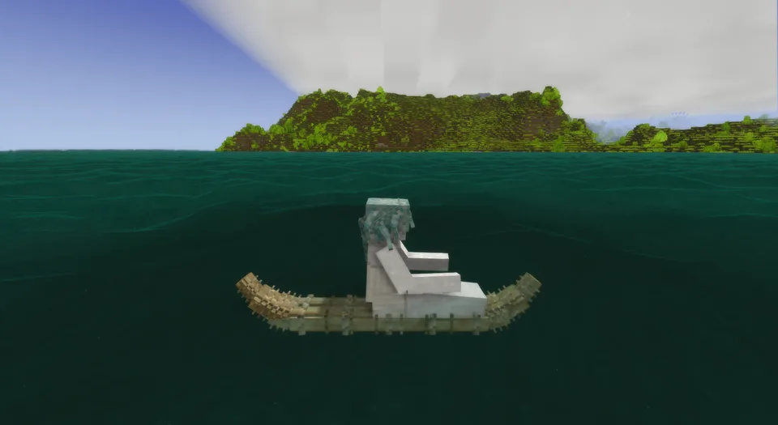

## Where it comes from

People have tied reeds into boats wherever reeds grow by water: Egyptians built papyrus skiffs on the Nile, and the Sumerians reed boats sealed with bitumen in the marshes of Mesopotamia. The model follows the *caballito de totora*, the "little reed horse" of Peru's north coast, which the Moche were drawing two thousand years ago and the fishermen of Huanchaco still bind today: two bundles of totora, bound tight with cord and lashed together, their ends swept up into a point, paddled out through the surf and ridden back in on the breakers. One of them, 2.4 m long, weighs 41 kg dry and some 68 kg soaked with sea water. On Lake Titicaca the Uru and Aymara build larger *balsas* of the same reed and haul them out to dry between trips, which keeps them months. Aymara builders from the lake made Thor Heyerdahl's *Ra II*, the papyrus boat that crossed the Atlantic in 1970; with nowhere to dry her, she settled about 10 cm deeper every day of the crossing, and the first *Ra*, built without the line that held an Egyptian stern up, was abandoned once her sagging stern dragged in the sea. In California the Chumash and the Ohlone bound the same kind of boat from tule.

## By the numbers

| | |
| --- | --- |
| Speed | 1.3 × the raft, rowed; about 5 m/s, faster than a swimmer |
| Turning | nimble |
| [Hull](Hull-Condition) | 3000 J; tears, shown as *Reed torn* |
| [Soaking](Hull-Condition#seeping-and-soaking) | 33 kg of water a day afloat: its rider awash after a day, on the bottom within four left alone; dries ashore in the sun, a third of it left behind as rot |
| [Freeboard](Surf-and-Swamping#how-she-floats) | 14 cm empty, 5 cm with its rider, when dry |
| [Mending](Mending) | cannot be mended |
| [Bilge](Bailing) | none: the sea washes through |
| [Capsized by](Surf-and-Swamping#capsizing), in 1.0 | a 0.9 m breaker |
| [Rapids](Rapids) | torn through in about ten seconds |
| [Lightning](Lightning) | torn apart |
| [In a current](Currents#drift) | carried with it and a little with the wind, steered or not |
| [Mooring](Mooring) | tied to a post |
| Carried | picked up, from the first binding on |
| Seats | one rower, with an [oar](https://wiki.vintagestory.at/Oar) in hand |
| Cargo | a basket (8 slots) |
| Built from | two reed bundles, each 144 cattail tops, papyrus tops or thatch and two ropes, and four ropes more: 288 reeds and 8 ropes, 50 kg |
| Wreckage | reed tops, broken up with an axe once it has sunk |

## How it is built

A reed boat is bound where its bundles lie, by the water, each binding drawn on her as it goes on.

1. **Bind two bundles.** In the crafting grid, 144 cattail tops, papyrus tops or thatch and two ropes make a three-metre bundle, tied every quarter metre; the knife cuts and trims ([recipe](Recipes#reed-bundle)).
2. **Lay them by the water.** Place a bundle on the ground beside the water, level with it or a block above: it lies along the way you look. Place the second on it, and it lies beside the first. They lie as long as they are, three blocks.

   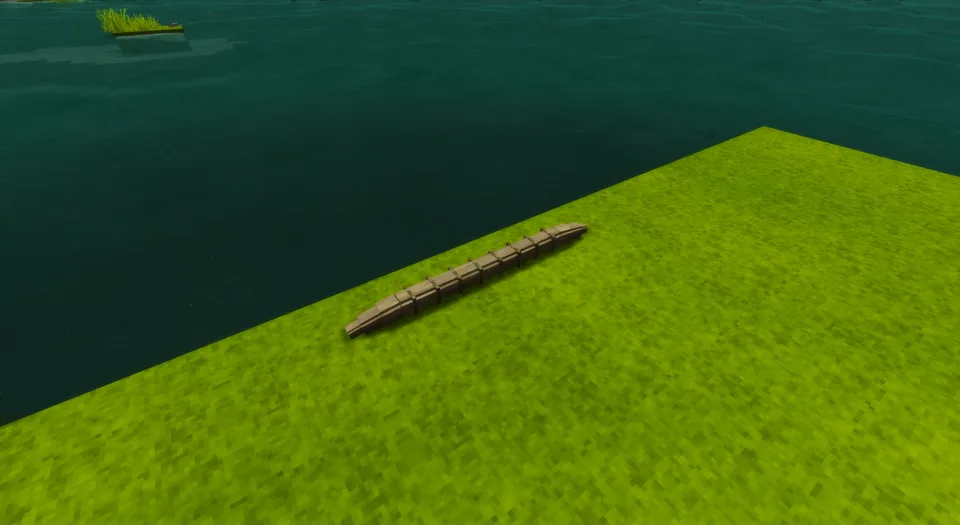
   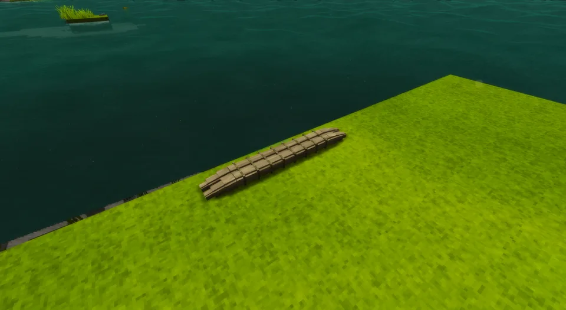

3. **Bind them into a boat.** Hold rope on the pair for a quarter of a minute: the first lashing goes around both, and they are the boat, where they lay. She floats and can be carried from now on, but has no seat yet.

   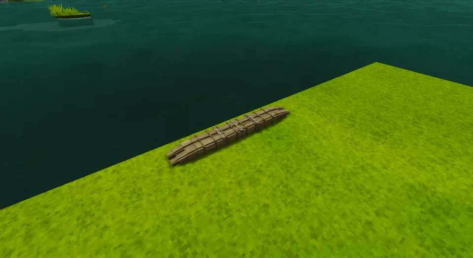

4. **Lash her.** Hold a second rope on her to finish the lashings along her length.

   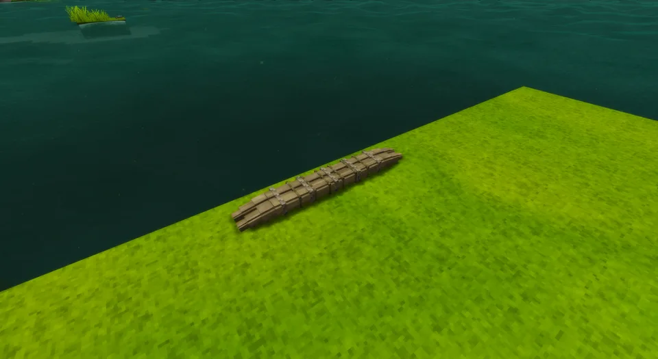

5. **Bind up her ends.** Hold a rope on her for each end: it is drawn together and bound up into a point, one end at a time. With both ends up she is finished and takes her rider.

   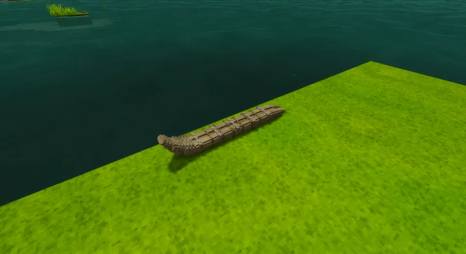
   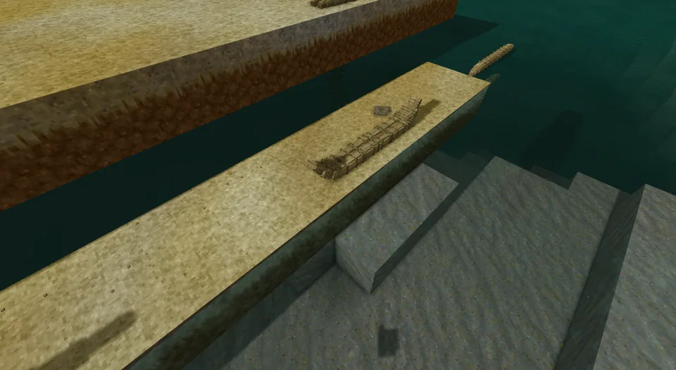

Carry her to the water and row away. A reed boat from before the build loads finished.

## Its neighbours

- The [raft](Raft) is the other cheap way across: it costs an axe and timber instead of a knife and reeds, keeps you drier, doesn't soak, and can be mended.
- The [dugout](Dugout) is what you build once you mean to stay on the water.

## Every form it takes

| | |
| --- | --- |
| 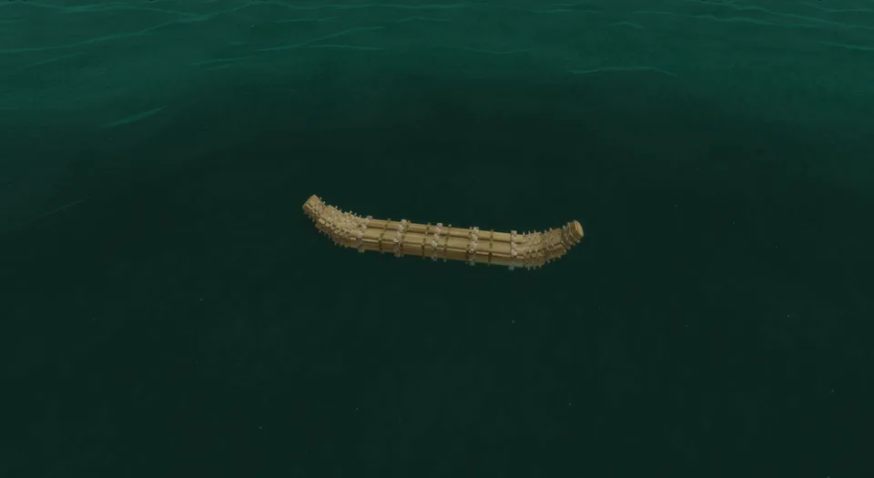 | 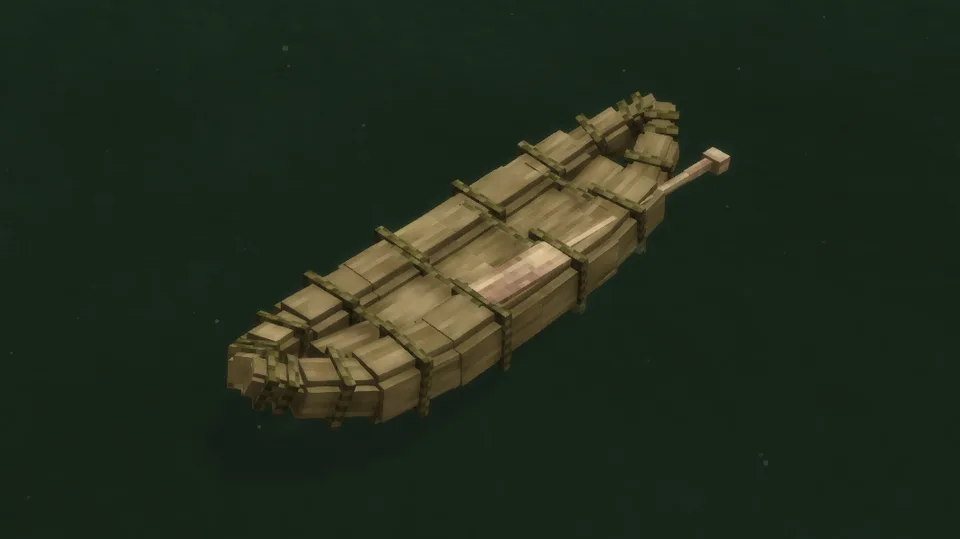 |
| Afloat, from the side | From the stern quarter |
| 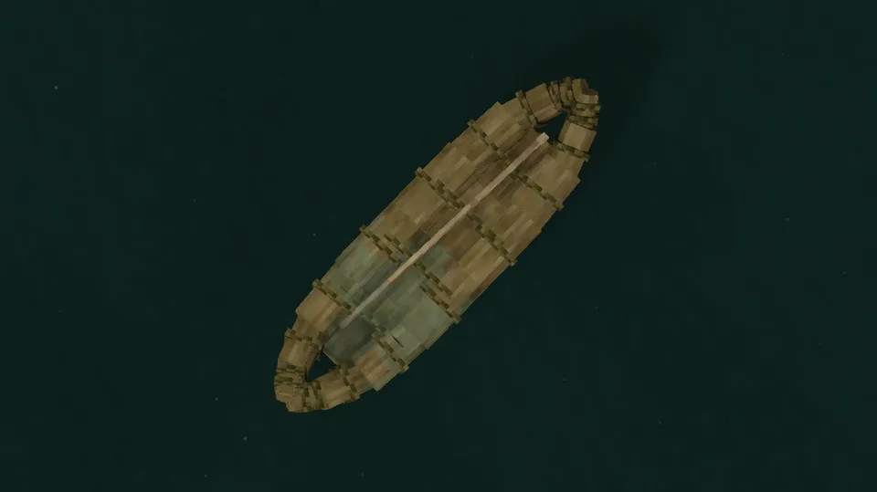 | 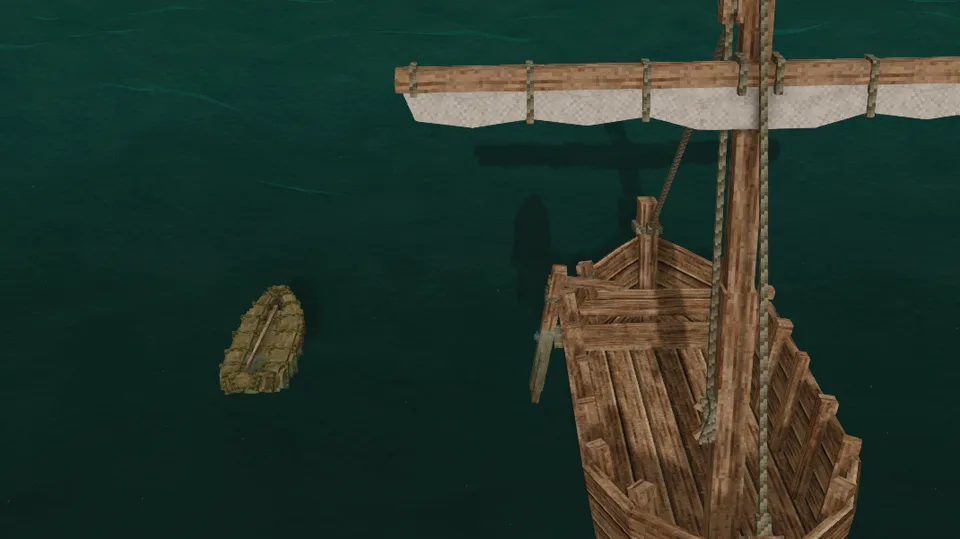 |
| From above | Beside the sailboat |
| 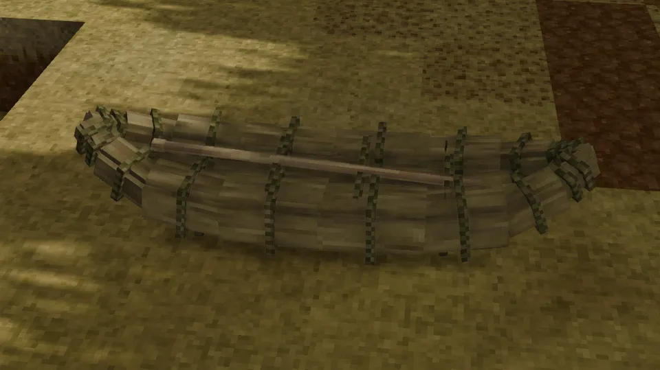 | 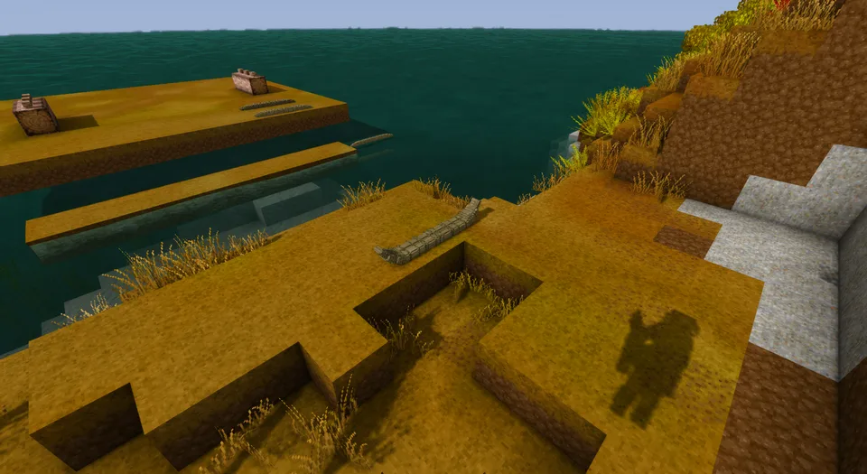 |
| Ashore | Ashore, from the quarter |
| 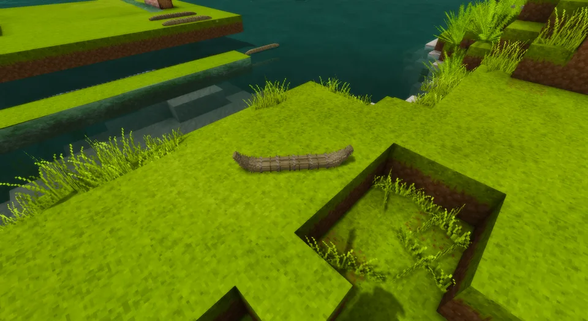 | 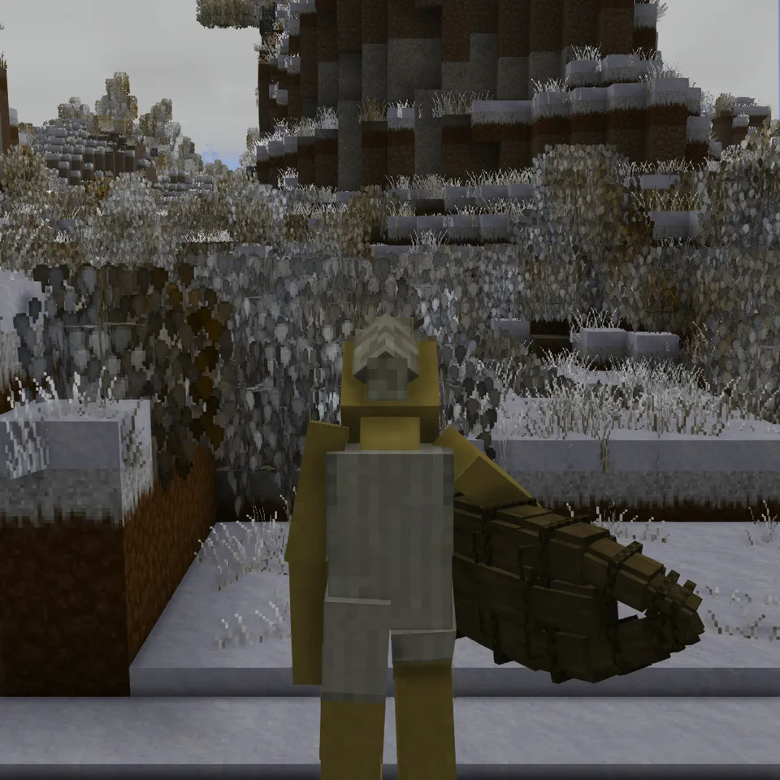 |
| Dropped on the ground | Carried under the arm |
| 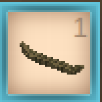 | 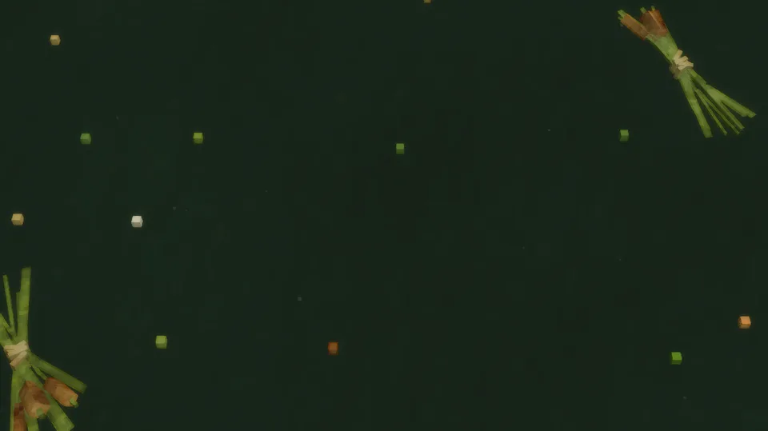 |
| In the hotbar | Its wreckage |
