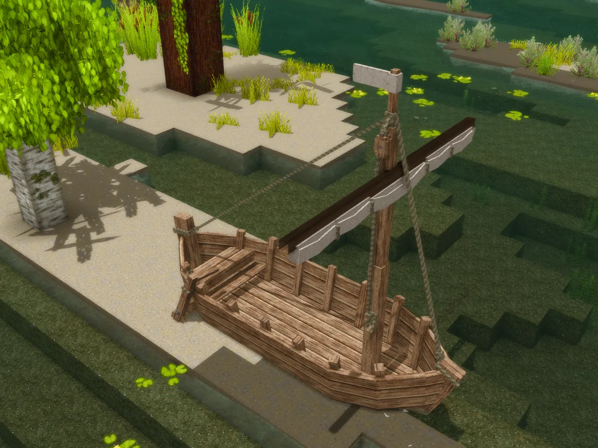
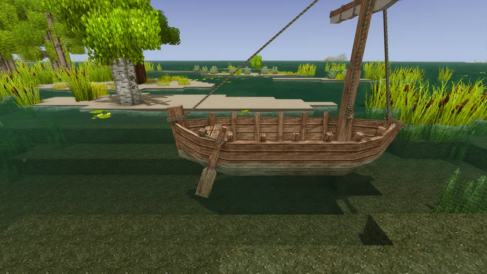
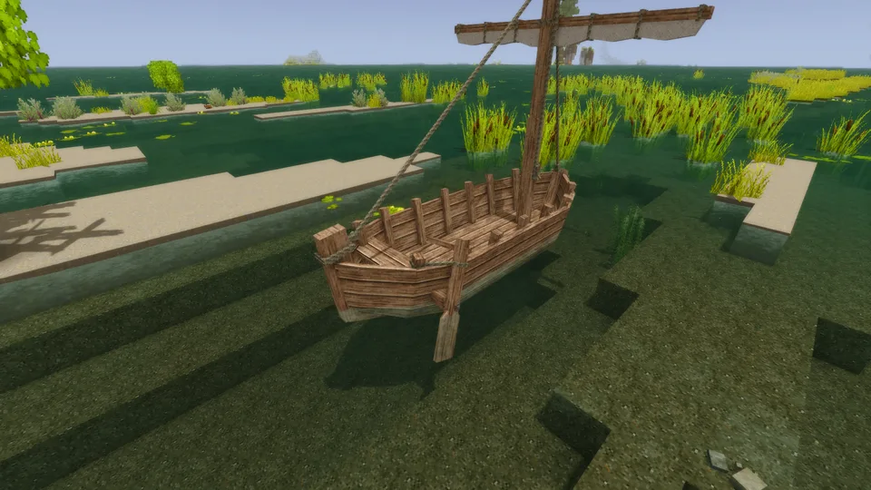
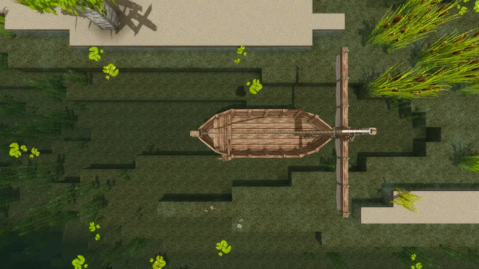
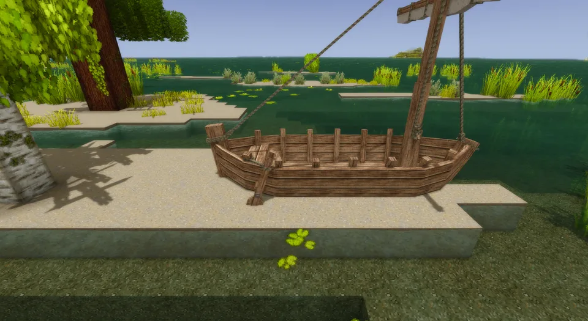
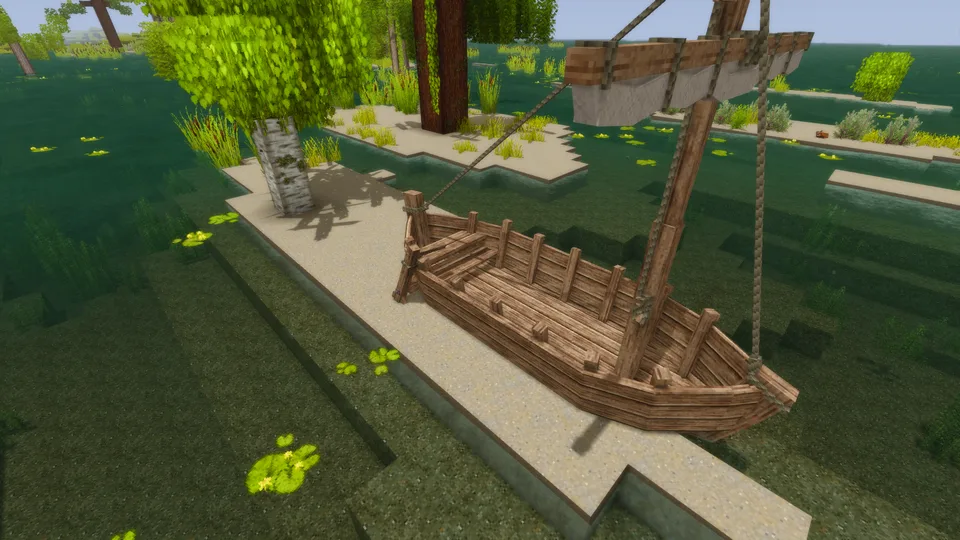
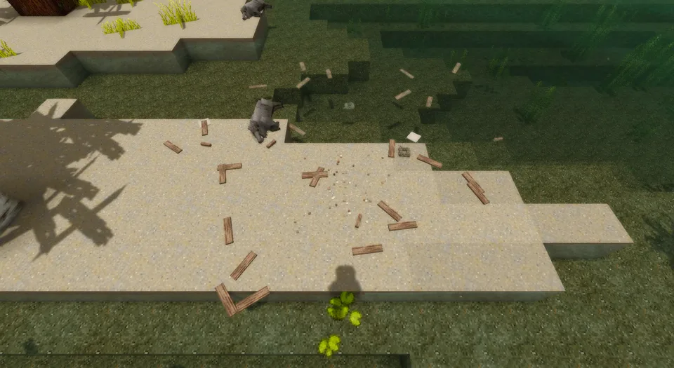

The game's own sailing boat: an open hull of planks on a keel, with a mast stepped amidships carrying one square sail on a yard, a steering oar aft and room for cargo. It is built in place on the shore, plank by plank, and launched from there.

## In Rough Seas

The vessel for long voyages and heavy cargo. Its square sail drives it by the wind, best with the wind abeam or behind. Its hull takes knocks that would break anything else, its 8209-litre bilge gives you time in a sea, and it is the one vessel that [anchors](Anchoring). Its mast draws [lightning](Lightning), its weight jerks hard on a [mooring](Mooring), and its 300 planks make it the dearest thing afloat to lose. In a gale it ships water faster than one person can [bail](Bailing): run for shelter, or anchor well out and ride it out. Two fifths of its weight is ballast, so flooded it goes to the bottom with its cargo, unless it is built of a light wood: of pine, larch, acacia, walnut, bald cypress, redwood or kapok it floats awash.

## Where it comes from

Open, square-sailed boats of planks carried the coastal trade of northern Europe for over a thousand years, from the Norse boats of the Viking age to the working boats of every fishing harbour. One square sail on a yard drives them well with the wind behind and poorly against it, and a single oar over the quarter steers them. The game's sailboat is a boat of that family, small enough for one or two to sail.

## By the numbers

| | |
| --- | --- |
| Speed | by the wind ([sailing it](#sailing-it)) |
| Turning | steady |
| [Hull](Hull-Condition) | 40 000 J in oak, more in harder [woods](Hull-Condition#what-it-is-made-of) |
| Upkeep | none |
| [Freeboard](Surf-and-Swamping#how-it-floats) | 92 cm empty, 91 cm with one aboard, in oak |
| [Flooded](Surf-and-Swamping#swamping) | sinks; floats awash in the lighter woods |
| [Mending](Mending) | 10 planks of its wood close a fifteenth of a stove-in place |
| [Bilge](Bailing) | 8209 litres, 15.1 m² of open deck |
| [Capsized by](Surf-and-Swamping#capsizing), in 1.0 | a 3.3 m breaker |
| [Lightning](Lightning) | its 7 m mast draws strikes |
| [Rapids](Rapids) | barely harmed |
| [Anchoring](Anchoring) | stone anchor on 120 m of rope, 210 m with an anchor warp |
| [In a current](Currents#drift) | carried with it and with the waves, steered or not |
| [Mooring](Mooring) | tied to a post, or anchored |
| Carried | too big to pick up |
| Seats | two aft: the starboard one steers, the port one takes a passenger |
| Cargo | 8 spots, 4 a side; each takes a chest (16 slots; a treasure chest 4), a crate (20 slots of one kind; 16 aged, 25 in ebony or purpleheart), a storage vessel (12), a basket (8), or a boat seat for one more aboard |
| Fittings | a lantern on the mast, the stone anchor in the port prow, an [anchor warp](Anchoring#rope) on the mast, a figurehead or a chiseled block of your own, ratlines either side, seven shields a side, and a fence post in a cargo spot with the one aft of it free, to tie an animal aboard |
| Built from | about 300 planks, with support beams, rope and a linen sail |
| Wreckage | about 40 planks, a few beams, rope and linen |

## Sailing it

1. **Set the sail.** Sit in the starboard seat aft and right-click the cleat on the side of the mast, where a rope is tied. The first click sets half the sail, the second the full sail, and the third furls it.
2. **Steer.** Under sail the wind drives the boat, and <kbd>A</kbd> and <kbd>D</kbd> steer it. With the sail furled, <kbd>W</kbd> and <kbd>S</kbd> move it slowly, as in vanilla.
3. **Pick your heading.** The square sail drives the boat best with the wind abeam or behind it, little close to the wind, and not at all straight into it. The yard turns about the mast to meet the wind by itself, as far as the stays let it.

The sail fills in the boat's own frame, so it heaves and pitches with the hull. The wind pushes the boat sideways a little as it sails, and drifts it downwind with the sail furled. A boat [anchored](Anchoring) or [tied up](Mooring) with its sail set strains its rope; set loose, it sails off on its own. How the wind drives it: [the science of the hull](The-Science-of-the-Hull#under-sail).

## Its neighbours

- The [outrigger canoe](Outrigger-Canoe) is steadier and carries a small hold; it sails with its float always to windward and shunts to change tack.
- The [hide currach](Hide-Currach) is the small, cheap boat for the coast, light enough to ride over surf, though a breaker that stoves in its hide leaves the sailboat's planks whole.

## Every form it takes

| | |
| --- | --- |
|  |  |
| Afloat, from the side | From the stern quarter |
|  |  |
| From above | Ashore |
|  |  |
| Ashore, from the quarter | Its wreckage |
