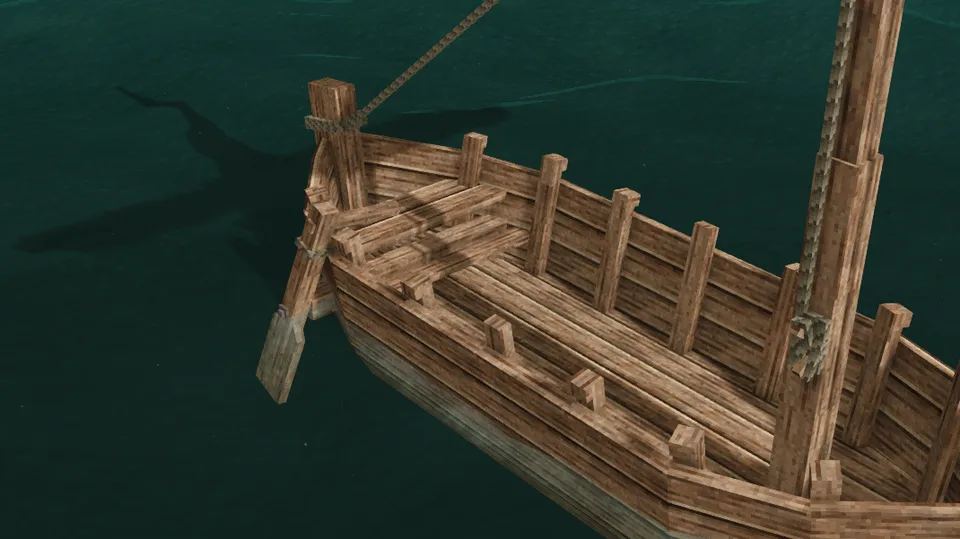
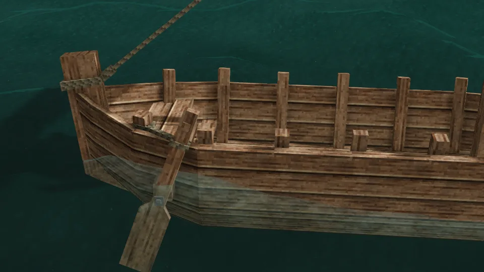
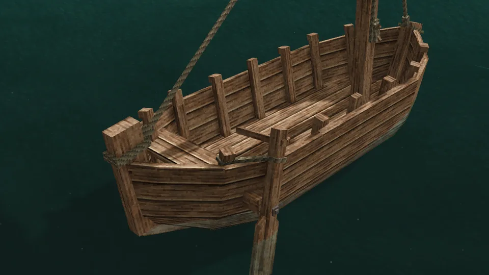
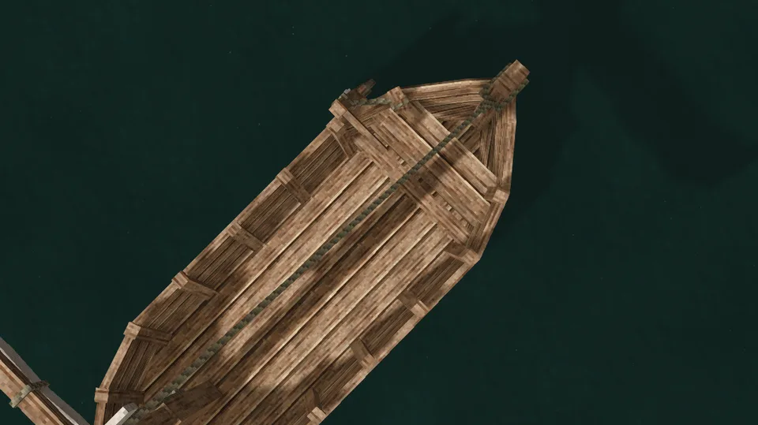
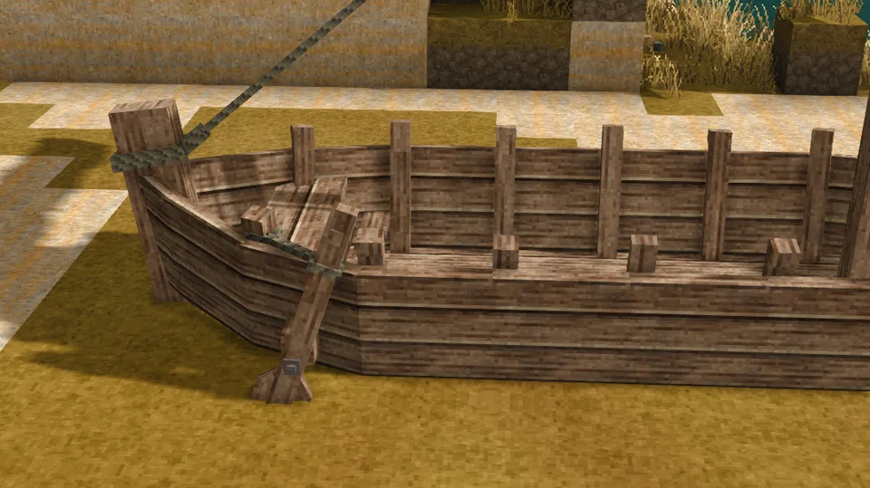
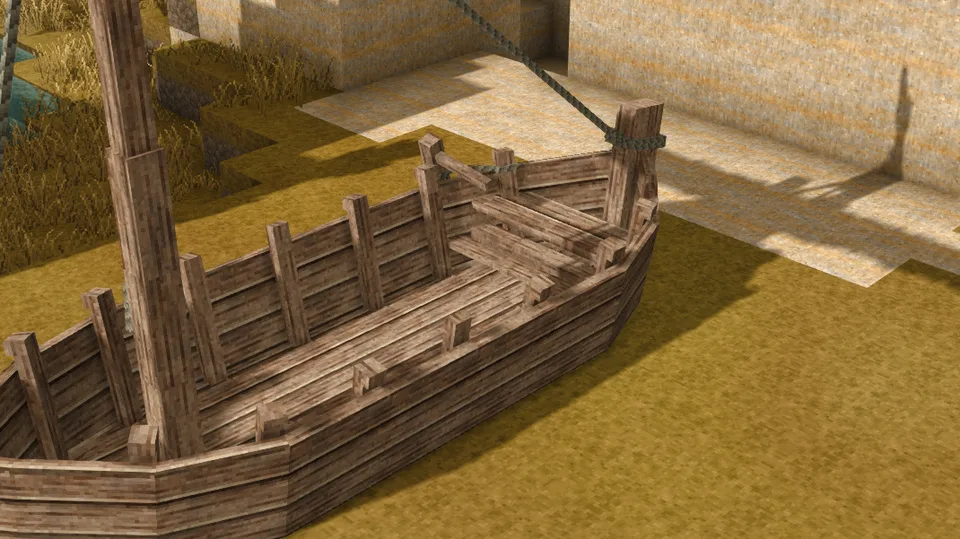
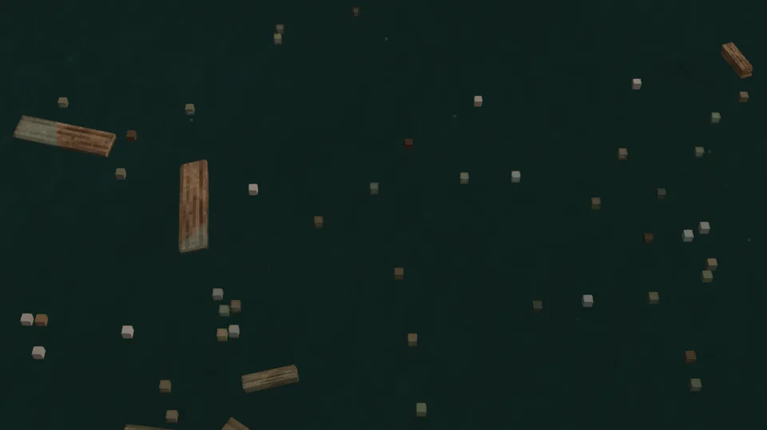

The game's own sailing boat: an open hull of planks on a keel, with a mast stepped amidships carrying one square sail on a yard, a steering oar aft and room for cargo. It is built in place on the shore, plank by plank, and launched from there.

## In Rough Seas

The vessel for long voyages and heavy cargo. Its hull takes knocks that would break anything else, its 1500-litre bilge gives you time in a sea, and it is the one vessel that [anchors](Anchoring). Its mast draws [lightning](Lightning), its sides catch the wind that strains a [mooring](Mooring), and its 300 planks make it the dearest thing afloat to lose. In a gale it ships water faster than one person can [bail](Bailing): run for shelter, or anchor well out and ride it out.

## Where it comes from

Open, square-sailed boats of planks carried the coastal trade of northern Europe for over a thousand years, from the Norse boats of the Viking age to the working boats of every fishing harbour. One square sail on a yard drives them well with the wind behind and poorly against it, and a single oar over the quarter steers them. The game's sailboat is a boat of that family, small enough for one or two to sail.

## By the numbers

| | |
| --- | --- |
| Speed | 2.5 × the raft under full sail |
| Turning | steady |
| [Hull](Hull-Condition) | 40 000 J in oak, more in harder [woods](Hull-Condition#what-it-is-made-of) |
| [Wear](Hull-Condition#wear) | none |
| [Mending](Mending) | 10 planks of its wood restore a fifteenth |
| [Bilge](Bailing) | 1500 litres, 8 m² of open deck |
| [Capsized by](Surf-and-Swamping#capsizing) | a 3.3 m breaker |
| [Lightning](Lightning) | its 6 m mast draws strikes |
| [Rapids](Rapids) | barely harmed |
| [Anchoring](Anchoring) | stone anchor on 120 m of rope, 210 m with an anchor warp |
| [Left alone](Currents#drift) | drifts with the current and the wind |
| [Mooring](Mooring) | tied to a post, or anchored |
| Carried | too big to pick up |
| Seats | two aft: the starboard one steers, the port one takes a passenger |
| Cargo | 8 spots, 4 a side; each takes a chest (16 slots), a crate (20 slots of one kind; 16 aged, 25 in ebony or purpleheart), a storage vessel (12), a basket (8), or a boat seat for one more aboard |
| Fittings | a lantern on the mast, the stone anchor in the port prow, an [anchor warp](Anchoring#rope) on the mast, a figurehead or a chiseled block of your own, ratlines either side, seven shields a side, and a fence post in a cargo spot with the one aft of it free, to tie an animal aboard |
| Built from | about 300 planks, with support beams, rope and a linen sail |
| Wreckage | about 40 planks, a few beams, rope and linen |

Its sail drives it the same whatever the wind does; sailing by the wind comes in [1.1](Roadmap#11-seamanship).

## Its neighbours

- The [outrigger canoe](Outrigger-Canoe) is faster and steadier, and carries one basket.
- The [hide currach](Hide-Currach) is the small, cheap boat for the coast, and it rides out surf the sailboat should keep away from.

## Every form it takes

| | |
| --- | --- |
|  |  |
| Afloat, from the side | From the stern quarter |
|  |  |
| From above | Ashore |
|  |  |
| Ashore, from the quarter | Its wreckage |
