Rough Seas in motion: every animation in this wiki, each with a link to the page that describes what it shows.

## The sea

| | |
| --- | --- |
| 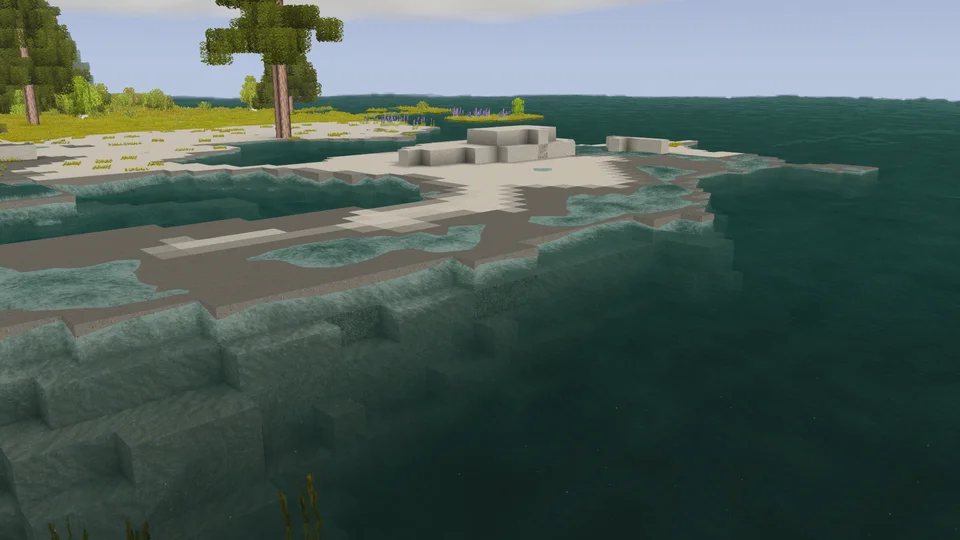 | 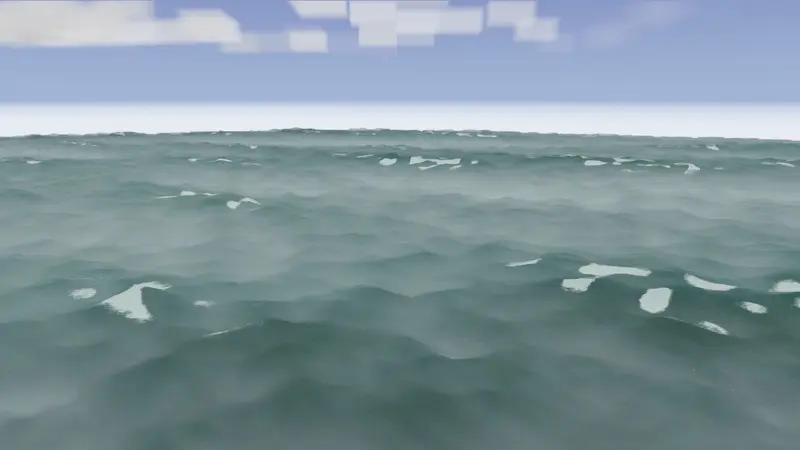 |
| A gale's breaker plunging on a sand beach, its swash running up and sliding back: [The look of the sea](The-Look-of-the-Sea#what-you-see) | A moderate breeze, force 4: waves of 1 to 1.5 m and fairly frequent whitecaps: [Wind and waves](Wind-and-Waves#the-beaufort-scale) |
| 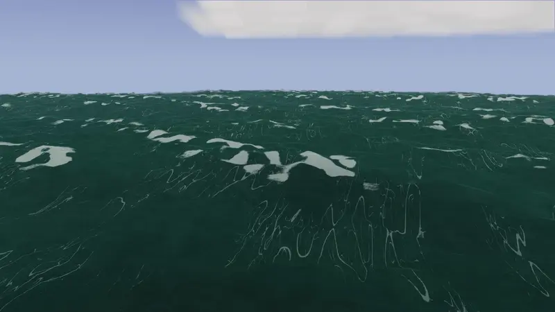 | 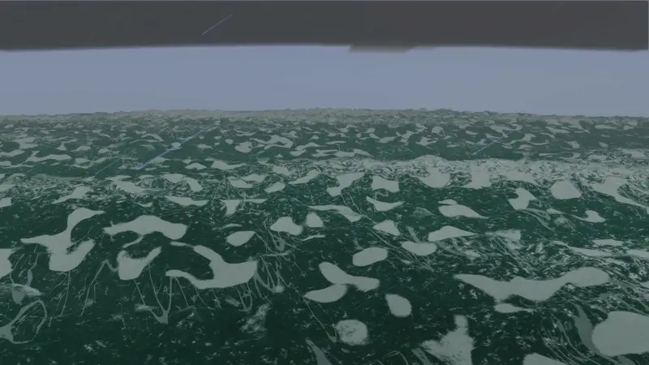 |
| A strong breeze, force 6: waves of 3 to 4 m and white foam crests everywhere: [Wind and waves](Wind-and-Waves#the-beaufort-scale) | A gale, force 8: waves of 5.5 to 7.5 m and foam in streaks along the wind: [Wind and waves](Wind-and-Waves#the-beaufort-scale) |

## Driving a vessel

| | |
| --- | --- |
| 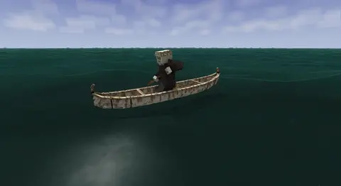 | 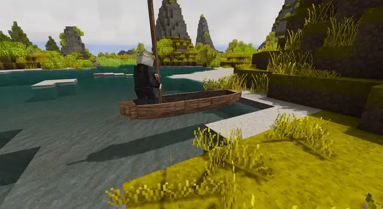 |
| A bark canoe paddled along one side: [Paddles, poles and oars](Paddles-Poles-and-Oars#using-them) | A dugout poled off the bottom, standing: [Paddles, poles and oars](Paddles-Poles-and-Oars#using-them) |
| 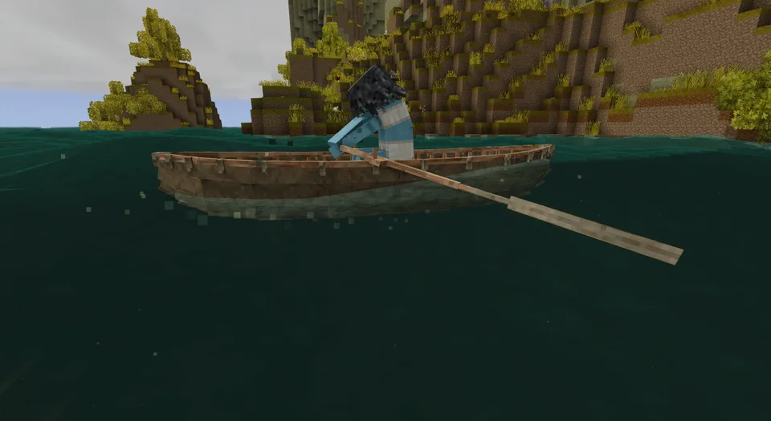 | 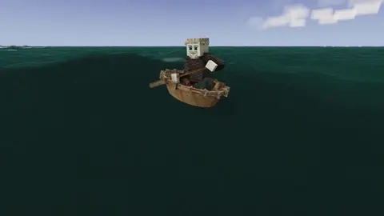 |
| A hide currach rowed on its thole pins: [Paddles, poles and oars](Paddles-Poles-and-Oars#using-them) | A coracle sculled over its bow: [Paddles, poles and oars](Paddles-Poles-and-Oars#using-them) |
| 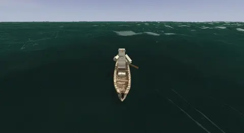 | |
| A bark canoe's paddler changing sides to hold a course: [Paddles, poles and oars](Paddles-Poles-and-Oars#using-them) | |

## Building a vessel

| | |
| --- | --- |
| 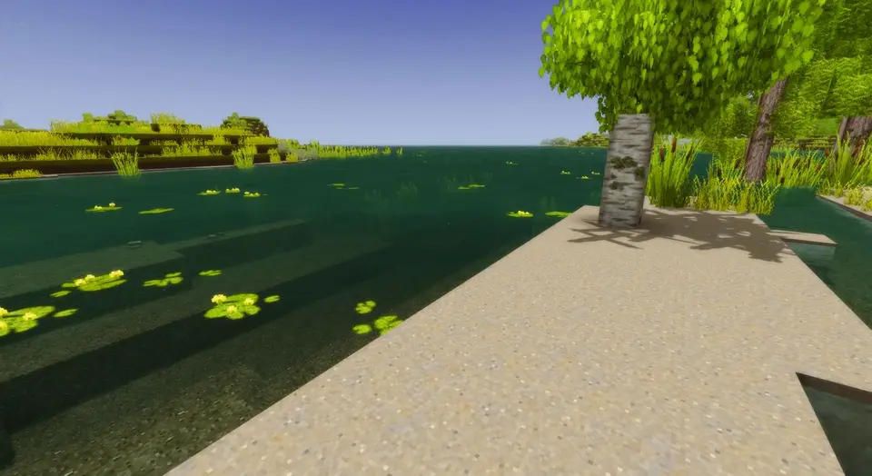 | 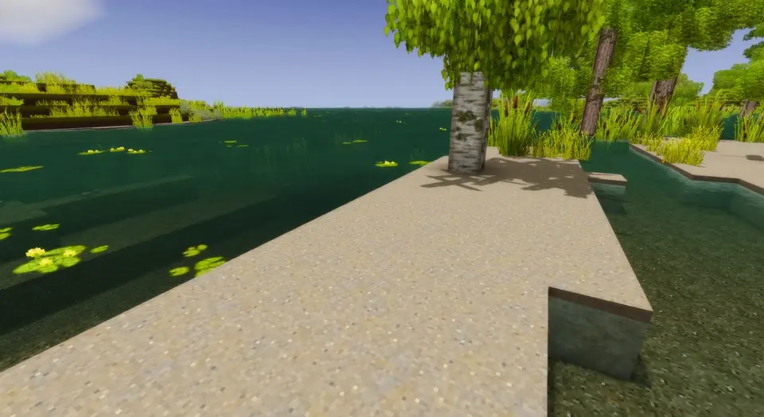 |
| A reed boat, from one bundle of reed to the finished boat: [Reed boat](Reed-Boat#how-it-is-built) | A coracle, from a lattice of laths to the finished coracle: [Coracle](Coracle#how-it-is-built) |
| 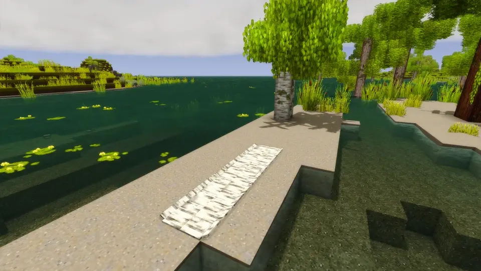 | 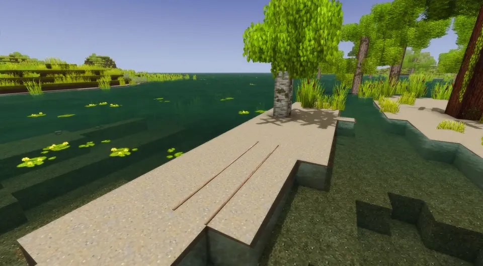 |
| A birch-bark canoe, from a sheet of bark to the pitched canoe: [Birch-bark canoe](Birch-Bark-Canoe#how-it-is-built) | A hide currach, from two laths to the covered hull turned over: [Hide currach](Hide-Currach#how-it-is-built) |
| 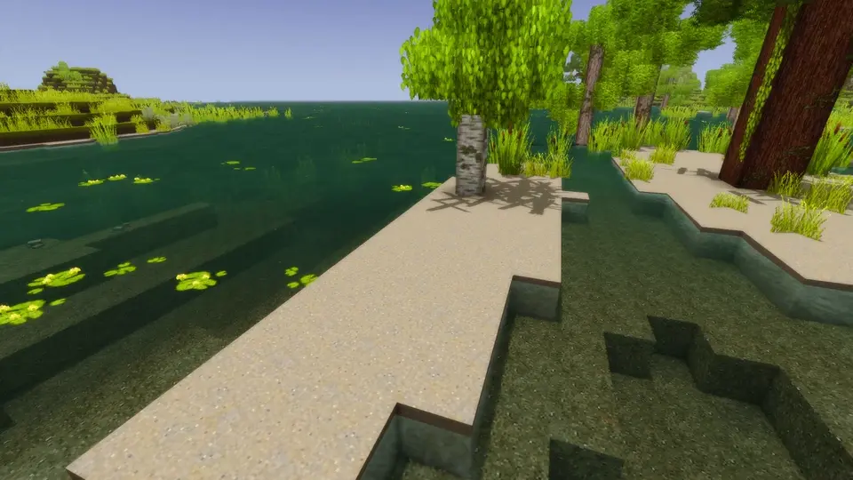 | |
| An outrigger canoe, from the logs to its washstrakes: [Outrigger canoe](Outrigger-Canoe#how-it-is-built) | |
