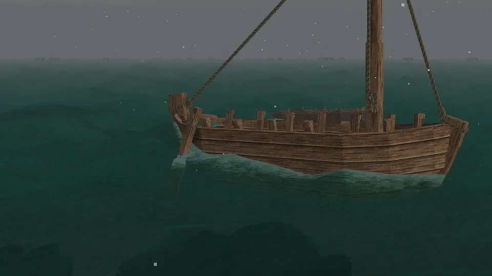
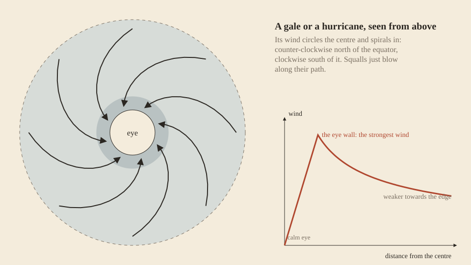

Storms are born, cross the world and die out. Each one is a real thing in the world, with a place, a size and a path: the same storm reaches a ship at sea and the coast it is heading for, hours apart. They raise the [wind and the waves](Wind-and-Waves), bring rain, and some bring [lightning](Lightning).

*A sailboat in a gale: the sky closes in, the sea darkens, and the boat heels to the wind.*

## Three kinds

| | Squall | Gale | Hurricane |
| --- | --- | --- | --- |
| Size across | 100 to 200 km | 800 to 1600 km | 480 to 1000 km |
| Peak wind | 17 to 26 m/s (force 7 to 10) | mostly 16 to 28 m/s (force 7 to 10); a few reach hurricane force | 33 to 55 m/s (force 12) |
| Lasts | 2 to 6 hours | 2 to 5 days | 3 to 7 days |
| Travels | 30 to 80 km an hour | 15 to 55 km an hour | 17 to 50 km an hour |
| Wind | blows along its path | a broad band around a wide centre | turns around a calm eye |
| Rain | heavy | steady | heavy |
| Thunder | heavy | light, and none when cold | heavy |

Sizes and speeds are real distances. In blocks they follow the world's scale: a block across is 200 m in a default world and 100 m in the *Rough Seas* playstyle, so a gale spans 4000 to 8000 blocks in the first and twice that in the second.

A day in the game is a day: a gale blows for days as a real one does. Only the calendar is shorter, so a game winter of 27 days holds fewer gales than a real winter of 90, but each of its days is as stormy as a real winter day.

The thunder is the game's own weather, played where it can play: thunder needs warm, wet air, so a storm thunders only where its rain is heavy enough and the air at least 12 °C, and a cold gale brings snow instead. Away from storms the game's other weather keeps its own rules: a warm shower may rumble, a cold downpour may hail, and a dry, calm sea brings nothing. Weather from other mods plays by the same rules.

- **Squalls** are the storms of warm, wet summers: small, short and violent, a wall of wind and rain that passes within hours.
- **Gales** are the depressions that cross the North Atlantic every winter. They cover a great area and blow for days, strongest in a broad band well out from their centre. Their wind circles that centre counter-clockwise north of the equator and clockwise south of it, as real lows do.
- **Hurricanes** form only over warm tropical seas, from late spring to autumn. They last for days and bring the strongest wind of all, at the wall of the small calm eye in the middle.

## Where and when they form

Storms are born as often as real ones, per day and per area of sea:

- **Gales** follow the storm tracks: between 30° and 70° of latitude, most of all near 50°, and half as often again in winter as in summer. They grow where cold air meets warm, so the steeper the temperature falls toward the pole, the stronger they come. Winter, when the poles grow cold, brings the strongest; a summer gale is mild. A mod that changes the world's temperatures moves them with it.
- **Hurricanes** form between 5° and 30° from the equator, over water of at least about 26 °C, from June to November in the north, peaking in September. South of the equator their season is turned around.
- **Squalls** follow warm, wet climates and summer.

So a cold sea in winter is gale country, the tropics in late summer are where hurricanes come from, and warm coasts see squall after squall.

Storms draw their strength from the sea, so most are born over it. Over land a squall forms half as often as over the sea, a gale three times less often, and a hurricane never. Once born, a storm crosses sea and land alike.

How each of these was taken from real measurements is on [The science behind it](The-Science-Behind-It).

## How a storm moves

A storm sets off on the [prevailing wind](Wind-and-Waves#wind) of the place it was born, within 30° of it, and keeps a straight course at a steady speed until it dies. It deepens over nearly half its life, fastest toward the end, peaks near the middle and slowly fills out after. A gale that reaches you at its peak was gathering strength upwind for a day or two.

Where two storms overlap, their winds add up and the heavier rain falls.

## Reading the sky

A storm warns you before it arrives:

- the treetops start to sway, harder and harder;
- the clouds thicken and darken, and rain begins;
- the waves rise, more slowly than the wind, since the sea takes hours to build.

That is your time to make for shore, or to [anchor](Anchoring) far out where the waves can't [throw your vessel ashore](Mooring#thrown-ashore). The sea goes on running high for hours after the wind drops.

## What a storm does at sea

- It raises the waves that [swamp](Surf-and-Swamping) boats and fill a [bilge](Bailing), with rain on top.
- It strains every [anchor](Anchoring) and [mooring rope](Mooring).
- In warm air it brings [lightning](Lightning), drawn to the masts of the [sailboat](Sailboat) and the [outrigger canoe](Outrigger-Canoe).

Which [vessel](Vessels) to trust in a storm: the [hide currach](Hide-Currach) rides over surf, though a storm's breakers can stave in her hide, the [outrigger](Outrigger-Canoe) barely rolls, and the [sailboat](Sailboat)'s planks stand the hardest breakers; the river boats belong ashore.

The walking player isn't blown about by a hurricane; the danger is all on the water. With [Dangerous oceans](World-Settings#dangerous-oceans) off, storms still come and go, but do no harm.
