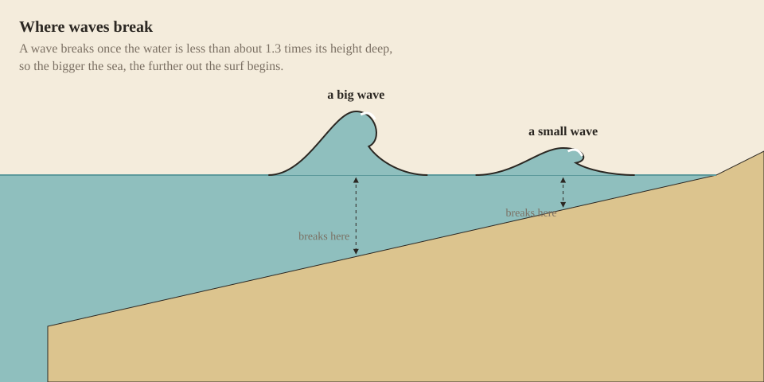

Out on the water, every few seconds a wave reaches your vessel. Most lift it and pass. Some come over the side, and some break on it. What each does depends on the wave, drawn fresh every time from the [sea state](Wind-and-Waves#every-wave-is-different), and on the hull it meets: how high it floats, and how it rides.

## How she floats

A hull sinks into the water until it pushes aside its own weight of seawater, so how deep she floats, her *draft*, comes from everything aboard:

- the hull, by what it is built of: a light wood floats higher than oak, a heavy one lower;
- each rider, with about 10 kg of gear and their armour;
- each basket, crate or chest, at its empty weight;
- the water in her bilge.

What is left of her side above the water is her *freeboard*, and the hover text gives it in centimetres. A loaded boat sits visibly lower, and water aboard settles her further:

| Vessel | Freeboard, empty | With one aboard |
| --- | --- | --- |
| [Raft](Raft), oak | 8 cm | awash |
| [Coracle](Coracle) | 26 cm | 20 cm |
| [Dugout](Dugout), oak | 24 cm | 20 cm |
| [Birch-bark canoe](Birch-Bark-Canoe) | 28 cm | 25 cm |
| [Reed boat](Reed-Boat), fresh | 36 cm | 25 cm |
| [Hide currach](Hide-Currach) | 42 cm | 40 cm |
| [Outrigger canoe](Outrigger-Canoe), oak | 45 cm | 40 cm |
| [Sailboat](Sailboat), oak | 52 cm | 50 cm |

When her freeboard reaches nothing, the sea comes over her gunwale and she floods, cracked or not: a boat loaded down to the water fills in a moment. The raft and the reed boat are solid: pressed under, they lie awash and still hold their load up.

## Shipping water

A wave's crest stands about half its height above the sea. A hull rises with the wave, a light and buoyant one more than a heavy one; what is left of the crest above her freeboard comes aboard. Higher sides keep more out, and so does a hull that rides over the swell instead of sitting in it.

Boats with a hull hold that water in their [bilge](Bailing), with what their [cracks let in](Hull-Condition#leaks). The [raft](Raft) and the [reed boat](Reed-Boat) hold none: the sea washes straight through them, and there is nothing to bail.

## Water aboard

A litre of seawater weighs a kilogram, and a bilge holds hundreds. As it fills, a boat:

- **rides lower.** With one aboard, a full bilge brings her gunwale down to the water, so each wave comes aboard more easily than the last;
- **gets slower.** It paddles as hard and pushes a heavier hull, so the lighter the boat, the more its water slows it: half full, a heavy dugout keeps nine tenths of its speed, a coracle four fifths and a hide currach, whose bilge holds 15 times its weight, two thirds. A load slows her the same way, a second rider or a hold of chests, and a hull of a light wood is a little faster than oak: a kapok dugout makes a seventh more speed, an ebony one a sixteenth less;
- **rolls harder.** The water sloshing across the bilge leans with every roll and adds to it, twice the roll when full, and a breaker half as high overturns it.

## Swamping

A full bilge swamps the vessel. Nobody can paddle it or sit in it, but everyone aboard can hold on to it, in the water at its side. Then bail it out, wait for a lull, or leave it and swim. Every wave breaks over a swamped hull and strikes it harder, so in a breaking sea it won't last long.

A swamped hull lies awash, or sinks. It sinks when what the water doesn't hold up outweighs what her own material keeps afloat. The water holds up the riders themselves, as a body is about as dense as seawater; it doesn't hold up the hull, the riders' gear and armour, or the containers. What each vessel holds up awash besides its own hull:

| Vessel | Holds up awash |
| --- | --- |
| [Coracle](Coracle) | 13 kg: its rider's gear, and no armour |
| [Hide currach](Hide-Currach) | 38 kg: three baskets, but not three chests |
| [Birch-bark canoe](Birch-Bark-Canoe) | 41 kg |
| [Raft](Raft), oak | 60 kg; bamboo 138 kg |
| [Outrigger canoe](Outrigger-Canoe), oak | 130 kg |
| [Dugout](Dugout), oak | 207 kg |
| [Reed boat](Reed-Boat), fresh | 248 kg, less the water it has soaked up |
| [Sailboat](Sailboat), oak | nothing: she goes down |

The wood counts. A sailboat carries two fifths of her weight in ballast to stand up to her sail: of oak, aged wood, birch, maple, purpleheart or ebony she goes down, while of pine, larch, acacia, walnut, bald cypress, redwood or kapok she floats awash. Ebony floats a dugout or an outrigger awash empty, and takes it down only loaded hard. A wood heavier than seawater sinks any hull of it, such as Wildcraft's ekki, lignum vitae, leadwood, mangrove, pink ivory and African blackwood ([Beside other mods](Other-Mods#wildcraft-trees-and-shrubs)).

A vessel that sinks throws everyone off and lies on the bottom, seen but no use: she can't be picked up, the sea fills her again as fast as she is bailed, and currents and waves no longer reach her. Her cargo stays aboard, her baskets and chests open to a diver. An axe swung at her on the bottom breaks her up for her wreckage, and her cargo floats free. Raising her is planned for [The deep](Roadmap#the-deep).

## Breakers

A wave breaks when it grows too steep, and a breaking wave is the dangerous one: its crest stands higher, it throws far more water aboard and it strikes the hull like a falling wall.

- **Surf.** Where the water is shallower than about 1.3 times a wave's height, the wave breaks, every time. Real waves do the same: a wave breaks once it is about four fifths as high as the water is deep, which is why the surf line runs further out the higher the sea. In rough weather the last stretch to a beach is all surf.

  

- **Whitecaps.** Out in deep water, now and then a wave breaks on its own, more often as the wind rises: about one wave in 50 in a strong breeze (force 6), one in 11 in a gale (force 8), one in 4 in a storm (force 10) and three in four in a hurricane.
- **A swamped vessel.** Once a bilge is full, every wave breaks over it.

A breaker strikes the side the wind comes from, with the energy of the water it throws, which grows very steeply with its height: a 4 m breaker hits about eight times as hard as a 2 m one. A hull full of water takes it harder, up to twice as hard. Each strike is weighed against the hull's [capacity](Hull-Condition#how-a-hull-takes-a-blow) and cracks the windward bow, side or quarter, so a boat beam-on to a breaking sea opens up along one side and floods.

## Capsizing

> **Switched off for now.** A capsized boat stayed upright on screen while its crew went into the water, with nothing to show what had happened. Capsizing comes back in [Seamanship](Roadmap#seamanship), with heel: wind on a sail and a breaker on the beam will lean a vessel over against its stability, and you will see it roll. Until then breakers still ship water and crack the hull, and a full bilge still swamps it. The heights below are what capsized a vessel in 1.0.

A breaker as high as a vessel's capsizing height overturns it. Everyone aboard is thrown into the sea, and the bilge fills to the brim. The cargo stays aboard, and the vessel floats awash or sinks as a swamped one does. The heights below are for an empty bilge; water aboard [lowers them](#water-aboard), down to half when full.

| Vessel | Rides the swell | Capsized by a breaker of |
| --- | --- | --- |
| [Coracle](Coracle) | well | 0.6 m |
| [Dugout](Dugout) | badly | 0.75 m |
| [Birch-bark canoe](Birch-Bark-Canoe) | very well | 0.75 m |
| [Reed boat](Reed-Boat) | well | 0.9 m |
| [Raft](Raft) | very well | 2 m |
| [Hide currach](Hide-Currach) | very well | 2 m |
| [Outrigger canoe](Outrigger-Canoe) | fairly | 2.1 m |
| [Sailboat](Sailboat) | fairly | 3.3 m |

The currach's 2 m is the surf the Aran islanders worked their currachs through. The coracle, the dugout and the canoe are river boats and go over in a short, steep sea.

## How each vessel takes the sea

Measured in the game, unanchored in open water, a few minutes in each sea:

| Waves | What happened |
| --- | --- |
| 2 m | The [dugout](Dugout) shipped 232 of its 450 litres, rolling hard. The [outrigger](Outrigger-Canoe) shipped 12 litres and barely rolled. The [currach](Hide-Currach) shipped none. The sea washed over the [raft](Raft). |
| 3 m | The dugout swamped and capsized, and the [bark canoe](Birch-Bark-Canoe) swamped. The [coracle](Coracle) and the raft broke. The outrigger shipped 129 litres; the currach stayed upright. |
| 4 m | The dugout rolled twice as far as the currach and ten times as far as the outrigger. The outrigger swamped and broke on a 5.4 m breaker. |

These were measured before capsizing was switched off and before hulls cracked where hit, in seas set to each height. A lake raises waves by its size and depth, a [pond barely ripples](Wind-and-Waves#how-high), and rivers have their own danger, [rapids](Rapids): that is where the river boats belong. The currach, the outrigger and the [sailboat](Sailboat) are the vessels for the sea.

## At anchor

A vessel at [anchor](Anchoring) ships less water and takes milder blows: three tenths of each. It still capsizes as easily, because it lies across the waves; turning its bow into the wind comes with sailing in [Seamanship](Roadmap#seamanship).

With [Dangerous oceans](World-Settings#dangerous-oceans) off, waves don't come aboard, strike or capsize anything.
