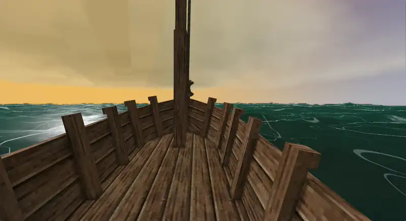
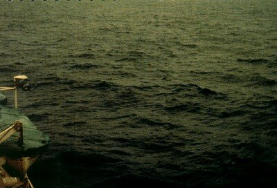
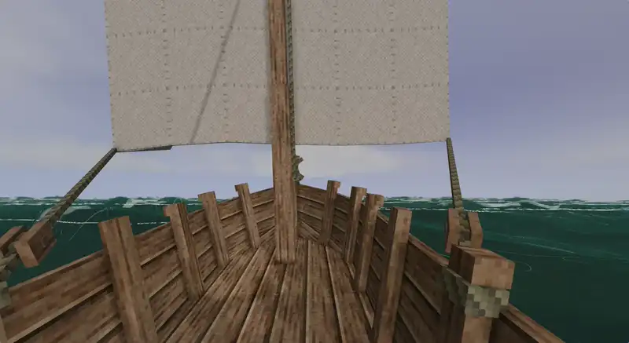
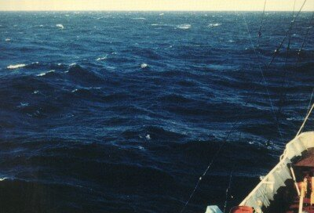
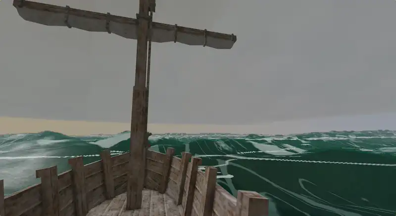
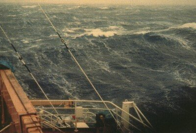

A sailor reads the weather off the sea before any instrument: the height of the swell, the white on its crests, the streaks the wind tears off them, the sky behind. Rough Seas draws the sea so it can be read the same way. Everything you see comes from the same [wind and waves](Wind-and-Waves) that toss your vessel, and the picture was tuned against photographs of the real sea.

## What you see

- **Waves as high as the sea is.** The swell runs before the wind, long and slow in a gale, short in a breeze. Its height is the sea's significant height, the same number the waves strike your hull with: a 5.5 m gale looks like one.
- **Whitecaps by the Beaufort scale.** Crests break white where they grow too steep, and how many break follows the wind, as the scale describes it: a few scattered whitecaps at force 3, many at 4 to 5, foam blown off the crests in streaks along the wind at 6 and 7, and from 8 up a sea whitening with spray.
- **Surf on the shore.** Where the water grows shallow enough for the waves to break, a band of foam runs onto the beach, thick and bright even in a moderate sea.
- **Boats ride the swell.** A vessel climbs each crest and slides down its back, rolling and pitching with the slope of the water under it, and you with it, each hull by its shape: a round coracle tilts more than the slope under it, a broad raft less. A big sea can bury you to the eyes.
- **Wreckage floats on it.** Planks and anything else that floats rise and fall with the waves.
- **Rain and clouds follow the weather.** All rain comes from Rough Seas' weather: ordinary showers, more often and heavier where the climate is wet, and [storms](Storms), whose clouds darken from their edge and whose rain falls toward their heart. Where the weather is fair, no rain falls and no thunder rolls; white clouds may still drift by.

The sea is drawn this way even with *Waving foliage* off in the game's graphics settings: a storm should never come unseen.

## Tuned against the real sea

The Beaufort scale describes each force by what the sea looks like, and the [NOAA](https://www.noaa.gov/) photographs of it are the standard reference sailors and meteorologists learn from. We drew the sea, set it beside them and corrected it until the two read alike:

| Force | Rough Seas | The real sea |
| --- | --- | --- |
| **4**, moderate breeze: waves 1 to 1.5 m, fairly frequent whitecaps |  |  |
| **6**, strong breeze: waves 3 to 4 m, white foam crests everywhere, some spray |  |  |
| **8**, gale: waves 5.5 to 7.5 m, crests breaking into spindrift, foam in well-marked streaks along the wind |  |  |

What the comparison taught us:

- **Foam is lace, not paint.** Our first whitecaps were solid white blobs with sharp edges; on screen they read as sun glints, not foam. Real foam is torn, see-through at its edges and tinted by the water under it, so ours is too.
- **Foam follows the breaking crest.** Whitecaps sit where a crest folds over, the way ocean simulations in films and games find them: from how sharply the surface pinches, not from height alone. Thin traces of old foam outline the waves and make their shape easy to read.
- **The amount follows measurement.** How much of the sea is white at each force starts from what oceanographers measured (Monahan's whitecap coverage) and is raised a little, so whitecaps read from afar as they do on a real horizon.
- **Shallow water breaks.** Surf starts where the water is shallower than 1.28 times the wave's height, McCowan's breaking depth, the same rule that makes a breaker strike a boat near the shore.

## Credits

The reference photographs are from the [NOAA Photo Library](https://photolib.noaa.gov/), by the U.S. National Weather Service, in the public domain, through Wikimedia Commons: [force 4](https://commons.wikimedia.org/wiki/File:Beaufort_scale_4.jpg), [force 6](https://commons.wikimedia.org/wiki/File:Beaufort_scale_6.jpg), [force 8](https://commons.wikimedia.org/wiki/File:Beaufort_scale_8.jpg).
