A sailor reads the weather off the sea before any instrument: the height of the swell, the white on its crests, the streaks the wind tears off them, the sky behind. Rough Seas draws the sea so it can be read the same way. Everything you see comes from the same [wind and waves](Wind-and-Waves) that toss your vessel, and the picture was tuned against photographs of the real sea.

## What you see

- **Waves as high as the sea is.** The swell runs before the wind, long and slow in a sea that has built for hours, short and choppy under a squall that has just arrived. Its height is the sea's significant height, the same number the waves strike your hull with: a 4 m sea looks like one. It is drawn cell by cell around you, so a sheltered bay lies calmer than the open water beyond its mouth.
- **A surface that bends.** Close to you the water is divided finer than a block, down to a hand's width between points, so crests round off and short waves show on the swell. Further out the division coarsens and short waves drop out, so the distant sea doesn't shimmer. An older graphics card that lacks the feature (OpenGL below 4.0) draws the same waves with a block between points.
- **Whitecaps by the Beaufort scale.** Crests break white where they grow too steep, and how many break follows the wind, as the scale describes it: a few scattered whitecaps at force 3, many at 4 to 5, foam blown off the crests in streaks along the wind at 6 and 7, and from 8 up a sea whitening with spray. Waves need to stand half a metre for it: a pond's ripple stays clear in any wind.
- **Surf on the shore.** The waves reach the beach. As the water shallows they grow higher and turn to face the shore, then break: they spill on a gentle beach and curl over and plunge on a steep one. Each broken wave runs up the beach as a thin sheet of water and slides back. The bigger the wave, the further it runs, so in a storm the swash climbs far up the sand. A rock shelf at sea level takes the surf too, and a big lake's shore surfs on fresh water. The measurements behind it: [The science of the waves](The-Science-of-the-Waves#the-shore).
- **Waves over a shallow bar.** A bar or a reef under the water far from shore breaks the waves as a beach does. Whitecaps show you where it lies, and behind it the sea is calmer.
- **Wet sand.** The ground the waves reach looks darker. Near the water, where nearly every wave reaches, sand stays dark; higher up, where only the biggest waves reach, it dries between them. Gravel drinks the water and dries almost at once.
- **Waves against a face.** A cliff, a quay, a wall you built and every block step of a beach are faces the sea meets. A wave that doesn't break reflects off a face and stands up against it, as high as twice its own height. A wave that breaks strikes the face and throws spray high up it, and foam lies along the face after the strike. A face lower than the crest takes no strike: the wave runs over it. A sheet of water that can't climb a step of a beach throws its own spray there, so a beach of steps sprays at every step it stops at. The bigger the strike, the more water it throws and the higher it goes.
- **The surf's foam** rides the front of each breaking wave toward the shore and up the beach with the swash, white on the front and breaking up into patches and traces behind it. The swash is as clear as it is thin: you see the sand through it, and a line of foam runs along its tip. It shows where the waves break, over a bar as over a beach. Where they break, the wind's whitecaps and streaks give way to it.
- **Boats ride the swell.** A vessel climbs each crest and slides down its back, rolling and pitching with the slope of the water under it, and you with it, each hull by its shape: a round coracle tilts more than the slope under it, a broad raft less. A big sea can bury you to the eyes.
- **Wreckage floats on it.** Planks and anything else that floats rise and fall with the waves.
- **Rain and clouds follow the weather.** All rain comes from Rough Seas' weather: ordinary showers, more often and heavier where the climate is wet, and [storms](Storms), whose clouds darken from their edge and whose rain falls toward their heart. Where the weather is fair, no rain falls and no thunder rolls; white clouds may still drift by.

| A gale's breaker on a sand beach | The sand it leaves wet |
| --- | --- |
| 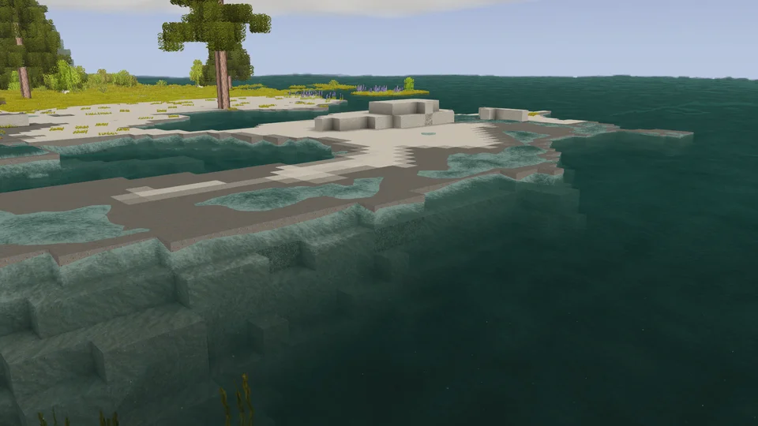 | 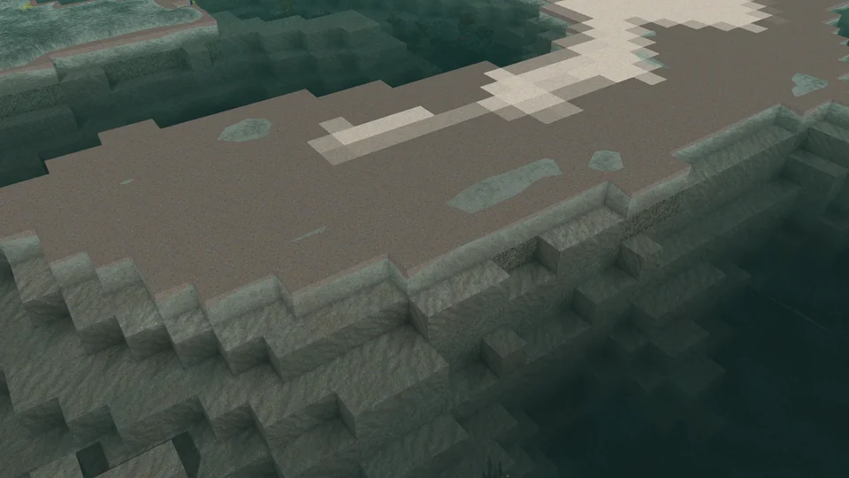 |

| Spray at the steps of a beach in a gale | A gale's sea breaking on a cliff |
| --- | --- |
| 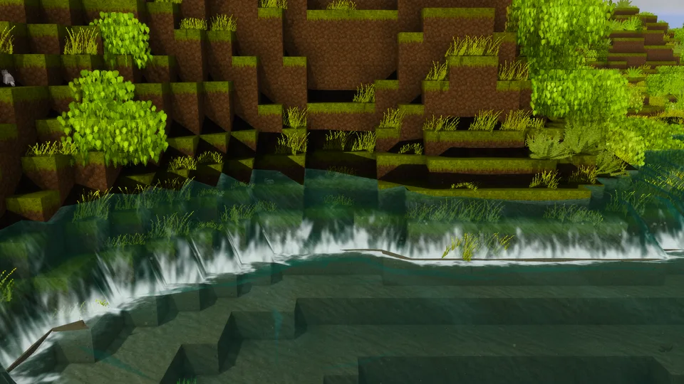 | 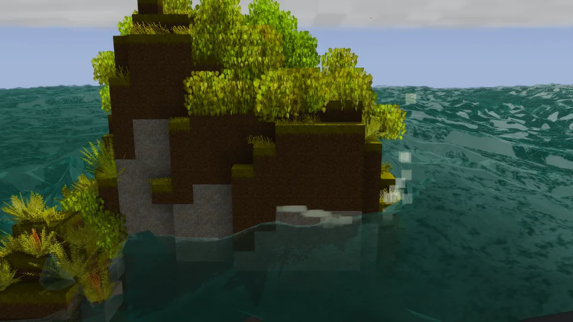 |

The pictures below paint the water by height, purple at its lowest and red at its highest, and outline each block. `.surface colours true` shows it to you. The first two are the same wave at the same moment.

| One flat quad a block | The block divided finer, as you see it near you |
| --- | --- |
| 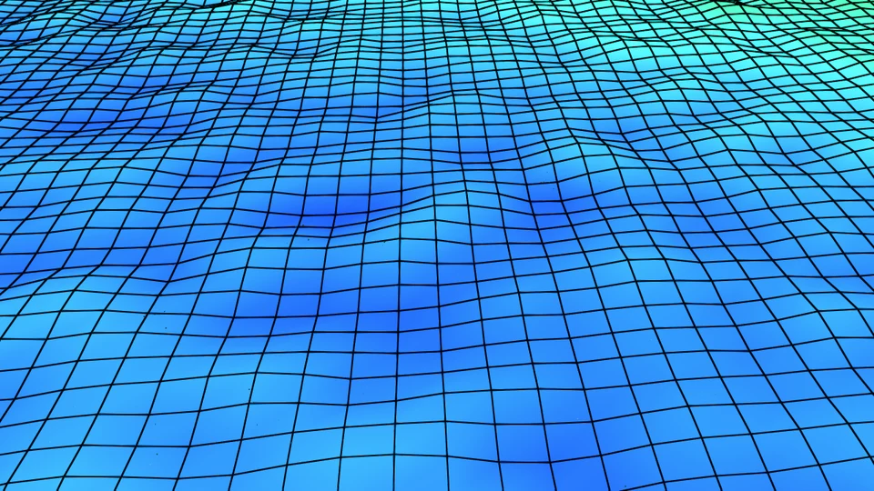 | 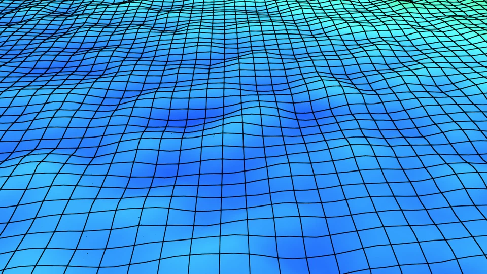 |

| A hurricane's sea in height colours | A bar a metre under the sea, bared by a trough |
| --- | --- |
| 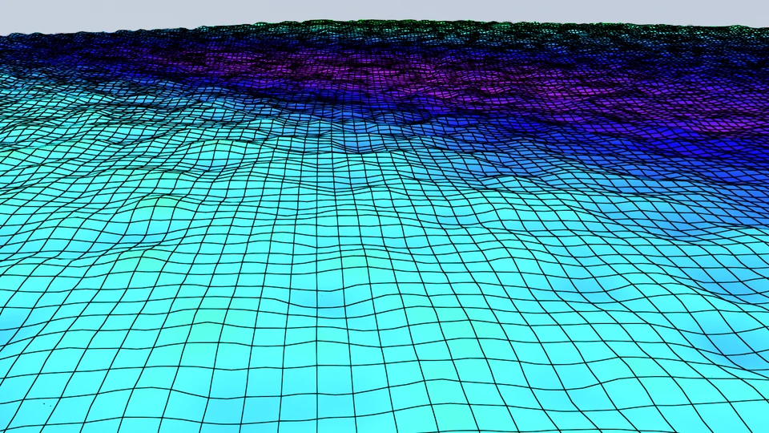 | 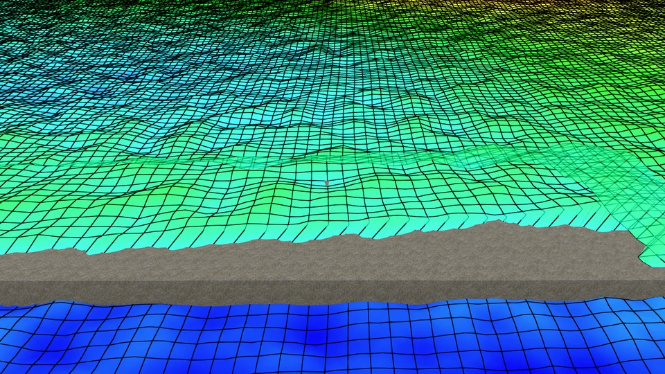 |

The sea is drawn this way even with *Waving foliage* off in the game's graphics settings: a storm should never come unseen.

Beside a mod that replaces the game's shaders, a part of this picture that doesn't fit that mod's shaders is left out: wet sand, the finer surface near you, or, in the rarest case, the waves themselves. Everything else draws as usual, and `client-main.log` says what was left out.

## Water under the beach

Under a shore at sea level lies the sea's own water, as far up as the waves run. It is there along every shore of the sea and of a lake. It reaches further inland while a storm's waves run high, and drains again after the storm. You don't see it until you dig: dig a hole down to the level of the water beside it, and the hole fills. Ground higher up digs as it always did.

The sand over that water stays land. You can't fill a bucket from it or fish in it, it doesn't water farmland, and it doesn't freeze.

## Tuned against the real sea

The Beaufort scale describes each force by what the sea looks like, and the [NOAA](https://www.noaa.gov/) photographs of it are the standard reference sailors and meteorologists learn from. We drew the sea, set it beside them and corrected it until the two read alike:

| Force | Rough Seas | The real sea |
| --- | --- | --- |
| **4**, moderate breeze: waves 1 to 1.5 m, fairly frequent whitecaps | 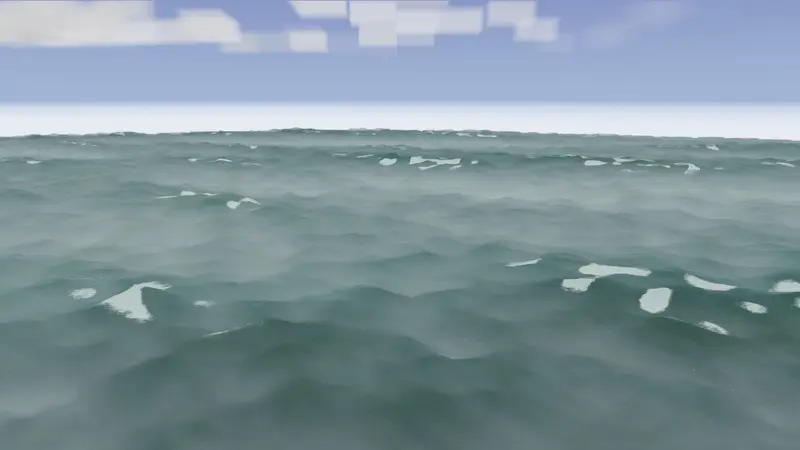 | 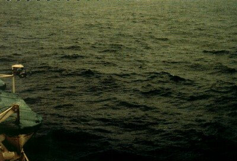 |
| **6**, strong breeze: waves 3 to 4 m, white foam crests everywhere, some spray | 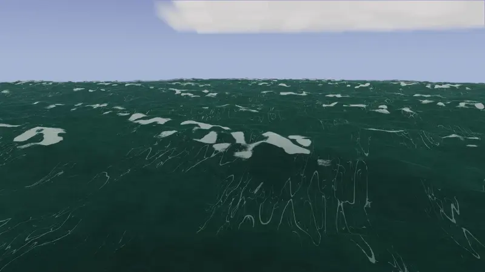 | 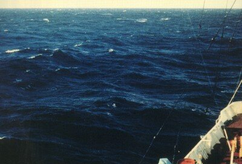 |
| **8**, gale: waves 5.5 to 7.5 m, crests breaking into spindrift, foam in well-marked streaks along the wind | 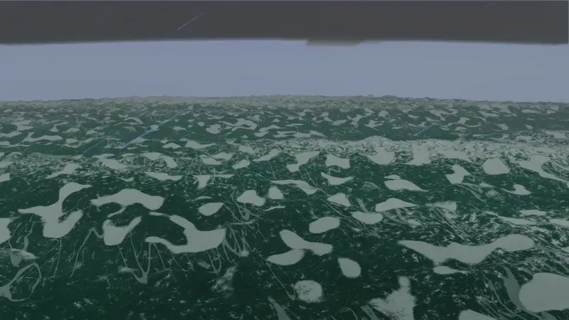 | 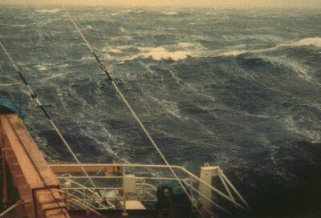 |

What the comparison taught us:

- **Foam is lace, not paint.** Our first whitecaps were solid white blobs with sharp edges; on screen they read as sun glints, not foam. Real foam is torn, see-through at its edges and tinted by the water under it, so ours is too.
- **Foam follows the breaking crest.** Whitecaps sit where a crest folds over, the way ocean simulations in films and games find them: from how sharply the surface pinches, not from height alone. Thin traces of old foam outline the waves and make their shape easy to read.
- **The amount follows measurement.** How much of the sea is white at each force starts from what oceanographers measured (Monahan's whitecap coverage) and is raised a little, so whitecaps read from afar as they do on a real horizon.
## Credits

The reference photographs are from the [NOAA Photo Library](https://photolib.noaa.gov/), by the U.S. National Weather Service, in the public domain, through Wikimedia Commons: [force 4](https://commons.wikimedia.org/wiki/File:Beaufort_scale_4.jpg), [force 6](https://commons.wikimedia.org/wiki/File:Beaufort_scale_6.jpg), [force 8](https://commons.wikimedia.org/wiki/File:Beaufort_scale_8.jpg).
