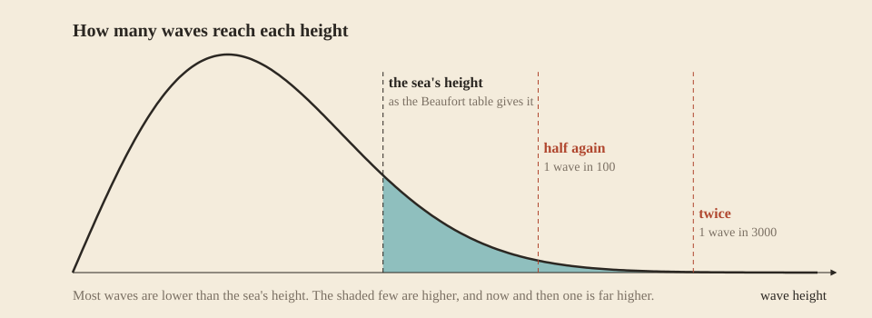

The sea has weather of its own. Wind has a direction and a strength, it changes over hours, and the waves follow it. Every vessel feels the waves; trees, clouds, rain and the roll of a boat all follow the wind, so a look around tells you what the sea is doing.

## Wind

Out of a storm, the wind follows what weather stations measure on Earth: about 4 m/s over land, a gentle breeze, and about 7 m/s over the open sea, a moderate one. Off a coast it freshens over the first thousand blocks of water. Around those averages it wanders from about a third of them to nearly twice. Only the eye of a storm is calm. It changes slowly: a spell of wind lasts the better part of a day and stretches for thousands of blocks, so the wind where you stand is the wind for the whole crossing, unless a [storm](Storms) comes.

Its direction follows the prevailing winds of the real world, set by latitude, and veers up to 60° either side of them:

| Latitude | Prevailing wind, north | Prevailing wind, south | On Earth |
| --- | --- | --- | --- |
| 0° to 30° | from the north-east | from the south-east | the trade winds |
| 30° to 60° | from the south-west | from the north-west | the westerlies |
| 60° to 90° | from the north-east | from the south-east | the polar easterlies |

Storms travel with the prevailing wind, so the sky upwind is where weather comes from.

Trees sway with the wind's strength. Their sway does not show its direction, because the game's foliage only bends one way; read the direction from the clouds.

## The Beaufort scale

The [Beaufort scale](https://en.wikipedia.org/wiki/Beaufort_scale) is how sailors have named a wind's strength since 1805. Rough Seas speaks it everywhere: the debug readout, the storms, the whitecaps.

| Force | Wind, m/s | Name |
| --- | --- | --- |
| 0 | under 0.3 | calm |
| 1 | 0.3 | light air |
| 2 | 1.6 | light breeze |
| 3 | 3.4 | gentle breeze |
| 4 | 5.5 | moderate breeze |
| 5 | 8.0 | fresh breeze |
| 6 | 10.8 | strong breeze |
| 7 | 13.9 | near gale |
| 8 | 17.2 | gale |
| 9 | 20.8 | strong gale |
| 10 | 24.5 | storm |
| 11 | 28.5 | violent storm |
| 12 | 32.7 | hurricane |

## Waves

A wind raises waves by blowing across water, and how high they grow depends on three things: how hard it blows, how far it blows over open water, and for how long. Rough Seas grows them the way coastal engineers predict waves, from exactly these; the models are on [The science behind it](The-Science-Behind-It). The water decides as much as the wind.

- **The fetch.** The fetch is the stretch of open water the wind has blown across before it reaches you, measured straight upwind to the shore. A pond barely ripples in a gale that raises a heavy sea in open water.
- **The depth.** Shallow water holds the waves down and shortens them, so the same wind raises less in a shallow bay than offshore.
- **The time.** Waves take hours to build, and days to build fully. The sea answers to the wind of the last half hour to three days, whichever raises it highest. A squall that has just arrived raises a short, choppy sea, and a gale that has blown all day a long, high one.

### The world's scale

The world is drawn about 200 times smaller across than the Earth, so a block of fetch counts as 200 metres of real water: a lake 500 blocks across raises the sea of a real 100 km lake. Heights and depths are not squeezed: a block is a metre.

### How high

The sea in a steady wind, from the formula, by force (height, then the time between waves):

| Force | Pond, 100 blocks across, 3 m deep | Lake, 500 blocks, 10 m deep | Bay, 5000 blocks, 30 m deep | Open sea, a day of wind | Open sea, three days |
| --- | --- | --- | --- | --- | --- |
| 3 | 0.2 m, 2 s | 0.4 m, 3 s | 0.5 m, 3 s | 0.5 m, 3 s | 0.5 m, 3 s |
| 4 | 0.4 m, 3 s | 0.7 m, 4 s | 1.1 m, 5 s | 1 m, 5 s | 1.1 m, 5 s |
| 5 | 0.5 m, 3 s | 1 m, 5 s | 1.9 m, 7 s | 1.8 m, 6 s | 2.2 m, 7 s |
| 6 | 0.6 m, 3 s | 1.3 m, 5 s | 2.6 m, 8 s | 2.7 m, 8 s | 3.6 m, 9 s |
| 7 | 0.7 m, 4 s | 1.6 m, 6 s | 3.3 m, 8 s | 3.8 m, 9 s | 5.6 m, 12 s |
| 8 | 0.9 m, 4 s | 1.9 m, 6 s | 4 m, 9 s | 5.1 m, 10 s | 7.9 m, 14 s |
| 10 | 1.1 m, 4 s | 2.4 m, 6 s | 5.2 m, 10 s | 8 m, 13 s | 12.5 m, 17 s |
| 12 | 1.4 m, 4 s | 3 m, 7 s | 6.3 m, 10 s | 11.4 m, 15 s | 15 m, 20 s |

A day of wind over open water raises the sea the Beaufort scale describes for each force, the sea sailors see on an ordinary crossing. Three days of the same wind raise a fully developed sea, higher still, as in the longest real storms. It rarely comes to that: the wind seldom holds that long.

And how a sea builds in a 20 m/s wind over open water: 0.6 m after an hour, 1.6 m after four, 4.3 m after sixteen, 5.5 m after a day and 8.6 m after three. When the wind drops the sea does not: the waves the last hours built keep running.

The highest seas bend down softly above 9 m and never pass 16 m. The formula alone would give a hurricane waves of 30 m and more, half the height of the world, which no real sea reaches and no ship would survive.

## Every wave is different

The height in these tables is the *significant height*: what an observer reports, the average of the highest third of the waves. Real waves scatter around it, and Rough Seas draws each one from the same distribution oceanographers use. Most waves are lower than the significant height. About one in a hundred is half again as high, and one in three thousand twice as high. That one is what breaks over a boat that rode out a hundred smaller ones.

## What a wave does

Each [vessel](Vessels) meets them in its own way: a low [dugout](Dugout) ships water in a 2 m sea that a [currach](Hide-Currach) rides over. What happens when a wave reaches a vessel is on its own page, [Surf and swamping](Surf-and-Swamping): the water it ships, and the breaker that strikes the hull. Waves also strain a [mooring](Mooring) and drag an [anchor](Anchoring).

You see the waves as high as they are: the swell and its whitecaps are drawn from this same sea, cell by cell around you, and boats ride it. How it looks, and how it was tuned against photographs of the real sea, is on [The look of the sea](The-Look-of-the-Sea).
